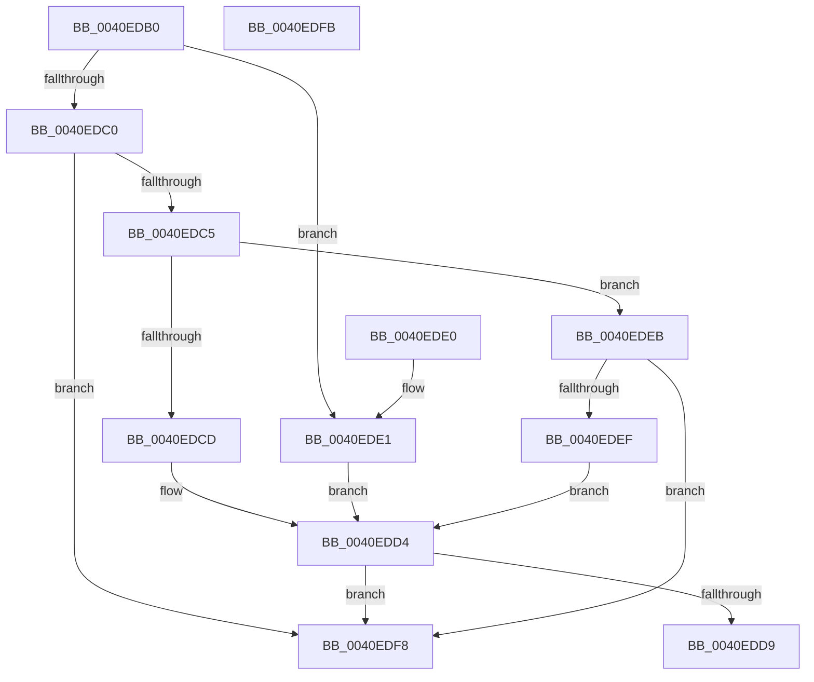

# IoGetRequestorProcessId

- RVA: `0x0040EDB0`–`0x0040EDFC` (길이 `76` bytes)
- VA: `0x000000014040EDB0`
- 실행 섹션: `.text`
- PDB 이름 있음: `예`; PDB Function 태그: `아니요`
- unwind 정보 RVA: `0x000DB714`
- 디코드: `24`개 명령, `76/76` bytes 표시
- 미해석 바이트: `0` (있으면 어셈블리에 `.byte`로 보존)

> 이 문서는 커널 이미지의 기계어와 PDB 기호를 분석해 생성했습니다. 4번과 5번은 함수 원형과 자료형을 바이너리 사용 방식에서 추정한 C 해석이며 원본 소스 복구 결과는 아닙니다.

## 1. Dependencies

- 직접 호출 지점: **0**; 고유 호출 대상: **0**
- 직접 호출자로 확인된 함수: **0**
- RIP 상대 이미지 참조: **0**

### Outgoing calls
- 직접 디코드된 call 명령이 없습니다.

### Direct callers
- 이 함수 시작 RVA로 연결되는 직접 call은 확인되지 않았습니다. 간접 호출은 완전히 역산할 수 없습니다.

### Static image references
- 디코드된 RIP-relative 메모리 참조가 없습니다.

## 2. Other-region calls and transfers

- 다른 실행 섹션으로 향하는 call: **0**
- 별도 외부 분기/꼬리 이동을 확인하지 못했습니다.

## 3. Assembly (complete function range)

```asm
0040EDB0  F7 41 10 00 20 00 00            test dword ptr [rcx + 0x10], 0x2000
0040EDB7  48 8B 91 98 00 00 00            mov rdx, qword ptr [rcx + 0x98]
0040EDBE  75 21                           jne 0x14040ede1
0040EDC0  48 85 D2                        test rdx, rdx
0040EDC3  74 33                           je 0x14040edf8
0040EDC5  0F B6 41 46                     movzx eax, byte ptr [rcx + 0x46]
0040EDC9  84 C0                           test al, al
0040EDCB  75 1E                           jne 0x14040edeb
0040EDCD  48 8B 82 20 02 00 00            mov rax, qword ptr [rdx + 0x220]
0040EDD4  48 85 C0                        test rax, rax
0040EDD7  74 1F                           je 0x14040edf8
0040EDD9  8B 80 D0 01 00 00               mov eax, dword ptr [rax + 0x1d0]
0040EDDF  C3                              ret
0040EDE0  CC                              int3
0040EDE1  48 8B 41 58                     mov rax, qword ptr [rcx + 0x58]
0040EDE5  48 83 E0 F9                     and rax, 0xfffffffffffffff9
0040EDE9  EB E9                           jmp 0x14040edd4
0040EDEB  3C 01                           cmp al, 1
0040EDED  75 09                           jne 0x14040edf8
0040EDEF  48 8B 82 B8 00 00 00            mov rax, qword ptr [rdx + 0xb8]
0040EDF6  EB DC                           jmp 0x14040edd4
0040EDF8  33 C0                           xor eax, eax
0040EDFA  C3                              ret
0040EDFB  CC                              int3
```

## 4. C-style interpretation (structured pseudocode)

```c
__int64 __fastcall IoGetRequestorProcessId(__int64 a1)
{
    __int64 result;

    if (((*(unsigned int *)(a1 + 16)) & (0x2000ULL)) != 0) goto loc_0040EDE1;
    if (*(unsigned __int64 *)(a1 + 152) == 0) goto loc_0040EDF8;
    if ((unsigned __int8)(*(unsigned __int8 *)(a1 + 70)) != 0) goto loc_0040EDEB;
loc_0040EDD4:
    if (*(unsigned __int64 *)(*(unsigned __int64 *)(a1 + 152) + 544) == 0) goto loc_0040EDF8;
    return (unsigned int)(*(unsigned int *)(*(unsigned __int64 *)(*(unsigned __int64 *)(a1 + 152) + 544) + 464));
loc_0040EDE1:
    result = (*(unsigned __int64 *)(a1 + 88)) & (-7);
    goto loc_0040EDD4;
loc_0040EDEB:
    if (((unsigned __int8)(result)) != 1) goto loc_0040EDF8;
    goto loc_0040EDD4;
loc_0040EDF8:
    result = 0;
    return result;
}
```

## 5. (Beta) C Style

```c
int64_t IoGetRequestorProcessId(void *Arg1)
{
    uint8_t *arg1 = (uint8_t *)Arg1;

    int64_t result;

    if (((*(uint32_t *)(arg1 + 0x10)) & (0x2000ULL)) != 0) goto loc_0040EDE1;
    if (*(uint64_t *)(arg1 + 0x98) == 0) goto loc_0040EDF8;
    if ((uint8_t)(*(uint8_t *)(arg1 + 0x46)) != 0) goto loc_0040EDEB;
loc_0040EDD4:
    if (*(uint64_t *)(*(uint64_t *)(arg1 + 0x98) + 0x220) == 0) goto loc_0040EDF8;
    return (uint32_t)(*(uint32_t *)(*(uint64_t *)(*(uint64_t *)(arg1 + 0x98) + 0x220) + 0x1D0));
loc_0040EDE1:
    result = (*(uint64_t *)(arg1 + 0x58)) & (-7);
    goto loc_0040EDD4;
loc_0040EDEB:
    if (((uint8_t)(result)) != 1) goto loc_0040EDF8;
    goto loc_0040EDD4;
loc_0040EDF8:
    result = 0;
    return result;
}
```

### 관측된 메모리 오프셋

구조체 형식이 확인되지 않은 접근은 인자 기준의 오프셋으로만 기록했습니다.

| 기준 인자 | 오프셋 표현 | 폭 (bit) | 접근 |
|---|---:|---:|---|
| `Arg1` | `+ 0x10` | `32` | `R` |
| `Arg1` | `+ 0x46` | `8` | `R` |
| `Arg1` | `+ 0x58` | `64` | `R` |
| `Arg1` | `+ 0x98` | `64` | `R` |

## 6. Execution-region graph

[열기: 2D/3D 그래프와 함수 탐색 컨트롤 패널](../../../control-panel.html?section=text&rva=0x0040EDB0&view=graph)

- 2D 그래프는 위에서 아래로 흐르고, 3D 그래프는 빈 공간을 드래그해 회전합니다. Shift+드래그는 이동, 휠은 확대·축소, 함수 노드 선택은 대상 보고서 이동입니다.

### Static fallback


