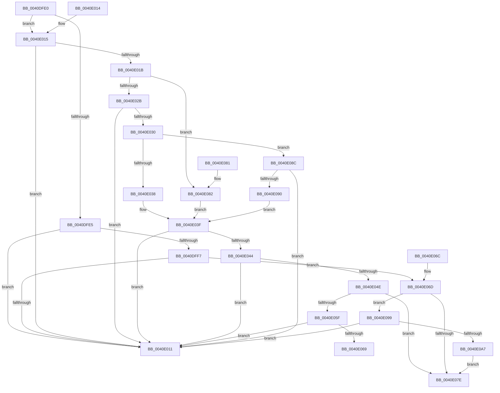

# IoIs32bitProcess

- RVA: `0x0040DFE0`–`0x0040E0A9` (길이 `201` bytes)
- VA: `0x000000014040DFE0`
- 실행 섹션: `.text`
- PDB 이름 있음: `예`; PDB Function 태그: `아니요`
- unwind 정보 RVA: `0x000DB714`
- 디코드: `55`개 명령, `201/201` bytes 표시
- 미해석 바이트: `0` (있으면 어셈블리에 `.byte`로 보존)

> 이 문서는 커널 이미지의 기계어와 PDB 기호를 분석해 생성했습니다. 4번과 5번은 함수 원형과 자료형을 바이너리 사용 방식에서 추정한 C 해석이며 원본 소스 복구 결과는 아닙니다.

## 1. Dependencies

- 직접 호출 지점: **0**; 고유 호출 대상: **0**
- 직접 호출자로 확인된 함수: **8**
- RIP 상대 이미지 참조: **0**

### Outgoing calls
- 직접 디코드된 call 명령이 없습니다.

### Direct callers
- [IoIsInitiator32bitProcess](IoIsInitiator32bitProcess_function_0040DF40.md) at `0x0040DF61`
- [FsRtlGetMarkHandleInfo](../58/FsRtlGetMarkHandleInfo_function_00581E5C.md) at `0x00581E81`
- [EtwpGetScsiPassThroughCdb](../65/EtwpGetScsiPassThroughCdb_function_00650934.md) at `0x00650995`
- [PiDqDispatch](../../page/8D/PiDqDispatch_function_008DC8A0.md) at `0x008DC9BE`
- [PiCMFastIoDeviceDispatch](../../page/8E/PiCMFastIoDeviceDispatch_function_008EB3D0.md) at `0x008EB3E7`
- [NtCopyFileChunk](../../page/94/NtCopyFileChunk_function_0094B600.md) at `0x0094BCCE`
- [NtCopyFileChunk](../../page/94/NtCopyFileChunk_function_0094B600.md) at `0x0094BD05`
- [WmipProbeAndCaptureGuidObjectAttributes](../../page/9D/WmipProbeAndCaptureGuidObjectAttributes_function_009DEA00.md) at `0x009DEA27`
- [WmipIoControl](../../page/9D/WmipIoControl_function_009DEBD0.md) at `0x009DEDA5`
- [WmipIoControl](../../page/9D/WmipIoControl_function_009DEBD0.md) at `0x009DEE71`

### Static image references
- 디코드된 RIP-relative 메모리 참조가 없습니다.

## 2. Other-region calls and transfers

- 다른 실행 섹션으로 향하는 call: **0**
- 별도 외부 분기/꼬리 이동을 확인하지 못했습니다.

## 3. Assembly (complete function range)

```asm
0040DFE0  48 85 C9                        test rcx, rcx
0040DFE3  75 30                           jne 0x14040e015
0040DFE5  65 48 8B 04 25 88 01 00 00      mov rax, qword ptr gs:[0x188]
0040DFEE  80 B8 32 02 00 00 01            cmp byte ptr [rax + 0x232], 1
0040DFF5  75 1A                           jne 0x14040e011
0040DFF7  65 48 8B 04 25 88 01 00 00      mov rax, qword ptr gs:[0x188]
0040E000  48 8B 88 B8 00 00 00            mov rcx, qword ptr [rax + 0xb8]
0040E007  48 83 B9 10 03 00 00 00         cmp qword ptr [rcx + 0x310], 0
0040E00F  75 5C                           jne 0x14040e06d
0040E011  32 C0                           xor al, al
0040E013  C3                              ret
0040E014  CC                              int3
0040E015  80 79 40 01                     cmp byte ptr [rcx + 0x40], 1
0040E019  75 F6                           jne 0x14040e011
0040E01B  F7 41 10 00 20 00 00            test dword ptr [rcx + 0x10], 0x2000
0040E022  48 8B 91 98 00 00 00            mov rdx, qword ptr [rcx + 0x98]
0040E029  75 57                           jne 0x14040e082
0040E02B  48 85 D2                        test rdx, rdx
0040E02E  74 E1                           je 0x14040e011
0040E030  0F B6 41 46                     movzx eax, byte ptr [rcx + 0x46]
0040E034  84 C0                           test al, al
0040E036  75 54                           jne 0x14040e08c
0040E038  48 8B 82 20 02 00 00            mov rax, qword ptr [rdx + 0x220]
0040E03F  48 85 C0                        test rax, rax
0040E042  74 CD                           je 0x14040e011
0040E044  48 83 B8 10 03 00 00 00         cmp qword ptr [rax + 0x310], 0
0040E04C  74 C3                           je 0x14040e011
0040E04E  0F B7 88 EC 06 00 00            movzx ecx, word ptr [rax + 0x6ec]
0040E055  B8 4C 01 00 00                  mov eax, 0x14c
0040E05A  66 3B C8                        cmp cx, ax
0040E05D  74 1F                           je 0x14040e07e
0040E05F  B8 C4 01 00 00                  mov eax, 0x1c4
0040E064  66 3B C8                        cmp cx, ax
0040E067  75 A8                           jne 0x14040e011
0040E069  B0 01                           mov al, 1
0040E06B  C3                              ret
0040E06C  CC                              int3
0040E06D  0F B7 91 EC 06 00 00            movzx edx, word ptr [rcx + 0x6ec]
0040E074  B8 4C 01 00 00                  mov eax, 0x14c
0040E079  66 3B D0                        cmp dx, ax
0040E07C  75 1B                           jne 0x14040e099
0040E07E  B0 01                           mov al, 1
0040E080  C3                              ret
0040E081  CC                              int3
0040E082  48 8B 41 58                     mov rax, qword ptr [rcx + 0x58]
0040E086  48 83 E0 F9                     and rax, 0xfffffffffffffff9
0040E08A  EB B3                           jmp 0x14040e03f
0040E08C  3C 01                           cmp al, 1
0040E08E  75 81                           jne 0x14040e011
0040E090  48 8B 82 B8 00 00 00            mov rax, qword ptr [rdx + 0xb8]
0040E097  EB A6                           jmp 0x14040e03f
0040E099  B8 C4 01 00 00                  mov eax, 0x1c4
0040E09E  66 3B D0                        cmp dx, ax
0040E0A1  0F 85 6A FF FF FF               jne 0x14040e011
0040E0A7  EB D5                           jmp 0x14040e07e
```

## 4. C-style interpretation (structured pseudocode)

```c
__int64 __fastcall IoIs32bitProcess(__int64 a1)
{
    __int64 result;

    if (a1 != 0) goto loc_0040E015;
    if ((*(unsigned __int8 *)(*(unsigned __int64 *)(gs_base + (0 + 392)) + 562)) != 1) goto loc_0040E011;
    if ((*(unsigned __int64 *)(*(unsigned __int64 *)(*(unsigned __int64 *)(gs_base + (0 + 392)) + 184) + 784)) != 0) goto loc_0040E06D;
loc_0040E011:
    result = 0;
    return result;
loc_0040E015:
    if ((*(unsigned __int8 *)(*(unsigned __int64 *)(*(unsigned __int64 *)(gs_base + (0 + 392)) + 184) + 64)) != 1) goto loc_0040E011;
    if (((*(unsigned int *)(*(unsigned __int64 *)(*(unsigned __int64 *)(gs_base + (0 + 392)) + 184) + 16)) & (0x2000ULL)) != 0) goto loc_0040E082;
    if (*(unsigned __int64 *)(*(unsigned __int64 *)(*(unsigned __int64 *)(gs_base + (0 + 392)) + 184) + 152) == 0) goto loc_0040E011;
    if ((unsigned __int8)(*(unsigned __int8 *)(*(unsigned __int64 *)(*(unsigned __int64 *)(gs_base + (0 + 392)) + 184) + 70)) != 0) goto loc_0040E08C;
loc_0040E03F:
    if (*(unsigned __int64 *)(*(unsigned __int64 *)(*(unsigned __int64 *)(*(unsigned __int64 *)(gs_base + (0 + 392)) + 184) + 152) + 544) == 0) goto loc_0040E011;
    if ((*(unsigned __int64 *)(*(unsigned __int64 *)(*(unsigned __int64 *)(*(unsigned __int64 *)(*(unsigned __int64 *)(gs_base + (0 + 392)) + 184) + 152) + 544) + 784)) == 0) goto loc_0040E011;
    if (((unsigned __int16)(*(unsigned __int16 *)(*(unsigned __int64 *)(*(unsigned __int64 *)(*(unsigned __int64 *)(*(unsigned __int64 *)(gs_base + (0 + 392)) + 184) + 152) + 544) + 1772))) == 332) goto loc_0040E07E;
    if (((unsigned __int16)(*(unsigned __int16 *)(*(unsigned __int64 *)(*(unsigned __int64 *)(*(unsigned __int64 *)(*(unsigned __int64 *)(gs_base + (0 + 392)) + 184) + 152) + 544) + 1772))) != 452) goto loc_0040E011;
    return 1;
loc_0040E06D:
    if (((unsigned __int16)(*(unsigned __int16 *)(*(unsigned __int16 *)(*(unsigned __int64 *)(*(unsigned __int64 *)(*(unsigned __int64 *)(*(unsigned __int64 *)(gs_base + (0 + 392)) + 184) + 152) + 544) + 1772) + 1772))) != 332) goto loc_0040E099;
loc_0040E07E:
    return 1;
loc_0040E082:
    result = (*(unsigned __int64 *)(*(unsigned __int16 *)(*(unsigned __int64 *)(*(unsigned __int64 *)(*(unsigned __int64 *)(*(unsigned __int64 *)(gs_base + (0 + 392)) + 184) + 152) + 544) + 1772) + 88)) & (-7);
    goto loc_0040E03F;
loc_0040E08C:
    if (((unsigned __int8)(result)) != 1) goto loc_0040E011;
    goto loc_0040E03F;
loc_0040E099:
    if (((unsigned __int16)(*(unsigned __int16 *)(*(unsigned __int16 *)(*(unsigned __int64 *)(*(unsigned __int64 *)(*(unsigned __int64 *)(*(unsigned __int64 *)(gs_base + (0 + 392)) + 184) + 152) + 544) + 1772) + 1772))) != 452) goto loc_0040E011;
    goto loc_0040E07E;
}
```

## 5. (Beta) C Style

```c
int64_t IoIs32bitProcess(int64_t Arg1)
{
    int64_t result;

    if (Arg1 != 0) goto loc_0040E015;
    if ((*(uint8_t *)(*(uint64_t *)(gs_base + (0 + 0x188)) + 0x232)) != 1) goto loc_0040E011;
    if ((*(uint64_t *)(*(uint64_t *)(*(uint64_t *)(gs_base + (0 + 0x188)) + 0xB8) + 0x310)) != 0) goto loc_0040E06D;
loc_0040E011:
    result = 0;
    return result;
loc_0040E015:
    if ((*(uint8_t *)(*(uint64_t *)(*(uint64_t *)(gs_base + (0 + 0x188)) + 0xB8) + 0x40)) != 1) goto loc_0040E011;
    if (((*(uint32_t *)(*(uint64_t *)(*(uint64_t *)(gs_base + (0 + 0x188)) + 0xB8) + 0x10)) & (0x2000ULL)) != 0) goto loc_0040E082;
    if (*(uint64_t *)(*(uint64_t *)(*(uint64_t *)(gs_base + (0 + 0x188)) + 0xB8) + 0x98) == 0) goto loc_0040E011;
    if ((uint8_t)(*(uint8_t *)(*(uint64_t *)(*(uint64_t *)(gs_base + (0 + 0x188)) + 0xB8) + 0x46)) != 0) goto loc_0040E08C;
loc_0040E03F:
    if (*(uint64_t *)(*(uint64_t *)(*(uint64_t *)(*(uint64_t *)(gs_base + (0 + 0x188)) + 0xB8) + 0x98) + 0x220) == 0) goto loc_0040E011;
    if ((*(uint64_t *)(*(uint64_t *)(*(uint64_t *)(*(uint64_t *)(*(uint64_t *)(gs_base + (0 + 0x188)) + 0xB8) + 0x98) + 0x220) + 0x310)) == 0) goto loc_0040E011;
    if (((uint16_t)(*(uint16_t *)(*(uint64_t *)(*(uint64_t *)(*(uint64_t *)(*(uint64_t *)(gs_base + (0 + 0x188)) + 0xB8) + 0x98) + 0x220) + 0x6EC))) == 332) goto loc_0040E07E;
    if (((uint16_t)(*(uint16_t *)(*(uint64_t *)(*(uint64_t *)(*(uint64_t *)(*(uint64_t *)(gs_base + (0 + 0x188)) + 0xB8) + 0x98) + 0x220) + 0x6EC))) != 452) goto loc_0040E011;
    return 1;
loc_0040E06D:
    if (((uint16_t)(*(uint16_t *)(*(uint16_t *)(*(uint64_t *)(*(uint64_t *)(*(uint64_t *)(*(uint64_t *)(gs_base + (0 + 0x188)) + 0xB8) + 0x98) + 0x220) + 0x6EC) + 0x6EC))) != 332) goto loc_0040E099;
loc_0040E07E:
    return 1;
loc_0040E082:
    result = (*(uint64_t *)(*(uint16_t *)(*(uint64_t *)(*(uint64_t *)(*(uint64_t *)(*(uint64_t *)(gs_base + (0 + 0x188)) + 0xB8) + 0x98) + 0x220) + 0x6EC) + 0x58)) & (-7);
    goto loc_0040E03F;
loc_0040E08C:
    if (((uint8_t)(result)) != 1) goto loc_0040E011;
    goto loc_0040E03F;
loc_0040E099:
    if (((uint16_t)(*(uint16_t *)(*(uint16_t *)(*(uint64_t *)(*(uint64_t *)(*(uint64_t *)(*(uint64_t *)(gs_base + (0 + 0x188)) + 0xB8) + 0x98) + 0x220) + 0x6EC) + 0x6EC))) != 452) goto loc_0040E011;
    goto loc_0040E07E;
}
```

## 6. Execution-region graph

[열기: 2D/3D 그래프와 함수 탐색 컨트롤 패널](../../../control-panel.html?section=text&rva=0x0040DFE0&view=graph)

- 2D 그래프는 위에서 아래로 흐르고, 3D 그래프는 빈 공간을 드래그해 회전합니다. Shift+드래그는 이동, 휠은 확대·축소, 함수 노드 선택은 대상 보고서 이동입니다.

### Static fallback


