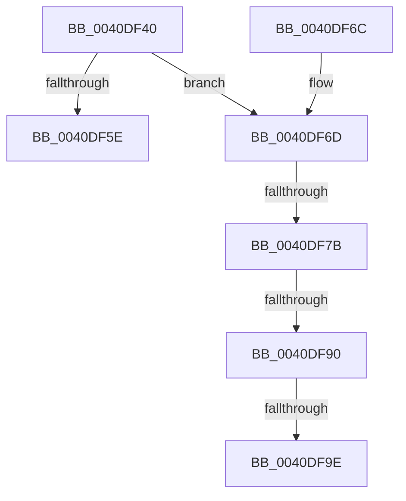

# IoIsInitiator32bitProcess

- RVA: `0x0040DF40`–`0x0040DFA3` (길이 `99` bytes)
- VA: `0x000000014040DF40`
- 실행 섹션: `.text`
- PDB 이름 있음: `예`; PDB Function 태그: `예`
- unwind 정보 RVA: `0x0007DF88`
- 디코드: `24`개 명령, `99/99` bytes 표시
- 미해석 바이트: `0` (있으면 어셈블리에 `.byte`로 보존)

> 이 문서는 커널 이미지의 기계어와 PDB 기호를 분석해 생성했습니다. 4번과 5번은 함수 원형과 자료형을 바이너리 사용 방식에서 추정한 C 해석이며 원본 소스 복구 결과는 아닙니다.

## 1. Dependencies

- 직접 호출 지점: **2**; 고유 호출 대상: **2**
- 직접 호출자로 확인된 함수: **0**
- RIP 상대 이미지 참조: **0**

### Outgoing calls
- `0x0040DF54` → [IoGetInitiatorProcess](IoGetInitiatorProcess_function_0040DFB0.md) (function, `0x0040DFB0`)
- `0x0040DF61` → [IoIs32bitProcess](IoIs32bitProcess_function_0040DFE0.md) (function, `0x0040DFE0`)

### Direct callers
- 이 함수 시작 RVA로 연결되는 직접 call은 확인되지 않았습니다. 간접 호출은 완전히 역산할 수 없습니다.

### Static image references
- 디코드된 RIP-relative 메모리 참조가 없습니다.

## 2. Other-region calls and transfers

- 다른 실행 섹션으로 향하는 call: **0**
- call이 아닌 외부 분기/꼬리 이동: **4**
  - `0x0040DF75` → [sub_006ECA2C + 0x7](../6E/Unknown_function_006ECA2C.md) (`tail-transfer`)
  - `0x0040DF8A` → [sub_006ECA2C](../6E/Unknown_function_006ECA2C.md) (`tail-transfer`)
  - `0x0040DF98` → [sub_006ECA2C](../6E/Unknown_function_006ECA2C.md) (`tail-transfer`)
  - `0x0040DF9E` → [sub_006ECA2C + 0x7](../6E/Unknown_function_006ECA2C.md) (`tail-transfer`)

## 3. Assembly (complete function range)

```asm
0040DF40  40 53                           push rbx
0040DF42  48 83 EC 20                     sub rsp, 0x20
0040DF46  48 8B D9                        mov rbx, rcx
0040DF49  48 8B 89 B8 00 00 00            mov rcx, qword ptr [rcx + 0xb8]
0040DF50  48 8B 49 30                     mov rcx, qword ptr [rcx + 0x30]
0040DF54  E8 57 00 00 00                  call 0x14040dfb0
0040DF59  48 85 C0                        test rax, rax
0040DF5C  75 0F                           jne 0x14040df6d
0040DF5E  48 8B CB                        mov rcx, rbx
0040DF61  E8 7A 00 00 00                  call 0x14040dfe0
0040DF66  48 83 C4 20                     add rsp, 0x20
0040DF6A  5B                              pop rbx
0040DF6B  C3                              ret
0040DF6C  CC                              int3
0040DF6D  48 83 B8 10 03 00 00 00         cmp qword ptr [rax + 0x310], 0
0040DF75  0F 84 B8 EA 2D 00               je 0x1406eca33
0040DF7B  0F B7 88 EC 06 00 00            movzx ecx, word ptr [rax + 0x6ec]
0040DF82  B8 4C 01 00 00                  mov eax, 0x14c
0040DF87  66 3B C8                        cmp cx, ax
0040DF8A  0F 84 9C EA 2D 00               je 0x1406eca2c
0040DF90  B8 C4 01 00 00                  mov eax, 0x1c4
0040DF95  66 3B C8                        cmp cx, ax
0040DF98  0F 84 8E EA 2D 00               je 0x1406eca2c
0040DF9E  E9 90 EA 2D 00                  jmp 0x1406eca33
```

## 4. C-style interpretation (structured pseudocode)

```c
__int64 __fastcall IoIsInitiator32bitProcess(__int64 a1)
{
    __int64 result;
    __int64 v_rsp;

    v_rsp = (v_rsp) - (32);
    result = IoGetInitiatorProcess(*(unsigned __int64 *)(*(unsigned __int64 *)(a1 + 184) + 48), a2, a3, a4);
    if (result != 0) goto loc_0040DF6D;
    result = IoIs32bitProcess(a1, a2, a3, a4);
    v_rsp = (v_rsp) + (32);
    return result;
loc_0040DF6D:
}
```

## 5. (Beta) C Style

```c
int64_t IoIsInitiator32bitProcess(void *Arg1)
{
    uint8_t *arg1 = (uint8_t *)Arg1;

    int64_t result;
    int64_t local_rsp;

    local_rsp = (local_rsp) - (32);
    result = IoGetInitiatorProcess(*(uint64_t *)(*(uint64_t *)(arg1 + 0xB8) + 0x30), a2, a3, a4);
    if (result != 0) goto loc_0040DF6D;
    result = IoIs32bitProcess(Arg1, a2, a3, a4);
    local_rsp = (local_rsp) + (32);
    return result;
loc_0040DF6D:
}
```

### 관측된 메모리 오프셋

구조체 형식이 확인되지 않은 접근은 인자 기준의 오프셋으로만 기록했습니다.

| 기준 인자 | 오프셋 표현 | 폭 (bit) | 접근 |
|---|---:|---:|---|
| `Arg1` | `+ 0xB8` | `64` | `R` |

## 6. Execution-region graph

[열기: 2D/3D 그래프와 함수 탐색 컨트롤 패널](../../../control-panel.html?section=text&rva=0x0040DF40&view=graph)

- 2D 그래프는 위에서 아래로 흐르고, 3D 그래프는 빈 공간을 드래그해 회전합니다. Shift+드래그는 이동, 휠은 확대·축소, 함수 노드 선택은 대상 보고서 이동입니다.

### Static fallback


