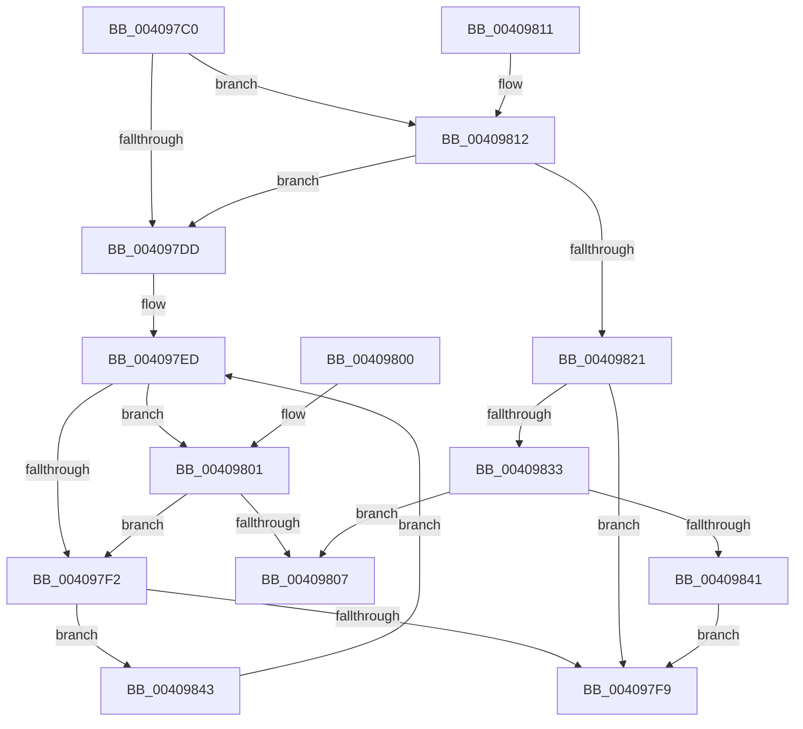

# IoWithinStackLimits

- RVA: `0x004097C0`–`0x0040985C` (길이 `156` bytes)
- VA: `0x00000001404097C0`
- 실행 섹션: `.text`
- PDB 이름 있음: `예`; PDB Function 태그: `아니요`
- unwind 정보 RVA: `0x0009AC14`
- 디코드: `42`개 명령, `156/156` bytes 표시
- 미해석 바이트: `0` (있으면 어셈블리에 `.byte`로 보존)

> 이 문서는 커널 이미지의 기계어와 PDB 기호를 분석해 생성했습니다. 4번과 5번은 함수 원형과 자료형을 바이너리 사용 방식에서 추정한 C 해석이며 원본 소스 복구 결과는 아닙니다.

## 1. Dependencies

- 직접 호출 지점: **0**; 고유 호출 대상: **0**
- 직접 호출자로 확인된 함수: **0**
- RIP 상대 이미지 참조: **1**

### Outgoing calls
- 직접 디코드된 call 명령이 없습니다.

### Direct callers
- 이 함수 시작 RVA로 연결되는 직접 call은 확인되지 않았습니다. 간접 호출은 완전히 역산할 수 없습니다.

### Static image references
- `0x00409833` → RVA `0x00FC5020` (`ALMOSTRO`; read)

## 2. Other-region calls and transfers

- 다른 실행 섹션으로 향하는 call: **0**
- 별도 외부 분기/꼬리 이동을 확인하지 못했습니다.

## 3. Assembly (complete function range)

```asm
004097C0  48 83 EC 48                     sub rsp, 0x48
004097C4  4C 8D 04 11                     lea r8, [rcx + rdx]
004097C8  65 48 8B 14 25 88 01 00 00      mov rdx, qword ptr gs:[0x188]
004097D1  65 8A 04 25 3C 3A 00 00         mov al, byte ptr gs:[0x3a3c]
004097D9  A8 01                           test al, 1
004097DB  75 35                           jne 0x140409812
004097DD  48 8B 42 38                     mov rax, qword ptr [rdx + 0x38]
004097E1  48 89 04 24                     mov qword ptr [rsp], rax
004097E5  48 8B 42 30                     mov rax, qword ptr [rdx + 0x30]
004097E9  4C 8B 4A 28                     mov r9, qword ptr [rdx + 0x28]
004097ED  48 3B C8                        cmp rcx, rax
004097F0  73 0F                           jae 0x140409801
004097F2  49 83 79 10 00                  cmp qword ptr [r9 + 0x10], 0
004097F7  75 4A                           jne 0x140409843
004097F9  33 C0                           xor eax, eax
004097FB  48 83 C4 48                     add rsp, 0x48
004097FF  C3                              ret
00409800  CC                              int3
00409801  4C 3B 04 24                     cmp r8, qword ptr [rsp]
00409805  77 EB                           ja 0x1404097f2
00409807  B8 01 00 00 00                  mov eax, 1
0040980C  48 83 C4 48                     add rsp, 0x48
00409810  C3                              ret
00409811  CC                              int3
00409812  65 48 8B 04 25 20 00 00 00      mov rax, qword ptr gs:[0x20]
0040981B  48 3B 50 18                     cmp rdx, qword ptr [rax + 0x18]
0040981F  74 BC                           je 0x1404097dd
00409821  65 48 8B 14 25 20 3A 00 00      mov rdx, qword ptr gs:[0x3a20]
0040982A  48 83 C2 50                     add rdx, 0x50
0040982E  4C 3B C2                        cmp r8, rdx
00409831  77 C6                           ja 0x1404097f9
00409833  8B 05 E7 B7 BB 00               mov eax, dword ptr [rip + 0xbbb7e7]
00409839  48 2B D0                        sub rdx, rax
0040983C  48 3B CA                        cmp rcx, rdx
0040983F  73 C6                           jae 0x140409807
00409841  EB B6                           jmp 0x1404097f9
00409843  41 0F 10 59 10                  movups xmm3, xmmword ptr [r9 + 0x10]
00409848  4D 8B 49 28                     mov r9, qword ptr [r9 + 0x28]
0040984C  0F 29 1C 24                     movaps xmmword ptr [rsp], xmm3
00409850  66 0F 73 DB 08                  psrldq xmm3, 8
00409855  66 48 0F 7E D8                  movq rax, xmm3
0040985A  EB 91                           jmp 0x1404097ed
```

## 4. C-style interpretation (structured pseudocode)

```c
__int64 __fastcall IoWithinStackLimits(__int64 a1, __int64 a2)
{
    __int64 result;
    __int64 v_rsp;
    unsigned __int64 v_stack_m48;
    unsigned __int64 v_stack_p0;
    unsigned __int64 v_stack_p48;

    v_rsp = (v_rsp) - (72);
    if ((((unsigned __int8)(*(unsigned __int8 *)(gs_base + (0 + 14908)))) & (1)) != 0) goto loc_00409812;
loc_004097DD:
    v_stack_m48 = *(unsigned __int64 *)(*(unsigned __int64 *)(gs_base + (0 + 392)) + 56);
loc_004097ED:
    if (a1 >= (*(unsigned __int64 *)(*(unsigned __int64 *)(gs_base + (0 + 392)) + 48))) goto loc_00409801;
loc_004097F2:
    if ((*(unsigned __int64 *)(*(unsigned __int64 *)(*(unsigned __int64 *)(gs_base + (0 + 392)) + 40) + 16)) != 0) goto loc_00409843;
loc_004097F9:
    result = 0;
    v_rsp = (v_rsp) + (72);
    return result;
loc_00409801:
    if ((a1 + a2 * 1) > v_stack_p0) goto loc_004097F2;
loc_00409807:
    v_rsp = (v_rsp) + (72);
    return 1;
loc_00409812:
    if ((*(unsigned __int64 *)(gs_base + (0 + 392))) == (*(unsigned __int64 *)(*(unsigned __int64 *)(gs_base + (0 + 32)) + 24))) goto loc_004097DD;
    a2 = (*(unsigned __int64 *)(gs_base + (0 + 14880))) + (80);
    if ((a1 + a2 * 1) > a2) goto loc_004097F9;
    a2 = (a2) - ((unsigned int)(*(unsigned int *)(v_rip + 12302311)));
    if (a1 >= a2) goto loc_00409807;
    goto loc_004097F9;
loc_00409843:
    v_stack_p48 = v_xmm3;
    goto loc_004097ED;
}
```

## 5. (Beta) C Style

```c
int64_t IoWithinStackLimits(void *Arg1, int64_t Arg2)
{
    uint8_t *arg1 = (uint8_t *)Arg1;

    int64_t result;
    int64_t local_rsp;
    uint64_t v_stack_m48;
    uint64_t v_stack_p0;
    uint64_t v_stack_p48;

    local_rsp = (local_rsp) - (72);
    if ((((uint8_t)(*(uint8_t *)(gs_base + (0 + 0x3A3C)))) & (1)) != 0) goto loc_00409812;
loc_004097DD:
    v_stack_m48 = *(uint64_t *)(*(uint64_t *)(gs_base + (0 + 0x188)) + 0x38);
loc_004097ED:
    if (Arg1 >= (*(uint64_t *)(*(uint64_t *)(gs_base + (0 + 0x188)) + 0x30))) goto loc_00409801;
loc_004097F2:
    if ((*(uint64_t *)(*(uint64_t *)(*(uint64_t *)(gs_base + (0 + 0x188)) + 0x28) + 0x10)) != 0) goto loc_00409843;
loc_004097F9:
    result = 0;
    local_rsp = (local_rsp) + (72);
    return result;
loc_00409801:
    if ((Arg1 + Arg2 * 1) > v_stack_p0) goto loc_004097F2;
loc_00409807:
    local_rsp = (local_rsp) + (72);
    return 1;
loc_00409812:
    if ((*(uint64_t *)(gs_base + (0 + 0x188))) == (*(uint64_t *)(*(uint64_t *)(gs_base + (0 + 0x20)) + 0x18))) goto loc_004097DD;
    Arg2 = (*(uint64_t *)(gs_base + (0 + 0x3A20))) + (80);
    if ((Arg1 + Arg2 * 1) > Arg2) goto loc_004097F9;
    Arg2 = (Arg2) - ((uint32_t)(*(uint32_t *)(v_rip + 0xBBB7E7)));
    if (Arg1 >= Arg2) goto loc_00409807;
    goto loc_004097F9;
loc_00409843:
    v_stack_p48 = v_xmm3;
    goto loc_004097ED;
}
```

### 관측된 메모리 오프셋

구조체 형식이 확인되지 않은 접근은 인자 기준의 오프셋으로만 기록했습니다.

| 기준 인자 | 오프셋 표현 | 폭 (bit) | 접근 |
|---|---:|---:|---|
| `Arg1` | `+ 0x0 + rdx*1` | `64` | `R` |

## 6. Execution-region graph

[열기: 2D/3D 그래프와 함수 탐색 컨트롤 패널](../../../control-panel.html?section=text&rva=0x004097C0&view=graph)

- 2D 그래프는 위에서 아래로 흐르고, 3D 그래프는 빈 공간을 드래그해 회전합니다. Shift+드래그는 이동, 휠은 확대·축소, 함수 노드 선택은 대상 보고서 이동입니다.

### Static fallback


