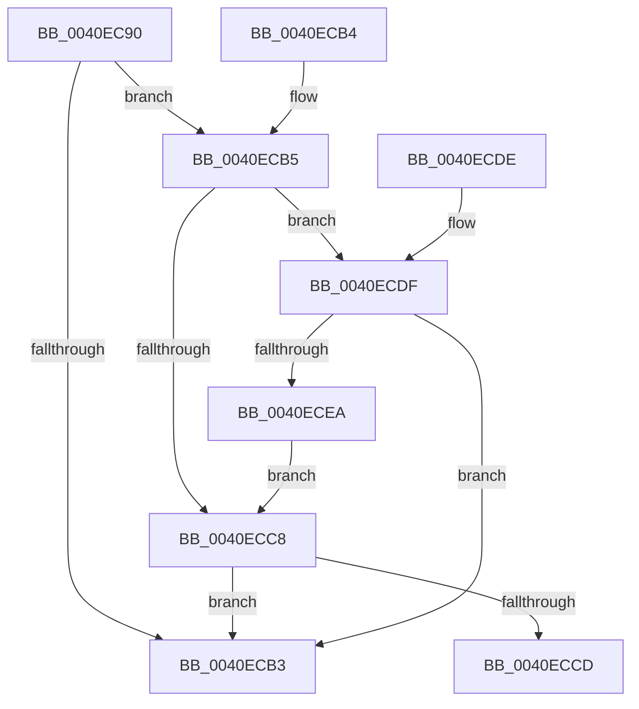

# IopMarkApcRoutineIfAsynchronousIo32

- RVA: `0x0040EC90`–`0x0040ECEC` (길이 `92` bytes)
- VA: `0x000000014040EC90`
- 실행 섹션: `.text`
- PDB 이름 있음: `예`; PDB Function 태그: `아니요`
- unwind 정보 RVA: `0x000DB714`
- 디코드: `27`개 명령, `92/92` bytes 표시
- 미해석 바이트: `0` (있으면 어셈블리에 `.byte`로 보존)

> 이 문서는 커널 이미지의 기계어와 PDB 기호를 분석해 생성했습니다. 4번과 5번은 함수 원형과 자료형을 바이너리 사용 방식에서 추정한 C 해석이며 원본 소스 복구 결과는 아닙니다.

## 1. Dependencies

- 직접 호출 지점: **0**; 고유 호출 대상: **0**
- 직접 호출자로 확인된 함수: **4**
- RIP 상대 이미지 참조: **0**

### Outgoing calls
- 직접 디코드된 call 명령이 없습니다.

### Direct callers
- [IopReadFile](../../page/8A/IopReadFile_function_008AEFF0.md) at `0x008AF152`
- [BuildQueryDirectoryIrp](../../page/8E/BuildQueryDirectoryIrp_function_008EC770.md) at `0x008ECE92`
- [IopReadFileScatter](../../page/AA/IopReadFileScatter_function_00AA5D78.md) at `0x00AA5EB3`
- [IopWriteFileGather](../../page/AA/IopWriteFileGather_function_00AAA95C.md) at `0x00AAAAA4`

### Static image references
- 디코드된 RIP-relative 메모리 참조가 없습니다.

## 2. Other-region calls and transfers

- 다른 실행 섹션으로 향하는 call: **0**
- 별도 외부 분기/꼬리 이동을 확인하지 못했습니다.

## 3. Assembly (complete function range)

```asm
0040EC90  65 48 8B 04 25 88 01 00 00      mov rax, qword ptr gs:[0x188]
0040EC99  4C 8B C9                        mov r9, rcx
0040EC9C  48 8B 09                        mov rcx, qword ptr [rcx]
0040EC9F  4C 8B 12                        mov r10, qword ptr [rdx]
0040ECA2  48 8B 80 B8 00 00 00            mov rax, qword ptr [rax + 0xb8]
0040ECA9  48 83 B8 10 03 00 00 00         cmp qword ptr [rax + 0x310], 0
0040ECB1  75 02                           jne 0x14040ecb5
0040ECB3  C3                              ret
0040ECB4  CC                              int3
0040ECB5  44 0F B7 98 EC 06 00 00         movzx r11d, word ptr [rax + 0x6ec]
0040ECBD  B8 4C 01 00 00                  mov eax, 0x14c
0040ECC2  66 44 3B D8                     cmp r11w, ax
0040ECC6  75 17                           jne 0x14040ecdf
0040ECC8  45 84 C0                        test r8b, r8b
0040ECCB  75 E6                           jne 0x14040ecb3
0040ECCD  8B 09                           mov ecx, dword ptr [rcx]
0040ECCF  49 83 CA 01                     or r10, 1
0040ECD3  8B 01                           mov eax, dword ptr [rcx]
0040ECD5  89 01                           mov dword ptr [rcx], eax
0040ECD7  49 89 09                        mov qword ptr [r9], rcx
0040ECDA  4C 89 12                        mov qword ptr [rdx], r10
0040ECDD  C3                              ret
0040ECDE  CC                              int3
0040ECDF  B8 C4 01 00 00                  mov eax, 0x1c4
0040ECE4  66 44 3B D8                     cmp r11w, ax
0040ECE8  75 C9                           jne 0x14040ecb3
0040ECEA  EB DC                           jmp 0x14040ecc8
```

## 4. C-style interpretation (structured pseudocode)

```c
__int64 __fastcall IopMarkApcRoutineIfAsynchronousIo32(__int64 a1, __int64 a2, unsigned __int8 a3)
{
    __int64 v_r10;

    if ((*(unsigned __int64 *)(*(unsigned __int64 *)(*(unsigned __int64 *)(gs_base + (0 + 392)) + 184) + 784)) != 0) goto loc_0040ECB5;
loc_0040ECB3:
    return *(unsigned __int64 *)(*(unsigned __int64 *)(gs_base + (0 + 392)) + 184);
loc_0040ECB5:
    if (((unsigned __int16)(*(unsigned __int16 *)(*(unsigned __int64 *)(*(unsigned __int64 *)(gs_base + (0 + 392)) + 184) + 1772))) != 332) goto loc_0040ECDF;
loc_0040ECC8:
    if (a3 != 0) goto loc_0040ECB3;
    v_r10 = (*(unsigned __int64 *)(a2)) | (1);
    *(unsigned int *)((unsigned int)(*(unsigned int *)(*(unsigned __int64 *)(a1)))) = (unsigned int)((unsigned int)(*(unsigned int *)((unsigned int)(*(unsigned int *)(*(unsigned __int64 *)(a1))))));
    *(unsigned __int64 *)(a1) = (unsigned int)(*(unsigned int *)(*(unsigned __int64 *)(a1)));
    *(unsigned __int64 *)(a2) = v_r10;
    return (unsigned int)(*(unsigned int *)((unsigned int)(*(unsigned int *)(*(unsigned __int64 *)(a1)))));
loc_0040ECDF:
    if (((unsigned __int16)(*(unsigned __int16 *)(*(unsigned __int64 *)(*(unsigned __int64 *)(gs_base + (0 + 392)) + 184) + 1772))) != 452) goto loc_0040ECB3;
    goto loc_0040ECC8;
}
```

## 5. (Beta) C Style

```c
int64_t IopMarkApcRoutineIfAsynchronousIo32(void *Arg1, void *Arg2, uint8_t Arg3)
{
    uint8_t *arg1 = (uint8_t *)Arg1;
    uint8_t *arg2 = (uint8_t *)Arg2;

    int64_t local_r10;

    if ((*(uint64_t *)(*(uint64_t *)(*(uint64_t *)(gs_base + (0 + 0x188)) + 0xB8) + 0x310)) != 0) goto loc_0040ECB5;
loc_0040ECB3:
    return *(uint64_t *)(*(uint64_t *)(gs_base + (0 + 0x188)) + 0xB8);
loc_0040ECB5:
    if (((uint16_t)(*(uint16_t *)(*(uint64_t *)(*(uint64_t *)(gs_base + (0 + 0x188)) + 0xB8) + 0x6EC))) != 332) goto loc_0040ECDF;
loc_0040ECC8:
    if (Arg3 != 0) goto loc_0040ECB3;
    local_r10 = (*(uint64_t *)(arg2)) | (1);
    *(uint32_t *)((uint32_t)(*(uint32_t *)(*(uint64_t *)(arg1)))) = (uint32_t)((uint32_t)(*(uint32_t *)((uint32_t)(*(uint32_t *)(*(uint64_t *)(arg1))))));
    *(uint64_t *)(arg1) = (uint32_t)(*(uint32_t *)(*(uint64_t *)(arg1)));
    *(uint64_t *)(arg2) = local_r10;
    return (uint32_t)(*(uint32_t *)((uint32_t)(*(uint32_t *)(*(uint64_t *)(arg1)))));
loc_0040ECDF:
    if (((uint16_t)(*(uint16_t *)(*(uint64_t *)(*(uint64_t *)(gs_base + (0 + 0x188)) + 0xB8) + 0x6EC))) != 452) goto loc_0040ECB3;
    goto loc_0040ECC8;
}
```

### 관측된 메모리 오프셋

구조체 형식이 확인되지 않은 접근은 인자 기준의 오프셋으로만 기록했습니다.

| 기준 인자 | 오프셋 표현 | 폭 (bit) | 접근 |
|---|---:|---:|---|
| `Arg1` | `+ 0x0` | `64` | `R` |
| `Arg1` | `+ 0x0` | `64` | `W` |
| `Arg2` | `+ 0x0` | `64` | `R` |
| `Arg2` | `+ 0x0` | `64` | `W` |

## 6. Execution-region graph

[열기: 2D/3D 그래프와 함수 탐색 컨트롤 패널](../../../control-panel.html?section=text&rva=0x0040EC90&view=graph)

- 2D 그래프는 위에서 아래로 흐르고, 3D 그래프는 빈 공간을 드래그해 회전합니다. Shift+드래그는 이동, 휠은 확대·축소, 함수 노드 선택은 대상 보고서 이동입니다.

### Static fallback


