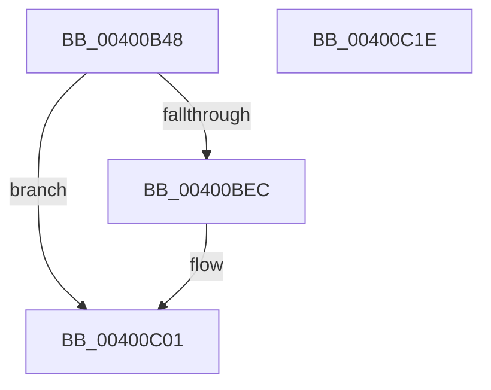

# IopPopulateCopyWriteWorkerData

- RVA: `0x00400B48`–`0x00400C1F` (길이 `215` bytes)
- VA: `0x0000000140400B48`
- 실행 섹션: `.text`
- PDB 이름 있음: `예`; PDB Function 태그: `아니요`
- unwind 정보 RVA: `0x0009A2E4`
- 디코드: `57`개 명령, `215/215` bytes 표시
- 미해석 바이트: `0` (있으면 어셈블리에 `.byte`로 보존)

> 이 문서는 커널 이미지의 기계어와 PDB 기호를 분석해 생성했습니다. 4번과 5번은 함수 원형과 자료형을 바이너리 사용 방식에서 추정한 C 해석이며 원본 소스 복구 결과는 아닙니다.

## 1. Dependencies

- 직접 호출 지점: **3**; 고유 호출 대상: **3**
- 직접 호출자로 확인된 함수: **1**
- RIP 상대 이미지 참조: **0**

### Outgoing calls
- `0x00400B7F` → [memset](../6C/memset_function_006C6C40.md) (function, `0x006C6C40`)
- `0x00400BE3` → [IopValidateAndGetWriteParameters](IopValidateAndGetWriteParameters_function_00400C30.md) (function, `0x00400C30`)
- `0x00400BFC` → [IopAllocateAndPopulateWriteIrp](IopAllocateAndPopulateWriteIrp_function_004011F4.md) (function, `0x004011F4`)

### Direct callers
- [NtCopyFileChunk](../../page/94/NtCopyFileChunk_function_0094B600.md) at `0x0094BA9B`

### Static image references
- 디코드된 RIP-relative 메모리 참조가 없습니다.

## 2. Other-region calls and transfers

- 다른 실행 섹션으로 향하는 call: **0**
- 별도 외부 분기/꼬리 이동을 확인하지 못했습니다.

## 3. Assembly (complete function range)

```asm
00400B48  48 8B C4                        mov rax, rsp
00400B4B  48 89 58 08                     mov qword ptr [rax + 8], rbx
00400B4F  48 89 70 10                     mov qword ptr [rax + 0x10], rsi
00400B53  48 89 78 18                     mov qword ptr [rax + 0x18], rdi
00400B57  4C 89 70 20                     mov qword ptr [rax + 0x20], r14
00400B5B  55                              push rbp
00400B5C  48 8D 68 D9                     lea rbp, [rax - 0x27]
00400B60  48 81 EC C0 00 00 00            sub rsp, 0xc0
00400B67  49 8B F0                        mov rsi, r8
00400B6A  48 8B FA                        mov rdi, rdx
00400B6D  48 8B D9                        mov rbx, rcx
00400B70  33 D2                           xor edx, edx
00400B72  41 B8 88 00 00 00               mov r8d, 0x88
00400B78  48 8D 4D 8F                     lea rcx, [rbp - 0x71]
00400B7C  45 8B F1                        mov r14d, r9d
00400B7F  E8 BC 60 2C 00                  call 0x1406c6c40
00400B84  48 8B 45 57                     mov rax, qword ptr [rbp + 0x57]
00400B88  48 8D 4D 8F                     lea rcx, [rbp - 0x71]
00400B8C  4C 8B 4D 6F                     mov r9, qword ptr [rbp + 0x6f]
00400B90  0F 57 C0                        xorps xmm0, xmm0
00400B93  4C 8B 45 67                     mov r8, qword ptr [rbp + 0x67]
00400B97  48 8B 55 5F                     mov rdx, qword ptr [rbp + 0x5f]
00400B9B  48 89 5D 9F                     mov qword ptr [rbp - 0x61], rbx
00400B9F  33 DB                           xor ebx, ebx
00400BA1  48 89 45 0F                     mov qword ptr [rbp + 0xf], rax
00400BA5  8B 45 77                        mov eax, dword ptr [rbp + 0x77]
00400BA8  89 44 24 20                     mov dword ptr [rsp + 0x20], eax
00400BAC  C6 45 99 01                     mov byte ptr [rbp - 0x67], 1
00400BB0  48 89 5D A7                     mov qword ptr [rbp - 0x59], rbx
00400BB4  48 89 5D AF                     mov qword ptr [rbp - 0x51], rbx
00400BB8  48 89 5D B7                     mov qword ptr [rbp - 0x49], rbx
00400BBC  48 89 5D BF                     mov qword ptr [rbp - 0x41], rbx
00400BC0  48 89 7D C7                     mov qword ptr [rbp - 0x39], rdi
00400BC4  48 89 75 CF                     mov qword ptr [rbp - 0x31], rsi
00400BC8  44 89 75 D7                     mov dword ptr [rbp - 0x29], r14d
00400BCC  48 89 5D DF                     mov qword ptr [rbp - 0x21], rbx
00400BD0  89 5D E7                        mov dword ptr [rbp - 0x19], ebx
00400BD3  66 0F 7F 45 EF                  movdqa xmmword ptr [rbp - 0x11], xmm0
00400BD8  C7 45 FF 00 00 00 C0            mov dword ptr [rbp - 1], 0xc0000000
00400BDF  48 89 5D 07                     mov qword ptr [rbp + 7], rbx
00400BE3  E8 48 00 00 00                  call 0x140400c30
00400BE8  85 C0                           test eax, eax
00400BEA  78 15                           js 0x140400c01
00400BEC  48 8B 55 7F                     mov rdx, qword ptr [rbp + 0x7f]
00400BF0  48 8D 4D 8F                     lea rcx, [rbp - 0x71]
00400BF4  48 8B 45 A7                     mov rax, qword ptr [rbp - 0x59]
00400BF8  48 89 42 08                     mov qword ptr [rdx + 8], rax
00400BFC  E8 F3 05 00 00                  call 0x1404011f4
00400C01  4C 8D 9C 24 C0 00 00 00         lea r11, [rsp + 0xc0]
00400C09  49 8B 5B 10                     mov rbx, qword ptr [r11 + 0x10]
00400C0D  49 8B 73 18                     mov rsi, qword ptr [r11 + 0x18]
00400C11  49 8B 7B 20                     mov rdi, qword ptr [r11 + 0x20]
00400C15  4D 8B 73 28                     mov r14, qword ptr [r11 + 0x28]
00400C19  49 8B E3                        mov rsp, r11
00400C1C  5D                              pop rbp
00400C1D  C3                              ret
00400C1E  CC                              int3
```

## 4. C-style interpretation (structured pseudocode)

```c
__int64 __fastcall IopPopulateCopyWriteWorkerData(__int64 a1, __int64 a2, __int64 a3, int a4)
{
    __int64 result;
    __int64 v_rbx;
    __int64 v_rsp;
    unsigned __int64 v_stack_m8;
    unsigned int v_stack_mA8;

    *(unsigned __int64 *)(v_rsp + 8) = v_rbx;
    *(unsigned __int64 *)(v_rsp + 16) = v_rsi;
    *(unsigned __int64 *)(v_rsp + 24) = v_rdi;
    *(unsigned __int64 *)(v_rsp + 32) = v_r14;
    v_rsp = (v_rsp) - (192);
    a2 = 0;
    result = memset(v_rsp - 39 - 113, a2, 136, a4);
    *(unsigned __int64 *)(v_rsp - 39 - 97) = a1;
    v_rbx = 0;
    *(unsigned __int64 *)(v_rsp - 39 + 15) = *(unsigned __int64 *)(v_rsp - 39 + 87);
    v_stack_mA8 = (unsigned int)((unsigned int)(*(unsigned int *)(v_rsp - 39 + 119)));
    *(unsigned __int8 *)(v_rsp - 39 - 103) = 1;
    *(unsigned __int64 *)(v_rsp - 39 - 89) = 0;
    *(unsigned __int64 *)(v_rsp - 39 - 81) = 0;
    *(unsigned __int64 *)(v_rsp - 39 - 73) = 0;
    *(unsigned __int64 *)(v_rsp - 39 - 65) = 0;
    *(unsigned __int64 *)(v_rsp - 39 - 57) = 0;
    *(unsigned __int64 *)(v_rsp - 39 - 49) = a3;
    *(unsigned int *)(v_rsp - 39 - 41) = (unsigned int)((unsigned int)(a4));
    *(unsigned __int64 *)(v_rsp - 39 - 33) = 0;
    *(unsigned int *)(v_rsp - 39 - 25) = 0;
    *(unsigned __int64 *)(v_rsp - 39 - 17) = v_xmm0;
    *(unsigned int *)(v_rsp - 39 - 1) = 0xC0000000ULL;
    *(unsigned __int64 *)(v_rsp - 39 + 7) = 0;
    result = IopValidateAndGetWriteParameters(v_rsp - 39 - 113, *(unsigned __int64 *)(v_rsp - 39 + 95), *(unsigned __int64 *)(v_rsp - 39 + 103), *(unsigned __int64 *)(v_rsp - 39 + 111));
    if (!(sign_flag)) {
        a2 = *(unsigned __int64 *)(v_rsp - 39 + 127);
        a1 = v_rsp - 39 - 113;
        result = *(unsigned __int64 *)(v_rsp - 39 - 89);
        *(unsigned __int64 *)(a2 + 8) = result;
        result = IopAllocateAndPopulateWriteIrp(a1, a2, *(unsigned __int64 *)(v_rsp - 39 + 103), *(unsigned __int64 *)(v_rsp - 39 + 111));
    }
    return result;
}
```

## 5. (Beta) C Style

```c
int64_t IopPopulateCopyWriteWorkerData(int64_t Arg1, int64_t Arg2, int64_t Arg3, int32_t Arg4)
{
    int64_t result;
    int64_t local_rbx;
    int64_t local_rsp;
    uint64_t v_stack_m8;
    uint32_t v_stack_mA8;

    *(uint64_t *)(local_rsp + 0x8) = local_rbx;
    *(uint64_t *)(local_rsp + 0x10) = local_rsi;
    *(uint64_t *)(local_rsp + 0x18) = local_rdi;
    *(uint64_t *)(local_rsp + 0x20) = local_r14;
    local_rsp = (local_rsp) - (192);
    Arg2 = 0;
    result = memset(local_rsp - 39 - 113, Arg2, 136, Arg4);
    *(uint64_t *)(local_rsp - 0x27 - 0x61) = Arg1;
    local_rbx = 0;
    *(uint64_t *)(local_rsp - 0x27 + 0xF) = *(uint64_t *)(local_rsp - 0x27 + 0x57);
    v_stack_mA8 = (uint32_t)((uint32_t)(*(uint32_t *)(local_rsp - 0x27 + 0x77)));
    *(uint8_t *)(local_rsp - 0x27 - 0x67) = 1;
    *(uint64_t *)(local_rsp - 0x27 - 0x59) = 0;
    *(uint64_t *)(local_rsp - 0x27 - 0x51) = 0;
    *(uint64_t *)(local_rsp - 0x27 - 0x49) = 0;
    *(uint64_t *)(local_rsp - 0x27 - 0x41) = 0;
    *(uint64_t *)(local_rsp - 0x27 - 0x39) = 0;
    *(uint64_t *)(local_rsp - 0x27 - 0x31) = Arg3;
    *(uint32_t *)(local_rsp - 0x27 - 0x29) = (uint32_t)((uint32_t)(Arg4));
    *(uint64_t *)(local_rsp - 0x27 - 0x21) = 0;
    *(uint32_t *)(local_rsp - 0x27 - 0x19) = 0;
    *(uint64_t *)(local_rsp - 0x27 - 0x11) = v_xmm0;
    *(uint32_t *)(local_rsp - 0x27 - 0x1) = 0xC0000000ULL;
    *(uint64_t *)(local_rsp - 0x27 + 0x7) = 0;
    result = IopValidateAndGetWriteParameters(local_rsp - 39 - 113, *(uint64_t *)(local_rsp - 0x27 + 0x5F), *(uint64_t *)(local_rsp - 0x27 + 0x67), *(uint64_t *)(local_rsp - 0x27 + 0x6F));
    if (!(sign_flag)) {
        Arg2 = *(uint64_t *)(local_rsp - 0x27 + 0x7F);
        Arg1 = local_rsp - 39 - 113;
        result = *(uint64_t *)(local_rsp - 0x27 - 0x59);
        *(uint64_t *)(Arg2 + 0x8) = result;
        result = IopAllocateAndPopulateWriteIrp(Arg1, Arg2, *(uint64_t *)(local_rsp - 0x27 + 0x67), *(uint64_t *)(local_rsp - 0x27 + 0x6F));
    }
    return result;
}
```

## 6. Execution-region graph

[열기: 2D/3D 그래프와 함수 탐색 컨트롤 패널](../../../control-panel.html?section=text&rva=0x00400B48&view=graph)

- 2D 그래프는 위에서 아래로 흐르고, 3D 그래프는 빈 공간을 드래그해 회전합니다. Shift+드래그는 이동, 휠은 확대·축소, 함수 노드 선택은 대상 보고서 이동입니다.

### Static fallback


