# IopQueueIrpToFileObject

- RVA: `0x00409864`–`0x004099AB` (길이 `327` bytes)
- VA: `0x0000000140409864`
- 실행 섹션: `.text`
- PDB 이름 있음: `예`; PDB Function 태그: `아니요`
- unwind 정보 RVA: `0x0009AC34`
- 디코드: `84`개 명령, `327/327` bytes 표시
- 미해석 바이트: `0` (있으면 어셈블리에 `.byte`로 보존)

> 이 문서는 커널 이미지의 기계어와 PDB 기호를 분석해 생성했습니다. 4번과 5번은 함수 원형과 자료형을 바이너리 사용 방식에서 추정한 C 해석이며 원본 소스 복구 결과는 아닙니다.

## 1. Dependencies

- 직접 호출 지점: **7**; 고유 호출 대상: **5**
- 직접 호출자로 확인된 함수: **3**
- RIP 상대 이미지 참조: **0**

### Outgoing calls
- `0x0040988F` → [KeAcquireSpinLockRaiseToDpc](../20/KeAcquireSpinLockRaiseToDpc_function_00208470.md) (function, `0x00208470`)
- `0x004098D0` → [KeReleaseSpinLock](../39/KeReleaseSpinLock_function_00392BA0.md) (function, `0x00392BA0`)
- `0x00409924` → [ObFastReferenceObject](ObFastReferenceObject_function_004099C0.md) (function, `0x004099C0`)
- `0x00409936` → [ObfReferenceObjectWithTag](../21/ObfReferenceObjectWithTag_function_00210710.md) (function, `0x00210710`)
- `0x00409971` → [KeReleaseSpinLock](../39/KeReleaseSpinLock_function_00392BA0.md) (function, `0x00392BA0`)
- `0x00409995` → [ObfReferenceObjectWithTag](../21/ObfReferenceObjectWithTag_function_00210710.md) (function, `0x00210710`)
- `0x004099A4` → [ObFastReferenceObjectLocked](../38/ObFastReferenceObjectLocked_function_00381DA0.md) (function, `0x00381DA0`)

### Direct callers
- [IopQueueIrpForServiceTail](../../page/71/IopQueueIrpForServiceTail_function_0071BCC0.md) at `0x0071BD11`
- [IopSynchronousServiceTail](../../page/8E/IopSynchronousServiceTail_function_008EB440.md) at `0x008EB566`
- [IopIsIosbInLockedRange](../../page/A2/IopIsIosbInLockedRange_function_00A2C908.md) at `0x00A2C982`

### Static image references
- 디코드된 RIP-relative 메모리 참조가 없습니다.

## 2. Other-region calls and transfers

- 다른 실행 섹션으로 향하는 call: **0**
- 별도 외부 분기/꼬리 이동을 확인하지 못했습니다.

## 3. Assembly (complete function range)

```asm
00409864  48 89 5C 24 08                  mov qword ptr [rsp + 8], rbx
00409869  48 89 6C 24 10                  mov qword ptr [rsp + 0x10], rbp
0040986E  48 89 74 24 18                  mov qword ptr [rsp + 0x18], rsi
00409873  57                              push rdi
00409874  41 56                           push r14
00409876  41 57                           push r15
00409878  48 83 EC 20                     sub rsp, 0x20
0040987C  48 8D B2 B8 00 00 00            lea rsi, [rdx + 0xb8]
00409883  48 8B F9                        mov rdi, rcx
00409886  48 8B CE                        mov rcx, rsi
00409889  45 8A F0                        mov r14b, r8b
0040988C  48 8B DA                        mov rbx, rdx
0040988F  E8 DC EB DF FF                  call 0x140208470
00409894  F7 43 50 00 04 00 00            test dword ptr [rbx + 0x50], 0x400
0040989B  40 8A E8                        mov bpl, al
0040989E  75 2A                           jne 0x1404098ca
004098A0  45 84 F6                        test r14b, r14b
004098A3  75 1B                           jne 0x1404098c0
004098A5  48 81 C3 C0 00 00 00            add rbx, 0xc0
004098AC  48 8D 4F 20                     lea rcx, [rdi + 0x20]
004098B0  48 8B 03                        mov rax, qword ptr [rbx]
004098B3  48 39 58 08                     cmp qword ptr [rax + 8], rbx
004098B7  74 23                           je 0x1404098dc
004098B9  B9 03 00 00 00                  mov ecx, 3
004098BE  CD 29                           int 0x29
004098C0  48 83 BB B0 00 00 00 00         cmp qword ptr [rbx + 0xb0], 0
004098C8  75 DB                           jne 0x1404098a5
004098CA  40 8A D5                        mov dl, bpl
004098CD  48 8B CE                        mov rcx, rsi
004098D0  E8 CB 92 F8 FF                  call 0x140392ba0
004098D5  32 C0                           xor al, al
004098D7  E9 9C 00 00 00                  jmp 0x140409978
004098DC  48 89 01                        mov qword ptr [rcx], rax
004098DF  BA 49 6F 43 70                  mov edx, 0x70436f49
004098E4  48 89 59 08                     mov qword ptr [rcx + 8], rbx
004098E8  48 89 48 08                     mov qword ptr [rax + 8], rcx
004098EC  48 89 0B                        mov qword ptr [rbx], rcx
004098EF  65 48 8B 04 25 88 01 00 00      mov rax, qword ptr gs:[0x188]
004098F8  65 4C 8B 3C 25 88 01 00 00      mov r15, qword ptr gs:[0x188]
00409901  4C 8B B0 B8 00 00 00            mov r14, qword ptr [rax + 0xb8]
00409908  65 48 8B 04 25 88 01 00 00      mov rax, qword ptr gs:[0x188]
00409911  80 B8 4A 02 00 00 01            cmp byte ptr [rax + 0x24a], 1
00409918  74 78                           je 0x140409992
0040991A  49 8D 9F 90 07 00 00            lea rbx, [r15 + 0x790]
00409921  48 8B CB                        mov rcx, rbx
00409924  E8 97 00 00 00                  call 0x1404099c0
00409929  48 85 C0                        test rax, rax
0040992C  74 6E                           je 0x14040999c
0040992E  BA 44 66 6C 74                  mov edx, 0x746c6644
00409933  49 8B CF                        mov rcx, r15
00409936  E8 D5 6D E0 FF                  call 0x140210710
0040993B  0F BA 6F 10 0D                  bts dword ptr [rdi + 0x10], 0xd
00409940  4C 89 77 58                     mov qword ptr [rdi + 0x58], r14
00409944  48 8B 47 58                     mov rax, qword ptr [rdi + 0x58]
00409948  4C 8B C0                        mov r8, rax
0040994B  48 8B D0                        mov rdx, rax
0040994E  41 83 E0 06                     and r8d, 6
00409952  48 83 E2 F9                     and rdx, 0xfffffffffffffff9
00409956  49 83 C0 02                     add r8, 2
0040995A  4C 8B C8                        mov r9, rax
0040995D  4C 0B C2                        or r8, rdx
00409960  F0 4C 0F B1 47 58               lock cmpxchg qword ptr [rdi + 0x58], r8
00409966  4C 3B C8                        cmp r9, rax
00409969  75 DD                           jne 0x140409948
0040996B  40 8A D5                        mov dl, bpl
0040996E  48 8B CE                        mov rcx, rsi
00409971  E8 2A 92 F8 FF                  call 0x140392ba0
00409976  B0 01                           mov al, 1
00409978  48 8B 5C 24 40                  mov rbx, qword ptr [rsp + 0x40]
0040997D  48 8B 6C 24 48                  mov rbp, qword ptr [rsp + 0x48]
00409982  48 8B 74 24 50                  mov rsi, qword ptr [rsp + 0x50]
00409987  48 83 C4 20                     add rsp, 0x20
0040998B  41 5F                           pop r15
0040998D  41 5E                           pop r14
0040998F  5F                              pop rdi
00409990  C3                              ret
00409991  CC                              int3
00409992  49 8B CE                        mov rcx, r14
00409995  E8 76 6D E0 FF                  call 0x140210710
0040999A  EB 92                           jmp 0x14040992e
0040999C  BA 49 6F 43 70                  mov edx, 0x70436f49
004099A1  48 8B CB                        mov rcx, rbx
004099A4  E8 F7 83 F7 FF                  call 0x140381da0
004099A9  EB 83                           jmp 0x14040992e
```

## 4. C-style interpretation (structured pseudocode)

```c
__int64 __fastcall IopQueueIrpToFileObject(__int64 a1, __int64 a2, unsigned __int8 a3)
{
    __int64 result;
    __int64 v_rbx;
    __int64 v_rsp;
    unsigned __int64 v_stack_p10;
    unsigned __int64 v_stack_p18;
    unsigned __int64 v_stack_p8;

    v_stack_p8 = v_rbx;
    v_stack_p10 = v_rbp;
    v_stack_p18 = v_rsi;
    v_rsp = (v_rsp) - (32);
    result = KeAcquireSpinLockRaiseToDpc(a2 + 184, a2, a3, a4);
    if (((*(unsigned int *)(a2 + 80)) & (0x400ULL)) != 0) goto loc_004098CA;
    if (a3 != 0) goto loc_004098C0;
loc_004098A5:
    v_rbx = (a2) + (192);
    if ((*(unsigned __int64 *)(*(unsigned __int64 *)(v_rbx) + 8)) == v_rbx) goto loc_004098DC;
loc_004098C0:
    if ((*(unsigned __int64 *)(v_rbx + 176)) != 0) goto loc_004098A5;
loc_004098CA:
    result = KeReleaseSpinLock(a2 + 184, (unsigned __int8)((unsigned __int8)(result)), a3, a4);
    result = 0;
    goto loc_00409978;
loc_004098DC:
    *(unsigned __int64 *)(a2 + 184) = 0;
    *(unsigned __int64 *)(a2 + 184 + 8) = v_rbx;
    *(unsigned __int64 *)(result + 8) = a2 + 184;
    *(unsigned __int64 *)(v_rbx) = a2 + 184;
    if ((*(unsigned __int8 *)(*(unsigned __int64 *)(gs_base + (0 + 392)) + 586)) == 1) goto loc_00409992;
    result = ObFastReferenceObject(*(unsigned __int64 *)(gs_base + (0 + 392)) + 1936, (unsigned int)(0x70436F49ULL), a3, a4);
    if (result == 0) goto loc_0040999C;
loc_0040992E:
    result = ObfReferenceObjectWithTag(*(unsigned __int64 *)(gs_base + (0 + 392)), (unsigned int)(0x746C6644ULL), a3, a4);
    *(unsigned __int64 *)(a1 + 88) = *(unsigned __int64 *)(*(unsigned __int64 *)(gs_base + (0 + 392)) + 184);
loc_00409948:
    a3 = (unsigned int)((*(unsigned __int64 *)(a1 + 88)) & (6));
    a2 = (*(unsigned __int64 *)(a1 + 88)) & (-7);
    a3 = (a3) + (2);
    a3 = (a3) | (a2);
    if ((*(unsigned __int64 *)(a1 + 88)) != (*(unsigned __int64 *)(a1 + 88))) goto loc_00409948;
    result = KeReleaseSpinLock(a2 + 184, (unsigned __int8)((unsigned __int8)(result)), a3, *(unsigned __int64 *)(a1 + 88));
loc_00409978:
    v_rsp = (v_rsp) + (32);
    return 1;
loc_00409992:
    result = ObfReferenceObjectWithTag(*(unsigned __int64 *)(*(unsigned __int64 *)(gs_base + (0 + 392)) + 184), (unsigned __int8)((unsigned __int8)(result)), a3, *(unsigned __int64 *)(a1 + 88));
    goto loc_0040992E;
loc_0040999C:
    result = ObFastReferenceObjectLocked(v_stack_p8, (unsigned int)(0x70436F49ULL), a3, *(unsigned __int64 *)(a1 + 88));
    goto loc_0040992E;
}
```

## 5. (Beta) C Style

```c
int64_t IopQueueIrpToFileObject(void *Arg1, void *Arg2, uint8_t Arg3)
{
    uint8_t *arg1 = (uint8_t *)Arg1;
    uint8_t *arg2 = (uint8_t *)Arg2;

    int64_t result;
    int64_t local_rbx;
    int64_t local_rsp;
    uint64_t v_stack_p10;
    uint64_t v_stack_p18;
    uint64_t v_stack_p8;

    v_stack_p8 = local_rbx;
    v_stack_p10 = local_rbp;
    v_stack_p18 = local_rsi;
    local_rsp = (local_rsp) - (32);
    result = KeAcquireSpinLockRaiseToDpc(Arg2 + 184, Arg2, Arg3, a4);
    if (((*(uint32_t *)(arg2 + 0x50)) & (0x400ULL)) != 0) goto loc_004098CA;
    if (Arg3 != 0) goto loc_004098C0;
loc_004098A5:
    local_rbx = (Arg2) + (192);
    if ((*(uint64_t *)(*(uint64_t *)(local_rbx) + 0x8)) == local_rbx) goto loc_004098DC;
loc_004098C0:
    if ((*(uint64_t *)(local_rbx + 0xB0)) != 0) goto loc_004098A5;
loc_004098CA:
    result = KeReleaseSpinLock(Arg2 + 184, (uint8_t)((uint8_t)(result)), Arg3, a4);
    result = 0;
    goto loc_00409978;
loc_004098DC:
    *(uint64_t *)(arg2 + 0xB8) = 0;
    *(uint64_t *)(arg2 + 0xB8 + 0x8) = local_rbx;
    *(void **)(result + 0x8) = Arg2 + 184;
    *(void **)(local_rbx) = Arg2 + 184;
    if ((*(uint8_t *)(*(uint64_t *)(gs_base + (0 + 0x188)) + 0x24A)) == 1) goto loc_00409992;
    result = ObFastReferenceObject(*(uint64_t *)(gs_base + (0 + 0x188)) + 1936, (uint32_t)(0x70436F49ULL), Arg3, a4);
    if (result == 0) goto loc_0040999C;
loc_0040992E:
    result = ObfReferenceObjectWithTag(*(uint64_t *)(gs_base + (0 + 0x188)), (uint32_t)(0x746C6644ULL), Arg3, a4);
    *(uint64_t *)(arg1 + 0x58) = *(uint64_t *)(*(uint64_t *)(gs_base + (0 + 0x188)) + 0xB8);
loc_00409948:
    Arg3 = (uint32_t)((*(uint64_t *)(arg1 + 0x58)) & (6));
    Arg2 = (*(uint64_t *)(arg1 + 0x58)) & (-7);
    Arg3 = (Arg3) + (2);
    Arg3 = (Arg3) | (Arg2);
    if ((*(uint64_t *)(arg1 + 0x58)) != (*(uint64_t *)(arg1 + 0x58))) goto loc_00409948;
    result = KeReleaseSpinLock(Arg2 + 184, (uint8_t)((uint8_t)(result)), Arg3, *(uint64_t *)(arg1 + 0x58));
loc_00409978:
    local_rsp = (local_rsp) + (32);
    return 1;
loc_00409992:
    result = ObfReferenceObjectWithTag(*(uint64_t *)(*(uint64_t *)(gs_base + (0 + 0x188)) + 0xB8), (uint8_t)((uint8_t)(result)), Arg3, *(uint64_t *)(arg1 + 0x58));
    goto loc_0040992E;
loc_0040999C:
    result = ObFastReferenceObjectLocked(v_stack_p8, (uint32_t)(0x70436F49ULL), Arg3, *(uint64_t *)(arg1 + 0x58));
    goto loc_0040992E;
}
```

### 관측된 메모리 오프셋

구조체 형식이 확인되지 않은 접근은 인자 기준의 오프셋으로만 기록했습니다.

| 기준 인자 | 오프셋 표현 | 폭 (bit) | 접근 |
|---|---:|---:|---|
| `Arg1` | `+ 0x0` | `64` | `W` |
| `Arg1` | `+ 0x8` | `64` | `W` |
| `Arg1` | `+ 0x10` | `32` | `R/W` |
| `Arg1` | `+ 0x20` | `64` | `R` |
| `Arg1` | `+ 0x58` | `64` | `R` |
| `Arg1` | `+ 0x58` | `64` | `W` |
| `Arg2` | `+ 0x0` | `64` | `R` |
| `Arg2` | `+ 0x0` | `64` | `W` |
| `Arg2` | `+ 0x50` | `32` | `R` |
| `Arg2` | `+ 0xB0` | `64` | `R` |
| `Arg2` | `+ 0xB8` | `64` | `R` |

## 6. Execution-region graph

[열기: 2D/3D 그래프와 함수 탐색 컨트롤 패널](../../../control-panel.html?section=text&rva=0x00409864&view=graph)

- 2D 그래프는 위에서 아래로 흐르고, 3D 그래프는 빈 공간을 드래그해 회전합니다. Shift+드래그는 이동, 휠은 확대·축소, 함수 노드 선택은 대상 보고서 이동입니다.

### Static fallback

```mermaid
flowchart TD
  bb_00409864[BB_00409864]
  bb_004098A0[BB_004098A0]
  bb_004098A5[BB_004098A5]
  bb_004098B9[BB_004098B9]
  bb_004098C0[BB_004098C0]
  bb_004098CA[BB_004098CA]
  bb_004098DC[BB_004098DC]
  bb_0040991A[BB_0040991A]
  bb_0040992E[BB_0040992E]
  bb_00409948[BB_00409948]
  bb_0040996B[BB_0040996B]
  bb_00409978[BB_00409978]
  bb_00409991[BB_00409991]
  bb_00409992[BB_00409992]
  bb_0040999C[BB_0040999C]
  bb_00409864 -->|branch| bb_004098CA
  bb_00409864 -->|fallthrough| bb_004098A0
  bb_004098A0 -->|branch| bb_004098C0
  bb_004098A0 -->|fallthrough| bb_004098A5
  bb_004098A5 -->|branch| bb_004098DC
  bb_004098A5 -->|fallthrough| bb_004098B9
  bb_004098B9 -->|flow| bb_004098C0
  bb_004098C0 -->|branch| bb_004098A5
  bb_004098C0 -->|fallthrough| bb_004098CA
  bb_004098CA -->|branch| bb_00409978
  bb_004098DC -->|branch| bb_00409992
  bb_004098DC -->|fallthrough| bb_0040991A
  bb_0040991A -->|branch| bb_0040999C
  bb_0040991A -->|fallthrough| bb_0040992E
  bb_0040992E -->|flow| bb_00409948
  bb_00409948 -->|branch| bb_00409948
  bb_00409948 -->|fallthrough| bb_0040996B
  bb_0040996B -->|flow| bb_00409978
  bb_00409991 -->|flow| bb_00409992
  bb_00409992 -->|branch| bb_0040992E
  bb_0040999C -->|branch| bb_0040992E
```


