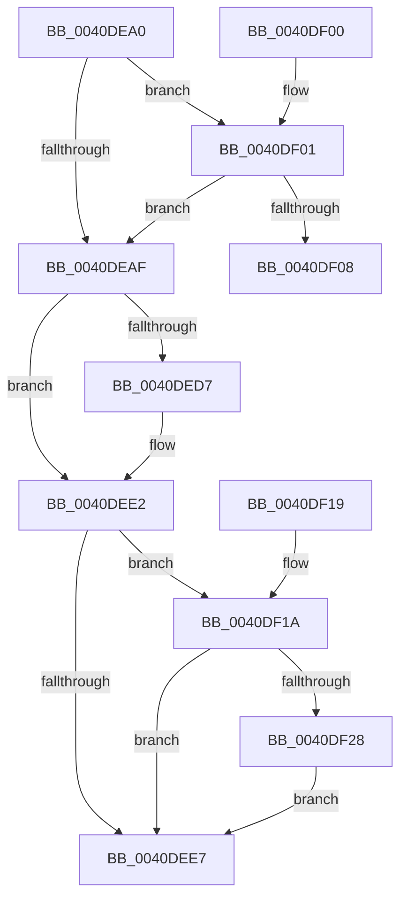

# IopSetIrpPriorityHintFromFileObject

- RVA: `0x0040DEA0`–`0x0040DF39` (길이 `153` bytes)
- VA: `0x000000014040DEA0`
- 실행 섹션: `.text`
- PDB 이름 있음: `예`; PDB Function 태그: `아니요`
- unwind 정보 RVA: `0x000DB714`
- 디코드: `42`개 명령, `153/153` bytes 표시
- 미해석 바이트: `0` (있으면 어셈블리에 `.byte`로 보존)

> 이 문서는 커널 이미지의 기계어와 PDB 기호를 분석해 생성했습니다. 4번과 5번은 함수 원형과 자료형을 바이너리 사용 방식에서 추정한 C 해석이며 원본 소스 복구 결과는 아닙니다.

## 1. Dependencies

- 직접 호출 지점: **0**; 고유 호출 대상: **0**
- 직접 호출자로 확인된 함수: **1**
- RIP 상대 이미지 참조: **0**

### Outgoing calls
- 직접 디코드된 call 명령이 없습니다.

### Direct callers
- [IopSynchronousServiceTail](../../page/8E/IopSynchronousServiceTail_function_008EB440.md) at `0x008EB6C5`

### Static image references
- 디코드된 RIP-relative 메모리 참조가 없습니다.

## 2. Other-region calls and transfers

- 다른 실행 섹션으로 향하는 call: **0**
- 별도 외부 분기/꼬리 이동을 확인하지 못했습니다.

## 3. Assembly (complete function range)

```asm
0040DEA0  48 8B 81 D0 00 00 00            mov rax, qword ptr [rcx + 0xd0]
0040DEA7  4C 8B C2                        mov r8, rdx
0040DEAA  48 85 C0                        test rax, rax
0040DEAD  75 52                           jne 0x14040df01
0040DEAF  65 48 8B 14 25 88 01 00 00      mov rdx, qword ptr gs:[0x188]
0040DEB8  48 8B 8A 20 02 00 00            mov rcx, qword ptr [rdx + 0x220]
0040DEBF  8B 82 A0 05 00 00               mov eax, dword ptr [rdx + 0x5a0]
0040DEC5  C1 E8 09                        shr eax, 9
0040DEC8  83 E0 07                        and eax, 7
0040DECB  48 8B 89 A0 02 00 00            mov rcx, qword ptr [rcx + 0x2a0]
0040DED2  48 85 C9                        test rcx, rcx
0040DED5  74 0B                           je 0x14040dee2
0040DED7  8B 89 3C 04 00 00               mov ecx, dword ptr [rcx + 0x43c]
0040DEDD  3B C1                           cmp eax, ecx
0040DEDF  0F 4D C1                        cmovge eax, ecx
0040DEE2  83 F8 02                        cmp eax, 2
0040DEE5  7C 33                           jl 0x14040df1a
0040DEE7  41 8B 48 10                     mov ecx, dword ptr [r8 + 0x10]
0040DEEB  C1 E0 11                        shl eax, 0x11
0040DEEE  81 E1 FF FF F1 FF               and ecx, 0xfff1ffff
0040DEF4  05 00 00 02 00                  add eax, 0x20000
0040DEF9  0B C1                           or eax, ecx
0040DEFB  41 89 40 10                     mov dword ptr [r8 + 0x10], eax
0040DEFF  C3                              ret
0040DF00  CC                              int3
0040DF01  8B 48 58                        mov ecx, dword ptr [rax + 0x58]
0040DF04  85 C9                           test ecx, ecx
0040DF06  74 A7                           je 0x14040deaf
0040DF08  8B 42 10                        mov eax, dword ptr [rdx + 0x10]
0040DF0B  25 FF FF F1 FF                  and eax, 0xfff1ffff
0040DF10  C1 E1 11                        shl ecx, 0x11
0040DF13  0B C8                           or ecx, eax
0040DF15  89 4A 10                        mov dword ptr [rdx + 0x10], ecx
0040DF18  C3                              ret
0040DF19  CC                              int3
0040DF1A  65 48 8B 0C 25 88 01 00 00      mov rcx, qword ptr gs:[0x188]
0040DF23  48 3B D1                        cmp rdx, rcx
0040DF26  75 BF                           jne 0x14040dee7
0040DF28  83 BA E0 05 00 00 00            cmp dword ptr [rdx + 0x5e0], 0
0040DF2F  B9 02 00 00 00                  mov ecx, 2
0040DF34  0F 45 C1                        cmovne eax, ecx
0040DF37  EB AE                           jmp 0x14040dee7
```

## 4. C-style interpretation (structured pseudocode)

```c
__int64 __fastcall IopSetIrpPriorityHintFromFileObject(__int64 a1, __int64 a2)
{
    __int64 result;

    if (*(unsigned __int64 *)(a1 + 208) != 0) goto loc_0040DF01;
loc_0040DEAF:
    result = (unsigned int)(((unsigned int)(*(unsigned int *)(*(unsigned __int64 *)(gs_base + (0 + 392)) + 1440))) >> (9));
    result = (unsigned int)((result) & (7));
    if (*(unsigned __int64 *)(*(unsigned __int64 *)(*(unsigned __int64 *)(gs_base + (0 + 392)) + 544) + 672) != 0) {
        a1 = *(unsigned int *)(*(unsigned __int64 *)(*(unsigned __int64 *)(*(unsigned __int64 *)(gs_base + (0 + 392)) + 544) + 672) + 1084);
        if (((unsigned int)(result)) >= ((unsigned int)(a1))) { result = (unsigned int)(a1); }
    }
    if (((unsigned int)(result)) < 2) goto loc_0040DF1A;
loc_0040DEE7:
    result = (unsigned int)((result) << (17));
    a1 = (unsigned int)(((unsigned int)(*(unsigned int *)(a2 + 16))) & (0xFFF1FFFFULL));
    result = (unsigned int)((result) + (0x20000ULL));
    result = (unsigned int)((result) | ((unsigned int)(a1)));
    *(unsigned int *)(a2 + 16) = (unsigned int)(result);
    return result;
loc_0040DF01:
    if ((unsigned int)((unsigned int)(*(unsigned int *)(result + 88))) == 0) goto loc_0040DEAF;
    result = (unsigned int)(((unsigned int)(*(unsigned int *)(*(unsigned __int64 *)(gs_base + (0 + 392)) + 16))) & (0xFFF1FFFFULL));
    a1 = (unsigned int)(((unsigned int)(*(unsigned int *)(result + 88))) << (17));
    a1 = (unsigned int)((a1) | ((unsigned int)(result)));
    *(unsigned int *)(*(unsigned __int64 *)(gs_base + (0 + 392)) + 16) = (unsigned int)(a1);
    return result;
loc_0040DF1A:
    if ((*(unsigned __int64 *)(gs_base + (0 + 392))) != (*(unsigned __int64 *)(gs_base + (0 + 392)))) goto loc_0040DEE7;
    if ((*(unsigned int *)(*(unsigned __int64 *)(gs_base + (0 + 392)) + 1504)) != 0) { result = 2; }
    goto loc_0040DEE7;
}
```

## 5. (Beta) C Style

```c
int64_t IopSetIrpPriorityHintFromFileObject(void *Arg1, void *Arg2)
{
    uint8_t *arg1 = (uint8_t *)Arg1;
    uint8_t *arg2 = (uint8_t *)Arg2;

    int64_t result;

    if (*(uint64_t *)(arg1 + 0xD0) != 0) goto loc_0040DF01;
loc_0040DEAF:
    result = (uint32_t)(((uint32_t)(*(uint32_t *)(*(uint64_t *)(gs_base + (0 + 0x188)) + 0x5A0))) >> (9));
    result = (uint32_t)((result) & (7));
    if (*(uint64_t *)(*(uint64_t *)(*(uint64_t *)(gs_base + (0 + 0x188)) + 0x220) + 0x2A0) != 0) {
        Arg1 = *(uint32_t *)(*(uint64_t *)(*(uint64_t *)(*(uint64_t *)(gs_base + (0 + 0x188)) + 0x220) + 0x2A0) + 0x43C);
        if (((uint32_t)(result)) >= ((uint32_t)(Arg1))) { result = (uint32_t)(Arg1); }
    }
    if (((uint32_t)(result)) < 2) goto loc_0040DF1A;
loc_0040DEE7:
    result = (uint32_t)((result) << (17));
    Arg1 = (uint32_t)(((uint32_t)(*(uint32_t *)(arg2 + 0x10))) & (0xFFF1FFFFULL));
    result = (uint32_t)((result) + (0x20000ULL));
    result = (uint32_t)((result) | ((uint32_t)(Arg1)));
    *(uint32_t *)(arg2 + 0x10) = (uint32_t)(result);
    return result;
loc_0040DF01:
    if ((uint32_t)((uint32_t)(*(uint32_t *)(result + 0x58))) == 0) goto loc_0040DEAF;
    result = (uint32_t)(((uint32_t)(*(uint32_t *)(*(uint64_t *)(gs_base + (0 + 0x188)) + 0x10))) & (0xFFF1FFFFULL));
    Arg1 = (uint32_t)(((uint32_t)(*(uint32_t *)(result + 0x58))) << (17));
    Arg1 = (uint32_t)((Arg1) | ((uint32_t)(result)));
    *(uint32_t *)(*(uint64_t *)(gs_base + (0 + 0x188)) + 0x10) = (uint32_t)(Arg1);
    return result;
loc_0040DF1A:
    if ((*(uint64_t *)(gs_base + (0 + 0x188))) != (*(uint64_t *)(gs_base + (0 + 0x188)))) goto loc_0040DEE7;
    if ((*(uint32_t *)(*(uint64_t *)(gs_base + (0 + 0x188)) + 0x5E0)) != 0) { result = 2; }
    goto loc_0040DEE7;
}
```

### 관측된 메모리 오프셋

구조체 형식이 확인되지 않은 접근은 인자 기준의 오프셋으로만 기록했습니다.

| 기준 인자 | 오프셋 표현 | 폭 (bit) | 접근 |
|---|---:|---:|---|
| `Arg1` | `+ 0xD0` | `64` | `R` |
| `Arg2` | `+ 0x10` | `32` | `R` |
| `Arg2` | `+ 0x10` | `32` | `W` |

## 6. Execution-region graph

[열기: 2D/3D 그래프와 함수 탐색 컨트롤 패널](../../../control-panel.html?section=text&rva=0x0040DEA0&view=graph)

- 2D 그래프는 위에서 아래로 흐르고, 3D 그래프는 빈 공간을 드래그해 회전합니다. Shift+드래그는 이동, 휠은 확대·축소, 함수 노드 선택은 대상 보고서 이동입니다.

### Static fallback


