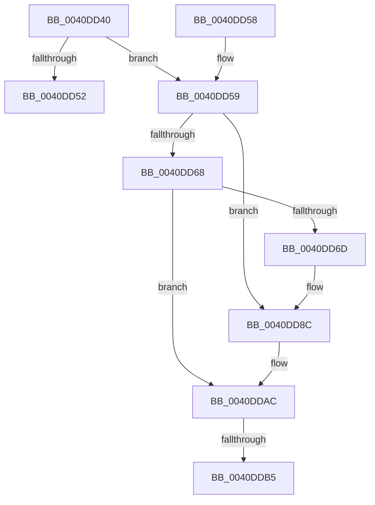

# KasanMarkAddressValid

- RVA: `0x0040DD40`–`0x0040DDD1` (길이 `145` bytes)
- VA: `0x000000014040DD40`
- 실행 섹션: `.text`
- PDB 이름 있음: `예`; PDB Function 태그: `아니요`
- unwind 정보 RVA: `0x0009B6C0`
- 디코드: `38`개 명령, `145/145` bytes 표시
- 미해석 바이트: `0` (있으면 어셈블리에 `.byte`로 보존)

> 이 문서는 커널 이미지의 기계어와 PDB 기호를 분석해 생성했습니다. 4번과 5번은 함수 원형과 자료형을 바이너리 사용 방식에서 추정한 C 해석이며 원본 소스 복구 결과는 아닙니다.

## 1. Dependencies

- 직접 호출 지점: **3**; 고유 호출 대상: **1**
- 직접 호출자로 확인된 함수: **1**
- RIP 상대 이미지 참조: **1**

### Outgoing calls
- `0x0040DD86` → [KeBugCheckEx](../4F/KeBugCheckEx_function_004FD660.md) (function, `0x004FD660`)
- `0x0040DDA6` → [KeBugCheckEx](../4F/KeBugCheckEx_function_004FD660.md) (function, `0x004FD660`)
- `0x0040DDCB` → [KeBugCheckEx](../4F/KeBugCheckEx_function_004FD660.md) (function, `0x004FD660`)

### Direct callers
- [MmFreeIsrStack](../../page/80/MmFreeIsrStack_function_00807FC0.md) at `0x00807FD5`

### Static image references
- `0x0040DD46` → RVA `0x00FCEC68` (`ALMOSTRO`; read)

## 2. Other-region calls and transfers

- 다른 실행 섹션으로 향하는 call: **0**
- call이 아닌 외부 분기/꼬리 이동: **1**
  - `0x0040DDB3` → [sub_0040DDD1](Unknown_function_0040DDD1.md) (`tail-transfer`)

## 3. Assembly (complete function range)

```asm
0040DD40  40 53                           push rbx
0040DD42  48 83 EC 30                     sub rsp, 0x30
0040DD46  80 3D 1B 0F BC 00 00            cmp byte ptr [rip + 0xbc0f1b], 0
0040DD4D  48 8B DA                        mov rbx, rdx
0040DD50  75 07                           jne 0x14040dd59
0040DD52  48 83 C4 30                     add rsp, 0x30
0040DD56  5B                              pop rbx
0040DD57  C3                              ret
0040DD58  CC                              int3
0040DD59  48 B8 00 00 00 00 00 80 FF FF   movabs rax, 0xffff800000000000
0040DD63  48 3B C8                        cmp rcx, rax
0040DD66  72 24                           jb 0x14040dd8c
0040DD68  F6 C1 07                        test cl, 7
0040DD6B  74 3F                           je 0x14040ddac
0040DD6D  BA 02 00 00 00                  mov edx, 2
0040DD72  48 C7 44 24 20 08 00 00 00      mov qword ptr [rsp + 0x20], 8
0040DD7B  4C 8B C9                        mov r9, rcx
0040DD7E  44 8B C2                        mov r8d, edx
0040DD81  B9 F1 01 00 00                  mov ecx, 0x1f1
0040DD86  E8 D5 F8 0E 00                  call 0x1404fd660
0040DD8B  CC                              int3
0040DD8C  BA 02 00 00 00                  mov edx, 2
0040DD91  48 C7 44 24 20 00 00 00 00      mov qword ptr [rsp + 0x20], 0
0040DD9A  4C 8B C9                        mov r9, rcx
0040DD9D  B9 F1 01 00 00                  mov ecx, 0x1f1
0040DDA2  44 8D 42 FF                     lea r8d, [rdx - 1]
0040DDA6  E8 B5 F8 0E 00                  call 0x1404fd660
0040DDAB  CC                              int3
0040DDAC  48 8D 04 11                     lea rax, [rcx + rdx]
0040DDB0  48 3B C1                        cmp rax, rcx
0040DDB3  73 1C                           jae 0x14040ddd1
0040DDB5  BA 02 00 00 00                  mov edx, 2
0040DDBA  48 89 5C 24 20                  mov qword ptr [rsp + 0x20], rbx
0040DDBF  4C 8B C9                        mov r9, rcx
0040DDC2  B9 F1 01 00 00                  mov ecx, 0x1f1
0040DDC7  44 8D 42 01                     lea r8d, [rdx + 1]
0040DDCB  E8 90 F8 0E 00                  call 0x1404fd660
0040DDD0  CC                              int3
```

## 4. C-style interpretation (structured pseudocode)

```c
__int64 __fastcall KasanMarkAddressValid(__int64 a1, __int64 a2)
{
    __int64 result;
    __int64 v_rsp;
    unsigned __int64 v_stack_p20;

    v_rsp = (v_rsp) - (48);
    if ((*(unsigned __int8 *)(v_rip + 12324635)) != 0) goto loc_0040DD59;
    v_rsp = (v_rsp) + (48);
    return result;
loc_0040DD59:
    if (a1 < result) goto loc_0040DD8C;
    if ((((unsigned __int8)(a1)) & (7)) == 0) goto loc_0040DDAC;
    v_stack_p20 = 8;
    result = KeBugCheckEx(497, 2, 2, a1);
loc_0040DD8C:
    v_stack_p20 = 0;
    result = KeBugCheckEx(497, 2, 2 - 1, 497);
loc_0040DDAC:
    v_stack_p20 = a2;
    result = KeBugCheckEx(497, 2, 2 + 1, 497);
    return result;
}
```

## 5. (Beta) C Style

```c
int64_t KasanMarkAddressValid(int64_t Arg1, int64_t Arg2)
{
    int64_t result;
    int64_t local_rsp;
    uint64_t v_stack_p20;

    local_rsp = (local_rsp) - (48);
    if ((*(uint8_t *)(v_rip + 0xBC0F1B)) != 0) goto loc_0040DD59;
    local_rsp = (local_rsp) + (48);
    return result;
loc_0040DD59:
    if (Arg1 < result) goto loc_0040DD8C;
    if ((((uint8_t)(Arg1)) & (7)) == 0) goto loc_0040DDAC;
    v_stack_p20 = 8;
    result = KeBugCheckEx(497, 2, 2, Arg1);
loc_0040DD8C:
    v_stack_p20 = 0;
    result = KeBugCheckEx(497, 2, 2 - 1, 497);
loc_0040DDAC:
    v_stack_p20 = Arg2;
    result = KeBugCheckEx(497, 2, 2 + 1, 497);
    return result;
}
```

## 6. Execution-region graph

[열기: 2D/3D 그래프와 함수 탐색 컨트롤 패널](../../../control-panel.html?section=text&rva=0x0040DD40&view=graph)

- 2D 그래프는 위에서 아래로 흐르고, 3D 그래프는 빈 공간을 드래그해 회전합니다. Shift+드래그는 이동, 휠은 확대·축소, 함수 노드 선택은 대상 보고서 이동입니다.

### Static fallback


