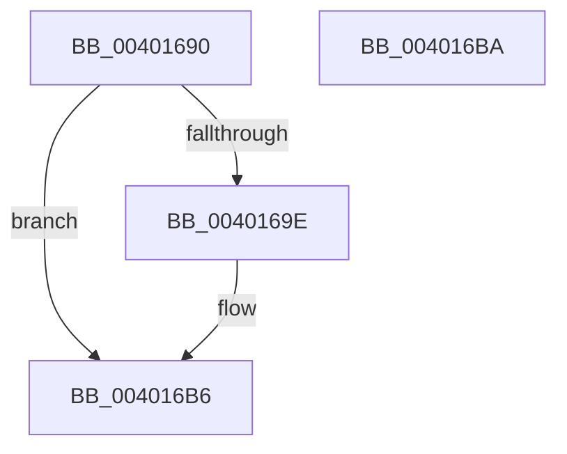

# KeGetCurrentProcessorNumberEx

- RVA: `0x00401690`–`0x004016BB` (길이 `43` bytes)
- VA: `0x0000000140401690`
- 실행 섹션: `.text`
- PDB 이름 있음: `예`; PDB Function 태그: `아니요`
- unwind 정보 RVA: `0x000DB714`
- 디코드: `11`개 명령, `43/43` bytes 표시
- 미해석 바이트: `0` (있으면 어셈블리에 `.byte`로 보존)

> 이 문서는 커널 이미지의 기계어와 PDB 기호를 분석해 생성했습니다. 4번과 5번은 함수 원형과 자료형을 바이너리 사용 방식에서 추정한 C 해석이며 원본 소스 복구 결과는 아닙니다.

## 1. Dependencies

- 직접 호출 지점: **0**; 고유 호출 대상: **0**
- 직접 호출자로 확인된 함수: **6**
- RIP 상대 이미지 참조: **0**

### Outgoing calls
- 직접 디코드된 call 명령이 없습니다.

### Direct callers
- [HalpHvInitMcaPcrContext](../4D/HalpHvInitMcaPcrContext_function_004D7D88.md) at `0x004D7DC7`
- [KiAltContextWorkQueueAddItem](../5C/KiAltContextWorkQueueAddItem_function_005CB028.md) at `0x005CB074`
- [PopIdleWakeNotifyWakeSource](../5D/PopIdleWakeNotifyWakeSource_function_005DC204.md) at `0x005DC2CD`
- [WheaFlushETWEventsAddWorkRtn](../66/WheaFlushETWEventsAddWorkRtn_function_0066031C.md) at `0x00660361`
- [KiCopyCountersWorker](../../page/74/KiCopyCountersWorker_function_00747058.md) at `0x00747075`
- [HalpMcaInitializePcrContext](../../pagelk/B5/HalpMcaInitializePcrContext_function_00B5BDD0.md) at `0x00B5BDE4`

### Static image references
- 디코드된 RIP-relative 메모리 참조가 없습니다.

## 2. Other-region calls and transfers

- 다른 실행 섹션으로 향하는 call: **0**
- 별도 외부 분기/꼬리 이동을 확인하지 못했습니다.

## 3. Assembly (complete function range)

```asm
00401690  65 48 8B 04 25 20 00 00 00      mov rax, qword ptr gs:[0x20]
00401699  48 85 C9                        test rcx, rcx
0040169C  74 18                           je 0x1404016b6
0040169E  0F B6 90 D0 00 00 00            movzx edx, byte ptr [rax + 0xd0]
004016A5  66 89 11                        mov word ptr [rcx], dx
004016A8  0F B6 90 D1 00 00 00            movzx edx, byte ptr [rax + 0xd1]
004016AF  88 51 02                        mov byte ptr [rcx + 2], dl
004016B2  C6 41 03 00                     mov byte ptr [rcx + 3], 0
004016B6  8B 40 24                        mov eax, dword ptr [rax + 0x24]
004016B9  C3                              ret
004016BA  CC                              int3
```

## 4. C-style interpretation (structured pseudocode)

```c
__int64 __fastcall KeGetCurrentProcessorNumberEx(__int64 a1)
{
    if (a1 != 0) {
        a2 = *(unsigned __int8 *)(*(unsigned __int64 *)(gs_base + (0 + 32)) + 208);
        *(unsigned __int16 *)(a1) = (unsigned __int16)(a2);
        a2 = *(unsigned __int8 *)(*(unsigned __int64 *)(gs_base + (0 + 32)) + 209);
        *(unsigned __int8 *)(a1 + 2) = (unsigned __int8)(a2);
        *(unsigned __int8 *)(a1 + 3) = 0;
    }
    return (unsigned int)(*(unsigned int *)(*(unsigned __int64 *)(gs_base + (0 + 32)) + 36));
}
```

## 5. (Beta) C Style

```c
int64_t KeGetCurrentProcessorNumberEx(int64_t Arg1)
{
    if (Arg1 != 0) {
        a2 = *(uint8_t *)(*(uint64_t *)(gs_base + (0 + 0x20)) + 0xD0);
        *(uint16_t *)(Arg1) = (uint16_t)(a2);
        a2 = *(uint8_t *)(*(uint64_t *)(gs_base + (0 + 0x20)) + 0xD1);
        *(uint8_t *)(Arg1 + 0x2) = (uint8_t)(a2);
        *(uint8_t *)(Arg1 + 0x3) = 0;
    }
    return (uint32_t)(*(uint32_t *)(*(uint64_t *)(gs_base + (0 + 0x20)) + 0x24));
}
```

## 6. Execution-region graph

[열기: 2D/3D 그래프와 함수 탐색 컨트롤 패널](../../../control-panel.html?section=text&rva=0x00401690&view=graph)

- 2D 그래프는 위에서 아래로 흐르고, 3D 그래프는 빈 공간을 드래그해 회전합니다. Shift+드래그는 이동, 휠은 확대·축소, 함수 노드 선택은 대상 보고서 이동입니다.

### Static fallback


