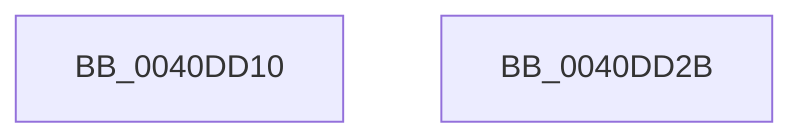

# KeInitializeEvent

- RVA: `0x0040DD10`–`0x0040DD2C` (길이 `28` bytes)
- VA: `0x000000014040DD10`
- 실행 섹션: `.text`
- PDB 이름 있음: `예`; PDB Function 태그: `아니요`
- unwind 정보 RVA: `0x000DB714`
- 디코드: `9`개 명령, `28/28` bytes 표시
- 미해석 바이트: `0` (있으면 어셈블리에 `.byte`로 보존)

> 이 문서는 커널 이미지의 기계어와 PDB 기호를 분석해 생성했습니다. 4번과 5번은 함수 원형과 자료형을 바이너리 사용 방식에서 추정한 C 해석이며 원본 소스 복구 결과는 아닙니다.

## 1. Dependencies

- 직접 호출 지점: **0**; 고유 호출 대상: **0**
- 직접 호출자로 확인된 함수: **197**
- RIP 상대 이미지 참조: **0**

### Outgoing calls
- 직접 디코드된 call 명령이 없습니다.

### Direct callers
- [IoCancelFileOpen](../../page/70/IoCancelFileOpen_function_007034A0.md) at `0x007034EE`
- [HalpSetAcpiRealTimeClock](../../page/70/HalpSetAcpiRealTimeClock_function_00705BFC.md) at `0x00705C51`
- [HalpAddDevice](../../page/70/HalpAddDevice_function_00708060.md) at `0x007082CA`
- [HalpInitializeInterruptRemappingBspLate](../../page/70/HalpInitializeInterruptRemappingBspLate_function_0070A708.md) at `0x0070A738`
- [HalpQueryAcpiWakeAlarmSystemPowerState](../../page/70/HalpQueryAcpiWakeAlarmSystemPowerState_function_0070B634.md) at `0x0070B67A`
- [HalpQueryPccInterface](../../page/70/HalpQueryPccInterface_function_0070D79C.md) at `0x0070D7FD`
- [ArbInitializeArbiterInstance](../../page/70/ArbInitializeArbiterInstance_function_0070ECB4.md) at `0x0070ED19`
- [ArbInitializeArbiterInstance](../../page/70/ArbInitializeArbiterInstance_function_0070ECB4.md) at `0x0070EDE4`
- [DbgkpLkmdLaunchSnapApc](../../page/71/DbgkpLkmdLaunchSnapApc_function_00711844.md) at `0x007118AC`
- [FsRtlBalanceReads](../../page/71/FsRtlBalanceReads_function_00714110.md) at `0x0071413A`
- [FsRtlIssueFileNotificationFsctl](../../page/71/FsRtlIssueFileNotificationFsctl_function_007161D8.md) at `0x00716229`
- [NT_DISK::Control](../../page/71/NT_DISK_Control_function_00716FC0.md) at `0x00717006`
- [IopLoadFileSystemDriver](../../page/71/IopLoadFileSystemDriver_function_0071BB1C.md) at `0x0071BB5F`
- [IopSetEaOrQuotaInformationFile](../../page/71/IopSetEaOrQuotaInformationFile_function_0071BD70.md) at `0x0071BF2C`
- [IopSetRemoteLink](../../page/71/IopSetRemoteLink_function_0071C690.md) at `0x0071C6F6`
- [IoSetInformation](../../page/71/IoSetInformation_function_0071DBF0.md) at `0x0071DCD8`
- [NtCreateIoRing](../../page/72/NtCreateIoRing_function_00720530.md) at `0x007207CD`
- [NtQueryQuotaInformationFile](../../page/72/NtQueryQuotaInformationFile_function_00720FE0.md) at `0x0072144D`
- [NtSetVolumeInformationFile](../../page/72/NtSetVolumeInformationFile_function_00721750.md) at `0x00721A02`
- [IopIssueSystemEnvironmentRequest](../../page/72/IopIssueSystemEnvironmentRequest_function_00722878.md) at `0x007228BF`
- [IoReplacePartitionUnit](../../page/72/IoReplacePartitionUnit_function_00727FD0.md) at `0x0072801D`
- [PnpRequestHwProfileChangeNotification](../../page/72/PnpRequestHwProfileChangeNotification_function_00729E78.md) at `0x00729F4E`
- [PiIrpQueryRemoveDevice](../../page/73/PiIrpQueryRemoveDevice_function_0073E088.md) at `0x0073E12E`
- [PpIrpAllocateDeviceUsageNotification](../../page/73/PpIrpAllocateDeviceUsageNotification_function_0073E1DC.md) at `0x0073E1F5`
- [KeInitializeSecondaryInterruptServices](../../page/74/KeInitializeSecondaryInterruptServices_function_007467E0.md) at `0x00746838`
- [AlpcpInitSystem](../../page/74/AlpcpInitSystem_function_0074CB9C.md) at `0x0074CC15`
- [PfpScenCtxInitialize](../../page/75/PfpScenCtxInitialize_function_00750FA0.md) at `0x00750FC1`
- [PfTInitialize](../../page/75/PfTInitialize_function_00751554.md) at `0x007516AE`
- [PfTInitialize](../../page/75/PfTInitialize_function_00751554.md) at `0x007516BB`
- [PfTInitialize](../../page/75/PfTInitialize_function_00751554.md) at `0x007516C8`
- [PfTInitialize](../../page/75/PfTInitialize_function_00751554.md) at `0x007516D5`
- [PopDisablePowerLimitExtension](../../page/75/PopDisablePowerLimitExtension_function_00756148.md) at `0x007561A5`
- [PopFreePowerLimitRequest](../../page/75/PopFreePowerLimitRequest_function_00756494.md) at `0x00756605`
- [PopDisableCoolingExtension](../../page/75/PopDisableCoolingExtension_function_00757208.md) at `0x00757292`
- [PopFxRegisterComponentPerfStates](../../page/75/PopFxRegisterComponentPerfStates_function_00759764.md) at `0x00759AE4`
- [PopFxRegisterDeviceWorker](../../page/75/PopFxRegisterDeviceWorker_function_00759E20.md) at `0x0075A250`
- [PopThermalZoneAdd](../../page/75/PopThermalZoneAdd_function_0075F980.md) at `0x0075FA1C`
- [PopThermalZoneAdd](../../page/75/PopThermalZoneAdd_function_0075F980.md) at `0x0075FA2D`
- [NtInitiatePowerAction](../../page/75/NtInitiatePowerAction_function_0075FCB0.md) at `0x0075FE32`
- [PopPolicyDeviceHandleWakeAlarmNotification](../../page/76/PopPolicyDeviceHandleWakeAlarmNotification_function_007660A4.md) at `0x0076617B`
- [PopBatteryAdd](../../page/76/PopBatteryAdd_function_00766580.md) at `0x007665A3`
- [PopPowerAdapterAdd](../../page/76/PopPowerAdapterAdd_function_00767430.md) at `0x00767484`
- [PopFanAdd](../../page/76/PopFanAdd_function_007690D0.md) at `0x00769103`
- [PopEtDeferredInitDxgContext](../../page/76/PopEtDeferredInitDxgContext_function_00769B40.md) at `0x00769BBB`
- [TtmiCreateEventQueue](../../page/77/TtmiCreateEventQueue_function_0077DA14.md) at `0x0077DAFD`
- [PspQueueDeferredWorkAndWait](../../page/78/PspQueueDeferredWorkAndWait_function_00780148.md) at `0x007801A2`
- [PsSetVmProcessorHostProcess](../../page/78/PsSetVmProcessorHostProcess_function_00783CEC.md) at `0x00783D94`
- [PspSessionObjectCreate](../../page/78/PspSessionObjectCreate_function_007892A8.md) at `0x007894CD`
- [PspSessionObjectCreate](../../page/78/PspSessionObjectCreate_function_007892A8.md) at `0x0078959E`
- [RawPerformDevIoCtrl](../../page/78/RawPerformDevIoCtrl_function_0078A154.md) at `0x0078A186`
- [RawQueryFileSystemInformation](../../page/78/RawQueryFileSystemInformation_function_0078A350.md) at `0x0078A46D`
- [RtlpCtContextInit](../../page/79/RtlpCtContextInit_function_00794938.md) at `0x007949D6`
- [Pdcv2ActivationClientRegister](../../page/79/Pdcv2ActivationClientRegister_function_0079AF28.md) at `0x0079AFF4`
- [SmPartitionInitialize](../../page/7A/SmPartitionInitialize_function_007A5D04.md) at `0x007A5D6A`
- [SmProcessResizeRequest](../../page/7A/SmProcessResizeRequest_function_007A6D50.md) at `0x007A6DC8`
- [SmProcessStatsRequest](../../page/7A/SmProcessStatsRequest_function_007A6E68.md) at `0x007A6EBE`
- [SmStorePhysicalRequestIssue](../../page/7A/SmStorePhysicalRequestIssue_function_007A732C.md) at `0x007A7377`
- [SmKmSendDeviceControl](../../page/7A/SmKmSendDeviceControl_function_007A8D84.md) at `0x007A8DAE`
- [SmKmSendUsageNotification](../../page/7A/SmKmSendUsageNotification_function_007A8E44.md) at `0x007A8E78`
- [SmKmStoreFileWriteHeader](../../page/7A/SmKmStoreFileWriteHeader_function_007A9DB4.md) at `0x007A9EFE`
- [WmipWaitForCollectionEnabled](../../page/7B/WmipWaitForCollectionEnabled_function_007B49C0.md) at `0x007B49DD`
- [EtwpCovSampCaptureContextStart](../../page/7C/EtwpCovSampCaptureContextStart_function_007C14AC.md) at `0x007C153A`
- [EtwpCovSampCaptureContextStart](../../page/7C/EtwpCovSampCaptureContextStart_function_007C14AC.md) at `0x007C156D`
- [EtwpCovSampCaptureContextStart](../../page/7C/EtwpCovSampCaptureContextStart_function_007C14AC.md) at `0x007C15AA`
- [ExpQueryPrmInterface](../../page/7C/ExpQueryPrmInterface_function_007CF018.md) at `0x007CF06D`
- [ExpWorkQueueDestroy](../../page/7C/ExpWorkQueueDestroy_function_007CFE70.md) at `0x007CFE96`
- [ExpWorkQueueManagerInitialize](../../page/7D/ExpWorkQueueManagerInitialize_function_007D01D4.md) at `0x007D0219`
- [ExpWorkQueueManagerInitialize](../../page/7D/ExpWorkQueueManagerInitialize_function_007D01D4.md) at `0x007D0232`
- [NtMapCMFModule](../../page/7D/NtMapCMFModule_function_007D4310.md) at `0x007D4987`
- [WheaAttemptClearPoison](../../page/7D/WheaAttemptClearPoison_function_007D72A0.md) at `0x007D7303`
- [WheaAttemptPhysicalPageOffline](../../page/7D/WheaAttemptPhysicalPageOffline_function_007D7380.md) at `0x007D73FB`
- [CmpInitializeSystemHivesLoad](../../page/7D/CmpInitializeSystemHivesLoad_function_007DAC7C.md) at `0x007DACA7`
- [CmpInitializeSystemHivesLoad](../../page/7D/CmpInitializeSystemHivesLoad_function_007DAC7C.md) at `0x007DACBA`
- [CmCompleteRegistryInitialization](../../page/7D/CmCompleteRegistryInitialization_function_007DF1EC.md) at `0x007DF2AD`
- [CmpInitializeMachineHiveLoadedCallbacks](../../page/7E/CmpInitializeMachineHiveLoadedCallbacks_function_007E1EA0.md) at `0x007E1EB6`
- [CmpInitializeMachineHiveLoadedCallbacks](../../page/7E/CmpInitializeMachineHiveLoadedCallbacks_function_007E1EA0.md) at `0x007E1EE1`
- [CmpInitializeRegistryProcess](../../page/7E/CmpInitializeRegistryProcess_function_007E8180.md) at `0x007E8293`
- [CmpInitializeLazyWriters](../../page/7E/CmpInitializeLazyWriters_function_007EEF34.md) at `0x007EEFAB`
- [MiInitializeSections](../../page/7F/MiInitializeSections_function_007FC738.md) at `0x007FC776`
- [MiInitializeSections](../../page/7F/MiInitializeSections_function_007FC738.md) at `0x007FC7BF`
- [MiInitializeSections](../../page/7F/MiInitializeSections_function_007FC738.md) at `0x007FC7DE`
- [MiInitializeSections](../../page/7F/MiInitializeSections_function_007FC738.md) at `0x007FC7EF`
- [MiInitializeSections](../../page/7F/MiInitializeSections_function_007FC738.md) at `0x007FC80E`
- [MiInitializeSections](../../page/7F/MiInitializeSections_function_007FC738.md) at `0x007FC82B`
- [MiInitializeSections](../../page/7F/MiInitializeSections_function_007FC738.md) at `0x007FC877`
- [MiInitializePartition](../../page/7F/MiInitializePartition_function_007FD3E8.md) at `0x007FD459`
- [MiInitializePartition](../../page/7F/MiInitializePartition_function_007FD3E8.md) at `0x007FD46C`
- [MiInitializePartition](../../page/7F/MiInitializePartition_function_007FD3E8.md) at `0x007FD492`
- [MiInitializePartition](../../page/7F/MiInitializePartition_function_007FD3E8.md) at `0x007FD5F7`
- [MiInitializePartition](../../page/7F/MiInitializePartition_function_007FD3E8.md) at `0x007FD675`
- [MiInitializePartition](../../page/7F/MiInitializePartition_function_007FD3E8.md) at `0x007FD6E7`
- [MiInitializePartition](../../page/7F/MiInitializePartition_function_007FD3E8.md) at `0x007FD72C`
- [MiInitializePartition](../../page/7F/MiInitializePartition_function_007FD3E8.md) at `0x007FD75D`
- [MiInitializePartition](../../page/7F/MiInitializePartition_function_007FD3E8.md) at `0x007FD76E`
- [MiInitializePartition](../../page/7F/MiInitializePartition_function_007FD3E8.md) at `0x007FD77F`
- [MiInitializePartition](../../page/7F/MiInitializePartition_function_007FD3E8.md) at `0x007FD7B3`
- [MiInitializePartition](../../page/7F/MiInitializePartition_function_007FD3E8.md) at `0x007FD7C4`
- [MiInitializePartition](../../page/7F/MiInitializePartition_function_007FD3E8.md) at `0x007FD7D5`
- [MiInitializePartition](../../page/7F/MiInitializePartition_function_007FD3E8.md) at `0x007FD7E6`
- [MiInitializePartition](../../page/7F/MiInitializePartition_function_007FD3E8.md) at `0x007FD805`
- [MiInitializePartition](../../page/7F/MiInitializePartition_function_007FD3E8.md) at `0x007FD8BD`
- [MiInitializePartition](../../page/7F/MiInitializePartition_function_007FD3E8.md) at `0x007FD8CE`
- [MiInitializePartition](../../page/7F/MiInitializePartition_function_007FD3E8.md) at `0x007FD8DF`
- [MiInitializePartition](../../page/7F/MiInitializePartition_function_007FD3E8.md) at `0x007FD963`
- [MiInsertPageFileInList](../../page/7F/MiInsertPageFileInList_function_007FFF80.md) at `0x00800112`
- [MiZeroPageFileFirstPage](../../page/80/MiZeroPageFileFirstPage_function_00800678.md) at `0x008006E5`
- [MmStoreRegister](../../page/80/MmStoreRegister_function_0080E6D8.md) at `0x0080E764`
- [MiCreateZeroThreadContext](../../page/81/MiCreateZeroThreadContext_function_008105B4.md) at `0x008106B1`
- [MiNodeZeroConductor](../../page/81/MiNodeZeroConductor_function_00810AC0.md) at `0x00810B4A`
- [MiNodeZeroConductor](../../page/81/MiNodeZeroConductor_function_00810AC0.md) at `0x00810B5A`
- [CreateTlgAggregateSession](../../page/83/CreateTlgAggregateSession_function_00835FFC.md) at `0x008360B4`
- [VhdVerifyBootDisk](../../page/83/VhdVerifyBootDisk_function_0083BB84.md) at `0x0083BC12`
- [VhdiMountVhdFile](../../page/83/VhdiMountVhdFile_function_0083BED0.md) at `0x0083C08F`
- [VhdiMountVhdFile](../../page/83/VhdiMountVhdFile_function_0083BED0.md) at `0x0083C306`
- [VhdiMountVhdFile](../../page/83/VhdiMountVhdFile_function_0083BED0.md) at `0x0083C3DF`
- [sub_00863E45](../../page/86/Unknown_function_00863E45.md) at `0x00863E86`
- [IopCloseFile](../../page/86/IopCloseFile_function_008640C0.md) at `0x00864170`
- [IopGetSetSecurityObject](../../page/87/IopGetSetSecurityObject_function_00873A80.md) at `0x00873B3B`
- [CmLoadAppKey](../../page/87/CmLoadAppKey_function_00876FFC.md) at `0x0087724D`
- [IopAllocRealFileObject](../../page/89/IopAllocRealFileObject_function_00899720.md) at `0x00899A39`
- [IopParseDevice](../../page/89/IopParseDevice_function_0089E510.md) at `0x0089F42A`
- [DbgkpQueueMessage](../../page/8A/DbgkpQueueMessage_function_008A31C0.md) at `0x008A345A`
- [IoVolumeDeviceToDosName](../../page/8A/IoVolumeDeviceToDosName_function_008A63F0.md) at `0x008A6490`
- [IoVolumeDeviceToDosName](../../page/8A/IoVolumeDeviceToDosName_function_008A63F0.md) at `0x008A652E`
- [IoVolumeDeviceToDosName](../../page/8A/IoVolumeDeviceToDosName_function_008A63F0.md) at `0x008A65DD`
- [IopQueryNameInternal](../../page/8A/IopQueryNameInternal_function_008A6770.md) at `0x008A692A`
- [IopQueryXxxInformation](../../page/8A/IopQueryXxxInformation_function_008A89D0.md) at `0x008A8A1F`
- [NtQueryEaFile](../../page/8A/NtQueryEaFile_function_008AC1B0.md) at `0x008AC6C5`
- [NtQueryVolumeInformationFile](../../page/8A/NtQueryVolumeInformationFile_function_008AC8C0.md) at `0x008ACD76`
- [IopFlushBuffersFile](../../page/8A/IopFlushBuffersFile_function_008ACFA4.md) at `0x008AD257`
- [IopGetFileInformation](../../page/8A/IopGetFileInformation_function_008AD4D0.md) at `0x008AD519`
- [NtQueryInformationFile](../../page/8A/NtQueryInformationFile_function_008AD630.md) at `0x008AD86F`
- [NtCreateEvent](../../page/8B/NtCreateEvent_function_008B9140.md) at `0x008B936F`
- [WmipCreateGuidObject](../../page/8C/WmipCreateGuidObject_function_008C7930.md) at `0x008C7A9A`
- [IopCancelIrpsInThreadListForCurrentProcess](../../page/8C/IopCancelIrpsInThreadListForCurrentProcess_function_008C9C18.md) at `0x008C9C80`
- [IopCancelIrpsInThreadList](../../page/8C/IopCancelIrpsInThreadList_function_008C9E18.md) at `0x008C9EDD`
- [PspSetContextThreadInternal](../../page/8D/PspSetContextThreadInternal_function_008D4420.md) at `0x008D4693`
- [PspGetContextThreadInternal](../../page/8D/PspGetContextThreadInternal_function_008D4770.md) at `0x008D491A`
- [IopSynchronousCall](../../page/8F/IopSynchronousCall_function_008FB018.md) at `0x008FB0A6`
- [PnpStartDeviceNode](../../page/8F/PnpStartDeviceNode_function_008FE38C.md) at `0x008FE43C`
- [IopDestroyActiveConnectBlock](../../page/90/IopDestroyActiveConnectBlock_function_00900FE8.md) at `0x00901046`
- [IopInitializeActiveConnectBlock](../../page/90/IopInitializeActiveConnectBlock_function_00901138.md) at `0x00901194`
- [NtCreateJobObject](../../page/91/NtCreateJobObject_function_009177E0.md) at `0x009178FC`
- [PiDrvDbLoadNode](../../page/93/PiDrvDbLoadNode_function_00931AB0.md) at `0x00931BE0`
- [VrpWaitForDiffHiveEntryTransitionOwnerToLeave](../../page/93/VrpWaitForDiffHiveEntryTransitionOwnerToLeave_function_00937128.md) at `0x0093716A`
- [PfpPrefetchRequestPerform](../../page/93/PfpPrefetchRequestPerform_function_00938F74.md) at `0x00938FD8`
- [PfpPrefetchSharedInitialize](../../page/93/PfpPrefetchSharedInitialize_function_00939E30.md) at `0x00939E5E`
- [PnpQueueQueryAndRemoveEvent](../../page/94/PnpQueueQueryAndRemoveEvent_function_0094FD2C.md) at `0x0094FE27`
- [IoVolumeDeviceToGuidPath](../../page/95/IoVolumeDeviceToGuidPath_function_00952B20.md) at `0x00952B9E`
- [IoVolumeDeviceNameToGuidPath](../../page/95/IoVolumeDeviceNameToGuidPath_function_00952CC0.md) at `0x00952DC2`
- [IoVolumeDeviceNameToGuidPath](../../page/95/IoVolumeDeviceNameToGuidPath_function_00952CC0.md) at `0x00952E74`
- [NtApphelpCacheControl](../../page/95/NtApphelpCacheControl_function_00953050.md) at `0x009530E6`
- [PiUEventNotifyUserMode](../../page/95/PiUEventNotifyUserMode_function_00954CB4.md) at `0x00954F02`
- [EtwpCoverageSamplerQuery](../../page/95/EtwpCoverageSamplerQuery_function_0095C4A0.md) at `0x0095C5A8`
- [FsRtlSetFileSize](../../page/98/FsRtlSetFileSize_function_00982B04.md) at `0x00982B40`
- [FsRtlGetFileSize](../../page/98/FsRtlGetFileSize_function_00985150.md) at `0x00985219`
- [MiReadImageHeaders](../../page/98/MiReadImageHeaders_function_00987DAC.md) at `0x00987E1F`
- [IoCreateDevice](../../page/9A/IoCreateDevice_function_009A4B00.md) at `0x009A4FA2`
- [RawInitializeVcb](../../page/9A/RawInitializeVcb_function_009A5658.md) at `0x009A5704`
- [RawInitializeVcb](../../page/9A/RawInitializeVcb_function_009A5658.md) at `0x009A5724`
- [sub_009A5974](../../page/9A/Unknown_function_009A5974.md) at `0x009A5A38`
- [IopInvalidateVolumesForDevice](../../page/9A/IopInvalidateVolumesForDevice_function_009A5E74.md) at `0x009A5FBF`
- [CmpFileFlushAndPurge](../../page/9B/CmpFileFlushAndPurge_function_009B2BAC.md) at `0x009B2BD9`
- [CmpLockRegistryFreezeAware](../../page/9B/CmpLockRegistryFreezeAware_function_009B4AE4.md) at `0x009B4B0F`
- [WmipForwardWmiIrp](../../page/9E/WmipForwardWmiIrp_function_009E0DB4.md) at `0x009E0F0E`
- [NtUnlockFile](../../page/9E/NtUnlockFile_function_009E5DA0.md) at `0x009E61B9`
- [NtGetMUIRegistryInfo](../../page/9E/NtGetMUIRegistryInfo_function_009EC780.md) at `0x009EC9A7`
- [PopInitSystemSleeperThread](../../page/9E/PopInitSystemSleeperThread_function_009ECBA8.md) at `0x009ECBF9`
- [PopInitSystemSleeperThread](../../page/9E/PopInitSystemSleeperThread_function_009ECBA8.md) at `0x009ECC07`
- [PopInitSystemSleeperThread](../../page/9E/PopInitSystemSleeperThread_function_009ECBA8.md) at `0x009ECC15`
- [FsRtlpAllocateOplock](../../page/9F/FsRtlpAllocateOplock_function_009F1C74.md) at `0x009F1CCF`
- [FsRtlQueryKernelEaFile](../../page/A0/FsRtlQueryKernelEaFile_function_00A0C680.md) at `0x00A0C6C2`
- [FsRtlSetKernelEaFile](../../page/A0/FsRtlSetKernelEaFile_function_00A0C8B0.md) at `0x00A0C8EB`
- [FsRtlKernelFsControlFile](../../page/A0/FsRtlKernelFsControlFile_function_00A0CA70.md) at `0x00A0CAB6`
- [MmCleanProcessAddressSpace](../../page/A1/MmCleanProcessAddressSpace_function_00A17EC0.md) at `0x00A17F26`
- [WdtpAllocateTimer](../../page/A2/WdtpAllocateTimer_function_00A26C94.md) at `0x00A26CE0`
- [PnpQueryInterface](../../page/A2/PnpQueryInterface_function_00A28D38.md) at `0x00A28DA2`
- [IopMountVolume](../../page/A3/IopMountVolume_function_00A329D0.md) at `0x00A32B17`
- [IopGetSetObjectId](../../page/A3/IopGetSetObjectId_function_00A37190.md) at `0x00A371D6`
- [IopGetVolumeId](../../page/A3/IopGetVolumeId_function_00A372CC.md) at `0x00A37326`
- [FsRtlQueryInformationFile](../../page/A3/FsRtlQueryInformationFile_function_00A38780.md) at `0x00A387C2`
- [FsRtlQueryCachedVdl](../../page/A4/FsRtlQueryCachedVdl_function_00A45570.md) at `0x00A455B2`
- [SmStoreCompressionStop](../../page/A6/SmStoreCompressionStop_function_00A6197C.md) at `0x00A61A07`
- [MiInSwapStore](../../page/A6/MiInSwapStore_function_00A61B74.md) at `0x00A61BAE`
- [FsRtlGetSectorSizeInformation](../../page/A6/FsRtlGetSectorSizeInformation_function_00A62EB0.md) at `0x00A62FAE`
- [FsRtlGetSectorSizeInformation](../../page/A6/FsRtlGetSectorSizeInformation_function_00A62EB0.md) at `0x00A630EC`
- [FsRtlGetSectorSizeInformation](../../page/A6/FsRtlGetSectorSizeInformation_function_00A62EB0.md) at `0x00A631A9`
- [FsRtlGetSectorSizeInformation](../../page/A6/FsRtlGetSectorSizeInformation_function_00A62EB0.md) at `0x00A6325B`
- [FsRtlGetSectorSizeInformation](../../page/A6/FsRtlGetSectorSizeInformation_function_00A62EB0.md) at `0x00A63339`
- [FsRtlIssueDeviceIoControl](../../page/A6/FsRtlIssueDeviceIoControl_function_00A634C0.md) at `0x00A634FE`
- [IoReportTargetDeviceChange](../../page/A6/IoReportTargetDeviceChange_function_00A66F20.md) at `0x00A67012`
- [ExSwapinWorkerThreads](../../page/A6/ExSwapinWorkerThreads_function_00A68C40.md) at `0x00A68C93`
- [EtwpInitLoggerContext](../../page/A7/EtwpInitLoggerContext_function_00A7154C.md) at `0x00A7177F`
- [EtwpInitLoggerContext](../../page/A7/EtwpInitLoggerContext_function_00A7154C.md) at `0x00A71790`
- [NtSetEaFile](../../page/A7/NtSetEaFile_function_00A788A0.md) at `0x00A78B13`
- [FsRtlNotifyInitializeSync](../../page/A7/FsRtlNotifyInitializeSync_function_00A7BDE0.md) at `0x00A7BE1E`
- [IopCreateArcName](../../page/A8/IopCreateArcName_function_00A8D580.md) at `0x00A8D6E4`
- [IopCreateArcName](../../page/A8/IopCreateArcName_function_00A8D580.md) at `0x00A8D7AF`
- [IopCreateArcName](../../page/A8/IopCreateArcName_function_00A8D580.md) at `0x00A8D8D2`
- [IopFilterResourceRequirementsCall](../../page/A9/IopFilterResourceRequirementsCall_function_00A92388.md) at `0x00A92421`
- [FsRtlInitializeTunnelCache](../../page/A9/FsRtlInitializeTunnelCache_function_00A943C0.md) at `0x00A943E4`
- [AlpcpWaitForPortReferences](../../page/A9/AlpcpWaitForPortReferences_function_00A95A9C.md) at `0x00A95B4E`
- [HalpQueryAcpiRealTimeClock](../../page/A9/HalpQueryAcpiRealTimeClock_function_00A98230.md) at `0x00A98298`
- [PsCreateVsmEnclave](../../page/A9/PsCreateVsmEnclave_function_00A9BCCC.md) at `0x00A9BEB0`
- [CmpWaitOnHiveWriteQueue](../../page/AA/CmpWaitOnHiveWriteQueue_function_00AA0110.md) at `0x00AA013F`
- [RawQueryFsSizeInfo](../../page/AA/RawQueryFsSizeInfo_function_00AA1DC8.md) at `0x00AA1E4E`
- [PnpSynchronizeDeviceEventQueue](../../page/AA/PnpSynchronizeDeviceEventQueue_function_00AA4F60.md) at `0x00AA4F81`
- [CmpAllocatePostBlock](../../page/AA/CmpAllocatePostBlock_function_00AA77F8.md) at `0x00AA791C`
- [PopPepRegisterDevice](../../page/AA/PopPepRegisterDevice_function_00AAEBD0.md) at `0x00AAECDD`
- [PopPepRegisterDevice](../../page/AA/PopPepRegisterDevice_function_00AAEBD0.md) at `0x00AAEDB0`
- [HalpCallWakeAlarmDriver](../../page/AA/HalpCallWakeAlarmDriver_function_00AAF5E0.md) at `0x00AAF621`
- [IopCancelSynchronousIrpsForThread](../../page/AB/IopCancelSynchronousIrpsForThread_function_00AB5DC4.md) at `0x00AB5E14`
- [IopUnloadDriver](../../page/AB/IopUnloadDriver_function_00ABF868.md) at `0x00ABFBE6`
- [NtCreateDebugObject](../../page/AC/NtCreateDebugObject_function_00AC2270.md) at `0x00AC233D`
- [NtCreateDebugObject](../../page/AC/NtCreateDebugObject_function_00AC2270.md) at `0x00AC2355`
- [IopAllocatePassiveInterruptBlock](../../page/AC/IopAllocatePassiveInterruptBlock_function_00AC2BE0.md) at `0x00AC2CAB`
- [PopReadPagesFromHiberFile](../../page/AC/PopReadPagesFromHiberFile_function_00AC8F78.md) at `0x00AC9122`
- [FsRtlGetDirectImageOriginalBase](../../page/AC/FsRtlGetDirectImageOriginalBase_function_00AC9C70.md) at `0x00AC9CA2`
- [EmPowerPagingEnabled](../../page/AC/EmPowerPagingEnabled_function_00ACE36C.md) at `0x00ACE3F2`
- [IoVerifyVolume](../../page/AC/IoVerifyVolume_function_00ACF200.md) at `0x00ACF28A`
- [PiQueueDeviceRequest](../../page/AD/PiQueueDeviceRequest_function_00AD1878.md) at `0x00AD18E6`
- [ExEnableHandleTracing](../../page/AD/ExEnableHandleTracing_function_00AD2C8C.md) at `0x00AD2DD1`
- [CmpMachineHiveListInitialize](../../page/AD/CmpMachineHiveListInitialize_function_00AD4B98.md) at `0x00AD4BF6`
- [CmpMachineHiveListInitialize](../../page/AD/CmpMachineHiveListInitialize_function_00AD4B98.md) at `0x00AD4C06`
- [PspPrepareEnclaveThreadWait](../../page/AD/PspPrepareEnclaveThreadWait_function_00ADB80C.md) at `0x00ADB85B`
- [IopFreeBandwidthContract](../../page/AD/IopFreeBandwidthContract_function_00ADC7B4.md) at `0x00ADC812`
- [PopDeactiveThermalRequest](../../page/AD/PopDeactiveThermalRequest_function_00ADF634.md) at `0x00ADF7B4`
- [sub_00AEC85F](../../page/AE/Unknown_function_00AEC85F.md) at `0x00AEC8AD`
- [RtlDecompressFragmentLZNT1](../../page/AE/RtlDecompressFragmentLZNT1_function_00AECAF0.md) at `0x00AECB4D`
- [sub_00B174A6](../../page/B1/Unknown_function_00B174A6.md) at `0x00B175B6`
- [sub_00B1D2FE](../../page/B1/Unknown_function_00B1D2FE.md) at `0x00B1D307`
- [sub_00B1D2FE](../../page/B1/Unknown_function_00B1D2FE.md) at `0x00B1D3BA`
- [sub_00B284C0](../../page/B2/Unknown_function_00B284C0.md) at `0x00B28560`
- [sub_00B30410](../../page/B3/Unknown_function_00B30410.md) at `0x00B304CE`
- [sub_00B3F12C](../../page/B3/Unknown_function_00B3F12C.md) at `0x00B3F161`
- [sub_00B3F12C](../../page/B3/Unknown_function_00B3F12C.md) at `0x00B3F170`
- [sub_00B3F12C](../../page/B3/Unknown_function_00B3F12C.md) at `0x00B3F17F`
- [IoShutdownSystem](../../pagelk/B6/IoShutdownSystem_function_00B63B8C.md) at `0x00B63BCD`
- [IopShutdownBaseFileSystems](../../pagelk/B6/IopShutdownBaseFileSystems_function_00B63E10.md) at `0x00B63E3F`
- [PnprInitiateReplaceOperation](../../pagelk/B6/PnprInitiateReplaceOperation_function_00B64034.md) at `0x00B6407A`
- [PnprInitiateReplaceOperation](../../pagelk/B6/PnprInitiateReplaceOperation_function_00B64034.md) at `0x00B64092`
- [PnprInitiateReplaceOperation](../../pagelk/B6/PnprInitiateReplaceOperation_function_00B64034.md) at `0x00B640AA`
- [PnprInitiateReplaceOperation](../../pagelk/B6/PnprInitiateReplaceOperation_function_00B64034.md) at `0x00B640C2`
- [PfTAccessTracingInitialize](../../pagelk/B6/PfTAccessTracingInitialize_function_00B6B990.md) at `0x00B6B9DC`
- [NtSetSystemPowerState](../../pagelk/B7/NtSetSystemPowerState_function_00B70890.md) at `0x00B709DB`
- [MiZeroAllPageFiles](../../pagelk/B7/MiZeroAllPageFiles_function_00B73B2C.md) at `0x00B73C5F`
- [KeInitThread](../../pagelk/B7/KeInitThread_function_00B78450.md) at `0x00B785B3`
- [PopBuildDeviceNotifyList](../../pagelk/B7/PopBuildDeviceNotifyList_function_00B789E8.md) at `0x00B78A42`
- [PopFlushVolumes](../../pagelk/B7/PopFlushVolumes_function_00B7B938.md) at `0x00B7B9B7`
- [IovpUnloadDriver](../../pagevrfy/B9/IovpUnloadDriver_function_00B92AE8.md) at `0x00B92B96`
- [VfIrpSendSynchronousIrp](../../pagevrfy/B9/VfIrpSendSynchronousIrp_function_00B9DEF0.md) at `0x00B9DF99`
- [VfPendingInitPhase1](../../pagevrfy/BA/VfPendingInitPhase1_function_00BA1AA4.md) at `0x00BA1AF7`
- [VfPoolInitPhase1](../../pagevrfy/BA/VfPoolInitPhase1_function_00BAA3E0.md) at `0x00BAA433`
- [sub_00BAD17D](../../pagevrfy/BA/Unknown_function_00BAD17D.md) at `0x00BAD184`
- [AnFwConfigureProgressResources](../../pagebgfx/BC/AnFwConfigureProgressResources_function_00BC1CFC.md) at `0x00BC1D25`
- [sub_00BF16D0](../../init/BF/Unknown_function_00BF16D0.md) at `0x00BF7CA4`
- [sub_00C18CD4](../../init/C1/Unknown_function_00C18CD4.md) at `0x00C18ED3`

### Static image references
- 디코드된 RIP-relative 메모리 참조가 없습니다.

## 2. Other-region calls and transfers

- 다른 실행 섹션으로 향하는 call: **0**
- 별도 외부 분기/꼬리 이동을 확인하지 못했습니다.

## 3. Assembly (complete function range)

```asm
0040DD10  41 0F B6 C0                     movzx eax, r8b
0040DD14  89 41 04                        mov dword ptr [rcx + 4], eax
0040DD17  48 8D 41 08                     lea rax, [rcx + 8]
0040DD1B  88 11                           mov byte ptr [rcx], dl
0040DD1D  66 C7 41 01 00 06               mov word ptr [rcx + 1], 0x600
0040DD23  48 89 40 08                     mov qword ptr [rax + 8], rax
0040DD27  48 89 00                        mov qword ptr [rax], rax
0040DD2A  C3                              ret
0040DD2B  CC                              int3
```

## 4. C-style interpretation (structured pseudocode)

```c
__int64 __fastcall KeInitializeEvent(__int64 a1, unsigned __int8 a2, unsigned __int8 a3)
{
    *(unsigned int *)(a1 + 4) = a3;
    *(unsigned __int8 *)(a1) = a2;
    *(unsigned __int16 *)(a1 + 1) = 0x600ULL;
    *(unsigned __int64 *)(a1 + 8 + 8) = a1 + 8;
    *(unsigned __int64 *)(a1 + 8) = a1 + 8;
    return a1 + 8;
}
```

## 5. (Beta) C Style

```c
void *KeInitializeEvent(void *Event, uint8_t Type, uint8_t State)
{
    uint8_t *event = (uint8_t *)Event;

    *(uint32_t *)(event + 0x4) = State;
    *(uint8_t *)(event) = Type;
    *(uint16_t *)(event + 0x1) = 0x600ULL;
    *(void **)(event + 0x8 + 0x8) = Event + 8;
    *(void **)(event + 0x8) = Event + 8;
    return Event + 8;
}
```

### 관측된 메모리 오프셋

구조체 형식이 확인되지 않은 접근은 인자 기준의 오프셋으로만 기록했습니다.

| 기준 인자 | 오프셋 표현 | 폭 (bit) | 접근 |
|---|---:|---:|---|
| `Event` | `+ 0x0` | `8` | `W` |
| `Event` | `+ 0x0` | `64` | `W` |
| `Event` | `+ 0x1` | `16` | `W` |
| `Event` | `+ 0x4` | `32` | `W` |
| `Event` | `+ 0x8` | `64` | `R` |
| `Event` | `+ 0x8` | `64` | `W` |

## 6. Execution-region graph

[열기: 2D/3D 그래프와 함수 탐색 컨트롤 패널](../../../control-panel.html?section=text&rva=0x0040DD10&view=graph)

- 2D 그래프는 위에서 아래로 흐르고, 3D 그래프는 빈 공간을 드래그해 회전합니다. Shift+드래그는 이동, 휠은 확대·축소, 함수 노드 선택은 대상 보고서 이동입니다.

### Static fallback


