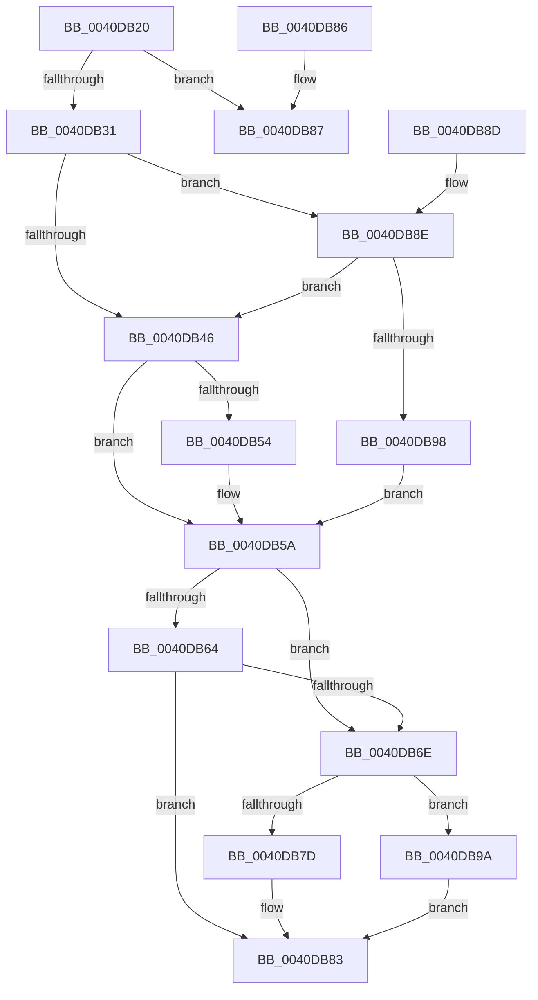

# KeQueryDpcWatchdogInformation

- RVA: `0x0040DB20`–`0x0040DBA3` (길이 `131` bytes)
- VA: `0x000000014040DB20`
- 실행 섹션: `.text`
- PDB 이름 있음: `예`; PDB Function 태그: `아니요`
- unwind 정보 RVA: `0x000DB714`
- 디코드: `41`개 명령, `131/131` bytes 표시
- 미해석 바이트: `0` (있으면 어셈블리에 `.byte`로 보존)

> 이 문서는 커널 이미지의 기계어와 PDB 기호를 분석해 생성했습니다. 4번과 5번은 함수 원형과 자료형을 바이너리 사용 방식에서 추정한 C 해석이며 원본 소스 복구 결과는 아닙니다.

## 1. Dependencies

- 직접 호출 지점: **0**; 고유 호출 대상: **0**
- 직접 호출자로 확인된 함수: **1**
- RIP 상대 이미지 참조: **0**

### Outgoing calls
- 직접 디코드된 call 명령이 없습니다.

### Direct callers
- [HalpCmcPollProcessor](../48/HalpCmcPollProcessor_function_0048772C.md) at `0x00487854`

### Static image references
- 디코드된 RIP-relative 메모리 참조가 없습니다.

## 2. Other-region calls and transfers

- 다른 실행 섹션으로 향하는 call: **0**
- 별도 외부 분기/꼬리 이동을 확인하지 못했습니다.

## 3. Assembly (complete function range)

```asm
0040DB20  65 48 8B 14 25 20 00 00 00      mov rdx, qword ptr gs:[0x20]
0040DB29  44 0F 20 C0                     mov rax, cr8
0040DB2D  3C 02                           cmp al, 2
0040DB2F  72 56                           jb 0x14040db87
0040DB31  33 C0                           xor eax, eax
0040DB33  0F 57 C0                        xorps xmm0, xmm0
0040DB36  0F 11 01                        movups xmmword ptr [rcx], xmm0
0040DB39  89 41 10                        mov dword ptr [rcx + 0x10], eax
0040DB3C  8B 82 CC 38 00 00               mov eax, dword ptr [rdx + 0x38cc]
0040DB42  85 C0                           test eax, eax
0040DB44  74 48                           je 0x14040db8e
0040DB46  89 01                           mov dword ptr [rcx], eax
0040DB48  44 8B 82 5C 86 00 00            mov r8d, dword ptr [rdx + 0x865c]
0040DB4F  41 3B C0                        cmp eax, r8d
0040DB52  76 06                           jbe 0x14040db5a
0040DB54  41 2B C0                        sub eax, r8d
0040DB57  89 41 04                        mov dword ptr [rcx + 4], eax
0040DB5A  8B 82 D8 38 00 00               mov eax, dword ptr [rdx + 0x38d8]
0040DB60  85 C0                           test eax, eax
0040DB62  75 0A                           jne 0x14040db6e
0040DB64  8B 82 A8 83 00 00               mov eax, dword ptr [rdx + 0x83a8]
0040DB6A  85 C0                           test eax, eax
0040DB6C  74 15                           je 0x14040db83
0040DB6E  89 41 08                        mov dword ptr [rcx + 8], eax
0040DB71  44 8B 82 AC 83 00 00            mov r8d, dword ptr [rdx + 0x83ac]
0040DB78  41 3B C0                        cmp eax, r8d
0040DB7B  76 1D                           jbe 0x14040db9a
0040DB7D  41 2B C0                        sub eax, r8d
0040DB80  89 41 0C                        mov dword ptr [rcx + 0xc], eax
0040DB83  33 C0                           xor eax, eax
0040DB85  C3                              ret
0040DB86  CC                              int3
0040DB87  B8 01 00 00 C0                  mov eax, 0xc0000001
0040DB8C  C3                              ret
0040DB8D  CC                              int3
0040DB8E  8B 82 60 86 00 00               mov eax, dword ptr [rdx + 0x8660]
0040DB94  85 C0                           test eax, eax
0040DB96  75 AE                           jne 0x14040db46
0040DB98  EB C0                           jmp 0x14040db5a
0040DB9A  C7 41 0C 00 00 00 00            mov dword ptr [rcx + 0xc], 0
0040DBA1  EB E0                           jmp 0x14040db83
```

## 4. C-style interpretation (structured pseudocode)

```c
__int64 __fastcall KeQueryDpcWatchdogInformation(__int64 a1)
{
    __int64 result;

    if (((unsigned __int8)(v_cr8)) < 2) goto loc_0040DB87;
    result = 0;
    *(unsigned __int64 *)(a1) = v_xmm0;
    *(unsigned int *)(a1 + 16) = 0;
    if ((unsigned int)((unsigned int)(*(unsigned int *)(*(unsigned __int64 *)(gs_base + (0 + 32)) + 14540))) == 0) goto loc_0040DB8E;
loc_0040DB46:
    *(unsigned int *)(a1) = (unsigned int)((unsigned int)(*(unsigned int *)(*(unsigned __int64 *)(gs_base + (0 + 32)) + 14540)));
    result = (unsigned int)(*(unsigned int *)(*(unsigned __int64 *)(gs_base + (0 + 32)) + 14540));
    if (((unsigned int)((unsigned int)(*(unsigned int *)(*(unsigned __int64 *)(gs_base + (0 + 32)) + 14540)))) >= = ((unsigned int)((unsigned int)(*(unsigned int *)(*(unsigned __int64 *)(gs_base + (0 + 32)) + 34396))))) {
        result = (unsigned int)(((unsigned int)(*(unsigned int *)(*(unsigned __int64 *)(gs_base + (0 + 32)) + 14540))) - ((unsigned int)((unsigned int)(*(unsigned int *)(*(unsigned __int64 *)(gs_base + (0 + 32)) + 34396)))));
        *(unsigned int *)(a1 + 4) = (unsigned int)(result);
    }
    if ((unsigned int)((unsigned int)(*(unsigned int *)(*(unsigned __int64 *)(gs_base + (0 + 32)) + 14552))) != 0) goto loc_0040DB6E;
    if ((unsigned int)((unsigned int)(*(unsigned int *)(*(unsigned __int64 *)(gs_base + (0 + 32)) + 33704))) == 0) goto loc_0040DB83;
loc_0040DB6E:
    *(unsigned int *)(a1 + 8) = (unsigned int)((unsigned int)(*(unsigned int *)(*(unsigned __int64 *)(gs_base + (0 + 32)) + 33704)));
    if (((unsigned int)((unsigned int)(*(unsigned int *)(*(unsigned __int64 *)(gs_base + (0 + 32)) + 33704)))) <= ((unsigned int)((unsigned int)(*(unsigned int *)(*(unsigned __int64 *)(gs_base + (0 + 32)) + 33708))))) goto loc_0040DB9A;
    result = (unsigned int)(((unsigned int)(*(unsigned int *)(*(unsigned __int64 *)(gs_base + (0 + 32)) + 33704))) - ((unsigned int)((unsigned int)(*(unsigned int *)(*(unsigned __int64 *)(gs_base + (0 + 32)) + 33708)))));
    *(unsigned int *)(a1 + 12) = (unsigned int)(result);
loc_0040DB83:
    result = 0;
    return result;
loc_0040DB87:
    return (unsigned int)(0xC0000001ULL);
loc_0040DB8E:
    if ((unsigned int)((unsigned int)(*(unsigned int *)(*(unsigned __int64 *)(gs_base + (0 + 32)) + 34400))) != 0) goto loc_0040DB46;
    goto loc_0040DB5A;
loc_0040DB9A:
    *(unsigned int *)(a1 + 12) = 0;
    goto loc_0040DB83;
}
```

## 5. (Beta) C Style

```c
int64_t KeQueryDpcWatchdogInformation(void *Arg1)
{
    uint8_t *arg1 = (uint8_t *)Arg1;

    int64_t result;

    if (((uint8_t)(v_cr8)) < 2) goto loc_0040DB87;
    result = 0;
    *(uint64_t *)(arg1) = v_xmm0;
    *(uint32_t *)(arg1 + 0x10) = 0;
    if ((uint32_t)((uint32_t)(*(uint32_t *)(*(uint64_t *)(gs_base + (0 + 0x20)) + 0x38CC))) == 0) goto loc_0040DB8E;
loc_0040DB46:
    *(uint32_t *)(arg1) = (uint32_t)((uint32_t)(*(uint32_t *)(*(uint64_t *)(gs_base + (0 + 0x20)) + 0x38CC)));
    result = (uint32_t)(*(uint32_t *)(*(uint64_t *)(gs_base + (0 + 0x20)) + 0x38CC));
    if (((uint32_t)((uint32_t)(*(uint32_t *)(*(uint64_t *)(gs_base + (0 + 0x20)) + 0x38CC)))) >= = ((uint32_t)((uint32_t)(*(uint32_t *)(*(uint64_t *)(gs_base + (0 + 0x20)) + 0x865C))))) {
        result = (uint32_t)(((uint32_t)(*(uint32_t *)(*(uint64_t *)(gs_base + (0 + 0x20)) + 0x38CC))) - ((uint32_t)((uint32_t)(*(uint32_t *)(*(uint64_t *)(gs_base + (0 + 0x20)) + 0x865C)))));
        *(uint32_t *)(arg1 + 0x4) = (uint32_t)(result);
    }
    if ((uint32_t)((uint32_t)(*(uint32_t *)(*(uint64_t *)(gs_base + (0 + 0x20)) + 0x38D8))) != 0) goto loc_0040DB6E;
    if ((uint32_t)((uint32_t)(*(uint32_t *)(*(uint64_t *)(gs_base + (0 + 0x20)) + 0x83A8))) == 0) goto loc_0040DB83;
loc_0040DB6E:
    *(uint32_t *)(arg1 + 0x8) = (uint32_t)((uint32_t)(*(uint32_t *)(*(uint64_t *)(gs_base + (0 + 0x20)) + 0x83A8)));
    if (((uint32_t)((uint32_t)(*(uint32_t *)(*(uint64_t *)(gs_base + (0 + 0x20)) + 0x83A8)))) <= ((uint32_t)((uint32_t)(*(uint32_t *)(*(uint64_t *)(gs_base + (0 + 0x20)) + 0x83AC))))) goto loc_0040DB9A;
    result = (uint32_t)(((uint32_t)(*(uint32_t *)(*(uint64_t *)(gs_base + (0 + 0x20)) + 0x83A8))) - ((uint32_t)((uint32_t)(*(uint32_t *)(*(uint64_t *)(gs_base + (0 + 0x20)) + 0x83AC)))));
    *(uint32_t *)(arg1 + 0xC) = (uint32_t)(result);
loc_0040DB83:
    result = 0;
    return result;
loc_0040DB87:
    return (uint32_t)(0xC0000001ULL);
loc_0040DB8E:
    if ((uint32_t)((uint32_t)(*(uint32_t *)(*(uint64_t *)(gs_base + (0 + 0x20)) + 0x8660))) != 0) goto loc_0040DB46;
    goto loc_0040DB5A;
loc_0040DB9A:
    *(uint32_t *)(arg1 + 0xC) = 0;
    goto loc_0040DB83;
}
```

### 관측된 메모리 오프셋

구조체 형식이 확인되지 않은 접근은 인자 기준의 오프셋으로만 기록했습니다.

| 기준 인자 | 오프셋 표현 | 폭 (bit) | 접근 |
|---|---:|---:|---|
| `Arg1` | `+ 0x0` | `32` | `W` |
| `Arg1` | `+ 0x0` | `128` | `R` |
| `Arg1` | `+ 0x4` | `32` | `W` |
| `Arg1` | `+ 0x8` | `32` | `W` |
| `Arg1` | `+ 0xC` | `32` | `W` |
| `Arg1` | `+ 0x10` | `32` | `W` |

## 6. Execution-region graph

[열기: 2D/3D 그래프와 함수 탐색 컨트롤 패널](../../../control-panel.html?section=text&rva=0x0040DB20&view=graph)

- 2D 그래프는 위에서 아래로 흐르고, 3D 그래프는 빈 공간을 드래그해 회전합니다. Shift+드래그는 이동, 휠은 확대·축소, 함수 노드 선택은 대상 보고서 이동입니다.

### Static fallback


