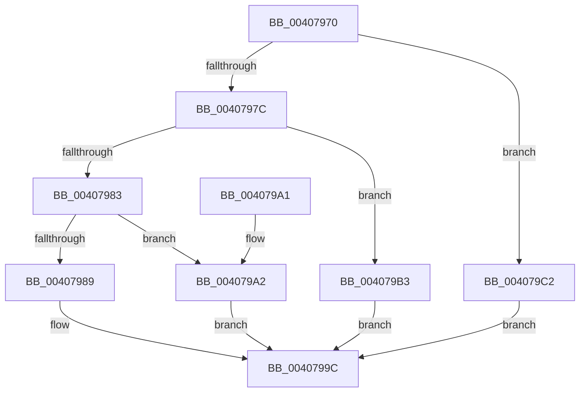

# KeSetPagePrivilege

- RVA: `0x00407970`–`0x004079C9` (길이 `89` bytes)
- VA: `0x0000000140407970`
- 실행 섹션: `.text`
- PDB 이름 있음: `예`; PDB Function 태그: `아니요`
- unwind 정보 RVA: `0x00098820`
- 디코드: `26`개 명령, `89/89` bytes 표시
- 미해석 바이트: `0` (있으면 어셈블리에 `.byte`로 보존)

> 이 문서는 커널 이미지의 기계어와 PDB 기호를 분석해 생성했습니다. 4번과 5번은 함수 원형과 자료형을 바이너리 사용 방식에서 추정한 C 해석이며 원본 소스 복구 결과는 아닙니다.

## 1. Dependencies

- 직접 호출 지점: **4**; 고유 호출 대상: **4**
- 직접 호출자로 확인된 함수: **7**
- RIP 상대 이미지 참조: **0**

### Outgoing calls
- `0x00407997` → [VslRemoveProtectedPage](VslRemoveProtectedPage_function_004079D0.md) (function, `0x004079D0`)
- `0x004079AC` → [VslMakeProtectedPageExecutable](VslMakeProtectedPageExecutable_function_00407A50.md) (function, `0x00407A50`)
- `0x004079BB` → [VslSetPrivilegedPte](VslSetPrivilegedPte_function_00407D0C.md) (function, `0x00407D0C`)
- `0x004079C2` → [VslRegisterProtectedPage](../4F/VslRegisterProtectedPage_function_004F99F4.md) (function, `0x004F99F4`)

### Direct callers
- [sub_002B1D4E](../2B/Unknown_function_002B1D4E.md) at `0x002B1F50`
- [MiMarkPfnVerified](../38/MiMarkPfnVerified_function_003833C4.md) at `0x0038350A`
- [MiAdjustSecureDriverStateForIatCapture](../4B/MiAdjustSecureDriverStateForIatCapture_function_004BE864.md) at `0x004BEA39`
- [MiLockDriverPageRange](../67/MiLockDriverPageRange_function_00670160.md) at `0x006703E5`
- [MiProtectDriverSectionPte](../67/MiProtectDriverSectionPte_function_006706C0.md) at `0x006709B8`
- [sub_006E48C2](../6E/Unknown_function_006E48C2.md) at `0x006E4955`
- [InitBootProcessor](../../init/C1/InitBootProcessor_function_00C1B1C8.md) at `0x00C1B321`

### Static image references
- 디코드된 RIP-relative 메모리 참조가 없습니다.

## 2. Other-region calls and transfers

- 다른 실행 섹션으로 향하는 call: **0**
- 별도 외부 분기/꼬리 이동을 확인하지 못했습니다.

## 3. Assembly (complete function range)

```asm
00407970  48 83 EC 28                     sub rsp, 0x28
00407974  49 8B C0                        mov rax, r8
00407977  45 84 C9                        test r9b, r9b
0040797A  78 46                           js 0x1404079c2
0040797C  41 0F BA E1 09                  bt r9d, 9
00407981  72 30                           jb 0x1404079b3
00407983  41 F6 C1 30                     test r9b, 0x30
00407987  74 19                           je 0x1404079a2
00407989  41 C1 E9 02                     shr r9d, 2
0040798D  48 8B D0                        mov rdx, rax
00407990  41 83 E1 01                     and r9d, 1
00407994  45 8B C1                        mov r8d, r9d
00407997  E8 34 00 00 00                  call 0x1404079d0
0040799C  48 83 C4 28                     add rsp, 0x28
004079A0  C3                              ret
004079A1  CC                              int3
004079A2  41 81 E1 00 04 00 00            and r9d, 0x400
004079A9  45 8B C1                        mov r8d, r9d
004079AC  E8 9F 00 00 00                  call 0x140407a50
004079B1  EB E9                           jmp 0x14040799c
004079B3  41 C1 E9 0B                     shr r9d, 0xb
004079B7  41 83 E1 01                     and r9d, 1
004079BB  E8 4C 03 00 00                  call 0x140407d0c
004079C0  EB DA                           jmp 0x14040799c
004079C2  E8 2D 20 0F 00                  call 0x1404f99f4
004079C7  EB D3                           jmp 0x14040799c
```

## 4. C-style interpretation (structured pseudocode)

```c
__int64 __fastcall KeSetPagePrivilege(__int64 a1, __int64 a2, __int64 a3, int a4)
{
    __int64 result;
    __int64 v_rsp;

    v_rsp = (v_rsp) - (40);
    if (sign_flag) goto loc_004079C2;
    if (condition_is_below) goto loc_004079B3;
    if ((((unsigned __int8)(a4)) & (48)) == 0) goto loc_004079A2;
    a4 = (unsigned int)((a4) >> (2));
    a4 = (unsigned int)((a4) & (1));
    result = VslRemoveProtectedPage(a1, a3, (unsigned int)(a4), a4);
loc_0040799C:
    v_rsp = (v_rsp) + (40);
    return result;
loc_004079A2:
    a4 = (unsigned int)((a4) & (0x400ULL));
    result = VslMakeProtectedPageExecutable(a1, a3, (unsigned int)(a4), a4);
    goto loc_0040799C;
loc_004079B3:
    a4 = (unsigned int)((a4) >> (11));
    a4 = (unsigned int)((a4) & (1));
    result = VslSetPrivilegedPte(a1, a3, (unsigned int)(a4), a4);
    goto loc_0040799C;
loc_004079C2:
    result = VslRegisterProtectedPage(a1, a3, (unsigned int)(a4), a4);
    goto loc_0040799C;
}
```

## 5. (Beta) C Style

```c
int64_t KeSetPagePrivilege(int64_t Arg1, int64_t Arg2, int64_t Arg3, int32_t Arg4)
{
    int64_t result;
    int64_t local_rsp;

    local_rsp = (local_rsp) - (40);
    if (sign_flag) goto loc_004079C2;
    if (condition_is_below) goto loc_004079B3;
    if ((((uint8_t)(Arg4)) & (48)) == 0) goto loc_004079A2;
    Arg4 = (uint32_t)((Arg4) >> (2));
    Arg4 = (uint32_t)((Arg4) & (1));
    result = VslRemoveProtectedPage(Arg1, Arg3, (uint32_t)(Arg4), Arg4);
loc_0040799C:
    local_rsp = (local_rsp) + (40);
    return result;
loc_004079A2:
    Arg4 = (uint32_t)((Arg4) & (0x400ULL));
    result = VslMakeProtectedPageExecutable(Arg1, Arg3, (uint32_t)(Arg4), Arg4);
    goto loc_0040799C;
loc_004079B3:
    Arg4 = (uint32_t)((Arg4) >> (11));
    Arg4 = (uint32_t)((Arg4) & (1));
    result = VslSetPrivilegedPte(Arg1, Arg3, (uint32_t)(Arg4), Arg4);
    goto loc_0040799C;
loc_004079C2:
    result = VslRegisterProtectedPage(Arg1, Arg3, (uint32_t)(Arg4), Arg4);
    goto loc_0040799C;
}
```

## 6. Execution-region graph

[열기: 2D/3D 그래프와 함수 탐색 컨트롤 패널](../../../control-panel.html?section=text&rva=0x00407970&view=graph)

- 2D 그래프는 위에서 아래로 흐르고, 3D 그래프는 빈 공간을 드래그해 회전합니다. Shift+드래그는 이동, 휠은 확대·축소, 함수 노드 선택은 대상 보고서 이동입니다.

### Static fallback


