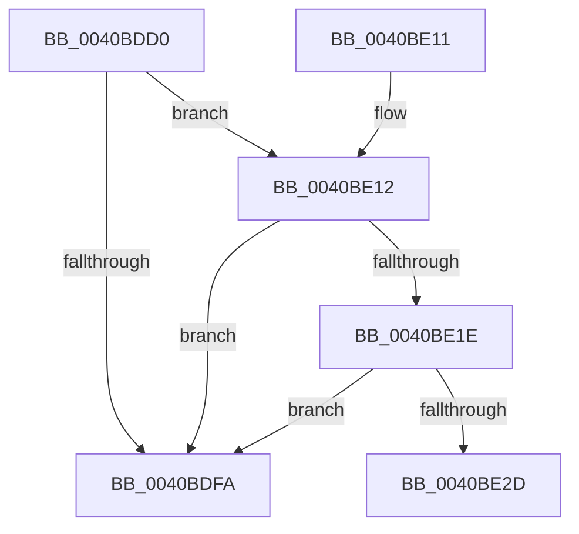

# KeVerifyContextIpForUserCet

- RVA: `0x0040BDD0`–`0x0040BE39` (길이 `105` bytes)
- VA: `0x000000014040BDD0`
- 실행 섹션: `.text`
- PDB 이름 있음: `예`; PDB Function 태그: `예`
- unwind 정보 RVA: `0x0009AFE0`
- 디코드: `28`개 명령, `105/105` bytes 표시
- 미해석 바이트: `0` (있으면 어셈블리에 `.byte`로 보존)

> 이 문서는 커널 이미지의 기계어와 PDB 기호를 분석해 생성했습니다. 4번과 5번은 함수 원형과 자료형을 바이너리 사용 방식에서 추정한 C 해석이며 원본 소스 복구 결과는 아닙니다.

## 1. Dependencies

- 직접 호출 지점: **0**; 고유 호출 대상: **0**
- 직접 호출자로 확인된 함수: **1**
- RIP 상대 이미지 참조: **0**

### Outgoing calls
- 직접 디코드된 call 명령이 없습니다.

### Direct callers
- [sub_009A6724](../../page/9A/Unknown_function_009A6724.md) at `0x009A6747`

### Static image references
- 디코드된 RIP-relative 메모리 참조가 없습니다.

## 2. Other-region calls and transfers

- 다른 실행 섹션으로 향하는 call: **0**
- 별도 외부 분기/꼬리 이동을 확인하지 못했습니다.

## 3. Assembly (complete function range)

```asm
0040BDD0  48 89 5C 24 10                  mov qword ptr [rsp + 0x10], rbx
0040BDD5  48 89 6C 24 18                  mov qword ptr [rsp + 0x18], rbp
0040BDDA  48 89 74 24 20                  mov qword ptr [rsp + 0x20], rsi
0040BDDF  57                              push rdi
0040BDE0  48 83 EC 30                     sub rsp, 0x30
0040BDE4  F7 41 74 00 00 10 00            test dword ptr [rcx + 0x74], 0x100000
0040BDEB  49 8B F0                        mov rsi, r8
0040BDEE  48 8B 99 B8 00 00 00            mov rbx, qword ptr [rcx + 0xb8]
0040BDF5  48 8B FA                        mov rdi, rdx
0040BDF8  75 18                           jne 0x14040be12
0040BDFA  33 C0                           xor eax, eax
0040BDFC  48 8B 5C 24 48                  mov rbx, qword ptr [rsp + 0x48]
0040BE01  48 8B 6C 24 50                  mov rbp, qword ptr [rsp + 0x50]
0040BE06  48 8B 74 24 58                  mov rsi, qword ptr [rsp + 0x58]
0040BE0B  48 83 C4 30                     add rsp, 0x30
0040BE0F  5F                              pop rdi
0040BE10  C3                              ret
0040BE11  CC                              int3
0040BE12  8B AB 54 07 00 00               mov ebp, dword ptr [rbx + 0x754]
0040BE18  0F BA E5 11                     bt ebp, 0x11
0040BE1C  73 DC                           jae 0x14040bdfa
0040BE1E  8B 42 30                        mov eax, dword ptr [rdx + 0x30]
0040BE21  25 01 00 10 00                  and eax, 0x100001
0040BE26  3D 01 00 10 00                  cmp eax, 0x100001
0040BE2B  75 CD                           jne 0x14040bdfa
0040BE2D  4C 89 4C 24 20                  mov qword ptr [rsp + 0x20], r9
0040BE32  C1 ED 1F                        shr ebp, 0x1f
0040BE35  44 0F B6 CD                     movzx r9d, bpl
```

## 4. C-style interpretation (structured pseudocode)

```c
__int64 __fastcall KeVerifyContextIpForUserCet(__int64 a1, __int64 a2, __int64 a3, __int64 a4)
{
    __int64 result;
    __int64 v_rbp;
    __int64 v_rsp;
    unsigned __int64 v_stack_p10;
    unsigned __int64 v_stack_p18;
    unsigned __int64 v_stack_p20;

    v_stack_p10 = v_rbx;
    v_stack_p18 = v_rbp;
    v_stack_p20 = v_rsi;
    v_rsp = (v_rsp) - (48);
    if (((*(unsigned int *)(a1 + 116)) & (0x100000ULL)) != 0) goto loc_0040BE12;
loc_0040BDFA:
    result = 0;
    v_rsp = (v_rsp) + (48);
    return result;
loc_0040BE12:
    if (condition_is_above_or_equal) goto loc_0040BDFA;
    result = (unsigned int)(((unsigned int)(*(unsigned int *)(a2 + 48))) & (0x100001ULL));
    if (((unsigned int)(result)) != 0x100001ULL) goto loc_0040BDFA;
    v_stack_p20 = a4;
    v_rbp = (unsigned int)(((unsigned int)(*(unsigned int *)(v_stack_p10 + 1876))) >> (31));
    return result;
}
```

## 5. (Beta) C Style

```c
int64_t KeVerifyContextIpForUserCet(void *Arg1, void *Arg2, int64_t Arg3, int64_t Arg4)
{
    uint8_t *arg1 = (uint8_t *)Arg1;
    uint8_t *arg2 = (uint8_t *)Arg2;

    int64_t result;
    int64_t local_rbp;
    int64_t local_rsp;
    uint64_t v_stack_p10;
    uint64_t v_stack_p18;
    uint64_t v_stack_p20;

    v_stack_p10 = local_rbx;
    v_stack_p18 = local_rbp;
    v_stack_p20 = local_rsi;
    local_rsp = (local_rsp) - (48);
    if (((*(uint32_t *)(arg1 + 0x74)) & (0x100000ULL)) != 0) goto loc_0040BE12;
loc_0040BDFA:
    result = 0;
    local_rsp = (local_rsp) + (48);
    return result;
loc_0040BE12:
    if (condition_is_above_or_equal) goto loc_0040BDFA;
    result = (uint32_t)(((uint32_t)(*(uint32_t *)(arg2 + 0x30))) & (0x100001ULL));
    if (((uint32_t)(result)) != 0x100001ULL) goto loc_0040BDFA;
    v_stack_p20 = Arg4;
    local_rbp = (uint32_t)(((uint32_t)(*(uint32_t *)(v_stack_p10 + 0x754))) >> (31));
    return result;
}
```

### 관측된 메모리 오프셋

구조체 형식이 확인되지 않은 접근은 인자 기준의 오프셋으로만 기록했습니다.

| 기준 인자 | 오프셋 표현 | 폭 (bit) | 접근 |
|---|---:|---:|---|
| `Arg1` | `+ 0x74` | `32` | `R` |
| `Arg1` | `+ 0xB8` | `64` | `R` |
| `Arg2` | `+ 0x30` | `32` | `R` |

## 6. Execution-region graph

[열기: 2D/3D 그래프와 함수 탐색 컨트롤 패널](../../../control-panel.html?section=text&rva=0x0040BDD0&view=graph)

- 2D 그래프는 위에서 아래로 흐르고, 3D 그래프는 빈 공간을 드래그해 회전합니다. Shift+드래그는 이동, 휠은 확대·축소, 함수 노드 선택은 대상 보고서 이동입니다.

### Static fallback


