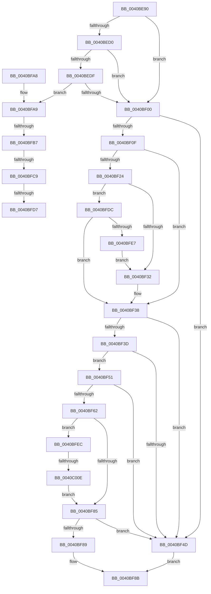

# KeVerifyContextRecord

- RVA: `0x0040BE90`–`0x0040C01F` (길이 `399` bytes)
- VA: `0x000000014040BE90`
- 실행 섹션: `.text`
- PDB 이름 있음: `예`; PDB Function 태그: `예`
- unwind 정보 RVA: `0x0009B034`
- 디코드: `99`개 명령, `399/399` bytes 표시
- 미해석 바이트: `0` (있으면 어셈블리에 `.byte`로 보존)

> 이 문서는 커널 이미지의 기계어와 PDB 기호를 분석해 생성했습니다. 4번과 5번은 함수 원형과 자료형을 바이너리 사용 방식에서 추정한 C 해석이며 원본 소스 복구 결과는 아닙니다.

## 1. Dependencies

- 직접 호출 지점: **4**; 고유 호출 대상: **4**
- 직접 호출자로 확인된 함수: **2**
- RIP 상대 이미지 참조: **0**

### Outgoing calls
- `0x0040BEF3` → [RtlGuardIsValidStackPointer](../../page/9E/RtlGuardIsValidStackPointer_function_009EB860.md) (function, `0x009EB860`)
- `0x0040BF19` → [PsWow64GetProcessMachine](../../page/8D/PsWow64GetProcessMachine_function_008D2130.md) (function, `0x008D2130`)
- `0x0040BF77` → [KiVerifyContextIpForUserCet](KiVerifyContextIpForUserCet_function_0040C028.md) (function, `0x0040C028`)
- `0x0040C013` → [KiLogUserCetSetContextIpValidationFailure](../5C/KiLogUserCetSetContextIpValidationFailure_function_005C830C.md) (function, `0x005C830C`)

### Direct callers
- [KyRaiseException](../3D/KyRaiseException_function_003D5E20.md) at `0x003D604E`
- [sub_009A6705](../../page/9A/Unknown_function_009A6705.md) at `0x009A6712`

### Static image references
- 디코드된 RIP-relative 메모리 참조가 없습니다.

## 2. Other-region calls and transfers

- 다른 실행 섹션으로 향하는 call: **2**
  - `0x0040BEF3` → [RtlGuardIsValidStackPointer](../../page/9E/RtlGuardIsValidStackPointer_function_009EB860.md) (`.text` → `PAGE`)
  - `0x0040BF19` → [PsWow64GetProcessMachine](../../page/8D/PsWow64GetProcessMachine_function_008D2130.md) (`.text` → `PAGE`)
- call이 아닌 외부 분기/꼬리 이동: **5**
  - `0x0040BFB1` → [sub_006EC920 + 0x1C](../6E/Unknown_function_006EC920.md) (`tail-transfer`)
  - `0x0040BFC3` → [sub_006EC920](../6E/Unknown_function_006EC920.md) (`tail-transfer`)
  - `0x0040BFD1` → [sub_006EC920](../6E/Unknown_function_006EC920.md) (`tail-transfer`)
  - `0x0040BFD7` → [sub_006EC920 + 0x1C](../6E/Unknown_function_006EC920.md) (`tail-transfer`)
  - `0x0040C008` → [sub_006EC920 + 0x26](../6E/Unknown_function_006EC920.md) (`tail-transfer`)

## 3. Assembly (complete function range)

```asm
0040BE90  48 89 5C 24 08                  mov qword ptr [rsp + 8], rbx
0040BE95  48 89 6C 24 10                  mov qword ptr [rsp + 0x10], rbp
0040BE9A  48 89 74 24 18                  mov qword ptr [rsp + 0x18], rsi
0040BE9F  57                              push rdi
0040BEA0  41 54                           push r12
0040BEA2  41 55                           push r13
0040BEA4  41 56                           push r14
0040BEA6  41 57                           push r15
0040BEA8  48 83 EC 30                     sub rsp, 0x30
0040BEAC  4C 8B B9 20 02 00 00            mov r15, qword ptr [rcx + 0x220]
0040BEB3  4D 8B E1                        mov r12, r9
0040BEB6  4D 8B F0                        mov r14, r8
0040BEB9  48 8B F2                        mov rsi, rdx
0040BEBC  48 8B D9                        mov rbx, rcx
0040BEBF  41 BD 4C 01 00 00               mov r13d, 0x14c
0040BEC5  41 8B 87 88 00 00 00            mov eax, dword ptr [r15 + 0x88]
0040BECC  A8 20                           test al, 0x20
0040BECE  74 30                           je 0x14040bf00
0040BED0  8B 42 30                        mov eax, dword ptr [rdx + 0x30]
0040BED3  25 01 00 10 00                  and eax, 0x100001
0040BED8  3D 01 00 10 00                  cmp eax, 0x100001
0040BEDD  75 21                           jne 0x14040bf00
0040BEDF  48 8B BA 98 00 00 00            mov rdi, qword ptr [rdx + 0x98]
0040BEE6  48 8B A9 F0 00 00 00            mov rbp, qword ptr [rcx + 0xf0]
0040BEED  48 8B CF                        mov rcx, rdi
0040BEF0  48 8B D5                        mov rdx, rbp
0040BEF3  E8 68 F9 5D 00                  call 0x1409eb860
0040BEF8  85 C0                           test eax, eax
0040BEFA  0F 84 A9 00 00 00               je 0x14040bfa9
0040BF00  8B 46 30                        mov eax, dword ptr [rsi + 0x30]
0040BF03  25 01 00 10 00                  and eax, 0x100001
0040BF08  3D 01 00 10 00                  cmp eax, 0x100001
0040BF0D  75 3E                           jne 0x14040bf4d
0040BF0F  48 8B BB 20 02 00 00            mov rdi, qword ptr [rbx + 0x220]
0040BF16  48 8B CF                        mov rcx, rdi
0040BF19  E8 12 62 4C 00                  call 0x1408d2130
0040BF1E  66 41 3B C5                     cmp ax, r13w
0040BF22  74 14                           je 0x14040bf38
0040BF24  48 83 BF 40 06 00 00 00         cmp qword ptr [rdi + 0x640], 0
0040BF2C  0F 85 AA 00 00 00               jne 0x14040bfdc
0040BF32  66 C7 46 38 33 00               mov word ptr [rsi + 0x38], 0x33
0040BF38  4D 85 F6                        test r14, r14
0040BF3B  74 10                           je 0x14040bf4d
0040BF3D  F7 43 74 00 00 10 00            test dword ptr [rbx + 0x74], 0x100000
0040BF44  48 8B BB B8 00 00 00            mov rdi, qword ptr [rbx + 0xb8]
0040BF4B  75 04                           jne 0x14040bf51
0040BF4D  33 C0                           xor eax, eax
0040BF4F  EB 3A                           jmp 0x14040bf8b
0040BF51  8B AF 54 07 00 00               mov ebp, dword ptr [rdi + 0x754]
0040BF57  0F BA E5 11                     bt ebp, 0x11
0040BF5B  0F 92 C0                        setb al
0040BF5E  A8 01                           test al, 1
0040BF60  74 EB                           je 0x14040bf4d
0040BF62  C1 ED 1F                        shr ebp, 0x1f
0040BF65  4D 8B C6                        mov r8, r14
0040BF68  44 0F B6 CD                     movzx r9d, bpl
0040BF6C  4C 89 64 24 20                  mov qword ptr [rsp + 0x20], r12
0040BF71  48 8B D6                        mov rdx, rsi
0040BF74  48 8B CB                        mov rcx, rbx
0040BF77  E8 AC 00 00 00                  call 0x14040c028
0040BF7C  8B D8                           mov ebx, eax
0040BF7E  3D 0A 06 00 C0                  cmp eax, 0xc000060a
0040BF83  74 67                           je 0x14040bfec
0040BF85  85 DB                           test ebx, ebx
0040BF87  79 C4                           jns 0x14040bf4d
0040BF89  8B C3                           mov eax, ebx
0040BF8B  48 8B 5C 24 60                  mov rbx, qword ptr [rsp + 0x60]
0040BF90  48 8B 6C 24 68                  mov rbp, qword ptr [rsp + 0x68]
0040BF95  48 8B 74 24 70                  mov rsi, qword ptr [rsp + 0x70]
0040BF9A  48 83 C4 30                     add rsp, 0x30
0040BF9E  41 5F                           pop r15
0040BFA0  41 5E                           pop r14
0040BFA2  41 5D                           pop r13
0040BFA4  41 5C                           pop r12
0040BFA6  5F                              pop rdi
0040BFA7  C3                              ret
0040BFA8  CC                              int3
0040BFA9  49 83 BF 10 03 00 00 00         cmp qword ptr [r15 + 0x310], 0
0040BFB1  0F 84 85 09 2E 00               je 0x1406ec93c
0040BFB7  41 0F B7 87 EC 06 00 00         movzx eax, word ptr [r15 + 0x6ec]
0040BFBF  66 41 3B C5                     cmp ax, r13w
0040BFC3  0F 84 57 09 2E 00               je 0x1406ec920
0040BFC9  B9 C4 01 00 00                  mov ecx, 0x1c4
0040BFCE  66 3B C1                        cmp ax, cx
0040BFD1  0F 84 49 09 2E 00               je 0x1406ec920
0040BFD7  E9 60 09 2E 00                  jmp 0x1406ec93c
0040BFDC  66 83 7E 38 23                  cmp word ptr [rsi + 0x38], 0x23
0040BFE1  0F 84 51 FF FF FF               je 0x14040bf38
0040BFE7  E9 46 FF FF FF                  jmp 0x14040bf32
0040BFEC  4C 8B 86 F8 00 00 00            mov r8, qword ptr [rsi + 0xf8]
0040BFF3  40 80 F5 01                     xor bpl, 1
0040BFF7  F7 87 54 07 00 00 00 00 04 00   test dword ptr [rdi + 0x754], 0x40000
0040C001  44 0F B6 CD                     movzx r9d, bpl
0040C005  41 8B 16                        mov edx, dword ptr [r14]
0040C008  0F 84 38 09 2E 00               je 0x1406ec946
0040C00E  B9 01 00 00 00                  mov ecx, 1
0040C013  E8 F4 C2 1B 00                  call 0x1405c830c
0040C018  33 DB                           xor ebx, ebx
0040C01A  E9 66 FF FF FF                  jmp 0x14040bf85
```

## 4. C-style interpretation (structured pseudocode)

```c
__int64 __fastcall KeVerifyContextRecord(__int64 a1, __int64 a2, __int64 a3, __int64 a4)
{
    __int64 result;
    __int64 v_rbp;
    __int64 v_rbx;
    __int64 v_rsp;
    unsigned __int64 v_stack_m38;
    unsigned __int64 v_stack_p10;
    unsigned __int64 v_stack_p18;
    unsigned __int64 v_stack_p8;

    v_stack_p8 = v_rbx;
    v_stack_p10 = v_rbp;
    v_stack_p18 = v_rsi;
    v_rsp = (v_rsp) - (48);
    if ((((unsigned __int8)((unsigned int)(*(unsigned int *)(*(unsigned __int64 *)(a1 + 544) + 136)))) & (32)) == 0) goto loc_0040BF00;
    result = (unsigned int)(((unsigned int)(*(unsigned int *)(a2 + 48))) & (0x100001ULL));
    if (((unsigned int)(result)) != 0x100001ULL) goto loc_0040BF00;
    result = RtlGuardIsValidStackPointer(*(unsigned __int64 *)(a2 + 152), *(unsigned __int64 *)(a1 + 240), a3, a4);
    if ((unsigned int)(result) == 0) goto loc_0040BFA9;
loc_0040BF00:
    result = (unsigned int)(((unsigned int)(*(unsigned int *)(a2 + 48))) & (0x100001ULL));
    if (((unsigned int)(result)) != 0x100001ULL) goto loc_0040BF4D;
    result = PsWow64GetProcessMachine(*(unsigned __int64 *)(a1 + 544), *(unsigned __int64 *)(a1 + 240), a3, a4);
    if (((unsigned __int16)(result)) == 332) goto loc_0040BF38;
    if ((*(unsigned __int64 *)(*(unsigned __int64 *)(a1 + 544) + 1600)) != 0) goto loc_0040BFDC;
loc_0040BF32:
    *(unsigned __int16 *)(a2 + 56) = 51;
loc_0040BF38:
    if (a3 == 0) goto loc_0040BF4D;
    if (((*(unsigned int *)(a1 + 116)) & (0x100000ULL)) != 0) goto loc_0040BF51;
loc_0040BF4D:
    result = 0;
    goto loc_0040BF8B;
loc_0040BF51:
    result = (condition_is_below) ? 1 : 0;
    if ((((unsigned __int8)(result)) & (1)) == 0) goto loc_0040BF4D;
    v_rbp = (unsigned int)(((unsigned int)(*(unsigned int *)(*(unsigned __int64 *)(a1 + 184) + 1876))) >> (31));
    v_stack_m38 = a4;
    result = KiVerifyContextIpForUserCet(a1, a2, a3, (unsigned __int8)(v_rbp));
    if (((unsigned int)(result)) == 0xC000060AULL) goto loc_0040BFEC;
loc_0040BF85:
    if (!sign_flag) goto loc_0040BF4D;
loc_0040BF8B:
    v_rsp = (v_rsp) + (48);
    return (unsigned int)((unsigned int)((unsigned int)((unsigned int)(result))));
loc_0040BFA9:
loc_0040BFDC:
    if ((*(unsigned __int16 *)(v_stack_p18 + 56)) == 35) goto loc_0040BF38;
    goto loc_0040BF32;
loc_0040BFEC:
    v_rbp = (unsigned __int8)((v_stack_p10) ^ (1));
    result = KiLogUserCetSetContextIpValidationFailure(1, (unsigned int)(*(unsigned int *)(a3)), *(unsigned __int64 *)(v_stack_p18 + 248), (unsigned __int8)(v_rbp));
    v_rbx = 0;
    goto loc_0040BF85;
}
```

## 5. (Beta) C Style

```c
int64_t KeVerifyContextRecord(void *Arg1, void *Arg2, int64_t Arg3, int64_t Arg4)
{
    uint8_t *arg1 = (uint8_t *)Arg1;
    uint8_t *arg2 = (uint8_t *)Arg2;

    int64_t result;
    int64_t local_rbp;
    int64_t local_rbx;
    int64_t local_rsp;
    uint64_t v_stack_m38;
    uint64_t v_stack_p10;
    uint64_t v_stack_p18;
    uint64_t v_stack_p8;

    v_stack_p8 = local_rbx;
    v_stack_p10 = local_rbp;
    v_stack_p18 = local_rsi;
    local_rsp = (local_rsp) - (48);
    if ((((uint8_t)((uint32_t)(*(uint32_t *)(*(uint64_t *)(arg1 + 0x220) + 0x88)))) & (32)) == 0) goto loc_0040BF00;
    result = (uint32_t)(((uint32_t)(*(uint32_t *)(arg2 + 0x30))) & (0x100001ULL));
    if (((uint32_t)(result)) != 0x100001ULL) goto loc_0040BF00;
    result = RtlGuardIsValidStackPointer(*(uint64_t *)(arg2 + 0x98), *(uint64_t *)(arg1 + 0xF0), Arg3, Arg4);
    if ((uint32_t)(result) == 0) goto loc_0040BFA9;
loc_0040BF00:
    result = (uint32_t)(((uint32_t)(*(uint32_t *)(arg2 + 0x30))) & (0x100001ULL));
    if (((uint32_t)(result)) != 0x100001ULL) goto loc_0040BF4D;
    result = PsWow64GetProcessMachine(*(uint64_t *)(arg1 + 0x220), *(uint64_t *)(arg1 + 0xF0), Arg3, Arg4);
    if (((uint16_t)(result)) == 332) goto loc_0040BF38;
    if ((*(uint64_t *)(*(uint64_t *)(arg1 + 0x220) + 0x640)) != 0) goto loc_0040BFDC;
loc_0040BF32:
    *(uint16_t *)(arg2 + 0x38) = 51;
loc_0040BF38:
    if (Arg3 == 0) goto loc_0040BF4D;
    if (((*(uint32_t *)(arg1 + 0x74)) & (0x100000ULL)) != 0) goto loc_0040BF51;
loc_0040BF4D:
    result = 0;
    goto loc_0040BF8B;
loc_0040BF51:
    result = (condition_is_below) ? 1 : 0;
    if ((((uint8_t)(result)) & (1)) == 0) goto loc_0040BF4D;
    local_rbp = (uint32_t)(((uint32_t)(*(uint32_t *)(*(uint64_t *)(arg1 + 0xB8) + 0x754))) >> (31));
    v_stack_m38 = Arg4;
    result = KiVerifyContextIpForUserCet(Arg1, Arg2, Arg3, (uint8_t)(local_rbp));
    if (((uint32_t)(result)) == 0xC000060AULL) goto loc_0040BFEC;
loc_0040BF85:
    if (!sign_flag) goto loc_0040BF4D;
loc_0040BF8B:
    local_rsp = (local_rsp) + (48);
    return (uint32_t)((uint32_t)((uint32_t)((uint32_t)(result))));
loc_0040BFA9:
loc_0040BFDC:
    if ((*(uint16_t *)(v_stack_p18 + 0x38)) == 35) goto loc_0040BF38;
    goto loc_0040BF32;
loc_0040BFEC:
    local_rbp = (uint8_t)((v_stack_p10) ^ (1));
    result = KiLogUserCetSetContextIpValidationFailure(1, (uint32_t)(*(uint32_t *)(Arg3)), *(uint64_t *)(v_stack_p18 + 0xF8), (uint8_t)(local_rbp));
    local_rbx = 0;
    goto loc_0040BF85;
}
```

### 관측된 메모리 오프셋

구조체 형식이 확인되지 않은 접근은 인자 기준의 오프셋으로만 기록했습니다.

| 기준 인자 | 오프셋 표현 | 폭 (bit) | 접근 |
|---|---:|---:|---|
| `Arg1` | `+ 0x74` | `32` | `R` |
| `Arg1` | `+ 0xB8` | `64` | `R` |
| `Arg1` | `+ 0xF0` | `64` | `R` |
| `Arg1` | `+ 0x220` | `64` | `R` |
| `Arg2` | `+ 0x30` | `32` | `R` |
| `Arg2` | `+ 0x38` | `16` | `R` |
| `Arg2` | `+ 0x38` | `16` | `W` |
| `Arg2` | `+ 0x98` | `64` | `R` |
| `Arg2` | `+ 0xF8` | `64` | `R` |

## 6. Execution-region graph

[열기: 2D/3D 그래프와 함수 탐색 컨트롤 패널](../../../control-panel.html?section=text&rva=0x0040BE90&view=graph)

- 2D 그래프는 위에서 아래로 흐르고, 3D 그래프는 빈 공간을 드래그해 회전합니다. Shift+드래그는 이동, 휠은 확대·축소, 함수 노드 선택은 대상 보고서 이동입니다.

### Static fallback


