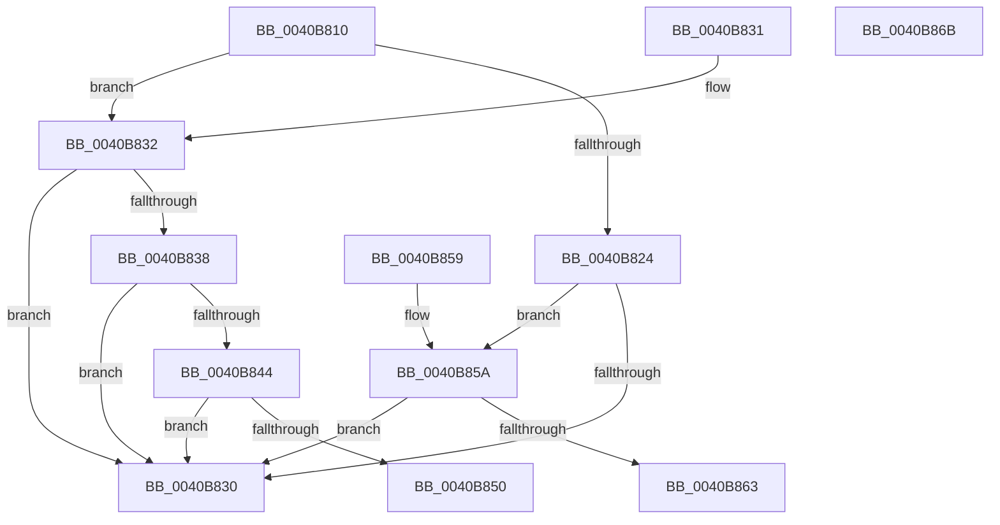

# KiCheckForSListAddress

- RVA: `0x0040B810`–`0x0040B86C` (길이 `92` bytes)
- VA: `0x000000014040B810`
- 실행 섹션: `.text`
- PDB 이름 있음: `예`; PDB Function 태그: `아니요`
- unwind 정보 RVA: `0x000DB714`
- 디코드: `25`개 명령, `92/92` bytes 표시
- 미해석 바이트: `0` (있으면 어셈블리에 `.byte`로 보존)

> 이 문서는 커널 이미지의 기계어와 PDB 기호를 분석해 생성했습니다. 4번과 5번은 함수 원형과 자료형을 바이너리 사용 방식에서 추정한 C 해석이며 원본 소스 복구 결과는 아닙니다.

## 1. Dependencies

- 직접 호출 지점: **0**; 고유 호출 대상: **0**
- 직접 호출자로 확인된 함수: **13**
- RIP 상대 이미지 참조: **4**

### Outgoing calls
- 직접 디코드된 call 명령이 없습니다.

### Direct callers
- [KiRollbackSlistPops](../4C/KiRollbackSlistPops_function_004CDDF0.md) at `0x004CDE0F`
- [KxIsrLinkage](../6B/KxIsrLinkage_function_006B5680.md) at `0x006B59CB`
- [KiHvInterrupt](../6B/KiHvInterrupt_function_006B6620.md) at `0x006B696D`
- [KiVmbusInterrupt0](../6B/KiVmbusInterrupt0_function_006B6990.md) at `0x006B6CDD`
- [KiVmbusInterrupt1](../6B/KiVmbusInterrupt1_function_006B6D00.md) at `0x006B704D`
- [KiVmbusInterrupt2](../6B/KiVmbusInterrupt2_function_006B7070.md) at `0x006B73BD`
- [KiVmbusInterrupt3](../6B/KiVmbusInterrupt3_function_006B73E0.md) at `0x006B772D`
- [KiSwInterrupt](../6B/KiSwInterrupt_function_006B8070.md) at `0x006B83BF`
- [KiIpiInterrupt](../6B/KiIpiInterrupt_function_006B8F20.md) at `0x006B926F`
- [KiNmiInterrupt](../6B/KiNmiInterrupt_function_006BD3C0.md) at `0x006BD581`
- [KiPageFault](../6C/KiPageFault_function_006C0740.md) at `0x006C0BE1`
- [KiMcheckAbort](../6C/KiMcheckAbort_function_006C16C0.md) at `0x006C1881`
- [KiVirtualizationException](../6C/KiVirtualizationException_function_006C2900.md) at `0x006C2C95`

### Static image references
- `0x0040B824` → RVA `0x00FC74C8` (`ALMOSTRO`; read)
- `0x0040B838` → RVA `0x006BA577` (`ExpInterlockedPopEntrySListResume`; read)
- `0x0040B844` → RVA `0x006BA590` (`ExpInterlockedPopEntrySListEnd`; read)
- `0x0040B85A` → RVA `0x00FC74B8` (`ALMOSTRO`; read)

## 2. Other-region calls and transfers

- 다른 실행 섹션으로 향하는 call: **0**
- 별도 외부 분기/꼬리 이동을 확인하지 못했습니다.

## 3. Assembly (complete function range)

```asm
0040B810  0F B7 81 70 01 00 00            movzx eax, word ptr [rcx + 0x170]
0040B817  48 8B 91 68 01 00 00            mov rdx, qword ptr [rcx + 0x168]
0040B81E  66 83 F8 33                     cmp ax, 0x33
0040B822  75 0E                           jne 0x14040b832
0040B824  48 8B 05 9D BC BB 00            mov rax, qword ptr [rip + 0xbbbc9d]
0040B82B  48 3B D0                        cmp rdx, rax
0040B82E  77 2A                           ja 0x14040b85a
0040B830  C3                              ret
0040B831  CC                              int3
0040B832  66 83 F8 10                     cmp ax, 0x10
0040B836  75 F8                           jne 0x14040b830
0040B838  48 8D 05 38 ED 2A 00            lea rax, [rip + 0x2aed38]
0040B83F  48 3B D0                        cmp rdx, rax
0040B842  76 EC                           jbe 0x14040b830
0040B844  48 8D 05 45 ED 2A 00            lea rax, [rip + 0x2aed45]
0040B84B  48 3B D0                        cmp rdx, rax
0040B84E  77 E0                           ja 0x14040b830
0040B850  48 81 49 30 00 00 01 00         or qword ptr [rcx + 0x30], 0x10000
0040B858  C3                              ret
0040B859  CC                              int3
0040B85A  48 3B 15 57 BC BB 00            cmp rdx, qword ptr [rip + 0xbbbc57]
0040B861  77 CD                           ja 0x14040b830
0040B863  48 89 81 68 01 00 00            mov qword ptr [rcx + 0x168], rax
0040B86A  C3                              ret
0040B86B  CC                              int3
```

## 4. C-style interpretation (structured pseudocode)

```c
__int64 __fastcall KiCheckForSListAddress(__int64 a1)
{
    if (((unsigned __int16)(*(unsigned __int16 *)(a1 + 368))) != 51) goto loc_0040B832;
    if ((*(unsigned __int64 *)(a1 + 360)) > (*(unsigned __int64 *)(v_rip + 12303517))) goto loc_0040B85A;
loc_0040B830:
    return *(unsigned __int64 *)(v_rip + 12303517);
loc_0040B832:
    if (((unsigned __int16)(*(unsigned __int64 *)(v_rip + 12303517))) != 16) goto loc_0040B830;
    if ((*(unsigned __int64 *)(a1 + 360)) <= (v_rip + 2813240)) goto loc_0040B830;
    if ((*(unsigned __int64 *)(a1 + 360)) > (v_rip + 2813253)) goto loc_0040B830;
    return v_rip + 2813253;
loc_0040B85A:
    if ((*(unsigned __int64 *)(a1 + 360)) > (*(unsigned __int64 *)(v_rip + 12303447))) goto loc_0040B830;
    *(unsigned __int64 *)(a1 + 360) = v_rip + 2813253;
    return v_rip + 2813253;
}
```

## 5. (Beta) C Style

```c
int64_t KiCheckForSListAddress(void *Arg1)
{
    uint8_t *arg1 = (uint8_t *)Arg1;

    if (((uint16_t)(*(uint16_t *)(arg1 + 0x170))) != 51) goto loc_0040B832;
    if ((*(uint64_t *)(arg1 + 0x168)) > (*(uint64_t *)(v_rip + 0xBBBC9D))) goto loc_0040B85A;
loc_0040B830:
    return *(uint64_t *)(v_rip + 0xBBBC9D);
loc_0040B832:
    if (((uint16_t)(*(uint64_t *)(v_rip + 0xBBBC9D))) != 16) goto loc_0040B830;
    if ((*(uint64_t *)(arg1 + 0x168)) <= (v_rip + 2813240)) goto loc_0040B830;
    if ((*(uint64_t *)(arg1 + 0x168)) > (v_rip + 2813253)) goto loc_0040B830;
    return v_rip + 2813253;
loc_0040B85A:
    if ((*(uint64_t *)(arg1 + 0x168)) > (*(uint64_t *)(v_rip + 0xBBBC57))) goto loc_0040B830;
    *(uint64_t *)(arg1 + 0x168) = v_rip + 2813253;
    return v_rip + 2813253;
}
```

### 관측된 메모리 오프셋

구조체 형식이 확인되지 않은 접근은 인자 기준의 오프셋으로만 기록했습니다.

| 기준 인자 | 오프셋 표현 | 폭 (bit) | 접근 |
|---|---:|---:|---|
| `Arg1` | `+ 0x30` | `64` | `R/W` |
| `Arg1` | `+ 0x168` | `64` | `R` |
| `Arg1` | `+ 0x168` | `64` | `W` |
| `Arg1` | `+ 0x170` | `16` | `R` |

## 6. Execution-region graph

[열기: 2D/3D 그래프와 함수 탐색 컨트롤 패널](../../../control-panel.html?section=text&rva=0x0040B810&view=graph)

- 2D 그래프는 위에서 아래로 흐르고, 3D 그래프는 빈 공간을 드래그해 회전합니다. Shift+드래그는 이동, 휠은 확대·축소, 함수 노드 선택은 대상 보고서 이동입니다.

### Static fallback


