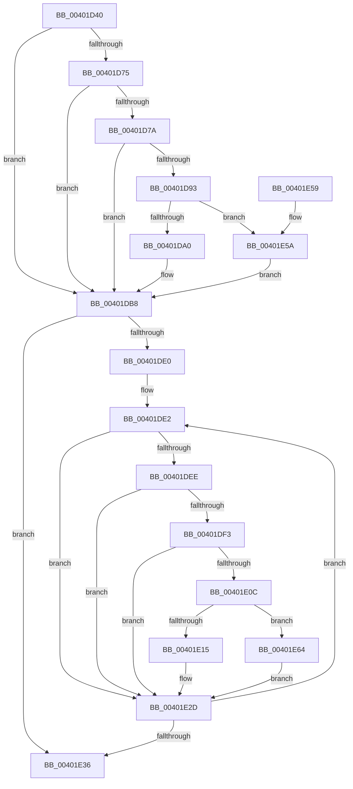

# KiFlushRangeTb

- RVA: `0x00401D40`–`0x00401E6B` (길이 `299` bytes)
- VA: `0x0000000140401D40`
- 실행 섹션: `.text`
- PDB 이름 있음: `예`; PDB Function 태그: `아니요`
- unwind 정보 RVA: `0x0009A604`
- 디코드: `73`개 명령, `299/299` bytes 표시
- 미해석 바이트: `0` (있으면 어셈블리에 `.byte`로 보존)

> 이 문서는 커널 이미지의 기계어와 PDB 기호를 분석해 생성했습니다. 4번과 5번은 함수 원형과 자료형을 바이너리 사용 방식에서 추정한 C 해석이며 원본 소스 복구 결과는 아닙니다.

## 1. Dependencies

- 직접 호출 지점: **3**; 고유 호출 대상: **2**
- 직접 호출자로 확인된 함수: **1**
- RIP 상대 이미지 참조: **2**

### Outgoing calls
- `0x00401E3E` → [_security_check_cookie](../6A/_security_check_cookie_function_006AC640.md) (function, `0x006AC640`)
- `0x00401E5A` → [KiSetUserTbFlushPending](../6B/KiSetUserTbFlushPending_function_006B20C0.md) (function, `0x006B20C0`)
- `0x00401E64` → [KiSetUserTbFlushPending](../6B/KiSetUserTbFlushPending_function_006B20C0.md) (function, `0x006B20C0`)

### Direct callers
- [sub_003127BF](../31/Unknown_function_003127BF.md) at `0x00312A27`

### Static image references
- `0x00401D52` → RVA `0x00E0A740` (`.data`; read)
- `0x00401D67` → RVA `0x00FC6A87` (`ALMOSTRO`; read)

## 2. Other-region calls and transfers

- 다른 실행 섹션으로 향하는 call: **0**
- 별도 외부 분기/꼬리 이동을 확인하지 못했습니다.

## 3. Assembly (complete function range)

```asm
00401D40  48 89 5C 24 10                  mov qword ptr [rsp + 0x10], rbx
00401D45  48 89 6C 24 18                  mov qword ptr [rsp + 0x18], rbp
00401D4A  56                              push rsi
00401D4B  57                              push rdi
00401D4C  41 56                           push r14
00401D4E  48 83 EC 50                     sub rsp, 0x50
00401D52  48 8B 05 E7 89 A0 00            mov rax, qword ptr [rip + 0xa089e7]
00401D59  48 33 C4                        xor rax, rsp
00401D5C  48 89 44 24 40                  mov qword ptr [rsp + 0x40], rax
00401D61  45 33 F6                        xor r14d, r14d
00401D64  8D 42 FF                        lea eax, [rdx - 1]
00401D67  44 38 35 19 4D BC 00            cmp byte ptr [rip + 0xbc4d19], r14b
00401D6E  8B FA                           mov edi, edx
00401D70  48 8B D9                        mov rbx, rcx
00401D73  74 43                           je 0x140401db8
00401D75  83 F8 01                        cmp eax, 1
00401D78  77 3E                           ja 0x140401db8
00401D7A  65 48 8B 04 25 88 01 00 00      mov rax, qword ptr gs:[0x188]
00401D83  48 8B 88 B8 00 00 00            mov rcx, qword ptr [rax + 0xb8]
00401D8A  44 38 B1 60 01 00 00            cmp byte ptr [rcx + 0x160], r14b
00401D91  75 25                           jne 0x140401db8
00401D93  F6 05 ED 4C BC 00 02            test byte ptr [rip + 0xbc4ced], 2
00401D9A  0F 84 BA 00 00 00               je 0x140401e5a
00401DA0  48 C7 44 24 20 01 00 00 00      mov qword ptr [rsp + 0x20], 1
00401DA9  48 89 5C 24 28                  mov qword ptr [rsp + 0x28], rbx
00401DAE  41 8B C6                        mov eax, r14d
00401DB1  66 0F 38 82 44 24 20            invpcid rax, xmmword ptr [rsp + 0x20]
00401DB8  0F 01 3B                        invlpg byte ptr [rbx]
00401DBB  48 8B CB                        mov rcx, rbx
00401DBE  BD 00 10 00 00                  mov ebp, 0x1000
00401DC3  48 C1 E9 0A                     shr rcx, 0xa
00401DC7  48 8B F3                        mov rsi, rbx
00401DCA  80 E1 03                        and cl, 3
00401DCD  0F B6 C1                        movzx eax, cl
00401DD0  C0 E0 03                        shl al, 3
00401DD3  02 C8                           add cl, al
00401DD5  48 D3 E5                        shl rbp, cl
00401DD8  81 E6 FF 03 00 00               and esi, 0x3ff
00401DDE  74 56                           je 0x140401e36
00401DE0  FF CF                           dec edi
00401DE2  48 03 DD                        add rbx, rbp
00401DE5  44 38 35 9B 4C BC 00            cmp byte ptr [rip + 0xbc4c9b], r14b
00401DEC  74 3F                           je 0x140401e2d
00401DEE  83 FF 01                        cmp edi, 1
00401DF1  77 3A                           ja 0x140401e2d
00401DF3  65 48 8B 04 25 88 01 00 00      mov rax, qword ptr gs:[0x188]
00401DFC  48 8B 88 B8 00 00 00            mov rcx, qword ptr [rax + 0xb8]
00401E03  44 38 B1 60 01 00 00            cmp byte ptr [rcx + 0x160], r14b
00401E0A  75 21                           jne 0x140401e2d
00401E0C  F6 05 74 4C BC 00 02            test byte ptr [rip + 0xbc4c74], 2
00401E13  74 4F                           je 0x140401e64
00401E15  48 C7 44 24 30 01 00 00 00      mov qword ptr [rsp + 0x30], 1
00401E1E  48 89 5C 24 38                  mov qword ptr [rsp + 0x38], rbx
00401E23  41 8B C6                        mov eax, r14d
00401E26  66 0F 38 82 44 24 30            invpcid rax, xmmword ptr [rsp + 0x30]
00401E2D  0F 01 3B                        invlpg byte ptr [rbx]
00401E30  48 83 EE 01                     sub rsi, 1
00401E34  75 AC                           jne 0x140401de2
00401E36  48 8B 4C 24 40                  mov rcx, qword ptr [rsp + 0x40]
00401E3B  48 33 CC                        xor rcx, rsp
00401E3E  E8 FD A7 2A 00                  call 0x1406ac640
00401E43  48 8B 5C 24 78                  mov rbx, qword ptr [rsp + 0x78]
00401E48  48 8B AC 24 80 00 00 00         mov rbp, qword ptr [rsp + 0x80]
00401E50  48 83 C4 50                     add rsp, 0x50
00401E54  41 5E                           pop r14
00401E56  5F                              pop rdi
00401E57  5E                              pop rsi
00401E58  C3                              ret
00401E59  CC                              int3
00401E5A  E8 61 02 2B 00                  call 0x1406b20c0
00401E5F  E9 54 FF FF FF                  jmp 0x140401db8
00401E64  E8 57 02 2B 00                  call 0x1406b20c0
00401E69  EB C2                           jmp 0x140401e2d
```

## 4. C-style interpretation (structured pseudocode)

```c
__int64 __fastcall KiFlushRangeTb(__int64 a1, __int64 a2)
{
    __int64 result;
    __int64 v_r14;
    __int64 v_rbp;
    __int64 v_rbx;
    __int64 v_rdi;
    __int64 v_rsi;
    __int64 v_rsp;
    unsigned __int64 v_stack_m28;
    unsigned __int64 v_stack_m30;
    unsigned __int64 v_stack_m38;
    unsigned __int64 v_stack_m40;
    unsigned __int64 v_stack_m48;
    unsigned __int64 v_stack_p10;
    unsigned __int64 v_stack_p18;

    v_stack_p10 = v_rbx;
    v_stack_p18 = v_rbp;
    v_rsp = (v_rsp) - (80);
    result = (*(unsigned __int64 *)(v_rip + 10521063)) ^ (v_rsp);
    v_stack_m28 = result;
    v_r14 = 0;
    if ((*(unsigned __int8 *)(v_rip + 12340505)) == 0) goto loc_00401DB8;
    if (((unsigned int)(a2 - 1)) > 1) goto loc_00401DB8;
    if ((*(unsigned __int8 *)(*(unsigned __int64 *)(*(unsigned __int64 *)(gs_base + (0 + 392)) + 184) + 352)) != 0) goto loc_00401DB8;
    if (((*(unsigned __int8 *)(v_rip + 12340461)) & (2)) == 0) goto loc_00401E5A;
    v_stack_m48 = 1;
    v_stack_m40 = a1;
loc_00401DB8:
    a1 = (a1) >> (10);
    a1 = (unsigned __int8)((a1) & (3));
    result = (unsigned __int8)(((unsigned __int8)(a1)) << (3));
    a1 = (unsigned __int8)((a1) + ((unsigned __int8)(result)));
    v_rbp = ((unsigned int)(0x1000ULL)) << ((unsigned __int8)(a1));
    v_rsi = (unsigned int)((a1) & (0x3FFULL));
    if (condition_is_equal) goto loc_00401E36;
    v_rdi = (unsigned int)(((unsigned int)((unsigned int)(a2))) - 1);
loc_00401DE2:
    v_rbx = (a1) + (v_rbp);
    if ((*(unsigned __int8 *)(v_rip + 12340379)) == 0) goto loc_00401E2D;
    if (((unsigned int)(v_rdi)) > 1) goto loc_00401E2D;
    if ((*(unsigned __int8 *)(*(unsigned __int64 *)(*(unsigned __int64 *)(gs_base + (0 + 392)) + 184) + 352)) != 0) goto loc_00401E2D;
    if (((*(unsigned __int8 *)(v_rip + 12340340)) & (2)) == 0) goto loc_00401E64;
    v_stack_m38 = 1;
    v_stack_m30 = v_rbx;
loc_00401E2D:
    v_rsi = (v_rsi) - (1);
    if (condition_is_not_equal) goto loc_00401DE2;
loc_00401E36:
    a1 = (v_stack_m28) ^ (v_rsp);
    result = _security_check_cookie(a1, a2, a3, a4);
    v_rsp = (v_rsp) + (80);
    return result;
loc_00401E5A:
    result = KiSetUserTbFlushPending(a1, a2, a3, a4);
    goto loc_00401DB8;
loc_00401E64:
    result = KiSetUserTbFlushPending(a1, a2, a3, a4);
    goto loc_00401E2D;
}
```

## 5. (Beta) C Style

```c
int64_t KiFlushRangeTb(void *Arg1, void *Arg2)
{
    uint8_t *arg1 = (uint8_t *)Arg1;
    uint8_t *arg2 = (uint8_t *)Arg2;

    int64_t result;
    int64_t local_r14;
    int64_t local_rbp;
    int64_t local_rbx;
    int64_t local_rdi;
    int64_t local_rsi;
    int64_t local_rsp;
    uint64_t v_stack_m28;
    uint64_t v_stack_m30;
    uint64_t v_stack_m38;
    uint64_t v_stack_m40;
    uint64_t v_stack_m48;
    uint64_t v_stack_p10;
    uint64_t v_stack_p18;

    v_stack_p10 = local_rbx;
    v_stack_p18 = local_rbp;
    local_rsp = (local_rsp) - (80);
    result = (*(uint64_t *)(v_rip + 0xA089E7)) ^ (local_rsp);
    v_stack_m28 = result;
    local_r14 = 0;
    if ((*(uint8_t *)(v_rip + 0xBC4D19)) == 0) goto loc_00401DB8;
    if (((uint32_t)(Arg2 - 1)) > 1) goto loc_00401DB8;
    if ((*(uint8_t *)(*(uint64_t *)(*(uint64_t *)(gs_base + (0 + 0x188)) + 0xB8) + 0x160)) != 0) goto loc_00401DB8;
    if (((*(uint8_t *)(v_rip + 0xBC4CED)) & (2)) == 0) goto loc_00401E5A;
    v_stack_m48 = 1;
    v_stack_m40 = Arg1;
loc_00401DB8:
    Arg1 = (Arg1) >> (10);
    Arg1 = (uint8_t)((Arg1) & (3));
    result = (uint8_t)(((uint8_t)(Arg1)) << (3));
    Arg1 = (uint8_t)((Arg1) + ((uint8_t)(result)));
    local_rbp = ((uint32_t)(0x1000ULL)) << ((uint8_t)(Arg1));
    local_rsi = (uint32_t)((Arg1) & (0x3FFULL));
    if (condition_is_equal) goto loc_00401E36;
    local_rdi = (uint32_t)(((uint32_t)((uint32_t)(Arg2))) - 1);
loc_00401DE2:
    local_rbx = (Arg1) + (local_rbp);
    if ((*(uint8_t *)(v_rip + 0xBC4C9B)) == 0) goto loc_00401E2D;
    if (((uint32_t)(local_rdi)) > 1) goto loc_00401E2D;
    if ((*(uint8_t *)(*(uint64_t *)(*(uint64_t *)(gs_base + (0 + 0x188)) + 0xB8) + 0x160)) != 0) goto loc_00401E2D;
    if (((*(uint8_t *)(v_rip + 0xBC4C74)) & (2)) == 0) goto loc_00401E64;
    v_stack_m38 = 1;
    v_stack_m30 = local_rbx;
loc_00401E2D:
    local_rsi = (local_rsi) - (1);
    if (condition_is_not_equal) goto loc_00401DE2;
loc_00401E36:
    Arg1 = (v_stack_m28) ^ (local_rsp);
    result = _security_check_cookie(Arg1, Arg2, a3, a4);
    local_rsp = (local_rsp) + (80);
    return result;
loc_00401E5A:
    result = KiSetUserTbFlushPending(Arg1, Arg2, a3, a4);
    goto loc_00401DB8;
loc_00401E64:
    result = KiSetUserTbFlushPending(Arg1, Arg2, a3, a4);
    goto loc_00401E2D;
}
```

### 관측된 메모리 오프셋

구조체 형식이 확인되지 않은 접근은 인자 기준의 오프셋으로만 기록했습니다.

| 기준 인자 | 오프셋 표현 | 폭 (bit) | 접근 |
|---|---:|---:|---|
| `Arg1` | `+ 0x0` | `8` | `R` |
| `Arg2` | `- 0x1` | `32` | `R` |

## 6. Execution-region graph

[열기: 2D/3D 그래프와 함수 탐색 컨트롤 패널](../../../control-panel.html?section=text&rva=0x00401D40&view=graph)

- 2D 그래프는 위에서 아래로 흐르고, 3D 그래프는 빈 공간을 드래그해 회전합니다. Shift+드래그는 이동, 휠은 확대·축소, 함수 노드 선택은 대상 보고서 이동입니다.

### Static fallback


