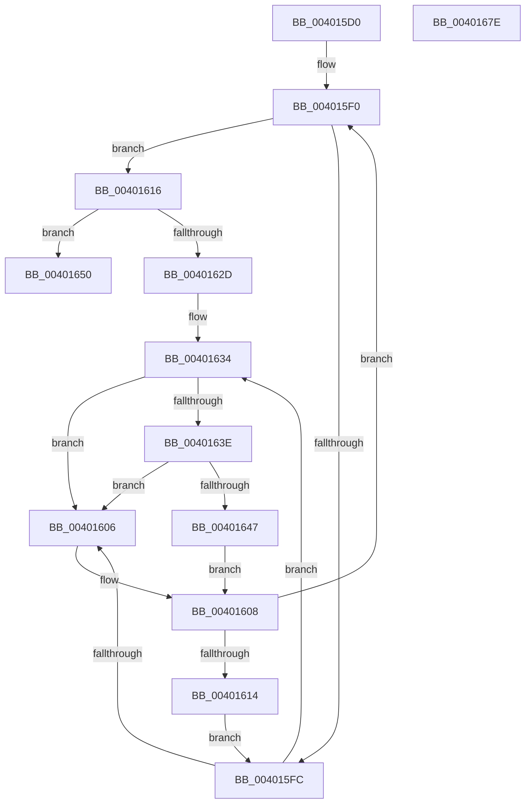

# KiInsertPrcbWaitEntry

- RVA: `0x004015D0`–`0x0040167F` (길이 `175` bytes)
- VA: `0x00000001404015D0`
- 실행 섹션: `.text`
- PDB 이름 있음: `예`; PDB Function 태그: `아니요`
- unwind 정보 RVA: `0x00060BC4`
- 디코드: `46`개 명령, `175/175` bytes 표시
- 미해석 바이트: `0` (있으면 어셈블리에 `.byte`로 보존)

> 이 문서는 커널 이미지의 기계어와 PDB 기호를 분석해 생성했습니다. 4번과 5번은 함수 원형과 자료형을 바이너리 사용 방식에서 추정한 C 해석이며 원본 소스 복구 결과는 아닙니다.

## 1. Dependencies

- 직접 호출 지점: **2**; 고유 호출 대상: **2**
- 직접 호출자로 확인된 함수: **1**
- RIP 상대 이미지 참조: **2**

### Outgoing calls
- `0x0040163E` → [KiCheckVpBackingLongSpinWaitHypercall](../30/KiCheckVpBackingLongSpinWaitHypercall_function_0030F490.md) (function, `0x0030F490`)
- `0x00401649` → [HvlNotifyLongSpinWait](../30/HvlNotifyLongSpinWait_function_0030F460.md) (function, `0x0030F460`)

### Direct callers
- [KiCommitThreadWait](../20/KiCommitThreadWait_function_0020DFE0.md) at `0x0020E2F9`

### Static image references
- `0x004015FE` → RVA `0x00FC52AC` (`ALMOSTRO`; reference)
- `0x00401634` → RVA `0x00FC6AB8` (`ALMOSTRO`; read)

## 2. Other-region calls and transfers

- 다른 실행 섹션으로 향하는 call: **0**
- 별도 외부 분기/꼬리 이동을 확인하지 못했습니다.

## 3. Assembly (complete function range)

```asm
004015D0  48 89 5C 24 08                  mov qword ptr [rsp + 8], rbx
004015D5  48 89 74 24 10                  mov qword ptr [rsp + 0x10], rsi
004015DA  57                              push rdi
004015DB  48 83 EC 20                     sub rsp, 0x20
004015DF  48 8B DA                        mov rbx, rdx
004015E2  48 8B F1                        mov rsi, rcx
004015E5  33 FF                           xor edi, edi
004015E7  66 0F 1F 84 00 00 00 00 00      nop word ptr [rax + rax]
004015F0  F0 48 0F BA AB D0 83 00 00 00   lock bts qword ptr [rbx + 0x83d0], 0
004015FA  73 1A                           jae 0x140401616
004015FC  FF C7                           inc edi
004015FE  85 3D A8 3C BC 00               test dword ptr [rip + 0xbc3ca8], edi
00401604  74 2E                           je 0x140401634
00401606  F3 90                           pause
00401608  48 8B 83 D0 83 00 00            mov rax, qword ptr [rbx + 0x83d0]
0040160F  48 85 C0                        test rax, rax
00401612  74 DC                           je 0x1404015f0
00401614  EB E6                           jmp 0x1404015fc
00401616  48 8D 83 C0 83 00 00            lea rax, [rbx + 0x83c0]
0040161D  48 8B 48 08                     mov rcx, qword ptr [rax + 8]
00401621  48 8D 96 D8 00 00 00            lea rdx, [rsi + 0xd8]
00401628  48 39 01                        cmp qword ptr [rcx], rax
0040162B  74 23                           je 0x140401650
0040162D  B9 03 00 00 00                  mov ecx, 3
00401632  CD 29                           int 0x29
00401634  8B 05 7E 54 BC 00               mov eax, dword ptr [rip + 0xbc547e]
0040163A  A8 40                           test al, 0x40
0040163C  74 C8                           je 0x140401606
0040163E  E8 4D DE F0 FF                  call 0x14030f490
00401643  84 C0                           test al, al
00401645  74 BF                           je 0x140401606
00401647  8B CF                           mov ecx, edi
00401649  E8 12 DE F0 FF                  call 0x14030f460
0040164E  EB B8                           jmp 0x140401608
00401650  48 89 02                        mov qword ptr [rdx], rax
00401653  48 89 4A 08                     mov qword ptr [rdx + 8], rcx
00401657  48 89 11                        mov qword ptr [rcx], rdx
0040165A  48 89 50 08                     mov qword ptr [rax + 8], rdx
0040165E  48 89 9E C8 02 00 00            mov qword ptr [rsi + 0x2c8], rbx
00401665  F0 48 83 A3 D0 83 00 00 00      lock and qword ptr [rbx + 0x83d0], 0
0040166E  48 8B 5C 24 30                  mov rbx, qword ptr [rsp + 0x30]
00401673  48 8B 74 24 38                  mov rsi, qword ptr [rsp + 0x38]
00401678  48 83 C4 20                     add rsp, 0x20
0040167C  5F                              pop rdi
0040167D  C3                              ret
0040167E  CC                              int3
```

## 4. C-style interpretation (structured pseudocode)

```c
__int64 __fastcall KiInsertPrcbWaitEntry(__int64 a1, __int64 a2)
{
    __int64 result;
    __int64 v_rdi;
    __int64 v_rsp;
    unsigned __int64 v_stack_p10;
    unsigned __int64 v_stack_p8;

    v_stack_p8 = v_rbx;
    v_stack_p10 = v_rsi;
    v_rsp = (v_rsp) - (32);
    v_rdi = 0;
loc_004015F0:
    if (condition_is_above_or_equal) goto loc_00401616;
loc_004015FC:
    v_rdi = (unsigned int)((v_rdi) + 1);
    if (((*(unsigned int *)(v_rip + 12336296)) & ((unsigned int)(v_rdi))) == 0) goto loc_00401634;
loc_00401606:
loc_00401608:
    if (*(unsigned __int64 *)(a2 + 33744) == 0) goto loc_004015F0;
    goto loc_004015FC;
loc_00401616:
    if ((*(unsigned __int64 *)(*(unsigned __int64 *)(a2 + 33728 + 8))) == (a2 + 33728)) goto loc_00401650;
loc_00401634:
    if ((((unsigned __int8)((unsigned int)(*(unsigned int *)(v_rip + 12342398)))) & (64)) == 0) goto loc_00401606;
    result = KiCheckVpBackingLongSpinWaitHypercall(3, a1 + 216, a3, a4);
    if ((unsigned __int8)(result) == 0) goto loc_00401606;
    result = HvlNotifyLongSpinWait((unsigned int)((unsigned int)(v_rdi)), a1 + 216, a3, a4);
    goto loc_00401608;
loc_00401650:
    *(unsigned __int64 *)(a1 + 216) = result;
    *(unsigned __int64 *)(a1 + 216 + 8) = (unsigned int)((unsigned int)(v_rdi));
    *(unsigned __int64 *)((unsigned int)((unsigned int)(v_rdi))) = a1 + 216;
    *(unsigned __int64 *)(result + 8) = a1 + 216;
    *(unsigned __int64 *)(a1 + 712) = a2;
    v_rsp = (v_rsp) + (32);
    return result;
}
```

## 5. (Beta) C Style

```c
int64_t KiInsertPrcbWaitEntry(void *Arg1, void *Arg2)
{
    uint8_t *arg1 = (uint8_t *)Arg1;
    uint8_t *arg2 = (uint8_t *)Arg2;

    int64_t result;
    int64_t local_rdi;
    int64_t local_rsp;
    uint64_t v_stack_p10;
    uint64_t v_stack_p8;

    v_stack_p8 = local_rbx;
    v_stack_p10 = local_rsi;
    local_rsp = (local_rsp) - (32);
    local_rdi = 0;
loc_004015F0:
    if (condition_is_above_or_equal) goto loc_00401616;
loc_004015FC:
    local_rdi = (uint32_t)((local_rdi) + 1);
    if (((*(uint32_t *)(v_rip + 0xBC3CA8)) & ((uint32_t)(local_rdi))) == 0) goto loc_00401634;
loc_00401606:
loc_00401608:
    if (*(uint64_t *)(arg2 + 0x83D0) == 0) goto loc_004015F0;
    goto loc_004015FC;
loc_00401616:
    if ((*(uint64_t *)(*(uint64_t *)(arg2 + 0x83C0 + 0x8))) == (Arg2 + 33728)) goto loc_00401650;
loc_00401634:
    if ((((uint8_t)((uint32_t)(*(uint32_t *)(v_rip + 0xBC547E)))) & (64)) == 0) goto loc_00401606;
    result = KiCheckVpBackingLongSpinWaitHypercall(3, Arg1 + 216, a3, a4);
    if ((uint8_t)(result) == 0) goto loc_00401606;
    result = HvlNotifyLongSpinWait((uint32_t)((uint32_t)(local_rdi)), Arg1 + 216, a3, a4);
    goto loc_00401608;
loc_00401650:
    *(uint64_t *)(arg1 + 0xD8) = result;
    *(uint64_t *)(arg1 + 0xD8 + 0x8) = (uint32_t)((uint32_t)(local_rdi));
    *(void **)((uint32_t)((uint32_t)(local_rdi))) = Arg1 + 216;
    *(void **)(result + 0x8) = Arg1 + 216;
    *(void **)(arg1 + 0x2C8) = Arg2;
    local_rsp = (local_rsp) + (32);
    return result;
}
```

### 관측된 메모리 오프셋

구조체 형식이 확인되지 않은 접근은 인자 기준의 오프셋으로만 기록했습니다.

| 기준 인자 | 오프셋 표현 | 폭 (bit) | 접근 |
|---|---:|---:|---|
| `Arg1` | `+ 0x0` | `64` | `W` |
| `Arg1` | `+ 0x8` | `64` | `W` |
| `Arg1` | `+ 0xD8` | `64` | `R` |
| `Arg1` | `+ 0x2C8` | `64` | `W` |
| `Arg2` | `+ 0x8` | `64` | `R` |
| `Arg2` | `+ 0x8` | `64` | `W` |
| `Arg2` | `+ 0x83C0` | `64` | `R` |
| `Arg2` | `+ 0x83D0` | `64` | `R` |
| `Arg2` | `+ 0x83D0` | `64` | `R/W` |

## 6. Execution-region graph

[열기: 2D/3D 그래프와 함수 탐색 컨트롤 패널](../../../control-panel.html?section=text&rva=0x004015D0&view=graph)

- 2D 그래프는 위에서 아래로 흐르고, 3D 그래프는 빈 공간을 드래그해 회전합니다. Shift+드래그는 이동, 휠은 확대·축소, 함수 노드 선택은 대상 보고서 이동입니다.

### Static fallback


