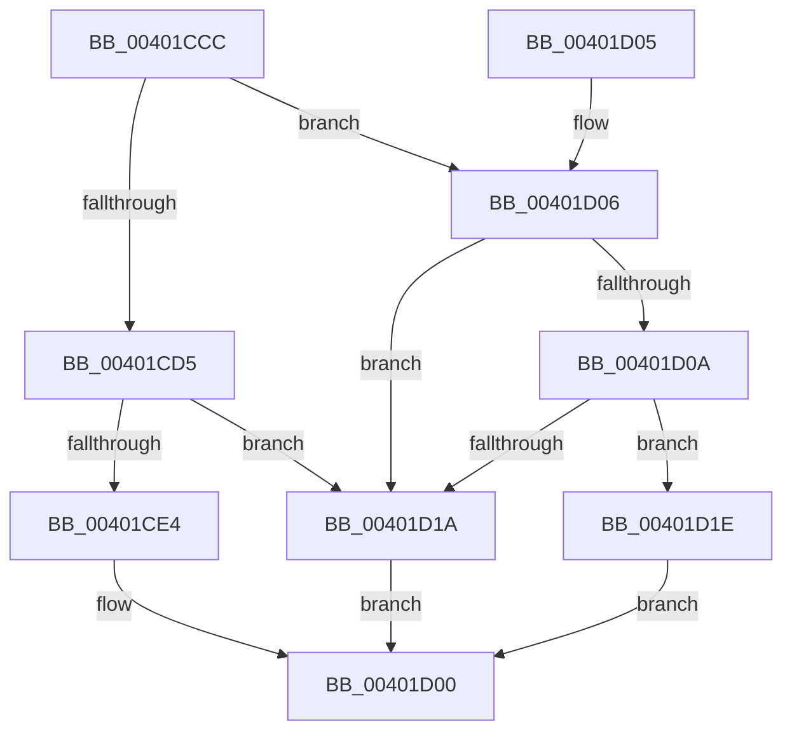

# KiIsSecureFlushRequired

- RVA: `0x00401CCC`–`0x00401D2D` (길이 `97` bytes)
- VA: `0x0000000140401CCC`
- 실행 섹션: `.text`
- PDB 이름 있음: `예`; PDB Function 태그: `아니요`
- unwind 정보 RVA: `0x00098820`
- 디코드: `26`개 명령, `97/97` bytes 표시
- 미해석 바이트: `0` (있으면 어셈블리에 `.byte`로 보존)

> 이 문서는 커널 이미지의 기계어와 PDB 기호를 분석해 생성했습니다. 4번과 5번은 함수 원형과 자료형을 바이너리 사용 방식에서 추정한 C 해석이며 원본 소스 복구 결과는 아닙니다.

## 1. Dependencies

- 직접 호출 지점: **1**; 고유 호출 대상: **1**
- 직접 호출자로 확인된 함수: **2**
- RIP 상대 이미지 참조: **0**

### Outgoing calls
- `0x00401D20` → [VslGetNestedPageProtectionFlags](../2F/VslGetNestedPageProtectionFlags_function_002F2164.md) (function, `0x002F2164`)

### Direct callers
- [KeFlushSingleCurrentTb](../5B/KeFlushSingleCurrentTb_function_005BDC9C.md) at `0x005BDCD7`
- [KeFlushSingleTb](../5B/KeFlushSingleTb_function_005BDE84.md) at `0x005BDF4F`

### Static image references
- 디코드된 RIP-relative 메모리 참조가 없습니다.

## 2. Other-region calls and transfers

- 다른 실행 섹션으로 향하는 call: **0**
- 별도 외부 분기/꼬리 이동을 확인하지 못했습니다.

## 3. Assembly (complete function range)

```asm
00401CCC  48 83 EC 28                     sub rsp, 0x28
00401CD0  83 FA 01                        cmp edx, 1
00401CD3  75 31                           jne 0x140401d06
00401CD5  48 B8 FF FF FE FF FF 7F 00 00   movabs rax, 0x7ffffffeffff
00401CDF  48 3B C8                        cmp rcx, rax
00401CE2  77 36                           ja 0x140401d1a
00401CE4  65 48 8B 04 25 88 01 00 00      mov rax, qword ptr gs:[0x188]
00401CED  48 8B 88 B8 00 00 00            mov rcx, qword ptr [rax + 0xb8]
00401CF4  33 C0                           xor eax, eax
00401CF6  48 39 81 70 01 00 00            cmp qword ptr [rcx + 0x170], rax
00401CFD  0F 95 C0                        setne al
00401D00  48 83 C4 28                     add rsp, 0x28
00401D04  C3                              ret
00401D05  CC                              int3
00401D06  85 D2                           test edx, edx
00401D08  75 10                           jne 0x140401d1a
00401D0A  41 81 E0 09 00 00 80            and r8d, 0x80000009
00401D11  41 81 F8 01 00 00 80            cmp r8d, 0x80000001
00401D18  74 04                           je 0x140401d1e
00401D1A  33 C0                           xor eax, eax
00401D1C  EB E2                           jmp 0x140401d00
00401D1E  33 C9                           xor ecx, ecx
00401D20  E8 3F 04 EF FF                  call 0x1402f2164
00401D25  C1 E8 0D                        shr eax, 0xd
00401D28  83 E0 02                        and eax, 2
00401D2B  EB D3                           jmp 0x140401d00
```

## 4. C-style interpretation (structured pseudocode)

```c
__int64 __fastcall KiIsSecureFlushRequired(__int64 a1, int a2, int a3)
{
    __int64 result;
    __int64 v_rsp;

    v_rsp = (v_rsp) - (40);
    if (a2 != 1) goto loc_00401D06;
    if (a1 > result) goto loc_00401D1A;
    result = 0;
    result = ((*(unsigned __int64 *)(*(unsigned __int64 *)(*(unsigned __int64 *)(gs_base + (0 + 392)) + 184) + 368)) != 0) ? 1 : 0;
loc_00401D00:
    v_rsp = (v_rsp) + (40);
    return result;
loc_00401D06:
    if (a2 != 0) goto loc_00401D1A;
    a3 = (unsigned int)((a3) & (0x80000009ULL));
    if (a3 == 0x80000001ULL) goto loc_00401D1E;
loc_00401D1A:
    result = 0;
    goto loc_00401D00;
loc_00401D1E:
    a1 = 0;
    result = VslGetNestedPageProtectionFlags(a1, a2, a3, a4);
    result = (unsigned int)((result) >> (13));
    result = (unsigned int)((result) & (2));
    goto loc_00401D00;
}
```

## 5. (Beta) C Style

```c
int64_t KiIsSecureFlushRequired(int64_t Arg1, int32_t Arg2, int32_t Arg3)
{
    int64_t result;
    int64_t local_rsp;

    local_rsp = (local_rsp) - (40);
    if (Arg2 != 1) goto loc_00401D06;
    if (Arg1 > result) goto loc_00401D1A;
    result = 0;
    result = ((*(uint64_t *)(*(uint64_t *)(*(uint64_t *)(gs_base + (0 + 0x188)) + 0xB8) + 0x170)) != 0) ? 1 : 0;
loc_00401D00:
    local_rsp = (local_rsp) + (40);
    return result;
loc_00401D06:
    if (Arg2 != 0) goto loc_00401D1A;
    Arg3 = (uint32_t)((Arg3) & (0x80000009ULL));
    if (Arg3 == 0x80000001ULL) goto loc_00401D1E;
loc_00401D1A:
    result = 0;
    goto loc_00401D00;
loc_00401D1E:
    Arg1 = 0;
    result = VslGetNestedPageProtectionFlags(Arg1, Arg2, Arg3, a4);
    result = (uint32_t)((result) >> (13));
    result = (uint32_t)((result) & (2));
    goto loc_00401D00;
}
```

## 6. Execution-region graph

[열기: 2D/3D 그래프와 함수 탐색 컨트롤 패널](../../../control-panel.html?section=text&rva=0x00401CCC&view=graph)

- 2D 그래프는 위에서 아래로 흐르고, 3D 그래프는 빈 공간을 드래그해 회전합니다. Shift+드래그는 이동, 휠은 확대·축소, 함수 노드 선택은 대상 보고서 이동입니다.

### Static fallback


