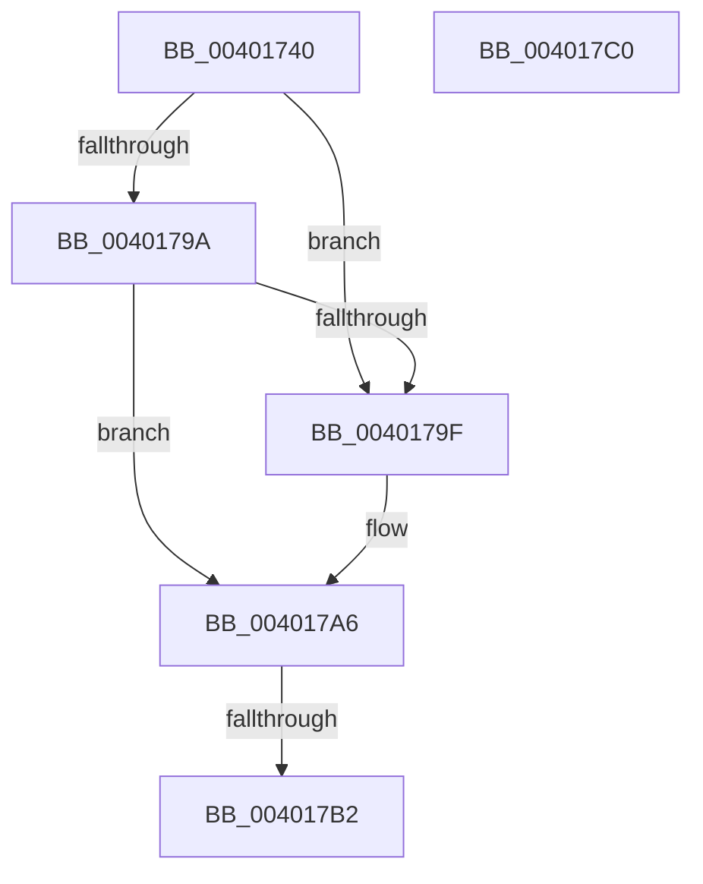

# KiRemoveEntryTimer

- RVA: `0x00401740`–`0x004017C1` (길이 `129` bytes)
- VA: `0x0000000140401740`
- 실행 섹션: `.text`
- PDB 이름 있음: `예`; PDB Function 태그: `아니요`
- unwind 정보 RVA: `0x0009A444`
- 디코드: `43`개 명령, `129/129` bytes 표시
- 미해석 바이트: `0` (있으면 어셈블리에 `.byte`로 보존)

> 이 문서는 커널 이미지의 기계어와 PDB 기호를 분석해 생성했습니다. 4번과 5번은 함수 원형과 자료형을 바이너리 사용 방식에서 추정한 C 해석이며 원본 소스 복구 결과는 아닙니다.

## 1. Dependencies

- 직접 호출 지점: **0**; 고유 호출 대상: **0**
- 직접 호출자로 확인된 함수: **2**
- RIP 상대 이미지 참조: **0**

### Outgoing calls
- 직접 디코드된 call 명령이 없습니다.

### Direct callers
- [KiInsertTimerTable](../23/KiInsertTimerTable_function_00233400.md) at `0x002337B3`
- [KiAdjustTimerDueTimes](../4E/KiAdjustTimerDueTimes_function_004E8CD4.md) at `0x004E8D85`

### Static image references
- 디코드된 RIP-relative 메모리 참조가 없습니다.

## 2. Other-region calls and transfers

- 다른 실행 섹션으로 향하는 call: **0**
- call이 아닌 외부 분기/꼬리 이동: **1**
  - `0x004017B0` → [sub_004017C1](Unknown_function_004017C1.md) (`tail-transfer`)

## 3. Assembly (complete function range)

```asm
00401740  44 89 44 24 18                  mov dword ptr [rsp + 0x18], r8d
00401745  55                              push rbp
00401746  41 54                           push r12
00401748  41 55                           push r13
0040174A  41 56                           push r14
0040174C  41 57                           push r15
0040174E  48 83 EC 20                     sub rsp, 0x20
00401752  44 0F B7 52 3A                  movzx r10d, word ptr [rdx + 0x3a]
00401757  4C 8B F9                        mov r15, rcx
0040175A  48 8B 4A 20                     mov rcx, qword ptr [rdx + 0x20]
0040175E  48 83 C2 20                     add rdx, 0x20
00401762  41 8B E8                        mov ebp, r8d
00401765  41 8B C2                        mov eax, r10d
00401768  48 C1 E0 08                     shl rax, 8
0040176C  4D 8B E9                        mov r13, r9
0040176F  4C 8D 75 10                     lea r14, [rbp + 0x10]
00401773  4C 03 F0                        add r14, rax
00401776  4C 8D 65 10                     lea r12, [rbp + 0x10]
0040177A  41 8B C2                        mov eax, r10d
0040177D  49 C1 E6 05                     shl r14, 5
00401781  48 83 F0 01                     xor rax, 1
00401785  48 C1 E0 08                     shl rax, 8
00401789  4C 03 E0                        add r12, rax
0040178C  48 8B 42 08                     mov rax, qword ptr [rdx + 8]
00401790  49 C1 E4 05                     shl r12, 5
00401794  48 39 51 08                     cmp qword ptr [rcx + 8], rdx
00401798  75 05                           jne 0x14040179f
0040179A  48 39 10                        cmp qword ptr [rax], rdx
0040179D  74 07                           je 0x1404017a6
0040179F  B9 03 00 00 00                  mov ecx, 3
004017A4  CD 29                           int 0x29
004017A6  48 89 08                        mov qword ptr [rax], rcx
004017A9  48 89 41 08                     mov qword ptr [rcx + 8], rax
004017AD  48 3B C1                        cmp rax, rcx
004017B0  74 0F                           je 0x1404017c1
004017B2  48 83 C4 20                     add rsp, 0x20
004017B6  41 5F                           pop r15
004017B8  41 5E                           pop r14
004017BA  41 5D                           pop r13
004017BC  41 5C                           pop r12
004017BE  5D                              pop rbp
004017BF  C3                              ret
004017C0  CC                              int3
```

## 4. C-style interpretation (structured pseudocode)

```c
__int64 __fastcall KiRemoveEntryTimer(__int64 a1, __int64 a2, int a3, __int64 a4)
{
    __int64 result;
    __int64 v_r12;
    __int64 v_r14;
    __int64 v_rsp;
    unsigned int v_stack_p18;

    v_stack_p18 = a3;
    v_rsp = (v_rsp) - (32);
    a2 = (a2) + (32);
    result = ((unsigned int)((unsigned int)(*(unsigned __int16 *)(a2 + 58)))) << (8);
    v_r14 = ((unsigned int)(a3) + 16) + (result);
    v_r14 = (v_r14) << (5);
    result = ((unsigned int)((unsigned int)(*(unsigned __int16 *)(a2 + 58)))) ^ (1);
    result = (result) << (8);
    v_r12 = ((unsigned int)(a3) + 16) + (result);
    v_r12 = (v_r12) << (5);
    if ((*(unsigned __int64 *)(*(unsigned __int64 *)(a2 + 32) + 8)) != a2) goto loc_0040179F;
    if ((*(unsigned __int64 *)(*(unsigned __int64 *)(a2 + 8))) != a2) {
        a1 = 3;
    }
    *(unsigned __int64 *)(*(unsigned __int64 *)(a2 + 8)) = a1;
    *(unsigned __int64 *)(a1 + 8) = *(unsigned __int64 *)(a2 + 8);
    v_rsp = (v_rsp) + (32);
    return *(unsigned __int64 *)(a2 + 8);
}
```

## 5. (Beta) C Style

```c
int64_t KiRemoveEntryTimer(int64_t Arg1, void *Arg2, void *Arg3, int64_t Arg4)
{
    uint8_t *arg2 = (uint8_t *)Arg2;
    uint8_t *arg3 = (uint8_t *)Arg3;

    int64_t result;
    int64_t local_r12;
    int64_t local_r14;
    int64_t local_rsp;
    uint32_t v_stack_p18;

    v_stack_p18 = Arg3;
    local_rsp = (local_rsp) - (32);
    Arg2 = (Arg2) + (32);
    result = ((uint32_t)((uint32_t)(*(uint16_t *)(arg2 + 0x3A)))) << (8);
    local_r14 = ((uint32_t)(Arg3) + 16) + (result);
    local_r14 = (local_r14) << (5);
    result = ((uint32_t)((uint32_t)(*(uint16_t *)(arg2 + 0x3A)))) ^ (1);
    result = (result) << (8);
    local_r12 = ((uint32_t)(Arg3) + 16) + (result);
    local_r12 = (local_r12) << (5);
    if ((*(uint64_t *)(*(uint64_t *)(arg2 + 0x20) + 0x8)) != Arg2) goto loc_0040179F;
    if ((*(uint64_t *)(*(uint64_t *)(arg2 + 0x8))) != Arg2) {
        Arg1 = 3;
    }
    *(uint64_t *)(*(uint64_t *)(arg2 + 0x8)) = Arg1;
    *(uint64_t *)(Arg1 + 0x8) = *(uint64_t *)(arg2 + 0x8);
    local_rsp = (local_rsp) + (32);
    return *(uint64_t *)(arg2 + 0x8);
}
```

### 관측된 메모리 오프셋

구조체 형식이 확인되지 않은 접근은 인자 기준의 오프셋으로만 기록했습니다.

| 기준 인자 | 오프셋 표현 | 폭 (bit) | 접근 |
|---|---:|---:|---|
| `Arg2` | `+ 0x8` | `64` | `R` |
| `Arg2` | `+ 0x20` | `64` | `R` |
| `Arg2` | `+ 0x3A` | `16` | `R` |
| `Arg3` | `+ 0x10` | `64` | `R` |

## 6. Execution-region graph

[열기: 2D/3D 그래프와 함수 탐색 컨트롤 패널](../../../control-panel.html?section=text&rva=0x00401740&view=graph)

- 2D 그래프는 위에서 아래로 흐르고, 3D 그래프는 빈 공간을 드래그해 회전합니다. Shift+드래그는 이동, 휠은 확대·축소, 함수 노드 선택은 대상 보고서 이동입니다.

### Static fallback


