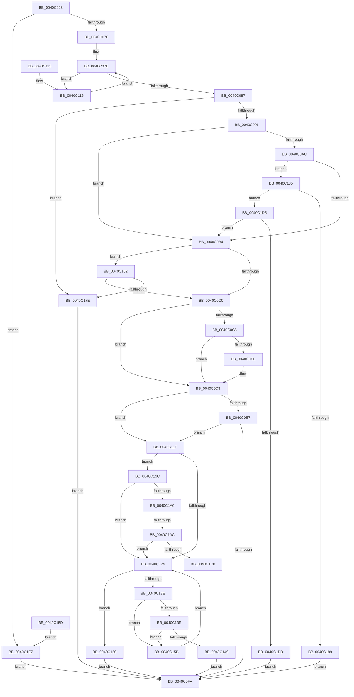

# KiVerifyContextIpForUserCet

- RVA: `0x0040C028`–`0x0040C1F1` (길이 `457` bytes)
- VA: `0x000000014040C028`
- 실행 섹션: `.text`
- PDB 이름 있음: `예`; PDB Function 태그: `예`
- unwind 정보 RVA: `0x0009B064`
- 디코드: `121`개 명령, `457/457` bytes 표시
- 미해석 바이트: `0` (있으면 어셈블리에 `.byte`로 보존)

> 이 문서는 커널 이미지의 기계어와 PDB 기호를 분석해 생성했습니다. 4번과 5번은 함수 원형과 자료형을 바이너리 사용 방식에서 추정한 C 해석이며 원본 소스 복구 결과는 아닙니다.

## 1. Dependencies

- 직접 호출 지점: **3**; 고유 호출 대상: **2**
- 직접 호출자로 확인된 함수: **3**
- RIP 상대 이미지 참조: **1**

### Outgoing calls
- `0x0040C0F1` → [RtlVerifyUserUnwindTarget](../../page/A1/RtlVerifyUserUnwindTarget_function_00A1FDB8.md) (function, `0x00A1FDB8`)
- `0x0040C192` → [RtlVerifyUserUnwindTarget](../../page/A1/RtlVerifyUserUnwindTarget_function_00A1FDB8.md) (function, `0x00A1FDB8`)
- `0x0040C1B9` → [RtlGetImageBaseAndLoadConfig](../46/RtlGetImageBaseAndLoadConfig_function_0046C3A4.md) (function, `0x0046C3A4`)

### Direct callers
- [KiContinuePreviousModeUser](../2F/KiContinuePreviousModeUser_function_002F9B10.md) at `0x002F9EA9`
- [sub_0040BE39](Unknown_function_0040BE39.md) at `0x0040BE3E`
- [KeVerifyContextRecord](KeVerifyContextRecord_function_0040BE90.md) at `0x0040BF77`

### Static image references
- `0x0040C0C5` → RVA `0x00FC7480` (`ALMOSTRO`; read)

## 2. Other-region calls and transfers

- 다른 실행 섹션으로 향하는 call: **2**
  - `0x0040C0F1` → [RtlVerifyUserUnwindTarget](../../page/A1/RtlVerifyUserUnwindTarget_function_00A1FDB8.md) (`.text` → `PAGE`)
  - `0x0040C192` → [RtlVerifyUserUnwindTarget](../../page/A1/RtlVerifyUserUnwindTarget_function_00A1FDB8.md) (`.text` → `PAGE`)
- call이 아닌 외부 분기/꼬리 이동: **2**
  - `0x0040C1A6` → [sub_006EC956](../6E/Unknown_function_006EC956.md) (`tail-transfer`)
  - `0x0040C1D0` → [sub_006EC956](../6E/Unknown_function_006EC956.md) (`tail-transfer`)

## 3. Assembly (complete function range)

```asm
0040C028  48 89 5C 24 08                  mov qword ptr [rsp + 8], rbx
0040C02D  48 89 74 24 18                  mov qword ptr [rsp + 0x18], rsi
0040C032  48 89 7C 24 20                  mov qword ptr [rsp + 0x20], rdi
0040C037  41 54                           push r12
0040C039  41 56                           push r14
0040C03B  41 57                           push r15
0040C03D  48 83 EC 50                     sub rsp, 0x50
0040C041  45 8A E1                        mov r12b, r9b
0040C044  49 8B F0                        mov rsi, r8
0040C047  4C 8B F1                        mov r14, rcx
0040C04A  48 8B BA F8 00 00 00            mov rdi, qword ptr [rdx + 0xf8]
0040C051  48 89 7C 24 20                  mov qword ptr [rsp + 0x20], rdi
0040C056  48 8D 87 00 00 FF FF            lea rax, [rdi - 0x10000]
0040C05D  48 B9 FF FF FD FF FF 7F 00 00   movabs rcx, 0x7ffffffdffff
0040C067  48 3B C1                        cmp rax, rcx
0040C06A  0F 87 77 01 00 00               ja 0x14040c1e7
0040C070  4C 89 74 24 28                  mov qword ptr [rsp + 0x28], r14
0040C075  49 8B 4E 28                     mov rcx, qword ptr [r14 + 0x28]
0040C079  BB 01 00 00 00                  mov ebx, 1
0040C07E  84 59 08                        test byte ptr [rcx + 8], bl
0040C081  0F 85 8F 00 00 00               jne 0x14040c116
0040C087  48 3B 79 D8                     cmp rdi, qword ptr [rcx - 0x28]
0040C08B  0F 84 ED 00 00 00               je 0x14040c17e
0040C091  4C 8B BC 24 90 00 00 00         mov r15, qword ptr [rsp + 0x90]
0040C099  49 8B 07                        mov rax, qword ptr [r15]
0040C09C  48 89 44 24 78                  mov qword ptr [rsp + 0x78], rax
0040C0A1  45 8B 00                        mov r8d, dword ptr [r8]
0040C0A4  41 8B C8                        mov ecx, r8d
0040C0A7  45 85 C0                        test r8d, r8d
0040C0AA  74 08                           je 0x14040c0b4
0040C0AC  2B CB                           sub ecx, ebx
0040C0AE  0F 85 D1 00 00 00               jne 0x14040c185
0040C0B4  48 83 7C 24 78 00               cmp qword ptr [rsp + 0x78], 0
0040C0BA  0F 84 A2 00 00 00               je 0x14040c162
0040C0C0  45 85 C0                        test r8d, r8d
0040C0C3  75 0E                           jne 0x14040c0d3
0040C0C5  48 3B 3D B4 B3 BB 00            cmp rdi, qword ptr [rip + 0xbbb3b4]
0040C0CC  75 05                           jne 0x14040c0d3
0040C0CE  89 1E                           mov dword ptr [rsi], ebx
0040C0D0  44 8B C3                        mov r8d, ebx
0040C0D3  0F 57 C0                        xorps xmm0, xmm0
0040C0D6  33 C0                           xor eax, eax
0040C0D8  0F 11 44 24 30                  movups xmmword ptr [rsp + 0x30], xmm0
0040C0DD  48 89 44 24 40                  mov qword ptr [rsp + 0x40], rax
0040C0E2  45 85 C0                        test r8d, r8d
0040C0E5  75 38                           jne 0x14040c11f
0040C0E7  4C 8D 44 24 30                  lea r8, [rsp + 0x30]
0040C0EC  33 D2                           xor edx, edx
0040C0EE  48 8B CF                        mov rcx, rdi
0040C0F1  E8 C2 3C 61 00                  call 0x140a1fdb8
0040C0F6  85 C0                           test eax, eax
0040C0F8  78 25                           js 0x14040c11f
0040C0FA  4C 8D 5C 24 50                  lea r11, [rsp + 0x50]
0040C0FF  49 8B 5B 20                     mov rbx, qword ptr [r11 + 0x20]
0040C103  49 8B 73 30                     mov rsi, qword ptr [r11 + 0x30]
0040C107  49 8B 7B 38                     mov rdi, qword ptr [r11 + 0x38]
0040C10B  49 8B E3                        mov rsp, r11
0040C10E  41 5F                           pop r15
0040C110  41 5E                           pop r14
0040C112  41 5C                           pop r12
0040C114  C3                              ret
0040C115  CC                              int3
0040C116  48 8B 49 28                     mov rcx, qword ptr [rcx + 0x28]
0040C11A  E9 5F FF FF FF                  jmp 0x14040c07e
0040C11F  45 84 E4                        test r12b, r12b
0040C122  75 78                           jne 0x14040c19c
0040C124  48 8B 44 24 78                  mov rax, qword ptr [rsp + 0x78]
0040C129  48 39 38                        cmp qword ptr [rax], rdi
0040C12C  74 22                           je 0x14040c150
0040C12E  48 83 C0 08                     add rax, 8
0040C132  48 89 44 24 78                  mov qword ptr [rsp + 0x78], rax
0040C137  A9 FF 0F 00 00                  test eax, 0xfff
0040C13C  75 1D                           jne 0x14040c15b
0040C13E  41 8B 86 A0 05 00 00            mov eax, dword ptr [r14 + 0x5a0]
0040C145  84 C3                           test bl, al
0040C147  74 12                           je 0x14040c15b
0040C149  B8 4B 00 00 C0                  mov eax, 0xc000004b
0040C14E  EB AA                           jmp 0x14040c0fa
0040C150  48 83 C0 08                     add rax, 8
0040C154  49 89 07                        mov qword ptr [r15], rax
0040C157  33 C0                           xor eax, eax
0040C159  EB 9F                           jmp 0x14040c0fa
0040C15B  EB C7                           jmp 0x14040c124
0040C15D  E9 85 00 00 00                  jmp 0x14040c1e7
0040C162  B9 A7 06 00 00                  mov ecx, 0x6a7
0040C167  0F 32                           rdmsr
0040C169  48 C1 E2 20                     shl rdx, 0x20
0040C16D  48 0B C2                        or rax, rdx
0040C170  48 89 44 24 78                  mov qword ptr [rsp + 0x78], rax
0040C175  48 85 C0                        test rax, rax
0040C178  0F 85 42 FF FF FF               jne 0x14040c0c0
0040C17E  33 C0                           xor eax, eax
0040C180  E9 75 FF FF FF                  jmp 0x14040c0fa
0040C185  2B CB                           sub ecx, ebx
0040C187  75 4C                           jne 0x14040c1d5
0040C189  45 33 C0                        xor r8d, r8d
0040C18C  8D 51 02                        lea edx, [rcx + 2]
0040C18F  48 8B CF                        mov rcx, rdi
0040C192  E8 21 3C 61 00                  call 0x140a1fdb8
0040C197  E9 5E FF FF FF                  jmp 0x14040c0fa
0040C19C  39 1E                           cmp dword ptr [rsi], ebx
0040C19E  74 84                           je 0x14040c124
0040C1A0  8A 4C 24 40                     mov cl, byte ptr [rsp + 0x40]
0040C1A4  84 C9                           test cl, cl
0040C1A6  0F 85 AA 07 2E 00               jne 0x1406ec956
0040C1AC  4C 8D 44 24 38                  lea r8, [rsp + 0x38]
0040C1B1  48 8D 54 24 30                  lea rdx, [rsp + 0x30]
0040C1B6  48 8B CF                        mov rcx, rdi
0040C1B9  E8 E6 01 06 00                  call 0x14046c3a4
0040C1BE  0F B6 4C 24 40                  movzx ecx, byte ptr [rsp + 0x40]
0040C1C3  85 C0                           test eax, eax
0040C1C5  0F 49 CB                        cmovns ecx, ebx
0040C1C8  84 C9                           test cl, cl
0040C1CA  0F 84 54 FF FF FF               je 0x14040c124
0040C1D0  E9 81 07 2E 00                  jmp 0x1406ec956
0040C1D5  3B CB                           cmp ecx, ebx
0040C1D7  0F 84 D7 FE FF FF               je 0x14040c0b4
0040C1DD  B8 0D 00 00 C0                  mov eax, 0xc000000d
0040C1E2  E9 13 FF FF FF                  jmp 0x14040c0fa
0040C1E7  B8 0A 06 00 C0                  mov eax, 0xc000060a
0040C1EC  E9 09 FF FF FF                  jmp 0x14040c0fa
```

## 4. C-style interpretation (structured pseudocode)

```c
__int64 __fastcall KiVerifyContextIpForUserCet(__int64 a1, __int64 a2, __int64 a3, unsigned __int8 a4, __int64 a5)
{
    __int64 result;
    __int64 v_rsp;
    unsigned __int8 v_stack_m10;
    unsigned __int64 v_stack_m18;
    unsigned __int64 v_stack_m20;
    unsigned __int64 v_stack_m28;
    unsigned __int64 v_stack_m38;
    unsigned __int64 v_stack_m40;
    unsigned __int64 v_stack_m48;
    unsigned __int64 v_stack_p10;
    unsigned __int64 v_stack_p18;
    unsigned __int64 v_stack_p20;
    unsigned __int64 v_stack_p28;
    unsigned __int64 v_stack_p8;

    v_stack_p8 = v_rbx;
    v_stack_p18 = v_rsi;
    v_stack_p20 = v_rdi;
    v_rsp = (v_rsp) - (80);
    v_stack_m48 = *(unsigned __int64 *)(a2 + 248);
    if ((*(unsigned __int64 *)(a2 + 248) - 65536) > a1) goto loc_0040C1E7;
    v_stack_m40 = a1;
loc_0040C07E:
    if (((*(unsigned __int8 *)(*(unsigned __int64 *)(a1 + 40) + 8)) & (1)) != 0) goto loc_0040C116;
    if ((*(unsigned __int64 *)(a2 + 248)) == (*(unsigned __int64 *)(*(unsigned __int64 *)(a1 + 40) - 40))) goto loc_0040C17E;
    v_stack_p10 = *(unsigned __int64 *)(a5);
    if ((unsigned int)((unsigned int)(*(unsigned int *)(a3))) == 0) goto loc_0040C0B4;
    a1 = (unsigned int)(((unsigned int)((unsigned int)((unsigned int)(*(unsigned int *)(a3))))) - (1));
    if (condition_is_not_equal) goto loc_0040C185;
loc_0040C0B4:
    if (v_stack_p10 == 0) goto loc_0040C162;
loc_0040C0C0:
    if ((unsigned int)((unsigned int)(*(unsigned int *)(a3))) != 0) goto loc_0040C0D3;
    if ((*(unsigned __int64 *)(a2 + 248)) == (*(unsigned __int64 *)(v_rip + 12301236))) {
        *(unsigned int *)(a3) = 1;
        a3 = 1;
    }
    result = 0;
    v_stack_m38 = v_xmm0;
    v_stack_m28 = 0;
    if ((unsigned int)(a3) != 0) goto loc_0040C11F;
    a2 = 0;
    result = RtlVerifyUserUnwindTarget(*(unsigned __int64 *)(a2 + 248), a2, v_stack_m38, a4);
    if (sign_flag) goto loc_0040C11F;
loc_0040C0FA:
    return result;
loc_0040C116:
    goto loc_0040C07E;
loc_0040C11F:
    if (a4 != 0) goto loc_0040C19C;
loc_0040C124:
    if ((*(unsigned __int64 *)(v_stack_p28)) == (*(unsigned __int64 *)(v_stack_m18 + 56))) goto loc_0040C150;
    result = (v_stack_p28) + (8);
    v_stack_p28 = result;
    if ((((unsigned int)(result)) & (0xFFFULL)) != 0) goto loc_0040C15B;
    if ((((unsigned __int8)(*(unsigned __int64 *)(v_stack_m18 + 32))) & ((unsigned __int8)((unsigned int)(*(unsigned int *)(a1 + 1440))))) == 0) goto loc_0040C15B;
    goto loc_0040C0FA;
loc_0040C150:
    result = ((unsigned int)(0xC000004BULL)) + (8);
    *(unsigned __int64 *)(a5) = result;
    result = 0;
    goto loc_0040C0FA;
loc_0040C15B:
    goto loc_0040C124;
loc_0040C162:
    a2 = (a2) << (32);
    result = (result) | (a2);
    v_stack_p28 = result;
    if (result != 0) goto loc_0040C0C0;
loc_0040C17E:
    result = 0;
    goto loc_0040C0FA;
loc_0040C185:
    a1 = (unsigned int)(((unsigned int)(0x6A7ULL)) - ((unsigned int)(*(unsigned __int64 *)(v_stack_m18 + 32))));
    if (condition_is_not_equal) goto loc_0040C1D5;
    a3 = 0;
    result = RtlVerifyUserUnwindTarget(*(unsigned __int64 *)(v_stack_m18 + 56), a1 + 2, a3, a4);
    goto loc_0040C0FA;
loc_0040C19C:
    if ((*(unsigned int *)(*(unsigned __int64 *)(v_stack_m18 + 48))) == ((unsigned int)(*(unsigned __int64 *)(v_stack_m18 + 32)))) goto loc_0040C124;
    result = RtlGetImageBaseAndLoadConfig(*(unsigned __int64 *)(v_stack_m18 + 56), v_stack_m20, v_stack_m18, a4);
    a1 = v_stack_m10;
    if (!sign_flag) { a1 = (unsigned int)(*(unsigned __int64 *)(v_stack_m18 + 32)); }
    if ((unsigned __int8)(a1) == 0) goto loc_0040C124;
loc_0040C1D5:
    if (((unsigned int)(a1)) == ((unsigned int)(*(unsigned __int64 *)(v_stack_m18 + 32)))) goto loc_0040C0B4;
    goto loc_0040C0FA;
loc_0040C1E7:
    goto loc_0040C0FA;
}
```

## 5. (Beta) C Style

```c
int64_t KiVerifyContextIpForUserCet(void *Arg1, void *Arg2, void *Arg3, uint8_t Arg4, void *Arg5)
{
    uint8_t *arg1 = (uint8_t *)Arg1;
    uint8_t *arg2 = (uint8_t *)Arg2;
    uint8_t *arg3 = (uint8_t *)Arg3;
    uint8_t *arg5 = (uint8_t *)Arg5;

    int64_t result;
    int64_t local_rsp;
    uint8_t v_stack_m10;
    uint64_t v_stack_m18;
    uint64_t v_stack_m20;
    uint64_t v_stack_m28;
    uint64_t v_stack_m38;
    uint64_t v_stack_m40;
    uint64_t v_stack_m48;
    uint64_t v_stack_p10;
    uint64_t v_stack_p18;
    uint64_t v_stack_p20;
    uint64_t v_stack_p28;
    uint64_t v_stack_p8;

    v_stack_p8 = local_rbx;
    v_stack_p18 = local_rsi;
    v_stack_p20 = local_rdi;
    local_rsp = (local_rsp) - (80);
    v_stack_m48 = *(uint64_t *)(arg2 + 0xF8);
    if ((*(uint64_t *)(arg2 + 0xF8) - 65536) > Arg1) goto loc_0040C1E7;
    v_stack_m40 = Arg1;
loc_0040C07E:
    if (((*(uint8_t *)(*(uint64_t *)(arg1 + 0x28) + 0x8)) & (1)) != 0) goto loc_0040C116;
    if ((*(uint64_t *)(arg2 + 0xF8)) == (*(uint64_t *)(*(uint64_t *)(arg1 + 0x28) - 0x28))) goto loc_0040C17E;
    v_stack_p10 = *(uint64_t *)(arg5);
    if ((uint32_t)((uint32_t)(*(uint32_t *)(arg3))) == 0) goto loc_0040C0B4;
    Arg1 = (uint32_t)(((uint32_t)((uint32_t)((uint32_t)(*(uint32_t *)(arg3))))) - (1));
    if (condition_is_not_equal) goto loc_0040C185;
loc_0040C0B4:
    if (v_stack_p10 == 0) goto loc_0040C162;
loc_0040C0C0:
    if ((uint32_t)((uint32_t)(*(uint32_t *)(arg3))) != 0) goto loc_0040C0D3;
    if ((*(uint64_t *)(arg2 + 0xF8)) == (*(uint64_t *)(v_rip + 0xBBB3B4))) {
        *(uint32_t *)(arg3) = 1;
        Arg3 = 1;
    }
    result = 0;
    v_stack_m38 = v_xmm0;
    v_stack_m28 = 0;
    if ((uint32_t)(Arg3) != 0) goto loc_0040C11F;
    Arg2 = 0;
    result = RtlVerifyUserUnwindTarget(*(uint64_t *)(arg2 + 0xF8), Arg2, v_stack_m38, Arg4);
    if (sign_flag) goto loc_0040C11F;
loc_0040C0FA:
    return result;
loc_0040C116:
    goto loc_0040C07E;
loc_0040C11F:
    if (Arg4 != 0) goto loc_0040C19C;
loc_0040C124:
    if ((*(uint64_t *)(v_stack_p28)) == (*(uint64_t *)(v_stack_m18 + 0x38))) goto loc_0040C150;
    result = (v_stack_p28) + (8);
    v_stack_p28 = result;
    if ((((uint32_t)(result)) & (0xFFFULL)) != 0) goto loc_0040C15B;
    if ((((uint8_t)(*(uint64_t *)(v_stack_m18 + 0x20))) & ((uint8_t)((uint32_t)(*(uint32_t *)(arg1 + 0x5A0))))) == 0) goto loc_0040C15B;
    goto loc_0040C0FA;
loc_0040C150:
    result = ((uint32_t)(0xC000004BULL)) + (8);
    *(uint64_t *)(arg5) = result;
    result = 0;
    goto loc_0040C0FA;
loc_0040C15B:
    goto loc_0040C124;
loc_0040C162:
    Arg2 = (Arg2) << (32);
    result = (result) | (Arg2);
    v_stack_p28 = result;
    if (result != 0) goto loc_0040C0C0;
loc_0040C17E:
    result = 0;
    goto loc_0040C0FA;
loc_0040C185:
    Arg1 = (uint32_t)(((uint32_t)(0x6A7ULL)) - ((uint32_t)(*(uint64_t *)(v_stack_m18 + 0x20))));
    if (condition_is_not_equal) goto loc_0040C1D5;
    Arg3 = 0;
    result = RtlVerifyUserUnwindTarget(*(uint64_t *)(v_stack_m18 + 0x38), Arg1 + 2, Arg3, Arg4);
    goto loc_0040C0FA;
loc_0040C19C:
    if ((*(uint32_t *)(*(uint64_t *)(v_stack_m18 + 0x30))) == ((uint32_t)(*(uint64_t *)(v_stack_m18 + 0x20)))) goto loc_0040C124;
    result = RtlGetImageBaseAndLoadConfig(*(uint64_t *)(v_stack_m18 + 0x38), v_stack_m20, v_stack_m18, Arg4);
    Arg1 = v_stack_m10;
    if (!sign_flag) { Arg1 = (uint32_t)(*(uint64_t *)(v_stack_m18 + 0x20)); }
    if ((uint8_t)(Arg1) == 0) goto loc_0040C124;
loc_0040C1D5:
    if (((uint32_t)(Arg1)) == ((uint32_t)(*(uint64_t *)(v_stack_m18 + 0x20)))) goto loc_0040C0B4;
    goto loc_0040C0FA;
loc_0040C1E7:
    goto loc_0040C0FA;
}
```

### 관측된 메모리 오프셋

구조체 형식이 확인되지 않은 접근은 인자 기준의 오프셋으로만 기록했습니다.

| 기준 인자 | 오프셋 표현 | 폭 (bit) | 접근 |
|---|---:|---:|---|
| `Arg1` | `+ 0x28` | `64` | `R` |
| `Arg1` | `+ 0x5A0` | `32` | `R` |
| `Arg2` | `+ 0xF8` | `64` | `R` |
| `Arg3` | `+ 0x0` | `32` | `R` |
| `Arg3` | `+ 0x0` | `32` | `W` |
| `Arg5` | `+ 0x0` | `64` | `R` |
| `Arg5` | `+ 0x0` | `64` | `W` |

## 6. Execution-region graph

[열기: 2D/3D 그래프와 함수 탐색 컨트롤 패널](../../../control-panel.html?section=text&rva=0x0040C028&view=graph)

- 2D 그래프는 위에서 아래로 흐르고, 3D 그래프는 빈 공간을 드래그해 회전합니다. Shift+드래그는 이동, 휠은 확대·축소, 함수 노드 선택은 대상 보고서 이동입니다.

### Static fallback


