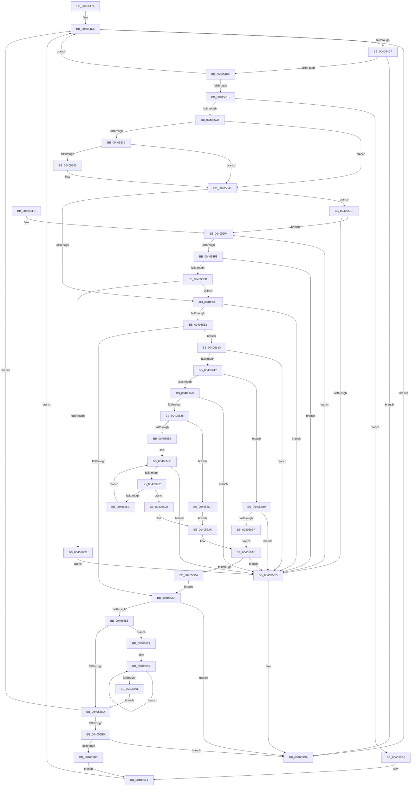

# MiAddToReservationCluster

- RVA: `0x00405474`–`0x004056FE` (길이 `650` bytes)
- VA: `0x0000000140405474`
- 실행 섹션: `.text`
- PDB 이름 있음: `예`; PDB Function 태그: `아니요`
- unwind 정보 RVA: `0x0009A804`
- 디코드: `184`개 명령, `650/650` bytes 표시
- 미해석 바이트: `0` (있으면 어셈블리에 `.byte`로 보존)

> 이 문서는 커널 이미지의 기계어와 PDB 기호를 분석해 생성했습니다. 4번과 5번은 함수 원형과 자료형을 바이너리 사용 방식에서 추정한 C 해석이며 원본 소스 복구 결과는 아닙니다.

## 1. Dependencies

- 직접 호출 지점: **6**; 고유 호출 대상: **4**
- 직접 호출자로 확인된 함수: **1**
- RIP 상대 이미지 참조: **2**

### Outgoing calls
- `0x00405507` → [MiSafeLockPage](../32/MiSafeLockPage_function_00321620.md) (function, `0x00321620`)
- `0x0040556F` → [MiReferencePageForModifiedWrite](MiReferencePageForModifiedWrite_function_00405DAC.md) (function, `0x00405DAC`)
- `0x0040557C` → [MiUnlockPage](../31/MiUnlockPage_function_0031A3E0.md) (function, `0x0031A3E0`)
- `0x004055C4` → [MI_IS_PTE_IN_WS_SWAP_SET](../38/MI_IS_PTE_IN_WS_SWAP_SET_function_00385DD8.md) (function, `0x00385DD8`)
- `0x004055D3` → [MiUnlockPage](../31/MiUnlockPage_function_0031A3E0.md) (function, `0x0031A3E0`)
- `0x004056EC` → [MiUnlockPage](../31/MiUnlockPage_function_0031A3E0.md) (function, `0x0031A3E0`)

### Direct callers
- [MiBuildReservationCluster](MiBuildReservationCluster_function_004071A0.md) at `0x004076DE`

### Static image references
- `0x00405528` → RVA `0x00E2DC80` (`.data`; read)
- `0x00405682` → RVA `0x00E37478` (`.data`; read)

## 2. Other-region calls and transfers

- 다른 실행 섹션으로 향하는 call: **0**
- 별도 외부 분기/꼬리 이동을 확인하지 못했습니다.

## 3. Assembly (complete function range)

```asm
00405474  48 89 5C 24 20                  mov qword ptr [rsp + 0x20], rbx
00405479  44 89 44 24 18                  mov dword ptr [rsp + 0x18], r8d
0040547E  48 89 54 24 10                  mov qword ptr [rsp + 0x10], rdx
00405483  55                              push rbp
00405484  56                              push rsi
00405485  57                              push rdi
00405486  41 54                           push r12
00405488  41 55                           push r13
0040548A  41 56                           push r14
0040548C  41 57                           push r15
0040548E  48 83 EC 30                     sub rsp, 0x30
00405492  0F B7 81 AC 00 00 00            movzx eax, word ptr [rcx + 0xac]
00405499  41 8B E9                        mov ebp, r9d
0040549C  48 8B 91 D8 00 00 00            mov rdx, qword ptr [rcx + 0xd8]
004054A3  83 E0 0F                        and eax, 0xf
004054A6  4C 8B A4 24 90 00 00 00         mov r12, qword ptr [rsp + 0x90]
004054AE  48 83 C0 30                     add rax, 0x30
004054B2  48 6B D8 58                     imul rbx, rax, 0x58
004054B6  48 89 54 24 20                  mov qword ptr [rsp + 0x20], rdx
004054BB  48 03 DA                        add rbx, rdx
004054BE  48 89 5C 24 70                  mov qword ptr [rsp + 0x70], rbx
004054C3  45 33 F6                        xor r14d, r14d
004054C6  45 3B F0                        cmp r14d, r8d
004054C9  0F 84 09 01 00 00               je 0x1404055d8
004054CF  4C 8B 6B 10                     mov r13, qword ptr [rbx + 0x10]
004054D3  48 B8 FF FF FF FF 3F 00 00 00   movabs rax, 0x3fffffffff
004054DD  4C 3B E8                        cmp r13, rax
004054E0  0F 84 F2 00 00 00               je 0x1404055d8
004054E6  4A 8D 34 6D 00 00 00 00         lea rsi, [r13*2]
004054EE  49 03 F5                        add rsi, r13
004054F1  48 C1 E6 04                     shl rsi, 4
004054F5  48 B8 00 00 00 00 00 DE FF FF   movabs rax, 0xffffde0000000000
004054FF  49 8B CD                        mov rcx, r13
00405502  48 03 F0                        add rsi, rax
00405505  33 FF                           xor edi, edi
00405507  E8 14 C1 F1 FF                  call 0x140321620
0040550C  44 8B 84 24 80 00 00 00         mov r8d, dword ptr [rsp + 0x80]
00405514  44 8A F8                        mov r15b, al
00405517  3C 11                           cmp al, 0x11
00405519  74 AB                           je 0x1404054c6
0040551B  48 8B 43 10                     mov rax, qword ptr [rbx + 0x10]
0040551F  4C 3B E8                        cmp r13, rax
00405522  0F 85 BE 01 00 00               jne 0x1404056e6
00405528  48 8B 05 51 87 A2 00            mov rax, qword ptr [rip + 0xa28751]
0040552F  48 8D 56 10                     lea rdx, [rsi + 0x10]
00405533  48 8B 1A                        mov rbx, qword ptr [rdx]
00405536  48 85 C0                        test rax, rax
00405539  74 0B                           je 0x140405546
0040553B  F6 C3 10                        test bl, 0x10
0040553E  75 06                           jne 0x140405546
00405540  48 F7 D0                        not rax
00405543  48 23 D8                        and rbx, rax
00405546  48 C1 EB 20                     shr rbx, 0x20
0040554A  3B DD                           cmp ebx, ebp
0040554C  75 6D                           jne 0x1404055bb
0040554E  4C 8B 44 24 78                  mov r8, qword ptr [rsp + 0x78]
00405553  49 8B 40 08                     mov rax, qword ptr [r8 + 8]
00405557  48 0F A3 18                     bt qword ptr [rax], rbx
0040555B  0F 92 C0                        setb al
0040555E  84 C0                           test al, al
00405560  75 6B                           jne 0x1404055cd
00405562  85 FF                           test edi, edi
00405564  0F 85 A6 00 00 00               jne 0x140405610
0040556A  33 D2                           xor edx, edx
0040556C  48 8B CE                        mov rcx, rsi
0040556F  E8 38 08 00 00                  call 0x140405dac
00405574  41 8A D7                        mov dl, r15b
00405577  48 8B CE                        mov rcx, rsi
0040557A  8B D8                           mov ebx, eax
0040557C  E8 5F 4E F1 FF                  call 0x14031a3e0
00405581  85 DB                           test ebx, ebx
00405583  74 53                           je 0x1404055d8
00405585  85 FF                           test edi, edi
00405587  0F 85 E6 00 00 00               jne 0x140405673
0040558D  44 8B 84 24 80 00 00 00         mov r8d, dword ptr [rsp + 0x80]
00405595  41 FF C6                        inc r14d
00405598  4D 89 2C 24                     mov qword ptr [r12], r13
0040559C  FF C5                           inc ebp
0040559E  49 83 C4 08                     add r12, 8
004055A2  83 FB 03                        cmp ebx, 3
004055A5  48 8B 5C 24 70                  mov rbx, qword ptr [rsp + 0x70]
004055AA  0F 85 16 FF FF FF               jne 0x1404054c6
004055B0  41 83 FE 10                     cmp r14d, 0x10
004055B4  73 22                           jae 0x1404055d8
004055B6  E9 36 01 00 00                  jmp 0x1404056f1
004055BB  48 8B 4C 24 20                  mov rcx, qword ptr [rsp + 0x20]
004055C0  8B FB                           mov edi, ebx
004055C2  2B FD                           sub edi, ebp
004055C4  E8 0F 08 F8 FF                  call 0x140385dd8
004055C9  85 C0                           test eax, eax
004055CB  75 27                           jne 0x1404055f4
004055CD  41 8A D7                        mov dl, r15b
004055D0  48 8B CE                        mov rcx, rsi
004055D3  E8 08 4E F1 FF                  call 0x14031a3e0
004055D8  48 8B 9C 24 88 00 00 00         mov rbx, qword ptr [rsp + 0x88]
004055E0  41 8B C6                        mov eax, r14d
004055E3  48 83 C4 30                     add rsp, 0x30
004055E7  41 5F                           pop r15
004055E9  41 5E                           pop r14
004055EB  41 5D                           pop r13
004055ED  41 5C                           pop r12
004055EF  5F                              pop rdi
004055F0  5E                              pop rsi
004055F1  5D                              pop rbp
004055F2  C3                              ret
004055F3  CC                              int3
004055F4  3B DD                           cmp ebx, ebp
004055F6  72 D5                           jb 0x1404055cd
004055F8  83 FF 1F                        cmp edi, 0x1f
004055FB  77 D0                           ja 0x1404055cd
004055FD  42 8D 04 37                     lea eax, [rdi + r14]
00405601  3B 84 24 80 00 00 00            cmp eax, dword ptr [rsp + 0x80]
00405608  0F 82 40 FF FF FF               jb 0x14040554e
0040560E  EB BD                           jmp 0x1404055cd
00405610  41 8B 00                        mov eax, dword ptr [r8]
00405613  3B E8                           cmp ebp, eax
00405615  73 B6                           jae 0x1404055cd
00405617  83 FF 01                        cmp edi, 1
0040561A  0F 86 99 00 00 00               jbe 0x1404056b9
00405620  2B C5                           sub eax, ebp
00405622  3B C7                           cmp eax, edi
00405624  72 A7                           jb 0x1404055cd
00405626  49 8B 48 08                     mov rcx, qword ptr [r8 + 8]
0040562A  44 8D 4D FF                     lea r9d, [rbp - 1]
0040562E  44 03 CF                        add r9d, edi
00405631  8B C5                           mov eax, ebp
00405633  48 C1 E8 05                     shr rax, 5
00405637  48 8D 14 81                     lea rdx, [rcx + rax*4]
0040563B  41 8B C1                        mov eax, r9d
0040563E  44 8B 02                        mov r8d, dword ptr [rdx]
00405641  48 C1 E8 05                     shr rax, 5
00405645  4C 8D 14 81                     lea r10, [rcx + rax*4]
00405649  83 C8 FF                        or eax, 0xffffffff
0040564C  49 3B D2                        cmp rdx, r10
0040564F  0F 84 82 00 00 00               je 0x1404056d7
00405655  8B CD                           mov ecx, ebp
00405657  D3 E0                           shl eax, cl
00405659  44 85 C0                        test eax, r8d
0040565C  0F 85 6B FF FF FF               jne 0x1404055cd
00405662  48 83 C2 04                     add rdx, 4
00405666  44 8B 02                        mov r8d, dword ptr [rdx]
00405669  49 3B D2                        cmp rdx, r10
0040566C  74 2D                           je 0x14040569b
0040566E  45 85 C0                        test r8d, r8d
00405671  EB E9                           jmp 0x14040565c
00405673  48 8B 84 24 98 00 00 00         mov rax, qword ptr [rsp + 0x98]
0040567B  44 03 F7                        add r14d, edi
0040567E  03 EF                           add ebp, edi
00405680  01 38                           add dword ptr [rax], edi
00405682  48 8B 05 EF 1D A3 00            mov rax, qword ptr [rip + 0xa31def]
00405689  49 89 04 24                     mov qword ptr [r12], rax
0040568D  49 83 C4 08                     add r12, 8
00405691  83 C7 FF                        add edi, -1
00405694  75 EC                           jne 0x140405682
00405696  E9 F2 FE FF FF                  jmp 0x14040558d
0040569B  41 F7 D1                        not r9d
0040569E  83 C8 FF                        or eax, 0xffffffff
004056A1  41 8A C9                        mov cl, r9b
004056A4  D3 E8                           shr eax, cl
004056A6  44 85 C0                        test eax, r8d
004056A9  0F 94 C0                        sete al
004056AC  84 C0                           test al, al
004056AE  0F 84 19 FF FF FF               je 0x1404055cd
004056B4  E9 B1 FE FF FF                  jmp 0x14040556a
004056B9  0F 85 0E FF FF FF               jne 0x1404055cd
004056BF  49 8B 40 08                     mov rax, qword ptr [r8 + 8]
004056C3  8B D5                           mov edx, ebp
004056C5  8B CD                           mov ecx, ebp
004056C7  83 E2 1F                        and edx, 0x1f
004056CA  48 C1 E9 05                     shr rcx, 5
004056CE  0F A3 14 88                     bt dword ptr [rax + rcx*4], edx
004056D2  0F 93 C0                        setae al
004056D5  EB D5                           jmp 0x1404056ac
004056D7  B9 20 00 00 00                  mov ecx, 0x20
004056DC  2B CF                           sub ecx, edi
004056DE  D3 E8                           shr eax, cl
004056E0  8B CD                           mov ecx, ebp
004056E2  D3 E0                           shl eax, cl
004056E4  EB C0                           jmp 0x1404056a6
004056E6  41 8A D7                        mov dl, r15b
004056E9  48 8B CE                        mov rcx, rsi
004056EC  E8 EF 4C F1 FF                  call 0x14031a3e0
004056F1  44 8B 84 24 80 00 00 00         mov r8d, dword ptr [rsp + 0x80]
004056F9  E9 C8 FD FF FF                  jmp 0x1404054c6
```

## 4. C-style interpretation (structured pseudocode)

```c
__int64 __fastcall MiAddToReservationCluster(__int64 a1, __int64 a2, int a3, int a4, __int64 a5, __int64 a6)
{
    __int64 result;
    __int64 v_r12;
    __int64 v_r14;
    __int64 v_rbp;
    __int64 v_rbx;
    __int64 v_rdi;
    __int64 v_rsi;
    __int64 v_rsp;
    unsigned __int64 v_stack_m48;
    unsigned __int64 v_stack_p10;
    unsigned int v_stack_p18;
    unsigned __int64 v_stack_p20;
    unsigned __int64 v_stack_p8;
    unsigned int v_stack_p80;

    v_stack_p20 = v_rbx;
    v_stack_p18 = a3;
    v_stack_p10 = a2;
    v_rsp = (v_rsp) - (48);
    result = (unsigned int)((*(unsigned __int16 *)(a1 + 172)) & (15));
    result = (result) + (48);
    v_rbx = (v_rbx) * (result);
    v_stack_m48 = *(unsigned __int64 *)(a1 + 216);
    v_rbx = (v_rbx) + (*(unsigned __int64 *)(a1 + 216));
    v_stack_p8 = v_rbx;
    v_r14 = 0;
loc_004054C6:
    if (0 == a3) goto loc_004055D8;
    if ((*(unsigned __int64 *)(v_rbx + 16)) == result) goto loc_004055D8;
    v_rsi = (*(unsigned __int64 *)(v_rbx + 16) * 2) + (*(unsigned __int64 *)(v_rbx + 16));
    v_rsi = (v_rsi) << (4);
    v_rsi = (v_rsi) + (result);
    v_rdi = 0;
    result = MiSafeLockPage(*(unsigned __int64 *)(v_rbx + 16), *(unsigned __int64 *)(a1 + 216), a3, a4);
    if (((unsigned __int8)(result)) == 17) goto loc_004054C6;
    if ((*(unsigned __int64 *)(v_rbx + 16)) != (*(unsigned __int64 *)(v_rbx + 16))) goto loc_004056E6;
    if (*(unsigned __int64 *)(v_rip + 10651473) == 0) goto loc_00405546;
    result = *(unsigned __int64 *)(v_rip + 10651473);
    v_rbx = *(unsigned __int64 *)(v_rsi + 16);
    if ((((unsigned __int8)(*(unsigned __int64 *)(v_rsi + 16))) & (16)) == 0) {
        result = ~(*(unsigned __int64 *)(v_rip + 10651473));
        v_rbx = (*(unsigned __int64 *)(v_rsi + 16)) & (result);
    }
    v_rbx = (v_rbx) >> (32);
    if (((unsigned int)(v_rbx)) != ((unsigned int)((unsigned int)(a4)))) goto loc_004055BB;
loc_0040554E:
    result = (((unsigned int)(v_rbx)) < ((unsigned int)((unsigned int)(a4)))) ? 1 : 0;
    if ((unsigned __int8)(result) != 0) goto loc_004055CD;
    if (0 != 0) goto loc_00405610;
loc_0040556A:
    a2 = 0;
    result = MiReferencePageForModifiedWrite(v_rsi, a2, v_stack_p10, a4);
    result = MiUnlockPage(v_rsi, (unsigned __int8)((unsigned __int8)(result)), v_stack_p10, a4);
    if ((unsigned int)((unsigned int)((unsigned int)(result))) == 0) goto loc_004055D8;
    if (0 != 0) goto loc_00405673;
loc_0040558D:
    v_r14 = (unsigned int)((v_r14) + 1);
    *(unsigned __int64 *)(a5) = *(unsigned __int64 *)(v_rbx + 16);
    v_rbp = (unsigned int)(((unsigned int)(a4)) + 1);
    v_r12 = (a5) + (8);
    if (((unsigned int)((unsigned int)((unsigned int)(result)))) != 3) goto loc_004054C6;
    if (((unsigned int)(v_r14)) >= 16) goto loc_004055D8;
    goto loc_004056F1;
loc_004055BB:
    v_rdi = (unsigned int)(((unsigned int)((unsigned int)(v_stack_p8))) - ((unsigned int)(v_rbp)));
    result = MI_IS_PTE_IN_WS_SWAP_SET(v_stack_m48, (unsigned __int8)((unsigned __int8)(result)), (unsigned int)(v_stack_p18), a4);
    if ((unsigned int)(result) != 0) goto loc_004055F4;
loc_004055CD:
    result = MiUnlockPage(v_rsi, (unsigned __int8)((unsigned __int8)(result)), (unsigned int)(v_stack_p18), a4);
loc_004055D8:
    v_rsp = (v_rsp) + (48);
    return (unsigned int)((unsigned int)(v_r14));
loc_004055F4:
    if (((unsigned int)(v_stack_p20)) < ((unsigned int)(v_rbp))) goto loc_004055CD;
    if (((unsigned int)(v_rdi)) > 31) goto loc_004055CD;
    if (((unsigned int)(v_rdi + v_r14 * 1)) < v_stack_p80) goto loc_0040554E;
    goto loc_004055CD;
loc_00405610:
    if (((unsigned int)(v_rbp)) >= ((unsigned int)((unsigned int)(*(unsigned int *)((unsigned int)(v_stack_p18)))))) goto loc_004055CD;
    if (((unsigned int)(v_rdi)) <= 1) goto loc_004056B9;
    result = (unsigned int)(((unsigned int)(*(unsigned int *)((unsigned int)(v_stack_p18)))) - ((unsigned int)(v_rbp)));
    if (((unsigned int)(result)) < ((unsigned int)(v_rdi))) goto loc_004055CD;
    a4 = (unsigned int)((v_rbp - 1) + ((unsigned int)(v_rdi)));
    result = ((unsigned int)((unsigned int)(v_rbp))) >> (5);
    result = ((unsigned int)(a4)) >> (5);
    result = (unsigned int)((result) | (0xFFFFFFFFULL));
    if ((*(unsigned __int64 *)((unsigned int)(v_stack_p18) + 8) + result * 4) == (*(unsigned __int64 *)((unsigned int)(v_stack_p18) + 8) + result * 4)) goto loc_004056D7;
    result = (unsigned int)((result) << ((unsigned __int8)((unsigned int)((unsigned int)(v_rbp)))));
loc_0040565C:
    if ((((unsigned int)(result)) & ((unsigned int)((unsigned int)(*(unsigned int *)(*(unsigned __int64 *)((unsigned int)(v_stack_p18) + 8) + result * 4))))) != 0) goto loc_004055CD;
    a2 = (*(unsigned __int64 *)((unsigned int)(v_stack_p18) + 8) + result * 4) + (4);
    if (a2 == (*(unsigned __int64 *)((unsigned int)(v_stack_p18) + 8) + result * 4)) goto loc_0040569B;
    goto loc_0040565C;
loc_00405673:
    v_r14 = (unsigned int)((v_r14) + ((unsigned int)(v_rdi)));
    v_rbp = (unsigned int)((v_rbp) + ((unsigned int)(v_rdi)));
loc_00405682:
    *(unsigned __int64 *)(v_r12) = *(unsigned __int64 *)(v_rip + 10690031);
    v_r12 = (v_r12) + (8);
    v_rdi = (unsigned int)((v_rdi) + (-1));
    if (condition_is_not_equal) goto loc_00405682;
    goto loc_0040558D;
loc_0040569B:
    a4 = (unsigned int)(~(a4));
    result = (unsigned int)((*(unsigned __int64 *)(v_rip + 10690031)) | (0xFFFFFFFFULL));
    result = (unsigned int)((result) >> ((unsigned __int8)((unsigned __int8)(a4))));
loc_004056A6:
    result = ((((unsigned int)(result)) & ((unsigned int)((unsigned int)(*(unsigned int *)(a2))))) == 0) ? 1 : 0;
loc_004056AC:
    if ((unsigned __int8)(result) == 0) goto loc_004055CD;
    goto loc_0040556A;
loc_004056B9:
    if ((unsigned __int8)(result) != 0) goto loc_004055CD;
    a2 = (unsigned int)(((unsigned int)((unsigned int)(v_rbp))) & (31));
    a1 = ((unsigned int)((unsigned int)(v_rbp))) >> (5);
    result = (condition_is_above_or_equal) ? 1 : 0;
    goto loc_004056AC;
loc_004056D7:
    a1 = (unsigned int)((32) - ((unsigned int)(v_rdi)));
    result = (unsigned int)((result) >> ((unsigned __int8)(a1)));
    result = (unsigned int)((result) << ((unsigned __int8)((unsigned int)((unsigned int)(v_rbp)))));
    goto loc_004056A6;
loc_004056E6:
    result = MiUnlockPage(v_rsi, (unsigned __int8)((unsigned __int8)(result)), (unsigned int)(*(unsigned int *)(a2)), a4);
loc_004056F1:
    goto loc_004054C6;
}
```

## 5. (Beta) C Style

```c
int64_t MiAddToReservationCluster(void *Arg1, int64_t Arg2, int32_t Arg3, int32_t Arg4, void *Arg5, void *Arg6)
{
    uint8_t *arg1 = (uint8_t *)Arg1;
    uint8_t *arg5 = (uint8_t *)Arg5;
    uint8_t *arg6 = (uint8_t *)Arg6;

    int64_t result;
    int64_t local_r12;
    int64_t local_r14;
    int64_t local_rbp;
    int64_t local_rbx;
    int64_t local_rdi;
    int64_t local_rsi;
    int64_t local_rsp;
    uint64_t v_stack_m48;
    uint64_t v_stack_p10;
    uint32_t v_stack_p18;
    uint64_t v_stack_p20;
    uint64_t v_stack_p8;
    uint32_t v_stack_p80;

    v_stack_p20 = local_rbx;
    v_stack_p18 = Arg3;
    v_stack_p10 = Arg2;
    local_rsp = (local_rsp) - (48);
    result = (uint32_t)((*(uint16_t *)(arg1 + 0xAC)) & (15));
    result = (result) + (48);
    local_rbx = (local_rbx) * (result);
    v_stack_m48 = *(uint64_t *)(arg1 + 0xD8);
    local_rbx = (local_rbx) + (*(uint64_t *)(arg1 + 0xD8));
    v_stack_p8 = local_rbx;
    local_r14 = 0;
loc_004054C6:
    if (0 == Arg3) goto loc_004055D8;
    if ((*(uint64_t *)(local_rbx + 0x10)) == result) goto loc_004055D8;
    local_rsi = (*(uint64_t *)(local_rbx + 0x10) * 2) + (*(uint64_t *)(local_rbx + 0x10));
    local_rsi = (local_rsi) << (4);
    local_rsi = (local_rsi) + (result);
    local_rdi = 0;
    result = MiSafeLockPage(*(uint64_t *)(local_rbx + 0x10), *(uint64_t *)(arg1 + 0xD8), Arg3, Arg4);
    if (((uint8_t)(result)) == 17) goto loc_004054C6;
    if ((*(uint64_t *)(local_rbx + 0x10)) != (*(uint64_t *)(local_rbx + 0x10))) goto loc_004056E6;
    if (*(uint64_t *)(v_rip + 0xA28751) == 0) goto loc_00405546;
    result = *(uint64_t *)(v_rip + 0xA28751);
    local_rbx = *(uint64_t *)(local_rsi + 0x10);
    if ((((uint8_t)(*(uint64_t *)(local_rsi + 0x10))) & (16)) == 0) {
        result = ~(*(uint64_t *)(v_rip + 0xA28751));
        local_rbx = (*(uint64_t *)(local_rsi + 0x10)) & (result);
    }
    local_rbx = (local_rbx) >> (32);
    if (((uint32_t)(local_rbx)) != ((uint32_t)((uint32_t)(Arg4)))) goto loc_004055BB;
loc_0040554E:
    result = (((uint32_t)(local_rbx)) < ((uint32_t)((uint32_t)(Arg4)))) ? 1 : 0;
    if ((uint8_t)(result) != 0) goto loc_004055CD;
    if (0 != 0) goto loc_00405610;
loc_0040556A:
    Arg2 = 0;
    result = MiReferencePageForModifiedWrite(local_rsi, Arg2, v_stack_p10, Arg4);
    result = MiUnlockPage(local_rsi, (uint8_t)((uint8_t)(result)), v_stack_p10, Arg4);
    if ((uint32_t)((uint32_t)((uint32_t)(result))) == 0) goto loc_004055D8;
    if (0 != 0) goto loc_00405673;
loc_0040558D:
    local_r14 = (uint32_t)((local_r14) + 1);
    *(uint64_t *)(arg5) = *(uint64_t *)(local_rbx + 0x10);
    local_rbp = (uint32_t)(((uint32_t)(Arg4)) + 1);
    local_r12 = (Arg5) + (8);
    if (((uint32_t)((uint32_t)((uint32_t)(result)))) != 3) goto loc_004054C6;
    if (((uint32_t)(local_r14)) >= 16) goto loc_004055D8;
    goto loc_004056F1;
loc_004055BB:
    local_rdi = (uint32_t)(((uint32_t)((uint32_t)(v_stack_p8))) - ((uint32_t)(local_rbp)));
    result = MI_IS_PTE_IN_WS_SWAP_SET(v_stack_m48, (uint8_t)((uint8_t)(result)), (uint32_t)(v_stack_p18), Arg4);
    if ((uint32_t)(result) != 0) goto loc_004055F4;
loc_004055CD:
    result = MiUnlockPage(local_rsi, (uint8_t)((uint8_t)(result)), (uint32_t)(v_stack_p18), Arg4);
loc_004055D8:
    local_rsp = (local_rsp) + (48);
    return (uint32_t)((uint32_t)(local_r14));
loc_004055F4:
    if (((uint32_t)(v_stack_p20)) < ((uint32_t)(local_rbp))) goto loc_004055CD;
    if (((uint32_t)(local_rdi)) > 31) goto loc_004055CD;
    if (((uint32_t)(local_rdi + local_r14 * 1)) < v_stack_p80) goto loc_0040554E;
    goto loc_004055CD;
loc_00405610:
    if (((uint32_t)(local_rbp)) >= ((uint32_t)((uint32_t)(*(uint32_t *)((uint32_t)(v_stack_p18)))))) goto loc_004055CD;
    if (((uint32_t)(local_rdi)) <= 1) goto loc_004056B9;
    result = (uint32_t)(((uint32_t)(*(uint32_t *)((uint32_t)(v_stack_p18)))) - ((uint32_t)(local_rbp)));
    if (((uint32_t)(result)) < ((uint32_t)(local_rdi))) goto loc_004055CD;
    Arg4 = (uint32_t)((local_rbp - 1) + ((uint32_t)(local_rdi)));
    result = ((uint32_t)((uint32_t)(local_rbp))) >> (5);
    result = ((uint32_t)(Arg4)) >> (5);
    result = (uint32_t)((result) | (0xFFFFFFFFULL));
    if ((*(uint64_t *)((uint32_t)(v_stack_p18) + 0x8) + result * 4) == (*(uint64_t *)((uint32_t)(v_stack_p18) + 0x8) + result * 4)) goto loc_004056D7;
    result = (uint32_t)((result) << ((uint8_t)((uint32_t)((uint32_t)(local_rbp)))));
loc_0040565C:
    if ((((uint32_t)(result)) & ((uint32_t)((uint32_t)(*(uint32_t *)(*(uint64_t *)((uint32_t)(v_stack_p18) + 0x8) + result * 4))))) != 0) goto loc_004055CD;
    Arg2 = (*(uint64_t *)((uint32_t)(v_stack_p18) + 0x8) + result * 4) + (4);
    if (Arg2 == (*(uint64_t *)((uint32_t)(v_stack_p18) + 0x8) + result * 4)) goto loc_0040569B;
    goto loc_0040565C;
loc_00405673:
    local_r14 = (uint32_t)((local_r14) + ((uint32_t)(local_rdi)));
    local_rbp = (uint32_t)((local_rbp) + ((uint32_t)(local_rdi)));
loc_00405682:
    *(uint64_t *)(local_r12) = *(uint64_t *)(v_rip + 0xA31DEF);
    local_r12 = (local_r12) + (8);
    local_rdi = (uint32_t)((local_rdi) + (-1));
    if (condition_is_not_equal) goto loc_00405682;
    goto loc_0040558D;
loc_0040569B:
    Arg4 = (uint32_t)(~(Arg4));
    result = (uint32_t)((*(uint64_t *)(v_rip + 0xA31DEF)) | (0xFFFFFFFFULL));
    result = (uint32_t)((result) >> ((uint8_t)((uint8_t)(Arg4))));
loc_004056A6:
    result = ((((uint32_t)(result)) & ((uint32_t)((uint32_t)(*(uint32_t *)(Arg2))))) == 0) ? 1 : 0;
loc_004056AC:
    if ((uint8_t)(result) == 0) goto loc_004055CD;
    goto loc_0040556A;
loc_004056B9:
    if ((uint8_t)(result) != 0) goto loc_004055CD;
    Arg2 = (uint32_t)(((uint32_t)((uint32_t)(local_rbp))) & (31));
    Arg1 = ((uint32_t)((uint32_t)(local_rbp))) >> (5);
    result = (condition_is_above_or_equal) ? 1 : 0;
    goto loc_004056AC;
loc_004056D7:
    Arg1 = (uint32_t)((32) - ((uint32_t)(local_rdi)));
    result = (uint32_t)((result) >> ((uint8_t)(Arg1)));
    result = (uint32_t)((result) << ((uint8_t)((uint32_t)((uint32_t)(local_rbp)))));
    goto loc_004056A6;
loc_004056E6:
    result = MiUnlockPage(local_rsi, (uint8_t)((uint8_t)(result)), (uint32_t)(*(uint32_t *)(Arg2)), Arg4);
loc_004056F1:
    goto loc_004054C6;
}
```

### 관측된 메모리 오프셋

구조체 형식이 확인되지 않은 접근은 인자 기준의 오프셋으로만 기록했습니다.

| 기준 인자 | 오프셋 표현 | 폭 (bit) | 접근 |
|---|---:|---:|---|
| `Arg1` | `+ 0xAC` | `16` | `R` |
| `Arg1` | `+ 0xD8` | `64` | `R` |
| `Arg5` | `+ 0x0` | `64` | `W` |
| `Arg6` | `+ 0x0` | `32` | `R/W` |

## 6. Execution-region graph

[열기: 2D/3D 그래프와 함수 탐색 컨트롤 패널](../../../control-panel.html?section=text&rva=0x00405474&view=graph)

- 2D 그래프는 위에서 아래로 흐르고, 3D 그래프는 빈 공간을 드래그해 회전합니다. Shift+드래그는 이동, 휠은 확대·축소, 함수 노드 선택은 대상 보고서 이동입니다.

### Static fallback


