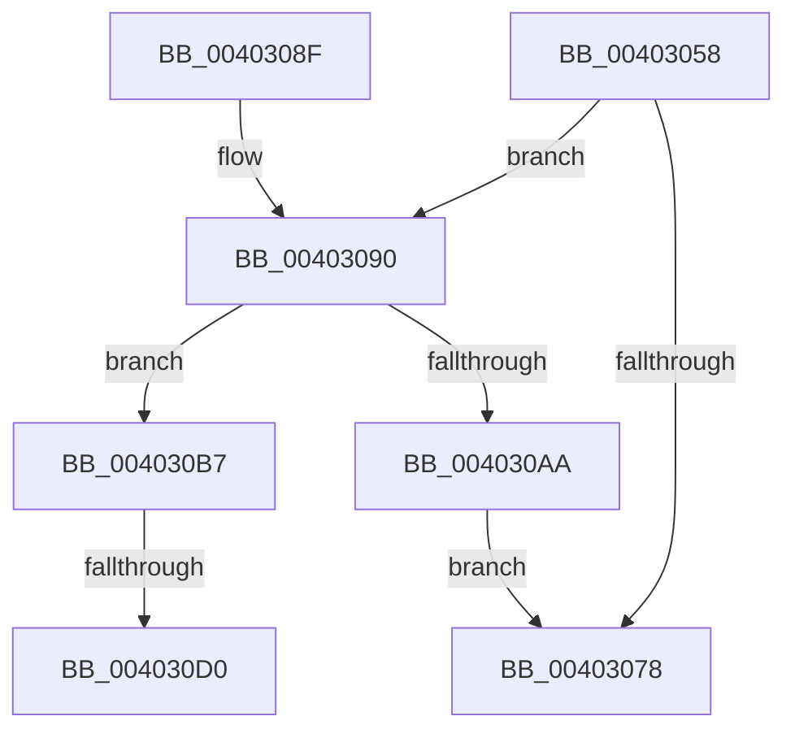

# MiAllocateMappedWriterMdls

- RVA: `0x00403058`–`0x004030E4` (길이 `140` bytes)
- VA: `0x0000000140403058`
- 실행 섹션: `.text`
- PDB 이름 있음: `예`; PDB Function 태그: `예`
- unwind 정보 RVA: `0x0009A6DC`
- 디코드: `35`개 명령, `140/140` bytes 표시
- 미해석 바이트: `0` (있으면 어셈블리에 `.byte`로 보존)

> 이 문서는 커널 이미지의 기계어와 PDB 기호를 분석해 생성했습니다. 4번과 5번은 함수 원형과 자료형을 바이너리 사용 방식에서 추정한 C 해석이며 원본 소스 복구 결과는 아닙니다.

## 1. Dependencies

- 직접 호출 지점: **2**; 고유 호출 대상: **2**
- 직접 호출자로 확인된 함수: **1**
- RIP 상대 이미지 참조: **0**

### Outgoing calls
- `0x0040309C` → [MiLockPartitionMappedWriter](MiLockPartitionMappedWriter_function_00403150.md) (function, `0x00403150`)
- `0x004030B0` → [MiUnlockPartitionMappedWriter](MiUnlockPartitionMappedWriter_function_004030EC.md) (function, `0x004030EC`)

### Direct callers
- [MiCreateNewSection](../../page/98/MiCreateNewSection_function_00985DB0.md) at `0x00985E53`

### Static image references
- 디코드된 RIP-relative 메모리 참조가 없습니다.

## 2. Other-region calls and transfers

- 다른 실행 섹션으로 향하는 call: **0**
- call이 아닌 외부 분기/꼬리 이동: **2**
  - `0x004030CA` → [sub_006EC200](../6E/Unknown_function_006EC200.md) (`tail-transfer`)
  - `0x004030DF` → [sub_006EC200](../6E/Unknown_function_006EC200.md) (`tail-transfer`)

## 3. Assembly (complete function range)

```asm
00403058  48 89 5C 24 08                  mov qword ptr [rsp + 8], rbx
0040305D  48 89 6C 24 10                  mov qword ptr [rsp + 0x10], rbp
00403062  48 89 74 24 18                  mov qword ptr [rsp + 0x18], rsi
00403067  57                              push rdi
00403068  48 83 EC 20                     sub rsp, 0x20
0040306C  83 B9 9C 02 00 00 00            cmp dword ptr [rcx + 0x29c], 0
00403073  48 8B D9                        mov rbx, rcx
00403076  74 18                           je 0x140403090
00403078  33 C0                           xor eax, eax
0040307A  48 8B 5C 24 30                  mov rbx, qword ptr [rsp + 0x30]
0040307F  48 8B 6C 24 38                  mov rbp, qword ptr [rsp + 0x38]
00403084  48 8B 74 24 40                  mov rsi, qword ptr [rsp + 0x40]
00403089  48 83 C4 20                     add rsp, 0x20
0040308D  5F                              pop rdi
0040308E  C3                              ret
0040308F  CC                              int3
00403090  65 48 8B 2C 25 88 01 00 00      mov rbp, qword ptr gs:[0x188]
00403099  48 8B D5                        mov rdx, rbp
0040309C  E8 AF 00 00 00                  call 0x140403150
004030A1  83 BB 9C 02 00 00 00            cmp dword ptr [rbx + 0x29c], 0
004030A8  74 0D                           je 0x1404030b7
004030AA  48 8B D5                        mov rdx, rbp
004030AD  48 8B CB                        mov rcx, rbx
004030B0  E8 37 00 00 00                  call 0x1404030ec
004030B5  EB C1                           jmp 0x140403078
004030B7  48 8B 83 50 48 00 00            mov rax, qword ptr [rbx + 0x4850]
004030BE  B9 14 00 00 00                  mov ecx, 0x14
004030C3  48 C1 E8 0F                     shr rax, 0xf
004030C7  48 3B C1                        cmp rax, rcx
004030CA  0F 82 30 91 2E 00               jb 0x1406ec200
004030D0  BA 80 00 00 00                  mov edx, 0x80
004030D5  48 8B C8                        mov rcx, rax
004030D8  48 3B C2                        cmp rax, rdx
004030DB  48 0F 47 CA                     cmova rcx, rdx
004030DF  E9 1C 91 2E 00                  jmp 0x1406ec200
```

## 4. C-style interpretation (structured pseudocode)

```c
__int64 __fastcall MiAllocateMappedWriterMdls(__int64 a1)
{
    __int64 result;
    __int64 v_rsp;
    unsigned __int64 v_stack_p10;
    unsigned __int64 v_stack_p18;
    unsigned __int64 v_stack_p8;

    v_stack_p8 = v_rbx;
    v_stack_p10 = v_rbp;
    v_stack_p18 = v_rsi;
    v_rsp = (v_rsp) - (32);
    if ((*(unsigned int *)(a1 + 668)) == 0) goto loc_00403090;
loc_00403078:
    result = 0;
    v_rsp = (v_rsp) + (32);
    return result;
loc_00403090:
    result = MiLockPartitionMappedWriter(a1, *(unsigned __int64 *)(gs_base + (0 + 392)), a3, a4);
    if ((*(unsigned int *)(v_stack_p8 + 668)) == 0) goto loc_004030B7;
    result = MiUnlockPartitionMappedWriter(v_stack_p8, *(unsigned __int64 *)(gs_base + (0 + 392)), a3, a4);
    goto loc_00403078;
loc_004030B7:
    result = (*(unsigned __int64 *)(v_stack_p8 + 18512)) >> (15);
    a1 = result;
    if (result > 128) { a1 = 128; }
}
```

## 5. (Beta) C Style

```c
int64_t MiAllocateMappedWriterMdls(void *Arg1)
{
    uint8_t *arg1 = (uint8_t *)Arg1;

    int64_t result;
    int64_t local_rsp;
    uint64_t v_stack_p10;
    uint64_t v_stack_p18;
    uint64_t v_stack_p8;

    v_stack_p8 = local_rbx;
    v_stack_p10 = local_rbp;
    v_stack_p18 = local_rsi;
    local_rsp = (local_rsp) - (32);
    if ((*(uint32_t *)(arg1 + 0x29C)) == 0) goto loc_00403090;
loc_00403078:
    result = 0;
    local_rsp = (local_rsp) + (32);
    return result;
loc_00403090:
    result = MiLockPartitionMappedWriter(Arg1, *(uint64_t *)(gs_base + (0 + 0x188)), a3, a4);
    if ((*(uint32_t *)(v_stack_p8 + 0x29C)) == 0) goto loc_004030B7;
    result = MiUnlockPartitionMappedWriter(v_stack_p8, *(uint64_t *)(gs_base + (0 + 0x188)), a3, a4);
    goto loc_00403078;
loc_004030B7:
    result = (*(uint64_t *)(v_stack_p8 + 0x4850)) >> (15);
    Arg1 = result;
    if (result > 128) { Arg1 = 128; }
}
```

### 관측된 메모리 오프셋

구조체 형식이 확인되지 않은 접근은 인자 기준의 오프셋으로만 기록했습니다.

| 기준 인자 | 오프셋 표현 | 폭 (bit) | 접근 |
|---|---:|---:|---|
| `Arg1` | `+ 0x29C` | `32` | `R` |
| `Arg1` | `+ 0x4850` | `64` | `R` |

## 6. Execution-region graph

[열기: 2D/3D 그래프와 함수 탐색 컨트롤 패널](../../../control-panel.html?section=text&rva=0x00403058&view=graph)

- 2D 그래프는 위에서 아래로 흐르고, 3D 그래프는 빈 공간을 드래그해 회전합니다. Shift+드래그는 이동, 휠은 확대·축소, 함수 노드 선택은 대상 보고서 이동입니다.

### Static fallback


