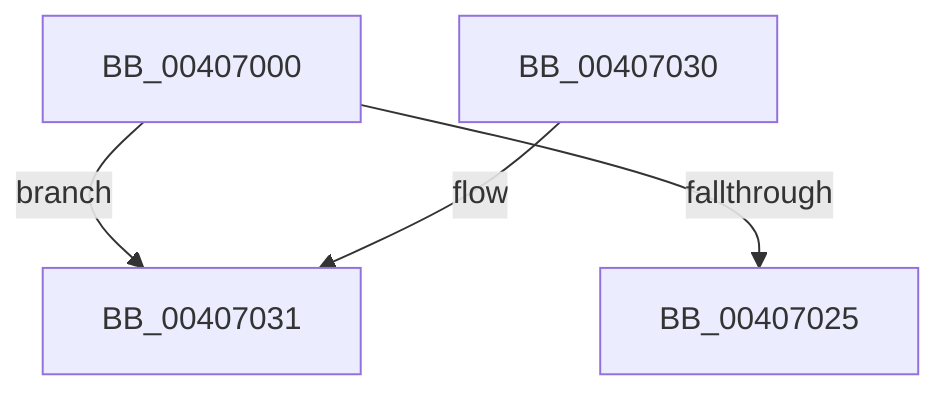

# MiClearPfnImageVerified

- RVA: `0x00407000`–`0x00407035` (길이 `53` bytes)
- VA: `0x0000000140407000`
- 실행 섹션: `.text`
- PDB 이름 있음: `예`; PDB Function 태그: `아니요`
- unwind 정보 RVA: `0x0009A8F8`
- 디코드: `18`개 명령, `53/53` bytes 표시
- 미해석 바이트: `0` (있으면 어셈블리에 `.byte`로 보존)

> 이 문서는 커널 이미지의 기계어와 PDB 기호를 분석해 생성했습니다. 4번과 5번은 함수 원형과 자료형을 바이너리 사용 방식에서 추정한 C 해석이며 원본 소스 복구 결과는 아닙니다.

## 1. Dependencies

- 직접 호출 지점: **0**; 고유 호출 대상: **0**
- 직접 호출자로 확인된 함수: **13**
- RIP 상대 이미지 참조: **0**

### Outgoing calls
- 직접 디코드된 call 명령이 없습니다.

### Direct callers
- [sub_0023D83F](../23/Unknown_function_0023D83F.md) at `0x0023D882`
- [MmStoreProbeAndLockPages](../23/MmStoreProbeAndLockPages_function_0023E570.md) at `0x0023E793`
- [MiAddPageToFlushMdl](../28/MiAddPageToFlushMdl_function_00286930.md) at `0x00286B6B`
- [sub_002B1D4E](../2B/Unknown_function_002B1D4E.md) at `0x002B1D5B`
- [MiStealPage](../2B/MiStealPage_function_002B28D0.md) at `0x002B3E66`
- [MiDeleteClusterPage](../34/MiDeleteClusterPage_function_00346CB0.md) at `0x003470B3`
- [MiDeleteSectionCluster](../37/MiDeleteSectionCluster_function_00373DF0.md) at `0x00374375`
- [MiReferencePageForModifiedWrite](MiReferencePageForModifiedWrite_function_00405DAC.md) at `0x00405ED1`
- [MiPrepareLargePageSubPageForFree](../69/MiPrepareLargePageSubPageForFree_function_006994F0.md) at `0x00699561`
- [sub_006DBBC0](../6D/Unknown_function_006DBBC0.md) at `0x006DBCB3`
- [sub_006EC390](../6E/Unknown_function_006EC390.md) at `0x006EC3F5`
- [MmChangeImageProtection](../../page/A5/MmChangeImageProtection_function_00A565F0.md) at `0x00A567FE`
- [MiTradeBootImagePage](../../init/C6/MiTradeBootImagePage_function_00C6C554.md) at `0x00C6C735`

### Static image references
- 디코드된 RIP-relative 메모리 참조가 없습니다.

## 2. Other-region calls and transfers

- 다른 실행 섹션으로 향하는 call: **0**
- 별도 외부 분기/꼬리 이동을 확인하지 못했습니다.

## 3. Assembly (complete function range)

```asm
00407000  48 89 5C 24 20                  mov qword ptr [rsp + 0x20], rbx
00407005  57                              push rdi
00407006  48 83 EC 40                     sub rsp, 0x40
0040700A  48 8B 41 28                     mov rax, qword ptr [rcx + 0x28]
0040700E  0F 57 C0                        xorps xmm0, xmm0
00407011  48 C1 E8 3C                     shr rax, 0x3c
00407015  8B FA                           mov edi, edx
00407017  24 07                           and al, 7
00407019  48 8B D9                        mov rbx, rcx
0040701C  0F 11 44 24 30                  movups xmmword ptr [rsp + 0x30], xmm0
00407021  3C 03                           cmp al, 3
00407023  74 0C                           je 0x140407031
00407025  48 8B 5C 24 68                  mov rbx, qword ptr [rsp + 0x68]
0040702A  48 83 C4 40                     add rsp, 0x40
0040702E  5F                              pop rdi
0040702F  C3                              ret
00407030  CC                              int3
00407031  48 8B 41 08                     mov rax, qword ptr [rcx + 8]
```

## 4. C-style interpretation (structured pseudocode)

```c
__int64 __fastcall MiClearPfnImageVerified(__int64 a1, int a2)
{
    __int64 result;
    __int64 v_rsp;
    unsigned __int64 v_stack_m18;
    unsigned __int64 v_stack_p20;

    v_stack_p20 = v_rbx;
    v_rsp = (v_rsp) - (64);
    result = (*(unsigned __int64 *)(a1 + 40)) >> (60);
    result = (unsigned __int8)((result) & (7));
    v_stack_m18 = v_xmm0;
    if (((unsigned __int8)(result)) == 3) goto loc_00407031;
    v_rsp = (v_rsp) + (64);
    return result;
loc_00407031:
    return *(unsigned __int64 *)(a1 + 8);
}
```

## 5. (Beta) C Style

```c
int64_t MiClearPfnImageVerified(void *Arg1, int32_t Arg2)
{
    uint8_t *arg1 = (uint8_t *)Arg1;

    int64_t result;
    int64_t local_rsp;
    uint64_t v_stack_m18;
    uint64_t v_stack_p20;

    v_stack_p20 = local_rbx;
    local_rsp = (local_rsp) - (64);
    result = (*(uint64_t *)(arg1 + 0x28)) >> (60);
    result = (uint8_t)((result) & (7));
    v_stack_m18 = v_xmm0;
    if (((uint8_t)(result)) == 3) goto loc_00407031;
    local_rsp = (local_rsp) + (64);
    return result;
loc_00407031:
    return *(uint64_t *)(arg1 + 0x8);
}
```

### 관측된 메모리 오프셋

구조체 형식이 확인되지 않은 접근은 인자 기준의 오프셋으로만 기록했습니다.

| 기준 인자 | 오프셋 표현 | 폭 (bit) | 접근 |
|---|---:|---:|---|
| `Arg1` | `+ 0x8` | `64` | `R` |
| `Arg1` | `+ 0x28` | `64` | `R` |

## 6. Execution-region graph

[열기: 2D/3D 그래프와 함수 탐색 컨트롤 패널](../../../control-panel.html?section=text&rva=0x00407000&view=graph)

- 2D 그래프는 위에서 아래로 흐르고, 3D 그래프는 빈 공간을 드래그해 회전합니다. Shift+드래그는 이동, 휠은 확대·축소, 함수 노드 선택은 대상 보고서 이동입니다.

### Static fallback


