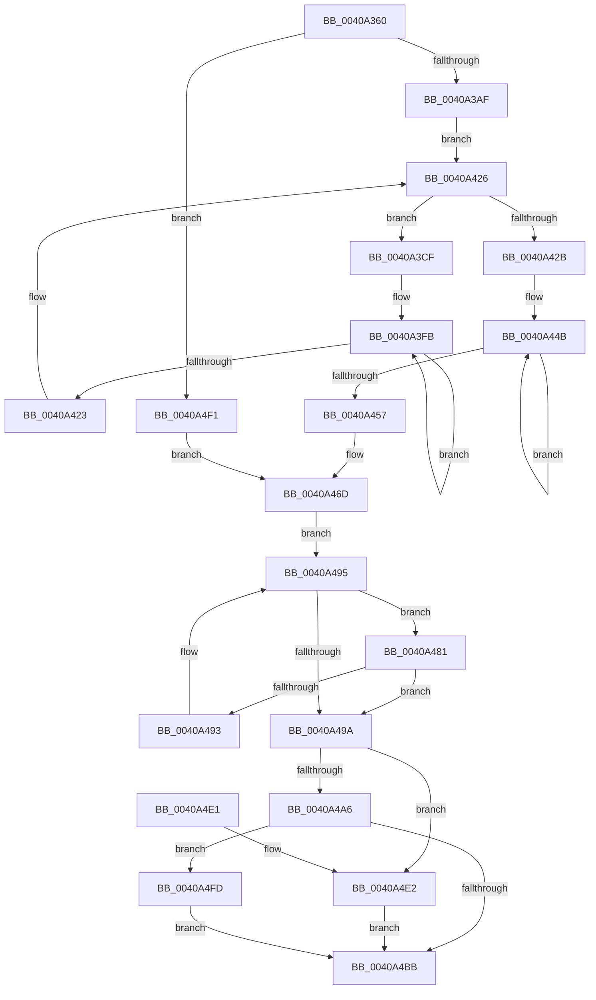

# MiComputeAgeDistribution

- RVA: `0x0040A360`–`0x0040A502` (길이 `418` bytes)
- VA: `0x000000014040A360`
- 실행 섹션: `.text`
- PDB 이름 있음: `예`; PDB Function 태그: `아니요`
- unwind 정보 RVA: `0x0009ACAC`
- 디코드: `112`개 명령, `418/418` bytes 표시
- 미해석 바이트: `0` (있으면 어셈블리에 `.byte`로 보존)

> 이 문서는 커널 이미지의 기계어와 PDB 기호를 분석해 생성했습니다. 4번과 5번은 함수 원형과 자료형을 바이너리 사용 방식에서 추정한 C 해석이며 원본 소스 복구 결과는 아닙니다.

## 1. Dependencies

- 직접 호출 지점: **5**; 고유 호출 대상: **5**
- 직접 호출자로 확인된 함수: **2**
- RIP 상대 이미지 참조: **2**

### Outgoing calls
- `0x0040A395` → [memset](../6C/memset_function_006C6C40.md) (function, `0x006C6C40`)
- `0x0040A3B6` → [ExAcquireSpinLockExclusive](../24/ExAcquireSpinLockExclusive_function_00248690.md) (function, `0x00248690`)
- `0x0040A43D` → [memcpy](../6C/memcpy_function_006C6840.md) (function, `0x006C6840`)
- `0x0040A468` → [MiReleaseSpinLockExclusive](../24/MiReleaseSpinLockExclusive_function_002482C0.md) (function, `0x002482C0`)
- `0x0040A4C3` → [_security_check_cookie](../6A/_security_check_cookie_function_006AC640.md) (function, `0x006AC640`)

### Direct callers
- [MiComputeSystemTrimCriteria](../34/MiComputeSystemTrimCriteria_function_0034E184.md) at `0x0034E367`
- [MiOrderTrimList](MiOrderTrimList_function_00409F24.md) at `0x0040A128`

### Static image references
- `0x0040A376` → RVA `0x00E0A740` (`.data`; read)
- `0x0040A3AF` → RVA `0x00E374C0` (`.data`; read)

## 2. Other-region calls and transfers

- 다른 실행 섹션으로 향하는 call: **0**
- 별도 외부 분기/꼬리 이동을 확인하지 못했습니다.

## 3. Assembly (complete function range)

```asm
0040A360  48 89 5C 24 10                  mov qword ptr [rsp + 0x10], rbx
0040A365  48 89 6C 24 18                  mov qword ptr [rsp + 0x18], rbp
0040A36A  56                              push rsi
0040A36B  57                              push rdi
0040A36C  41 54                           push r12
0040A36E  41 56                           push r14
0040A370  41 57                           push r15
0040A372  48 83 EC 70                     sub rsp, 0x70
0040A376  48 8B 05 C3 03 A0 00            mov rax, qword ptr [rip + 0xa003c3]
0040A37D  48 33 C4                        xor rax, rsp
0040A380  48 89 44 24 60                  mov qword ptr [rsp + 0x60], rax
0040A385  8B DA                           mov ebx, edx
0040A387  48 8B F1                        mov rsi, rcx
0040A38A  33 D2                           xor edx, edx
0040A38C  48 8D 4C 24 20                  lea rcx, [rsp + 0x20]
0040A391  44 8D 42 40                     lea r8d, [rdx + 0x40]
0040A395  E8 A6 C8 2B 00                  call 0x1406c6c40
0040A39A  48 8B BE C0 44 00 00            mov rdi, qword ptr [rsi + 0x44c0]
0040A3A1  41 BC 01 00 00 00               mov r12d, 1
0040A3A7  85 DB                           test ebx, ebx
0040A3A9  0F 84 42 01 00 00               je 0x14040a4f1
0040A3AF  48 8D 0D 0A D1 A2 00            lea rcx, [rip + 0xa2d10a]
0040A3B6  E8 D5 E2 E3 FF                  call 0x140248690
0040A3BB  4C 8D 96 C8 44 00 00            lea r10, [rsi + 0x44c8]
0040A3C2  44 8A F0                        mov r14b, al
0040A3C5  4D 8B 0A                        mov r9, qword ptr [r10]
0040A3C8  41 8D 74 24 01                  lea esi, [r12 + 1]
0040A3CD  EB 57                           jmp 0x14040a426
0040A3CF  49 8D 59 E8                     lea rbx, [r9 - 0x18]
0040A3D3  BD 03 00 00 00                  mov ebp, 3
0040A3D8  8B 8B B8 00 00 00               mov ecx, dword ptr [rbx + 0xb8]
0040A3DE  48 8D 44 24 20                  lea rax, [rsp + 0x20]
0040A3E3  C1 E9 10                        shr ecx, 0x10
0040A3E6  4C 8D 5C 24 20                  lea r11, [rsp + 0x20]
0040A3EB  40 3A CE                        cmp cl, sil
0040A3EE  41 BF 08 00 00 00               mov r15d, 8
0040A3F4  41 0F 45 EC                     cmovne ebp, r12d
0040A3F8  48 2B D8                        sub rbx, rax
0040A3FB  4A 8B 44 1B 28                  mov rax, qword ptr [rbx + r11 + 0x28]
0040A400  8B CD                           mov ecx, ebp
0040A402  49 8B 13                        mov rdx, qword ptr [r11]
0040A405  48 D3 E8                        shr rax, cl
0040A408  48 8D 0C 10                     lea rcx, [rax + rdx]
0040A40C  48 83 C8 FF                     or rax, 0xffffffffffffffff
0040A410  48 3B CA                        cmp rcx, rdx
0040A413  48 0F 42 C8                     cmovb rcx, rax
0040A417  49 89 0B                        mov qword ptr [r11], rcx
0040A41A  4D 8D 5B 08                     lea r11, [r11 + 8]
0040A41E  4D 2B FC                        sub r15, r12
0040A421  75 D8                           jne 0x14040a3fb
0040A423  4D 8B 09                        mov r9, qword ptr [r9]
0040A426  4D 3B CA                        cmp r9, r10
0040A429  75 A4                           jne 0x14040a3cf
0040A42B  48 8D 8F 58 01 00 00            lea rcx, [rdi + 0x158]
0040A432  41 B8 40 00 00 00               mov r8d, 0x40
0040A438  48 8D 54 24 20                  lea rdx, [rsp + 0x20]
0040A43D  E8 FE C3 2B 00                  call 0x1406c6840
0040A442  33 DB                           xor ebx, ebx
0040A444  48 8D 87 88 01 00 00            lea rax, [rdi + 0x188]
0040A44B  48 03 18                        add rbx, qword ptr [rax]
0040A44E  48 8D 40 08                     lea rax, [rax + 8]
0040A452  49 2B F4                        sub rsi, r12
0040A455  75 F4                           jne 0x14040a44b
0040A457  41 8A D6                        mov dl, r14b
0040A45A  48 89 9F 50 01 00 00            mov qword ptr [rdi + 0x150], rbx
0040A461  48 8D 0D 58 D0 A2 00            lea rcx, [rip + 0xa2d058]
0040A468  E8 53 DE E3 FF                  call 0x1402482c0
0040A46D  4C 8B 87 38 01 00 00            mov r8, qword ptr [rdi + 0x138]
0040A474  33 C9                           xor ecx, ecx
0040A476  49 C1 E0 02                     shl r8, 2
0040A47A  BA 05 00 00 00                  mov edx, 5
0040A47F  EB 14                           jmp 0x14040a495
0040A481  8B C2                           mov eax, edx
0040A483  41 03 CC                        add ecx, r12d
0040A486  48 03 9C C7 58 01 00 00         add rbx, qword ptr [rdi + rax*8 + 0x158]
0040A48E  41 3B D4                        cmp edx, r12d
0040A491  74 07                           je 0x14040a49a
0040A493  FF CA                           dec edx
0040A495  49 3B D8                        cmp rbx, r8
0040A498  72 E7                           jb 0x14040a481
0040A49A  4C 8B 87 18 01 00 00            mov r8, qword ptr [rdi + 0x118]
0040A4A1  4D 85 C0                        test r8, r8
0040A4A4  74 3C                           je 0x14040a4e2
0040A4A6  69 C1 E8 03 00 00               imul eax, ecx, 0x3e8
0040A4AC  33 D2                           xor edx, edx
0040A4AE  B9 E8 03 00 00                  mov ecx, 0x3e8
0040A4B3  49 F7 F0                        div r8
0040A4B6  66 3B C1                        cmp ax, cx
0040A4B9  77 42                           ja 0x14040a4fd
0040A4BB  48 8B 4C 24 60                  mov rcx, qword ptr [rsp + 0x60]
0040A4C0  48 33 CC                        xor rcx, rsp
0040A4C3  E8 78 21 2A 00                  call 0x1406ac640
0040A4C8  4C 8D 5C 24 70                  lea r11, [rsp + 0x70]
0040A4CD  49 8B 5B 38                     mov rbx, qword ptr [r11 + 0x38]
0040A4D1  49 8B 6B 40                     mov rbp, qword ptr [r11 + 0x40]
0040A4D5  49 8B E3                        mov rsp, r11
0040A4D8  41 5F                           pop r15
0040A4DA  41 5E                           pop r14
0040A4DC  41 5C                           pop r12
0040A4DE  5F                              pop rdi
0040A4DF  5E                              pop rsi
0040A4E0  C3                              ret
0040A4E1  CC                              int3
0040A4E2  F7 D9                           neg ecx
0040A4E4  B9 E8 03 00 00                  mov ecx, 0x3e8
0040A4E9  66 1B C0                        sbb ax, ax
0040A4EC  66 23 C1                        and ax, cx
0040A4EF  EB CA                           jmp 0x14040a4bb
0040A4F1  48 8B 9F 50 01 00 00            mov rbx, qword ptr [rdi + 0x150]
0040A4F8  E9 70 FF FF FF                  jmp 0x14040a46d
0040A4FD  0F B7 C1                        movzx eax, cx
0040A500  EB B9                           jmp 0x14040a4bb
```

## 4. C-style interpretation (structured pseudocode)

```c
__int64 __fastcall MiComputeAgeDistribution(__int64 a1, int a2)
{
    __int64 result;
    __int64 v_r15;
    __int64 v_rbp;
    __int64 v_rbx;
    __int64 v_rsi;
    __int64 v_rsp;
    unsigned __int64 v_stack_m28;
    unsigned __int64 v_stack_m38;
    unsigned __int64 v_stack_m78;
    unsigned __int64 v_stack_p10;
    unsigned __int64 v_stack_p18;

    v_stack_p10 = v_rbx;
    v_stack_p18 = v_rbp;
    v_rsp = (v_rsp) - (112);
    result = (*(unsigned __int64 *)(v_rip + 10486723)) ^ (v_rsp);
    v_stack_m38 = result;
    a2 = 0;
    result = memset(v_stack_m78, a2, a2 + 64, a4);
    if ((unsigned int)((unsigned int)(a2)) == 0) goto loc_0040A4F1;
    result = ExAcquireSpinLockExclusive(v_rip + 10670346, a2, a2 + 64, a4);
    goto loc_0040A426;
loc_0040A3CF:
    a1 = (unsigned int)(((unsigned int)(*(unsigned int *)(*(unsigned __int64 *)(a1 + 17608) - 24 + 184))) >> (16));
    v_rbp = 3;
    if (((unsigned __int8)(a1)) != ((unsigned __int8)(1 + 1))) { v_rbp = 1; }
    v_rbx = (*(unsigned __int64 *)(a1 + 17608) - 24) - (v_stack_m78);
loc_0040A3FB:
    result = (*(unsigned __int64 *)(v_rbx + v_stack_m78 * 1 + 40)) >> ((unsigned __int8)((unsigned int)((unsigned int)(v_rbp))));
    result = (result) | (-1);
    a1 = result + *(unsigned __int64 *)(v_stack_m78) * 1;
    if ((result + *(unsigned __int64 *)(v_stack_m78) * 1) < (*(unsigned __int64 *)(v_stack_m78))) { a1 = result; }
    *(unsigned __int64 *)(v_stack_m78) = a1;
    v_r15 = (8) - (1);
    if (condition_is_not_equal) goto loc_0040A3FB;
loc_0040A426:
    if ((*(unsigned __int64 *)(*(unsigned __int64 *)(a1 + 17608))) != (a1 + 17608)) goto loc_0040A3CF;
    result = memcpy(*(unsigned __int64 *)(a1 + 17600) + 344, v_stack_m78, 64, *(unsigned __int64 *)(*(unsigned __int64 *)(a1 + 17608)));
    v_rbx = 0;
loc_0040A44B:
    v_rbx = (v_rbx) + (*(unsigned __int64 *)(*(unsigned __int64 *)(a1 + 17600) + 392));
    v_rsi = (1 + 1) - (1);
    if (condition_is_not_equal) goto loc_0040A44B;
    *(unsigned __int64 *)(*(unsigned __int64 *)(a1 + 17600) + 336) = v_rbx;
    result = MiReleaseSpinLockExclusive(v_rip + 10670168, (unsigned __int8)((unsigned __int8)(result)), 64, *(unsigned __int64 *)(*(unsigned __int64 *)(a1 + 17608)));
loc_0040A46D:
    a1 = 0;
    a3 = (*(unsigned __int64 *)(*(unsigned __int64 *)(a1 + 17600) + 312)) << (2);
    goto loc_0040A495;
loc_0040A481:
    a1 = (unsigned int)((a1) + (1));
    v_rbx = (v_rbx) + (*(unsigned __int64 *)(*(unsigned __int64 *)(a1 + 17600) + 5 * 8 + 344));
    if (5 == 1) goto loc_0040A49A;
    a2 = (unsigned int)((5) - 1);
loc_0040A495:
    if (v_rbx < a3) goto loc_0040A481;
loc_0040A49A:
    if (*(unsigned __int64 *)(*(unsigned __int64 *)(a1 + 17600) + 280) == 0) goto loc_0040A4E2;
    result = (unsigned int)((5) * ((unsigned int)(a1)));
    a2 = 0;
    if (((unsigned __int16)(result)) > 1000) goto loc_0040A4FD;
loc_0040A4BB:
    a1 = (v_stack_m38) ^ (v_rsp);
    result = _security_check_cookie(a1, a2, *(unsigned __int64 *)(*(unsigned __int64 *)(a1 + 17600) + 280), *(unsigned __int64 *)(*(unsigned __int64 *)(a1 + 17608)));
    return result;
loc_0040A4E2:
    a1 = (unsigned int)(-(a1));
    result = (unsigned __int16)((result) & (1000));
    goto loc_0040A4BB;
loc_0040A4F1:
    goto loc_0040A46D;
loc_0040A4FD:
    goto loc_0040A4BB;
}
```

## 5. (Beta) C Style

```c
int64_t MiComputeAgeDistribution(void *Arg1, int32_t Arg2)
{
    uint8_t *arg1 = (uint8_t *)Arg1;

    int64_t result;
    int64_t local_r15;
    int64_t local_rbp;
    int64_t local_rbx;
    int64_t local_rsi;
    int64_t local_rsp;
    uint64_t v_stack_m28;
    uint64_t v_stack_m38;
    uint64_t v_stack_m78;
    uint64_t v_stack_p10;
    uint64_t v_stack_p18;

    v_stack_p10 = local_rbx;
    v_stack_p18 = local_rbp;
    local_rsp = (local_rsp) - (112);
    result = (*(uint64_t *)(v_rip + 0xA003C3)) ^ (local_rsp);
    v_stack_m38 = result;
    Arg2 = 0;
    result = memset(v_stack_m78, Arg2, Arg2 + 64, a4);
    if ((uint32_t)((uint32_t)(Arg2)) == 0) goto loc_0040A4F1;
    result = ExAcquireSpinLockExclusive(v_rip + 10670346, Arg2, Arg2 + 64, a4);
    goto loc_0040A426;
loc_0040A3CF:
    Arg1 = (uint32_t)(((uint32_t)(*(uint32_t *)(*(uint64_t *)(arg1 + 0x44C8) - 0x18 + 0xB8))) >> (16));
    local_rbp = 3;
    if (((uint8_t)(Arg1)) != ((uint8_t)(1 + 1))) { local_rbp = 1; }
    local_rbx = (*(uint64_t *)(arg1 + 0x44C8) - 24) - (v_stack_m78);
loc_0040A3FB:
    result = (*(uint64_t *)(local_rbx + v_stack_m78 * 1 + 0x28)) >> ((uint8_t)((uint32_t)((uint32_t)(local_rbp))));
    result = (result) | (-1);
    Arg1 = result + *(uint64_t *)(v_stack_m78) * 1;
    if ((result + *(uint64_t *)(v_stack_m78) * 1) < (*(uint64_t *)(v_stack_m78))) { Arg1 = result; }
    *(void **)(v_stack_m78) = Arg1;
    local_r15 = (8) - (1);
    if (condition_is_not_equal) goto loc_0040A3FB;
loc_0040A426:
    if ((*(uint64_t *)(*(uint64_t *)(arg1 + 0x44C8))) != (Arg1 + 17608)) goto loc_0040A3CF;
    result = memcpy(*(uint64_t *)(arg1 + 0x44C0) + 344, v_stack_m78, 64, *(uint64_t *)(*(uint64_t *)(arg1 + 0x44C8)));
    local_rbx = 0;
loc_0040A44B:
    local_rbx = (local_rbx) + (*(uint64_t *)(*(uint64_t *)(arg1 + 0x44C0) + 0x188));
    local_rsi = (1 + 1) - (1);
    if (condition_is_not_equal) goto loc_0040A44B;
    *(uint64_t *)(*(uint64_t *)(arg1 + 0x44C0) + 0x150) = local_rbx;
    result = MiReleaseSpinLockExclusive(v_rip + 10670168, (uint8_t)((uint8_t)(result)), 64, *(uint64_t *)(*(uint64_t *)(arg1 + 0x44C8)));
loc_0040A46D:
    Arg1 = 0;
    a3 = (*(uint64_t *)(*(uint64_t *)(arg1 + 0x44C0) + 0x138)) << (2);
    goto loc_0040A495;
loc_0040A481:
    Arg1 = (uint32_t)((Arg1) + (1));
    local_rbx = (local_rbx) + (*(uint64_t *)(*(uint64_t *)(arg1 + 0x44C0) + 0x5 * 8 + 0x158));
    if (5 == 1) goto loc_0040A49A;
    Arg2 = (uint32_t)((5) - 1);
loc_0040A495:
    if (local_rbx < a3) goto loc_0040A481;
loc_0040A49A:
    if (*(uint64_t *)(*(uint64_t *)(arg1 + 0x44C0) + 0x118) == 0) goto loc_0040A4E2;
    result = (uint32_t)((5) * ((uint32_t)(Arg1)));
    Arg2 = 0;
    if (((uint16_t)(result)) > 1000) goto loc_0040A4FD;
loc_0040A4BB:
    Arg1 = (v_stack_m38) ^ (local_rsp);
    result = _security_check_cookie(Arg1, Arg2, *(uint64_t *)(*(uint64_t *)(arg1 + 0x44C0) + 0x118), *(uint64_t *)(*(uint64_t *)(arg1 + 0x44C8)));
    return result;
loc_0040A4E2:
    Arg1 = (uint32_t)(-(Arg1));
    result = (uint16_t)((result) & (1000));
    goto loc_0040A4BB;
loc_0040A4F1:
    goto loc_0040A46D;
loc_0040A4FD:
    goto loc_0040A4BB;
}
```

### 관측된 메모리 오프셋

구조체 형식이 확인되지 않은 접근은 인자 기준의 오프셋으로만 기록했습니다.

| 기준 인자 | 오프셋 표현 | 폭 (bit) | 접근 |
|---|---:|---:|---|
| `Arg1` | `+ 0x0` | `64` | `R` |
| `Arg1` | `+ 0x44C0` | `64` | `R` |
| `Arg1` | `+ 0x44C8` | `64` | `R` |

## 6. Execution-region graph

[열기: 2D/3D 그래프와 함수 탐색 컨트롤 패널](../../../control-panel.html?section=text&rva=0x0040A360&view=graph)

- 2D 그래프는 위에서 아래로 흐르고, 3D 그래프는 빈 공간을 드래그해 회전합니다. Shift+드래그는 이동, 휠은 확대·축소, 함수 노드 선택은 대상 보고서 이동입니다.

### Static fallback


