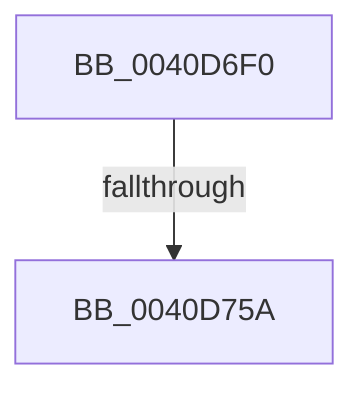

# MiCountWslesInPageTableRange

- RVA: `0x0040D6F0`–`0x0040D75D` (길이 `109` bytes)
- VA: `0x000000014040D6F0`
- 실행 섹션: `.text`
- PDB 이름 있음: `예`; PDB Function 태그: `예`
- unwind 정보 RVA: `0x0009B198`
- 디코드: `30`개 명령, `109/109` bytes 표시
- 미해석 바이트: `0` (있으면 어셈블리에 `.byte`로 보존)

> 이 문서는 커널 이미지의 기계어와 PDB 기호를 분석해 생성했습니다. 4번과 5번은 함수 원형과 자료형을 바이너리 사용 방식에서 추정한 C 해석이며 원본 소스 복구 결과는 아닙니다.

## 1. Dependencies

- 직접 호출 지점: **0**; 고유 호출 대상: **0**
- 직접 호출자로 확인된 함수: **1**
- RIP 상대 이미지 참조: **1**

### Outgoing calls
- 직접 디코드된 call 명령이 없습니다.

### Direct callers
- [MiCountWslesInPageTable](MiCountWslesInPageTable_function_0040D5DC.md) at `0x0040D662`
- [MiCountWslesInPageTable](MiCountWslesInPageTable_function_0040D5DC.md) at `0x0040D6CE`

### Static image references
- `0x0040D6FD` → RVA `0x00E0A740` (`.data`; read)

## 2. Other-region calls and transfers

- 다른 실행 섹션으로 향하는 call: **0**
- call이 아닌 외부 분기/꼬리 이동: **1**
  - `0x0040D754` → [sub_0040D8FD](Unknown_function_0040D8FD.md) (`tail-transfer`)

## 3. Assembly (complete function range)

```asm
0040D6F0  40 53                           push rbx
0040D6F2  55                              push rbp
0040D6F3  56                              push rsi
0040D6F4  57                              push rdi
0040D6F5  41 54                           push r12
0040D6F7  41 55                           push r13
0040D6F9  48 83 EC 78                     sub rsp, 0x78
0040D6FD  48 8B 05 3C D0 9F 00            mov rax, qword ptr [rip + 0x9fd03c]
0040D704  48 33 C4                        xor rax, rsp
0040D707  48 89 44 24 68                  mov qword ptr [rsp + 0x68], rax
0040D70C  0F 57 C0                        xorps xmm0, xmm0
0040D70F  4C 89 4C 24 40                  mov qword ptr [rsp + 0x40], r9
0040D714  33 DB                           xor ebx, ebx
0040D716  48 89 4C 24 38                  mov qword ptr [rsp + 0x38], rcx
0040D71B  48 8B F2                        mov rsi, rdx
0040D71E  89 5C 24 30                     mov dword ptr [rsp + 0x30], ebx
0040D722  0F 11 44 24 48                  movups xmmword ptr [rsp + 0x48], xmm0
0040D727  49 8B E8                        mov rbp, r8
0040D72A  48 BA 00 00 00 00 80 F6 FF FF   movabs rdx, 0xfffff68000000000
0040D734  0F 11 44 24 58                  movups xmmword ptr [rsp + 0x58], xmm0
0040D739  4C 8B E2                        mov r12, rdx
0040D73C  48 8B CE                        mov rcx, rsi
0040D73F  49 C1 E4 19                     shl r12, 0x19
0040D743  48 C1 E1 19                     shl rcx, 0x19
0040D747  49 2B CC                        sub rcx, r12
0040D74A  48 C1 F9 10                     sar rcx, 0x10
0040D74E  48 8B C2                        mov rax, rdx
0040D751  48 3B C8                        cmp rcx, rax
0040D754  0F 83 A3 01 00 00               jae 0x14040d8fd
0040D75A  45 33 ED                        xor r13d, r13d
```

## 4. C-style interpretation (structured pseudocode)

```c
__int64 __fastcall MiCountWslesInPageTableRange(__int64 a1, __int64 a2, __int64 a3, __int64 a4)
{
    __int64 result;
    __int64 v_r12;
    __int64 v_r13;
    __int64 v_rbx;
    __int64 v_rsp;
    unsigned __int64 v_stack_m40;
    unsigned __int64 v_stack_m50;
    unsigned __int64 v_stack_m60;
    unsigned __int64 v_stack_m68;
    unsigned __int64 v_stack_m70;
    unsigned int v_stack_m78;

    v_rsp = (v_rsp) - (120);
    result = (*(unsigned __int64 *)(v_rip + 10473532)) ^ (v_rsp);
    v_stack_m40 = result;
    v_stack_m68 = a4;
    v_rbx = 0;
    v_stack_m70 = a1;
    v_stack_m78 = 0;
    v_stack_m60 = v_xmm0;
    v_stack_m50 = v_xmm0;
    v_r12 = (a2) << (25);
    a1 = (a2) << (25);
    a1 = (a1) - (v_r12);
    a1 = (a1) >> (16);
    v_r13 = 0;
    return a2;
}
```

## 5. (Beta) C Style

```c
int64_t MiCountWslesInPageTableRange(int64_t Arg1, int64_t Arg2, int64_t Arg3, int64_t Arg4)
{
    int64_t result;
    int64_t local_r12;
    int64_t local_r13;
    int64_t local_rbx;
    int64_t local_rsp;
    uint64_t v_stack_m40;
    uint64_t v_stack_m50;
    uint64_t v_stack_m60;
    uint64_t v_stack_m68;
    uint64_t v_stack_m70;
    uint32_t v_stack_m78;

    local_rsp = (local_rsp) - (120);
    result = (*(uint64_t *)(v_rip + 0x9FD03C)) ^ (local_rsp);
    v_stack_m40 = result;
    v_stack_m68 = Arg4;
    local_rbx = 0;
    v_stack_m70 = Arg1;
    v_stack_m78 = 0;
    v_stack_m60 = v_xmm0;
    v_stack_m50 = v_xmm0;
    local_r12 = (Arg2) << (25);
    Arg1 = (Arg2) << (25);
    Arg1 = (Arg1) - (local_r12);
    Arg1 = (Arg1) >> (16);
    local_r13 = 0;
    return Arg2;
}
```

## 6. Execution-region graph

[열기: 2D/3D 그래프와 함수 탐색 컨트롤 패널](../../../control-panel.html?section=text&rva=0x0040D6F0&view=graph)

- 2D 그래프는 위에서 아래로 흐르고, 3D 그래프는 빈 공간을 드래그해 회전합니다. Shift+드래그는 이동, 휠은 확대·축소, 함수 노드 선택은 대상 보고서 이동입니다.

### Static fallback


