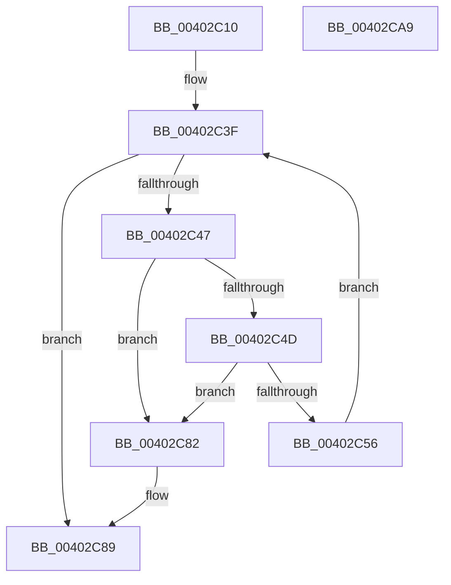

# MiDeleteMappedMdls

- RVA: `0x00402C10`–`0x00402CAA` (길이 `154` bytes)
- VA: `0x0000000140402C10`
- 실행 섹션: `.text`
- PDB 이름 있음: `예`; PDB Function 태그: `아니요`
- unwind 정보 RVA: `0x0005C954`
- 디코드: `42`개 명령, `154/154` bytes 표시
- 미해석 바이트: `0` (있으면 어셈블리에 `.byte`로 보존)

> 이 문서는 커널 이미지의 기계어와 PDB 기호를 분석해 생성했습니다. 4번과 5번은 함수 원형과 자료형을 바이너리 사용 방식에서 추정한 C 해석이며 원본 소스 복구 결과는 아닙니다.

## 1. Dependencies

- 직접 호출 지점: **5**; 고유 호출 대상: **3**
- 직접 호출자로 확인된 함수: **1**
- RIP 상대 이미지 참조: **0**

### Outgoing calls
- `0x00402C33` → [MiLockPartitionMappedWriter](MiLockPartitionMappedWriter_function_00403150.md) (function, `0x00403150`)
- `0x00402C63` → [MiUnlockPartitionMappedWriter](MiUnlockPartitionMappedWriter_function_004030EC.md) (function, `0x004030EC`)
- `0x00402C70` → [MiFreeModWriterEntry](MiFreeModWriterEntry_function_00407AE8.md) (function, `0x00407AE8`)
- `0x00402C7B` → [MiLockPartitionMappedWriter](MiLockPartitionMappedWriter_function_00403150.md) (function, `0x00403150`)
- `0x00402C8F` → [MiUnlockPartitionMappedWriter](MiUnlockPartitionMappedWriter_function_004030EC.md) (function, `0x004030EC`)

### Direct callers
- [MiMappedPageWriter](MiMappedPageWriter_function_00404AC0.md) at `0x00404DD6`

### Static image references
- 디코드된 RIP-relative 메모리 참조가 없습니다.

## 2. Other-region calls and transfers

- 다른 실행 섹션으로 향하는 call: **0**
- 별도 외부 분기/꼬리 이동을 확인하지 못했습니다.

## 3. Assembly (complete function range)

```asm
00402C10  48 89 5C 24 08                  mov qword ptr [rsp + 8], rbx
00402C15  48 89 6C 24 10                  mov qword ptr [rsp + 0x10], rbp
00402C1A  48 89 74 24 18                  mov qword ptr [rsp + 0x18], rsi
00402C1F  57                              push rdi
00402C20  48 83 EC 20                     sub rsp, 0x20
00402C24  65 48 8B 2C 25 88 01 00 00      mov rbp, qword ptr gs:[0x188]
00402C2D  48 8B F1                        mov rsi, rcx
00402C30  48 8B D5                        mov rdx, rbp
00402C33  E8 18 05 00 00                  call 0x140403150
00402C38  48 8D BE A8 02 00 00            lea rdi, [rsi + 0x2a8]
00402C3F  48 8B 1F                        mov rbx, qword ptr [rdi]
00402C42  48 3B DF                        cmp rbx, rdi
00402C45  74 42                           je 0x140402c89
00402C47  48 39 7B 08                     cmp qword ptr [rbx + 8], rdi
00402C4B  75 35                           jne 0x140402c82
00402C4D  48 8B 03                        mov rax, qword ptr [rbx]
00402C50  48 39 58 08                     cmp qword ptr [rax + 8], rbx
00402C54  75 2C                           jne 0x140402c82
00402C56  48 89 07                        mov qword ptr [rdi], rax
00402C59  48 8B D5                        mov rdx, rbp
00402C5C  48 8B CE                        mov rcx, rsi
00402C5F  48 89 78 08                     mov qword ptr [rax + 8], rdi
00402C63  E8 84 04 00 00                  call 0x1404030ec
00402C68  BA 01 00 00 00                  mov edx, 1
00402C6D  48 8B CB                        mov rcx, rbx
00402C70  E8 73 4E 00 00                  call 0x140407ae8
00402C75  48 8B D5                        mov rdx, rbp
00402C78  48 8B CE                        mov rcx, rsi
00402C7B  E8 D0 04 00 00                  call 0x140403150
00402C80  EB BD                           jmp 0x140402c3f
00402C82  B9 03 00 00 00                  mov ecx, 3
00402C87  CD 29                           int 0x29
00402C89  48 8B D5                        mov rdx, rbp
00402C8C  48 8B CE                        mov rcx, rsi
00402C8F  E8 58 04 00 00                  call 0x1404030ec
00402C94  48 8B 5C 24 30                  mov rbx, qword ptr [rsp + 0x30]
00402C99  48 8B 6C 24 38                  mov rbp, qword ptr [rsp + 0x38]
00402C9E  48 8B 74 24 40                  mov rsi, qword ptr [rsp + 0x40]
00402CA3  48 83 C4 20                     add rsp, 0x20
00402CA7  5F                              pop rdi
00402CA8  C3                              ret
00402CA9  CC                              int3
```

## 4. C-style interpretation (structured pseudocode)

```c
__int64 __fastcall MiDeleteMappedMdls(__int64 a1)
{
    __int64 result;
    __int64 v_rsp;
    unsigned __int64 v_stack_p10;
    unsigned __int64 v_stack_p18;
    unsigned __int64 v_stack_p8;

    v_stack_p8 = v_rbx;
    v_stack_p10 = v_rbp;
    v_stack_p18 = v_rsi;
    v_rsp = (v_rsp) - (32);
    result = MiLockPartitionMappedWriter(a1, *(unsigned __int64 *)(gs_base + (0 + 392)), a3, a4);
loc_00402C3F:
    if ((*(unsigned __int64 *)(a1 + 680)) == (a1 + 680)) goto loc_00402C89;
    if ((*(unsigned __int64 *)(*(unsigned __int64 *)(a1 + 680) + 8)) != (a1 + 680)) goto loc_00402C82;
    if ((*(unsigned __int64 *)(*(unsigned __int64 *)(*(unsigned __int64 *)(a1 + 680)) + 8)) != (*(unsigned __int64 *)(a1 + 680))) goto loc_00402C82;
    *(unsigned __int64 *)(a1 + 680) = *(unsigned __int64 *)(*(unsigned __int64 *)(a1 + 680));
    *(unsigned __int64 *)(*(unsigned __int64 *)(*(unsigned __int64 *)(a1 + 680)) + 8) = a1 + 680;
    result = MiUnlockPartitionMappedWriter(a1, *(unsigned __int64 *)(gs_base + (0 + 392)), a3, a4);
    result = MiFreeModWriterEntry(*(unsigned __int64 *)(a1 + 680), 1, a3, a4);
    result = MiLockPartitionMappedWriter(a1, *(unsigned __int64 *)(gs_base + (0 + 392)), a3, a4);
    goto loc_00402C3F;
loc_00402C82:
loc_00402C89:
    result = MiUnlockPartitionMappedWriter(a1, *(unsigned __int64 *)(gs_base + (0 + 392)), a3, a4);
    v_rsp = (v_rsp) + (32);
    return result;
}
```

## 5. (Beta) C Style

```c
int64_t MiDeleteMappedMdls(void *Arg1)
{
    uint8_t *arg1 = (uint8_t *)Arg1;

    int64_t result;
    int64_t local_rsp;
    uint64_t v_stack_p10;
    uint64_t v_stack_p18;
    uint64_t v_stack_p8;

    v_stack_p8 = local_rbx;
    v_stack_p10 = local_rbp;
    v_stack_p18 = local_rsi;
    local_rsp = (local_rsp) - (32);
    result = MiLockPartitionMappedWriter(Arg1, *(uint64_t *)(gs_base + (0 + 0x188)), a3, a4);
loc_00402C3F:
    if ((*(uint64_t *)(arg1 + 0x2A8)) == (Arg1 + 680)) goto loc_00402C89;
    if ((*(uint64_t *)(*(uint64_t *)(arg1 + 0x2A8) + 0x8)) != (Arg1 + 680)) goto loc_00402C82;
    if ((*(uint64_t *)(*(uint64_t *)(*(uint64_t *)(arg1 + 0x2A8)) + 0x8)) != (*(uint64_t *)(arg1 + 0x2A8))) goto loc_00402C82;
    *(uint64_t *)(arg1 + 0x2A8) = *(uint64_t *)(*(uint64_t *)(arg1 + 0x2A8));
    *(void **)(*(uint64_t *)(*(uint64_t *)(arg1 + 0x2A8)) + 0x8) = Arg1 + 680;
    result = MiUnlockPartitionMappedWriter(Arg1, *(uint64_t *)(gs_base + (0 + 0x188)), a3, a4);
    result = MiFreeModWriterEntry(*(uint64_t *)(arg1 + 0x2A8), 1, a3, a4);
    result = MiLockPartitionMappedWriter(Arg1, *(uint64_t *)(gs_base + (0 + 0x188)), a3, a4);
    goto loc_00402C3F;
loc_00402C82:
loc_00402C89:
    result = MiUnlockPartitionMappedWriter(Arg1, *(uint64_t *)(gs_base + (0 + 0x188)), a3, a4);
    local_rsp = (local_rsp) + (32);
    return result;
}
```

### 관측된 메모리 오프셋

구조체 형식이 확인되지 않은 접근은 인자 기준의 오프셋으로만 기록했습니다.

| 기준 인자 | 오프셋 표현 | 폭 (bit) | 접근 |
|---|---:|---:|---|
| `Arg1` | `+ 0x0` | `64` | `R` |
| `Arg1` | `+ 0x0` | `64` | `W` |
| `Arg1` | `+ 0x2A8` | `64` | `R` |

## 6. Execution-region graph

[열기: 2D/3D 그래프와 함수 탐색 컨트롤 패널](../../../control-panel.html?section=text&rva=0x00402C10&view=graph)

- 2D 그래프는 위에서 아래로 흐르고, 3D 그래프는 빈 공간을 드래그해 회전합니다. Shift+드래그는 이동, 휠은 확대·축소, 함수 노드 선택은 대상 보고서 이동입니다.

### Static fallback


