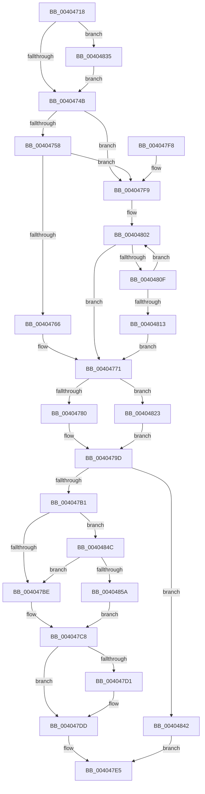

# MiEndingOffsetWithLock

- RVA: `0x00404718`–`0x0040486C` (길이 `340` bytes)
- VA: `0x0000000140404718`
- 실행 섹션: `.text`
- PDB 이름 있음: `예`; PDB Function 태그: `아니요`
- unwind 정보 RVA: `0x0009A784`
- 디코드: `85`개 명령, `340/340` bytes 표시
- 미해석 바이트: `0` (있으면 어셈블리에 `.byte`로 보존)

> 이 문서는 커널 이미지의 기계어와 PDB 기호를 분석해 생성했습니다. 4번과 5번은 함수 원형과 자료형을 바이너리 사용 방식에서 추정한 C 해석이며 원본 소스 복구 결과는 아닙니다.

## 1. Dependencies

- 직접 호출 지점: **6**; 고유 호출 대상: **6**
- 직접 호출자로 확인된 함수: **5**
- RIP 상대 이미지 참조: **3**

### Outgoing calls
- `0x0040476C` → [ExpAcquireSpinLockSharedAtDpcLevelInstrumented](../27/ExpAcquireSpinLockSharedAtDpcLevelInstrumented_function_0027CD20.md) (function, `0x0027CD20`)
- `0x004047D8` → [KiLowerIrqlProcessIrqlFlags](../4F/KiLowerIrqlProcessIrqlFlags_function_004F5698.md) (function, `0x004F5698`)
- `0x00404819` → [ExpWaitForSpinLockSharedAndAcquire](../36/ExpWaitForSpinLockSharedAndAcquire_function_00362380.md) (function, `0x00362380`)
- `0x00404838` → [KiRaiseIrqlProcessIrqlFlags](../4F/KiRaiseIrqlProcessIrqlFlags_function_004F56FC.md) (function, `0x004F56FC`)
- `0x00404845` → [ExReleaseSpinLockSharedFromDpcLevel](../24/ExReleaseSpinLockSharedFromDpcLevel_function_0024A590.md) (function, `0x0024A590`)
- `0x00404862` → [ExpReleaseSpinLockSharedFromDpcLevelInstrumented](../2F/ExpReleaseSpinLockSharedFromDpcLevelInstrumented_function_002F0F48.md) (function, `0x002F0F48`)

### Direct callers
- [MiViewMayContainPage](../2E/MiViewMayContainPage_function_002E11F0.md) at `0x002E130B`
- [MiReadyFlushMdlToWrite](MiReadyFlushMdlToWrite_function_00404664.md) at `0x004046BD`
- [MiPfPrepareReadList](../../page/93/MiPfPrepareReadList_function_0093CD5C.md) at `0x0093D061`
- [MiPfPrepareSequentialReadList](../../page/93/MiPfPrepareSequentialReadList_function_0093D8E8.md) at `0x0093E03D`
- [MiPfAllocateMdls](../../page/93/MiPfAllocateMdls_function_0093E45C.md) at `0x0093E77C`

### Static image references
- `0x0040473E` → RVA `0x00FC6D20` (`ALMOSTRO`; read)
- `0x0040474B` → RVA `0x00FC6B06` (`ALMOSTRO`; read)
- `0x00404758` → RVA `0x00F0DE58` (`.data`; read)

## 2. Other-region calls and transfers

- 다른 실행 섹션으로 향하는 call: **0**
- 별도 외부 분기/꼬리 이동을 확인하지 못했습니다.

## 3. Assembly (complete function range)

```asm
00404718  48 89 5C 24 08                  mov qword ptr [rsp + 8], rbx
0040471D  48 89 74 24 10                  mov qword ptr [rsp + 0x10], rsi
00404722  57                              push rdi
00404723  48 83 EC 20                     sub rsp, 0x20
00404727  48 8B 19                        mov rbx, qword ptr [rcx]
0040472A  48 8B F1                        mov rsi, rcx
0040472D  48 83 C3 48                     add rbx, 0x48
00404731  44 0F 20 C7                     mov rdi, cr8
00404735  BA 02 00 00 00                  mov edx, 2
0040473A  44 0F 22 C2                     mov cr8, rdx
0040473E  83 3D DB 25 BC 00 00            cmp dword ptr [rip + 0xbc25db], 0
00404745  0F 85 EA 00 00 00               jne 0x140404835
0040474B  F6 05 B4 23 BC 00 21            test byte ptr [rip + 0xbc23b4], 0x21
00404752  0F 84 A1 00 00 00               je 0x1404047f9
00404758  8B 05 FA 96 B0 00               mov eax, dword ptr [rip + 0xb096fa]
0040475E  85 C0                           test eax, eax
00404760  0F 85 93 00 00 00               jne 0x1404047f9
00404766  40 8A D7                        mov dl, dil
00404769  48 8B CB                        mov rcx, rbx
0040476C  E8 AF 85 E7 FF                  call 0x14027cd20
00404771  48 8B 06                        mov rax, qword ptr [rsi]
00404774  8B 48 38                        mov ecx, dword ptr [rax + 0x38]
00404777  F6 C1 20                        test cl, 0x20
0040477A  0F 85 A3 00 00 00               jne 0x140404823
00404780  8B 4E 20                        mov ecx, dword ptr [rsi + 0x20]
00404783  8B 46 24                        mov eax, dword ptr [rsi + 0x24]
00404786  81 E1 C0 FF 00 00               and ecx, 0xffc0
0040478C  48 C1 E1 1A                     shl rcx, 0x1a
00404790  48 0B C8                        or rcx, rax
00404793  8B 46 28                        mov eax, dword ptr [rsi + 0x28]
00404796  48 03 C8                        add rcx, rax
00404799  48 C1 E1 0C                     shl rcx, 0xc
0040479D  8B 76 20                        mov esi, dword ptr [rsi + 0x20]
004047A0  48 C1 EE 14                     shr rsi, 0x14
004047A4  48 03 F1                        add rsi, rcx
004047A7  40 80 FF 11                     cmp dil, 0x11
004047AB  0F 84 91 00 00 00               je 0x140404842
004047B1  F6 05 4E 23 BC 00 01            test byte ptr [rip + 0xbc234e], 1
004047B8  0F 85 8E 00 00 00               jne 0x14040484c
004047BE  F0 81 23 FF FF FF BF            lock and dword ptr [rbx], 0xbfffffff
004047C5  F0 FF 0B                        lock dec dword ptr [rbx]
004047C8  83 3D 51 25 BC 00 00            cmp dword ptr [rip + 0xbc2551], 0
004047CF  74 0C                           je 0x1404047dd
004047D1  44 0F 20 C1                     mov rcx, cr8
004047D5  40 8A D7                        mov dl, dil
004047D8  E8 BB 0E 0F 00                  call 0x1404f5698
004047DD  40 0F B6 CF                     movzx ecx, dil
004047E1  44 0F 22 C1                     mov cr8, rcx
004047E5  48 8B 5C 24 30                  mov rbx, qword ptr [rsp + 0x30]
004047EA  48 8B C6                        mov rax, rsi
004047ED  48 8B 74 24 38                  mov rsi, qword ptr [rsp + 0x38]
004047F2  48 83 C4 20                     add rsp, 0x20
004047F6  5F                              pop rdi
004047F7  C3                              ret
004047F8  CC                              int3
004047F9  0F 0D 0B                        prefetchw byte ptr [rbx]
004047FC  8B 03                           mov eax, dword ptr [rbx]
004047FE  0F BA F0 1F                     btr eax, 0x1f
00404802  8D 48 01                        lea ecx, [rax + 1]
00404805  F0 0F B1 0B                     lock cmpxchg dword ptr [rbx], ecx
00404809  0F 84 62 FF FF FF               je 0x140404771
0040480F  85 C0                           test eax, eax
00404811  79 EF                           jns 0x140404802
00404813  40 8A D7                        mov dl, dil
00404816  48 8B CB                        mov rcx, rbx
00404819  E8 62 DB F5 FF                  call 0x140362380
0040481E  E9 4E FF FF FF                  jmp 0x140404771
00404823  8B 4E 28                        mov ecx, dword ptr [rsi + 0x28]
00404826  8B 46 24                        mov eax, dword ptr [rsi + 0x24]
00404829  48 03 C8                        add rcx, rax
0040482C  48 C1 E1 09                     shl rcx, 9
00404830  E9 68 FF FF FF                  jmp 0x14040479d
00404835  40 8A CF                        mov cl, dil
00404838  E8 BF 0E 0F 00                  call 0x1404f56fc
0040483D  E9 09 FF FF FF                  jmp 0x14040474b
00404842  48 8B CB                        mov rcx, rbx
00404845  E8 46 5D E4 FF                  call 0x14024a590
0040484A  EB 99                           jmp 0x1404047e5
0040484C  8B 05 06 96 B0 00               mov eax, dword ptr [rip + 0xb09606]
00404852  85 C0                           test eax, eax
00404854  0F 85 64 FF FF FF               jne 0x1404047be
0040485A  48 8B 54 24 28                  mov rdx, qword ptr [rsp + 0x28]
0040485F  48 8B CB                        mov rcx, rbx
00404862  E8 E1 C6 EE FF                  call 0x1402f0f48
00404867  E9 5C FF FF FF                  jmp 0x1404047c8
```

## 4. C-style interpretation (structured pseudocode)

```c
__int64 __fastcall MiEndingOffsetWithLock(__int64 a1)
{
    __int64 result;
    __int64 v_rbx;
    __int64 v_rsi;
    __int64 v_rsp;
    unsigned __int64 v_stack_p10;
    unsigned __int64 v_stack_p28;
    unsigned __int64 v_stack_p8;

    v_stack_p8 = v_rbx;
    v_stack_p10 = v_rsi;
    v_rsp = (v_rsp) - (32);
    v_rbx = (*(unsigned __int64 *)(a1)) + (72);
    if ((*(unsigned int *)(v_rip + 12330459)) != 0) goto loc_00404835;
loc_0040474B:
    if (((*(unsigned __int8 *)(v_rip + 12329908)) & (33)) == 0) goto loc_004047F9;
    if ((unsigned int)((unsigned int)(*(unsigned int *)(v_rip + 11572986))) != 0) goto loc_004047F9;
    result = ExpAcquireSpinLockSharedAtDpcLevelInstrumented(v_rbx, (unsigned __int8)(v_cr8), a3, a4);
loc_00404771:
    if ((((unsigned __int8)((unsigned int)(*(unsigned int *)(*(unsigned __int64 *)(a1) + 56)))) & (32)) != 0) goto loc_00404823;
    a1 = (unsigned int)(((unsigned int)(*(unsigned int *)(a1 + 32))) & (0xFFC0ULL));
    a1 = (a1) << (26);
    a1 = (a1) | ((unsigned int)(*(unsigned int *)(a1 + 36)));
    a1 = (a1) + ((unsigned int)(*(unsigned int *)(a1 + 40)));
    a1 = (a1) << (12);
loc_0040479D:
    v_rsi = ((unsigned int)(*(unsigned int *)(a1 + 32))) >> (20);
    v_rsi = (v_rsi) + (a1);
    if (((unsigned __int8)(v_cr8)) == 17) goto loc_00404842;
    if (((*(unsigned __int8 *)(v_rip + 12329806)) & (1)) != 0) goto loc_0040484C;
loc_004047BE:
loc_004047C8:
    result = (unsigned int)(*(unsigned int *)(a1 + 40));
    if ((*(unsigned int *)(v_rip + 12330321)) != 0) {
        a1 = 2;
        a2 = (unsigned __int8)(v_cr8);
        result = KiLowerIrqlProcessIrqlFlags(a1, a2, a3, a4);
    }
loc_004047E5:
    v_rsp = (v_rsp) + (32);
    return v_rsi;
loc_004047F9:
loc_00404802:
    if (condition_is_equal) goto loc_00404771;
    if (!sign_flag) goto loc_00404802;
    result = ExpWaitForSpinLockSharedAndAcquire(v_stack_p8, (unsigned __int8)(v_cr8), a3, a4);
    goto loc_00404771;
loc_00404823:
    a1 = ((unsigned int)(*(unsigned int *)(v_stack_p10 + 40))) + ((unsigned int)(*(unsigned int *)(v_stack_p10 + 36)));
    a1 = (a1) << (9);
    goto loc_0040479D;
loc_00404835:
    result = KiRaiseIrqlProcessIrqlFlags((unsigned __int8)(v_cr8), (unsigned __int8)(v_cr8), a3, a4);
    goto loc_0040474B;
loc_00404842:
    result = ExReleaseSpinLockSharedFromDpcLevel(v_stack_p8, (unsigned __int8)(v_cr8), a3, a4);
    goto loc_004047E5;
loc_0040484C:
    if ((unsigned int)((unsigned int)(*(unsigned int *)(v_rip + 11572742))) != 0) goto loc_004047BE;
    result = ExpReleaseSpinLockSharedFromDpcLevelInstrumented(v_stack_p8, v_stack_p28, a3, a4);
    goto loc_004047C8;
}
```

## 5. (Beta) C Style

```c
int64_t MiEndingOffsetWithLock(void *Arg1)
{
    uint8_t *arg1 = (uint8_t *)Arg1;

    int64_t result;
    int64_t local_rbx;
    int64_t local_rsi;
    int64_t local_rsp;
    uint64_t v_stack_p10;
    uint64_t v_stack_p28;
    uint64_t v_stack_p8;

    v_stack_p8 = local_rbx;
    v_stack_p10 = local_rsi;
    local_rsp = (local_rsp) - (32);
    local_rbx = (*(uint64_t *)(arg1)) + (72);
    if ((*(uint32_t *)(v_rip + 0xBC25DB)) != 0) goto loc_00404835;
loc_0040474B:
    if (((*(uint8_t *)(v_rip + 0xBC23B4)) & (33)) == 0) goto loc_004047F9;
    if ((uint32_t)((uint32_t)(*(uint32_t *)(v_rip + 0xB096FA))) != 0) goto loc_004047F9;
    result = ExpAcquireSpinLockSharedAtDpcLevelInstrumented(local_rbx, (uint8_t)(v_cr8), a3, a4);
loc_00404771:
    if ((((uint8_t)((uint32_t)(*(uint32_t *)(*(uint64_t *)(arg1) + 0x38)))) & (32)) != 0) goto loc_00404823;
    Arg1 = (uint32_t)(((uint32_t)(*(uint32_t *)(arg1 + 0x20))) & (0xFFC0ULL));
    Arg1 = (Arg1) << (26);
    Arg1 = (Arg1) | ((uint32_t)(*(uint32_t *)(arg1 + 0x24)));
    Arg1 = (Arg1) + ((uint32_t)(*(uint32_t *)(arg1 + 0x28)));
    Arg1 = (Arg1) << (12);
loc_0040479D:
    local_rsi = ((uint32_t)(*(uint32_t *)(arg1 + 0x20))) >> (20);
    local_rsi = (local_rsi) + (Arg1);
    if (((uint8_t)(v_cr8)) == 17) goto loc_00404842;
    if (((*(uint8_t *)(v_rip + 0xBC234E)) & (1)) != 0) goto loc_0040484C;
loc_004047BE:
loc_004047C8:
    result = (uint32_t)(*(uint32_t *)(arg1 + 0x28));
    if ((*(uint32_t *)(v_rip + 0xBC2551)) != 0) {
        Arg1 = 2;
        a2 = (uint8_t)(v_cr8);
        result = KiLowerIrqlProcessIrqlFlags(Arg1, a2, a3, a4);
    }
loc_004047E5:
    local_rsp = (local_rsp) + (32);
    return local_rsi;
loc_004047F9:
loc_00404802:
    if (condition_is_equal) goto loc_00404771;
    if (!sign_flag) goto loc_00404802;
    result = ExpWaitForSpinLockSharedAndAcquire(v_stack_p8, (uint8_t)(v_cr8), a3, a4);
    goto loc_00404771;
loc_00404823:
    Arg1 = ((uint32_t)(*(uint32_t *)(v_stack_p10 + 0x28))) + ((uint32_t)(*(uint32_t *)(v_stack_p10 + 0x24)));
    Arg1 = (Arg1) << (9);
    goto loc_0040479D;
loc_00404835:
    result = KiRaiseIrqlProcessIrqlFlags((uint8_t)(v_cr8), (uint8_t)(v_cr8), a3, a4);
    goto loc_0040474B;
loc_00404842:
    result = ExReleaseSpinLockSharedFromDpcLevel(v_stack_p8, (uint8_t)(v_cr8), a3, a4);
    goto loc_004047E5;
loc_0040484C:
    if ((uint32_t)((uint32_t)(*(uint32_t *)(v_rip + 0xB09606))) != 0) goto loc_004047BE;
    result = ExpReleaseSpinLockSharedFromDpcLevelInstrumented(v_stack_p8, v_stack_p28, a3, a4);
    goto loc_004047C8;
}
```

### 관측된 메모리 오프셋

구조체 형식이 확인되지 않은 접근은 인자 기준의 오프셋으로만 기록했습니다.

| 기준 인자 | 오프셋 표현 | 폭 (bit) | 접근 |
|---|---:|---:|---|
| `Arg1` | `+ 0x0` | `64` | `R` |
| `Arg1` | `+ 0x20` | `32` | `R` |
| `Arg1` | `+ 0x24` | `32` | `R` |
| `Arg1` | `+ 0x28` | `32` | `R` |

## 6. Execution-region graph

[열기: 2D/3D 그래프와 함수 탐색 컨트롤 패널](../../../control-panel.html?section=text&rva=0x00404718&view=graph)

- 2D 그래프는 위에서 아래로 흐르고, 3D 그래프는 빈 공간을 드래그해 회전합니다. Shift+드래그는 이동, 휠은 확대·축소, 함수 노드 선택은 대상 보고서 이동입니다.

### Static fallback


