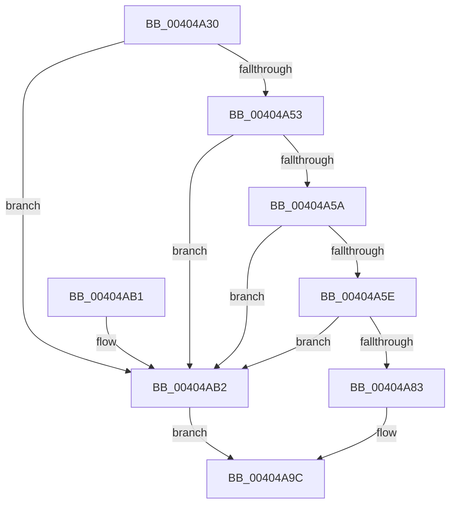

# MiExpandFlushMdl

- RVA: `0x00404A30`–`0x00404AB6` (길이 `134` bytes)
- VA: `0x0000000140404A30`
- 실행 섹션: `.text`
- PDB 이름 있음: `예`; PDB Function 태그: `아니요`
- unwind 정보 RVA: `0x0005F9EC`
- 디코드: `39`개 명령, `134/134` bytes 표시
- 미해석 바이트: `0` (있으면 어셈블리에 `.byte`로 보존)

> 이 문서는 커널 이미지의 기계어와 PDB 기호를 분석해 생성했습니다. 4번과 5번은 함수 원형과 자료형을 바이너리 사용 방식에서 추정한 C 해석이며 원본 소스 복구 결과는 아닙니다.

## 1. Dependencies

- 직접 호출 지점: **2**; 고유 호출 대상: **2**
- 직접 호출자로 확인된 함수: **1**
- RIP 상대 이미지 참조: **0**

### Outgoing calls
- `0x00404A76` → [MiAllocatePool](../35/MiAllocatePool_function_0035B540.md) (function, `0x0035B540`)
- `0x00404A91` → [memcpy](../6C/memcpy_function_006C6840.md) (function, `0x006C6840`)

### Direct callers
- [MiFlushSection](MiFlushSection_function_004036B0.md) at `0x00403B2C`

### Static image references
- 디코드된 RIP-relative 메모리 참조가 없습니다.

## 2. Other-region calls and transfers

- 다른 실행 섹션으로 향하는 call: **0**
- 별도 외부 분기/꼬리 이동을 확인하지 못했습니다.

## 3. Assembly (complete function range)

```asm
00404A30  48 89 5C 24 08                  mov qword ptr [rsp + 8], rbx
00404A35  48 89 6C 24 10                  mov qword ptr [rsp + 0x10], rbp
00404A3A  48 89 74 24 18                  mov qword ptr [rsp + 0x18], rsi
00404A3F  57                              push rdi
00404A40  48 83 EC 20                     sub rsp, 0x20
00404A44  8B 79 28                        mov edi, dword ptr [rcx + 0x28]
00404A47  B8 FF FF 0F 00                  mov eax, 0xfffff
00404A4C  48 8B E9                        mov rbp, rcx
00404A4F  3B F8                           cmp edi, eax
00404A51  74 5F                           je 0x140404ab2
00404A53  8D 1C 3F                        lea ebx, [rdi + rdi]
00404A56  3B DF                           cmp ebx, edi
00404A58  76 58                           jbe 0x140404ab2
00404A5A  3B D8                           cmp ebx, eax
00404A5C  77 54                           ja 0x140404ab2
00404A5E  3B DA                           cmp ebx, edx
00404A60  B9 40 00 00 00                  mov ecx, 0x40
00404A65  41 B8 4D 6D 46 6C               mov r8d, 0x6c466d4d
00404A6B  0F 47 DA                        cmova ebx, edx
00404A6E  48 8D 14 DD 30 00 00 00         lea rdx, [rbx*8 + 0x30]
00404A76  E8 C5 6A F5 FF                  call 0x14035b540
00404A7B  48 8B F0                        mov rsi, rax
00404A7E  48 85 C0                        test rax, rax
00404A81  74 2F                           je 0x140404ab2
00404A83  4C 8D 04 FD 30 00 00 00         lea r8, [rdi*8 + 0x30]
00404A8B  48 8B D5                        mov rdx, rbp
00404A8E  48 8B C8                        mov rcx, rax
00404A91  E8 AA 1D 2C 00                  call 0x1406c6840
00404A96  48 8B C6                        mov rax, rsi
00404A99  89 5E 2C                        mov dword ptr [rsi + 0x2c], ebx
00404A9C  48 8B 5C 24 30                  mov rbx, qword ptr [rsp + 0x30]
00404AA1  48 8B 6C 24 38                  mov rbp, qword ptr [rsp + 0x38]
00404AA6  48 8B 74 24 40                  mov rsi, qword ptr [rsp + 0x40]
00404AAB  48 83 C4 20                     add rsp, 0x20
00404AAF  5F                              pop rdi
00404AB0  C3                              ret
00404AB1  CC                              int3
00404AB2  33 C0                           xor eax, eax
00404AB4  EB E6                           jmp 0x140404a9c
```

## 4. C-style interpretation (structured pseudocode)

```c
__int64 __fastcall MiExpandFlushMdl(__int64 a1, int a2)
{
    __int64 result;
    __int64 v_rbx;
    __int64 v_rsp;
    unsigned __int64 v_stack_p10;
    unsigned __int64 v_stack_p18;
    unsigned __int64 v_stack_p8;

    v_stack_p8 = v_rbx;
    v_stack_p10 = v_rbp;
    v_stack_p18 = v_rsi;
    v_rsp = (v_rsp) - (32);
    if (((unsigned int)((unsigned int)(*(unsigned int *)(a1 + 40)))) == ((unsigned int)((unsigned int)(0xFFFFFULL)))) goto loc_00404AB2;
    if (((unsigned int)((unsigned int)(*(unsigned int *)(a1 + 40)) + (unsigned int)(*(unsigned int *)(a1 + 40)) * 1)) <= ((unsigned int)((unsigned int)(*(unsigned int *)(a1 + 40))))) goto loc_00404AB2;
    if (((unsigned int)((unsigned int)(*(unsigned int *)(a1 + 40)) + (unsigned int)(*(unsigned int *)(a1 + 40)) * 1)) > ((unsigned int)((unsigned int)(0xFFFFFULL)))) goto loc_00404AB2;
    v_rbx = (unsigned int)(*(unsigned int *)(a1 + 40)) + (unsigned int)(*(unsigned int *)(a1 + 40)) * 1;
    if (((unsigned int)((unsigned int)(*(unsigned int *)(a1 + 40)) + (unsigned int)(*(unsigned int *)(a1 + 40)) * 1)) > a2) { v_rbx = a2; }
    result = MiAllocatePool(64, v_rbx * 8 + 48, (unsigned int)(0x6C466D4DULL), a4);
    if (result == 0) goto loc_00404AB2;
    result = memcpy(result, a1, (unsigned int)(*(unsigned int *)(a1 + 40)) * 8 + 48, a4);
    *(unsigned int *)(result + 44) = (unsigned int)(v_rbx);
loc_00404A9C:
    v_rsp = (v_rsp) + (32);
    return result;
loc_00404AB2:
    result = 0;
    goto loc_00404A9C;
}
```

## 5. (Beta) C Style

```c
int64_t MiExpandFlushMdl(void *Arg1, int32_t Arg2)
{
    uint8_t *arg1 = (uint8_t *)Arg1;

    int64_t result;
    int64_t local_rbx;
    int64_t local_rsp;
    uint64_t v_stack_p10;
    uint64_t v_stack_p18;
    uint64_t v_stack_p8;

    v_stack_p8 = local_rbx;
    v_stack_p10 = local_rbp;
    v_stack_p18 = local_rsi;
    local_rsp = (local_rsp) - (32);
    if (((uint32_t)((uint32_t)(*(uint32_t *)(arg1 + 0x28)))) == ((uint32_t)((uint32_t)(0xFFFFFULL)))) goto loc_00404AB2;
    if (((uint32_t)((uint32_t)(*(uint32_t *)(arg1 + 0x28)) + (uint32_t)(*(uint32_t *)(arg1 + 0x28)) * 1)) <= ((uint32_t)((uint32_t)(*(uint32_t *)(arg1 + 0x28))))) goto loc_00404AB2;
    if (((uint32_t)((uint32_t)(*(uint32_t *)(arg1 + 0x28)) + (uint32_t)(*(uint32_t *)(arg1 + 0x28)) * 1)) > ((uint32_t)((uint32_t)(0xFFFFFULL)))) goto loc_00404AB2;
    local_rbx = (uint32_t)(*(uint32_t *)(arg1 + 0x28)) + (uint32_t)(*(uint32_t *)(arg1 + 0x28)) * 1;
    if (((uint32_t)((uint32_t)(*(uint32_t *)(arg1 + 0x28)) + (uint32_t)(*(uint32_t *)(arg1 + 0x28)) * 1)) > Arg2) { local_rbx = Arg2; }
    result = MiAllocatePool(64, local_rbx * 8 + 48, (uint32_t)(0x6C466D4DULL), a4);
    if (result == 0) goto loc_00404AB2;
    result = memcpy(result, Arg1, (uint32_t)(*(uint32_t *)(arg1 + 0x28)) * 8 + 48, a4);
    *(uint32_t *)(result + 0x2C) = (uint32_t)(local_rbx);
loc_00404A9C:
    local_rsp = (local_rsp) + (32);
    return result;
loc_00404AB2:
    result = 0;
    goto loc_00404A9C;
}
```

### 관측된 메모리 오프셋

구조체 형식이 확인되지 않은 접근은 인자 기준의 오프셋으로만 기록했습니다.

| 기준 인자 | 오프셋 표현 | 폭 (bit) | 접근 |
|---|---:|---:|---|
| `Arg1` | `+ 0x28` | `32` | `R` |

## 6. Execution-region graph

[열기: 2D/3D 그래프와 함수 탐색 컨트롤 패널](../../../control-panel.html?section=text&rva=0x00404A30&view=graph)

- 2D 그래프는 위에서 아래로 흐르고, 3D 그래프는 빈 공간을 드래그해 회전합니다. Shift+드래그는 이동, 휠은 확대·축소, 함수 노드 선택은 대상 보고서 이동입니다.

### Static fallback


