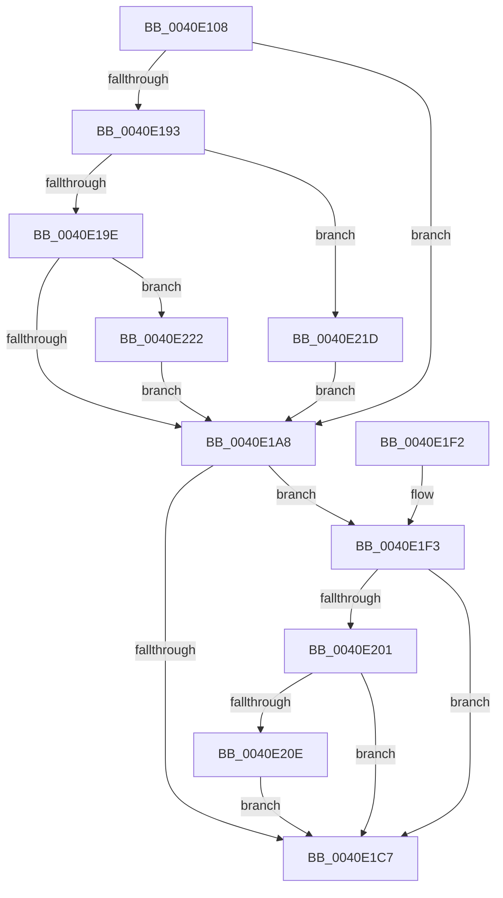

# MiFaultInProbeAddress

- RVA: `0x0040E108`–`0x0040E236` (길이 `302` bytes)
- VA: `0x000000014040E108`
- 실행 섹션: `.text`
- PDB 이름 있음: `예`; PDB Function 태그: `아니요`
- unwind 정보 RVA: `0x0009B878`
- 디코드: `86`개 명령, `302/302` bytes 표시
- 미해석 바이트: `0` (있으면 어셈블리에 `.byte`로 보존)

> 이 문서는 커널 이미지의 기계어와 PDB 기호를 분석해 생성했습니다. 4번과 5번은 함수 원형과 자료형을 바이너리 사용 방식에서 추정한 C 해석이며 원본 소스 복구 결과는 아닙니다.

## 1. Dependencies

- 직접 호출 지점: **6**; 고유 호출 대상: **6**
- 직접 호출자로 확인된 함수: **4**
- RIP 상대 이미지 참조: **0**

### Outgoing calls
- `0x0040E138` → [memset](../6C/memset_function_006C6C40.md) (function, `0x006C6C40`)
- `0x0040E1AB` → [MiUnlockProbePacketWorkingSet](../23/MiUnlockProbePacketWorkingSet_function_0023B800.md) (function, `0x0023B800`)
- `0x0040E1BC` → [MmAccessFault](../27/MmAccessFault_function_0027EE80.md) (function, `0x0027EE80`)
- `0x0040E1CA` → [MiLockProbePacketWorkingSet](MiLockProbePacketWorkingSet_function_0040E500.md) (function, `0x0040E500`)
- `0x0040E214` → [MiDeliverPicoExceptionForProbedPage](../67/MiDeliverPicoExceptionForProbedPage_function_00673DE4.md) (function, `0x00673DE4`)
- `0x0040E225` → [MiGetSystemRegionType](../28/MiGetSystemRegionType_function_0028EC80.md) (function, `0x0028EC80`)

### Direct callers
- [MiProbeAndLockPacket](../23/MiProbeAndLockPacket_function_0023BE20.md) at `0x0023C0FE`
- [MiLockPageLeafPageTable](../23/MiLockPageLeafPageTable_function_0023D160.md) at `0x0023D2A9`
- [MiLockPageLeafPageTable](../23/MiLockPageLeafPageTable_function_0023D160.md) at `0x0023D46A`
- [MmStoreProbeAndLockPages](../23/MmStoreProbeAndLockPages_function_0023E570.md) at `0x0023E820`
- [sub_0023FA7A](../23/Unknown_function_0023FA7A.md) at `0x0023FAA8`

### Static image references
- 디코드된 RIP-relative 메모리 참조가 없습니다.

## 2. Other-region calls and transfers

- 다른 실행 섹션으로 향하는 call: **0**
- 별도 외부 분기/꼬리 이동을 확인하지 못했습니다.

## 3. Assembly (complete function range)

```asm
0040E108  48 8B C4                        mov rax, rsp
0040E10B  48 89 58 08                     mov qword ptr [rax + 8], rbx
0040E10F  48 89 70 10                     mov qword ptr [rax + 0x10], rsi
0040E113  48 89 78 18                     mov qword ptr [rax + 0x18], rdi
0040E117  4C 89 60 20                     mov qword ptr [rax + 0x20], r12
0040E11B  55                              push rbp
0040E11C  41 56                           push r14
0040E11E  41 57                           push r15
0040E120  48 8D 68 A1                     lea rbp, [rax - 0x5f]
0040E124  48 81 EC B0 00 00 00            sub rsp, 0xb0
0040E12B  33 D2                           xor edx, edx
0040E12D  48 8B D9                        mov rbx, rcx
0040E130  48 8D 4D C7                     lea rcx, [rbp - 0x39]
0040E134  44 8D 42 78                     lea r8d, [rdx + 0x78]
0040E138  E8 03 8B 2B 00                  call 0x1406c6c40
0040E13D  48 8B 73 08                     mov rsi, qword ptr [rbx + 8]
0040E141  4C 8D 7D C7                     lea r15, [rbp - 0x39]
0040E145  48 8B 43 10                     mov rax, qword ptr [rbx + 0x10]
0040E149  45 33 E4                        xor r12d, r12d
0040E14C  44 8B 73 60                     mov r14d, dword ptr [rbx + 0x60]
0040E150  48 8B D6                        mov rdx, rsi
0040E153  48 81 E2 00 F0 FF FF            and rdx, 0xfffffffffffff000
0040E15A  66 C7 45 C7 02 00               mov word ptr [rbp - 0x39], 2
0040E160  48 2B C2                        sub rax, rdx
0040E163  48 89 55 B7                     mov qword ptr [rbp - 0x49], rdx
0040E167  48 89 45 BF                     mov qword ptr [rbp - 0x41], rax
0040E16B  49 83 CF 01                     or r15, 1
0040E16F  48 C7 45 D7 01 00 00 00         mov qword ptr [rbp - 0x29], 1
0040E177  48 8D 45 B7                     lea rax, [rbp - 0x49]
0040E17B  48 89 45 CF                     mov qword ptr [rbp - 0x31], rax
0040E17F  41 8B FC                        mov edi, r12d
0040E182  4C 89 65 DF                     mov qword ptr [rbp - 0x21], r12
0040E186  4C 89 65 E7                     mov qword ptr [rbp - 0x19], r12
0040E18A  44 89 65 EF                     mov dword ptr [rbp - 0x11], r12d
0040E18E  45 85 F6                        test r14d, r14d
0040E191  74 15                           je 0x14040e1a8
0040E193  41 8D 7C 24 02                  lea edi, [r12 + 2]
0040E198  41 83 FE 03                     cmp r14d, 3
0040E19C  74 7F                           je 0x14040e21d
0040E19E  8B 43 48                        mov eax, dword ptr [rbx + 0x48]
0040E1A1  83 E0 0F                        and eax, 0xf
0040E1A4  3C 06                           cmp al, 6
0040E1A6  74 7A                           je 0x14040e222
0040E1A8  48 8B CB                        mov rcx, rbx
0040E1AB  E8 50 D6 E2 FF                  call 0x14023b800
0040E1B0  4D 8B CF                        mov r9, r15
0040E1B3  45 33 C0                        xor r8d, r8d
0040E1B6  48 8B D6                        mov rdx, rsi
0040E1B9  48 8B CF                        mov rcx, rdi
0040E1BC  E8 BF 0C E7 FF                  call 0x14027ee80
0040E1C1  8B F8                           mov edi, eax
0040E1C3  85 C0                           test eax, eax
0040E1C5  78 2C                           js 0x14040e1f3
0040E1C7  48 8B CB                        mov rcx, rbx
0040E1CA  E8 31 03 00 00                  call 0x14040e500
0040E1CF  4C 8D 9C 24 B0 00 00 00         lea r11, [rsp + 0xb0]
0040E1D7  8B C7                           mov eax, edi
0040E1D9  49 8B 5B 20                     mov rbx, qword ptr [r11 + 0x20]
0040E1DD  49 8B 73 28                     mov rsi, qword ptr [r11 + 0x28]
0040E1E1  49 8B 7B 30                     mov rdi, qword ptr [r11 + 0x30]
0040E1E5  4D 8B 63 38                     mov r12, qword ptr [r11 + 0x38]
0040E1E9  49 8B E3                        mov rsp, r11
0040E1EC  41 5F                           pop r15
0040E1EE  41 5E                           pop r14
0040E1F0  5D                              pop rbp
0040E1F1  C3                              ret
0040E1F2  CC                              int3
0040E1F3  44 8B 43 48                     mov r8d, dword ptr [rbx + 0x48]
0040E1F7  41 80 E0 0F                     and r8b, 0xf
0040E1FB  41 80 F8 01                     cmp r8b, 1
0040E1FF  75 C6                           jne 0x14040e1c7
0040E201  4C 8B 43 58                     mov r8, qword ptr [rbx + 0x58]
0040E205  4D 39 A0 40 06 00 00            cmp qword ptr [r8 + 0x640], r12
0040E20C  74 B9                           je 0x14040e1c7
0040E20E  41 8B D6                        mov edx, r14d
0040E211  48 8B CE                        mov rcx, rsi
0040E214  E8 CB 5B 26 00                  call 0x140673de4
0040E219  8B F8                           mov edi, eax
0040E21B  EB AA                           jmp 0x14040e1c7
0040E21D  49 8B FC                        mov rdi, r12
0040E220  EB 86                           jmp 0x14040e1a8
0040E222  48 8B CE                        mov rcx, rsi
0040E225  E8 56 0A E8 FF                  call 0x14028ec80
0040E22A  83 F8 0B                        cmp eax, 0xb
0040E22D  49 0F 44 FC                     cmove rdi, r12
0040E231  E9 72 FF FF FF                  jmp 0x14040e1a8
```

## 4. C-style interpretation (structured pseudocode)

```c
__int64 __fastcall MiFaultInProbeAddress(__int64 a1, int a2)
{
    __int64 result;
    __int64 v_r12;
    __int64 v_r15;
    __int64 v_rdi;
    __int64 v_rsp;
    unsigned __int64 v_stack_m18;

    *(unsigned __int64 *)(v_rsp + 8) = v_rbx;
    *(unsigned __int64 *)(v_rsp + 16) = v_rsi;
    *(unsigned __int64 *)(v_rsp + 24) = v_rdi;
    *(unsigned __int64 *)(v_rsp + 32) = v_r12;
    v_rsp = (v_rsp) - (176);
    a2 = 0;
    result = memset(v_rsp - 95 - 57, a2, a2 + 120, a4);
    v_r12 = 0;
    a2 = (*(unsigned __int64 *)(a1 + 8)) & (0xFFFFFFFFFFFFF000ULL);
    *(unsigned __int16 *)(v_rsp - 95 - 57) = 2;
    result = (*(unsigned __int64 *)(a1 + 16)) - (a2);
    *(unsigned __int64 *)(v_rsp - 95 - 73) = a2;
    *(unsigned __int64 *)(v_rsp - 95 - 65) = result;
    v_r15 = (v_rsp - 95 - 57) | (1);
    *(unsigned __int64 *)(v_rsp - 95 - 41) = 1;
    *(unsigned __int64 *)(v_rsp - 95 - 49) = v_rsp - 95 - 73;
    *(unsigned __int64 *)(v_rsp - 95 - 33) = 0;
    *(unsigned __int64 *)(v_rsp - 95 - 25) = 0;
    *(unsigned int *)(v_rsp - 95 - 17) = 0;
    if ((unsigned int)((unsigned int)(*(unsigned int *)(a1 + 96))) == 0) goto loc_0040E1A8;
    if (((unsigned int)((unsigned int)(*(unsigned int *)(a1 + 96)))) == 3) goto loc_0040E21D;
    result = (unsigned int)(((unsigned int)(*(unsigned int *)(a1 + 72))) & (15));
    if (((unsigned __int8)(result)) == 6) goto loc_0040E222;
loc_0040E1A8:
    result = MiUnlockProbePacketWorkingSet(a1, a2, a2 + 120, a4);
    a3 = 0;
    result = MmAccessFault(v_r12 + 2, *(unsigned __int64 *)(a1 + 8), a3, v_r15);
    if (sign_flag) goto loc_0040E1F3;
loc_0040E1C7:
    result = MiLockProbePacketWorkingSet(a1, *(unsigned __int64 *)(a1 + 8), a3, v_r15);
    return (unsigned int)((unsigned int)((unsigned int)((unsigned int)(result))));
loc_0040E1F3:
    a3 = (unsigned __int8)(((unsigned int)(*(unsigned int *)(*(unsigned __int64 *)(v_stack_m18 + 32) + 72))) & (15));
    if (((unsigned __int8)(a3)) != 1) goto loc_0040E1C7;
    if ((*(unsigned __int64 *)(*(unsigned __int64 *)(*(unsigned __int64 *)(v_stack_m18 + 32) + 88) + 1600)) == (*(unsigned __int64 *)(v_stack_m18 + 56))) goto loc_0040E1C7;
    result = MiDeliverPicoExceptionForProbedPage(*(unsigned __int64 *)(v_stack_m18 + 40), (unsigned int)((unsigned int)((unsigned int)(*(unsigned int *)(a1 + 96)))), *(unsigned __int64 *)(*(unsigned __int64 *)(v_stack_m18 + 32) + 88), v_r15);
    goto loc_0040E1C7;
loc_0040E21D:
    goto loc_0040E1A8;
loc_0040E222:
    result = MiGetSystemRegionType(*(unsigned __int64 *)(v_stack_m18 + 40), (unsigned int)((unsigned int)((unsigned int)(*(unsigned int *)(a1 + 96)))), *(unsigned __int64 *)(*(unsigned __int64 *)(v_stack_m18 + 32) + 88), v_r15);
    v_rdi = *(unsigned __int64 *)(v_stack_m18 + 56);
    if (((unsigned int)(result)) == 11) { v_rdi = *(unsigned __int64 *)(v_stack_m18 + 56); }
    goto loc_0040E1A8;
}
```

## 5. (Beta) C Style

```c
int64_t MiFaultInProbeAddress(void *Arg1, int32_t Arg2)
{
    uint8_t *arg1 = (uint8_t *)Arg1;

    int64_t result;
    int64_t local_r12;
    int64_t local_r15;
    int64_t local_rdi;
    int64_t local_rsp;
    uint64_t v_stack_m18;

    *(uint64_t *)(local_rsp + 0x8) = local_rbx;
    *(uint64_t *)(local_rsp + 0x10) = local_rsi;
    *(uint64_t *)(local_rsp + 0x18) = local_rdi;
    *(uint64_t *)(local_rsp + 0x20) = local_r12;
    local_rsp = (local_rsp) - (176);
    Arg2 = 0;
    result = memset(local_rsp - 95 - 57, Arg2, Arg2 + 120, a4);
    local_r12 = 0;
    Arg2 = (*(uint64_t *)(arg1 + 0x8)) & (0xFFFFFFFFFFFFF000ULL);
    *(uint16_t *)(local_rsp - 0x5F - 0x39) = 2;
    result = (*(uint64_t *)(arg1 + 0x10)) - (Arg2);
    *(uint64_t *)(local_rsp - 0x5F - 0x49) = Arg2;
    *(uint64_t *)(local_rsp - 0x5F - 0x41) = result;
    local_r15 = (local_rsp - 95 - 57) | (1);
    *(uint64_t *)(local_rsp - 0x5F - 0x29) = 1;
    *(uint64_t *)(local_rsp - 0x5F - 0x31) = local_rsp - 95 - 73;
    *(uint64_t *)(local_rsp - 0x5F - 0x21) = 0;
    *(uint64_t *)(local_rsp - 0x5F - 0x19) = 0;
    *(uint32_t *)(local_rsp - 0x5F - 0x11) = 0;
    if ((uint32_t)((uint32_t)(*(uint32_t *)(arg1 + 0x60))) == 0) goto loc_0040E1A8;
    if (((uint32_t)((uint32_t)(*(uint32_t *)(arg1 + 0x60)))) == 3) goto loc_0040E21D;
    result = (uint32_t)(((uint32_t)(*(uint32_t *)(arg1 + 0x48))) & (15));
    if (((uint8_t)(result)) == 6) goto loc_0040E222;
loc_0040E1A8:
    result = MiUnlockProbePacketWorkingSet(Arg1, Arg2, Arg2 + 120, a4);
    a3 = 0;
    result = MmAccessFault(local_r12 + 2, *(uint64_t *)(arg1 + 0x8), a3, local_r15);
    if (sign_flag) goto loc_0040E1F3;
loc_0040E1C7:
    result = MiLockProbePacketWorkingSet(Arg1, *(uint64_t *)(arg1 + 0x8), a3, local_r15);
    return (uint32_t)((uint32_t)((uint32_t)((uint32_t)(result))));
loc_0040E1F3:
    a3 = (uint8_t)(((uint32_t)(*(uint32_t *)(*(uint64_t *)(v_stack_m18 + 0x20) + 0x48))) & (15));
    if (((uint8_t)(a3)) != 1) goto loc_0040E1C7;
    if ((*(uint64_t *)(*(uint64_t *)(*(uint64_t *)(v_stack_m18 + 0x20) + 0x58) + 0x640)) == (*(uint64_t *)(v_stack_m18 + 0x38))) goto loc_0040E1C7;
    result = MiDeliverPicoExceptionForProbedPage(*(uint64_t *)(v_stack_m18 + 0x28), (uint32_t)((uint32_t)((uint32_t)(*(uint32_t *)(arg1 + 0x60)))), *(uint64_t *)(*(uint64_t *)(v_stack_m18 + 0x20) + 0x58), local_r15);
    goto loc_0040E1C7;
loc_0040E21D:
    goto loc_0040E1A8;
loc_0040E222:
    result = MiGetSystemRegionType(*(uint64_t *)(v_stack_m18 + 0x28), (uint32_t)((uint32_t)((uint32_t)(*(uint32_t *)(arg1 + 0x60)))), *(uint64_t *)(*(uint64_t *)(v_stack_m18 + 0x20) + 0x58), local_r15);
    local_rdi = *(uint64_t *)(v_stack_m18 + 0x38);
    if (((uint32_t)(result)) == 11) { local_rdi = *(uint64_t *)(v_stack_m18 + 0x38); }
    goto loc_0040E1A8;
}
```

### 관측된 메모리 오프셋

구조체 형식이 확인되지 않은 접근은 인자 기준의 오프셋으로만 기록했습니다.

| 기준 인자 | 오프셋 표현 | 폭 (bit) | 접근 |
|---|---:|---:|---|
| `Arg1` | `+ 0x8` | `64` | `R` |
| `Arg1` | `+ 0x10` | `64` | `R` |
| `Arg1` | `+ 0x48` | `32` | `R` |
| `Arg1` | `+ 0x58` | `64` | `R` |
| `Arg1` | `+ 0x60` | `32` | `R` |

## 6. Execution-region graph

[열기: 2D/3D 그래프와 함수 탐색 컨트롤 패널](../../../control-panel.html?section=text&rva=0x0040E108&view=graph)

- 2D 그래프는 위에서 아래로 흐르고, 3D 그래프는 빈 공간을 드래그해 회전합니다. Shift+드래그는 이동, 휠은 확대·축소, 함수 노드 선택은 대상 보고서 이동입니다.

### Static fallback


