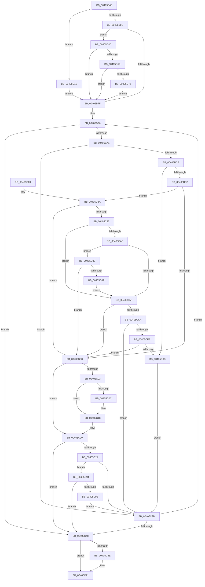

# MiFillNoReservationCluster

- RVA: `0x00405B40`–`0x00405DA3` (길이 `611` bytes)
- VA: `0x0000000140405B40`
- 실행 섹션: `.text`
- PDB 이름 있음: `예`; PDB Function 태그: `아니요`
- unwind 정보 RVA: `0x0009A86C`
- 디코드: `150`개 명령, `611/611` bytes 표시
- 미해석 바이트: `0` (있으면 어셈블리에 `.byte`로 보존)

> 이 문서는 커널 이미지의 기계어와 PDB 기호를 분석해 생성했습니다. 4번과 5번은 함수 원형과 자료형을 바이너리 사용 방식에서 추정한 C 해석이며 원본 소스 복구 결과는 아닙니다.

## 1. Dependencies

- 직접 호출 지점: **10**; 고유 호출 대상: **8**
- 직접 호출자로 확인된 함수: **1**
- RIP 상대 이미지 참조: **2**

### Outgoing calls
- `0x00405BB9` → [MiSafeLockPage](../32/MiSafeLockPage_function_00321620.md) (function, `0x00321620`)
- `0x00405BE7` → [MiReferencePageForModifiedWrite](MiReferencePageForModifiedWrite_function_00405DAC.md) (function, `0x00405DAC`)
- `0x00405C13` → [KiLowerIrqlProcessIrqlFlags](../4F/KiLowerIrqlProcessIrqlFlags_function_004F5698.md) (function, `0x004F5698`)
- `0x00405C6C` → [qsort](../50/qsort_function_005009F0.md) (function, `0x005009F0`)
- `0x00405CB7` → [MiSufficientAvailablePages](../36/MiSufficientAvailablePages_function_0036D0B0.md) (function, `0x0036D0B0`)
- `0x00405CCE` → [MiUnlockPage](../31/MiUnlockPage_function_0031A3E0.md) (function, `0x0031A3E0`)
- `0x00405CE6` → [MiReservePageFileSpace](../38/MiReservePageFileSpace_function_00383ED8.md) (function, `0x00383ED8`)
- `0x00405CEE` → [MiSafeLockPage](../32/MiSafeLockPage_function_00321620.md) (function, `0x00321620`)
- `0x00405D11` → [MiUnlockPage](../31/MiUnlockPage_function_0031A3E0.md) (function, `0x0031A3E0`)
- `0x00405D4C` → [MiIsStoreVirtualPagefileFull](../4A/MiIsStoreVirtualPagefileFull_function_004ACB9C.md) (function, `0x004ACB9C`)

### Direct callers
- [MiGatherPagefilePages](../37/MiGatherPagefilePages_function_00372B08.md) at `0x00372C92`

### Static image references
- `0x00405C03` → RVA `0x00FC6D20` (`ALMOSTRO`; read)
- `0x00405C5C` → RVA `0x00452B80` (`MiModifiedWriterNoReservationSort`; read)

## 2. Other-region calls and transfers

- 다른 실행 섹션으로 향하는 call: **0**
- 별도 외부 분기/꼬리 이동을 확인하지 못했습니다.

## 3. Assembly (complete function range)

```asm
00405B40  48 89 5C 24 08                  mov qword ptr [rsp + 8], rbx
00405B45  44 89 4C 24 20                  mov dword ptr [rsp + 0x20], r9d
00405B4A  55                              push rbp
00405B4B  56                              push rsi
00405B4C  57                              push rdi
00405B4D  41 54                           push r12
00405B4F  41 55                           push r13
00405B51  41 56                           push r14
00405B53  41 57                           push r15
00405B55  48 83 EC 20                     sub rsp, 0x20
00405B59  F6 82 AC 00 00 00 40            test byte ptr [rdx + 0xac], 0x40
00405B60  4D 8B E0                        mov r12, r8
00405B63  48 8B E9                        mov rbp, rcx
00405B66  0F 85 AF 01 00 00               jne 0x140405d1b
00405B6C  48 8D B9 80 0F 00 00            lea rdi, [rcx + 0xf80]
00405B73  48 8B 07                        mov rax, qword ptr [rdi]
00405B76  48 85 C0                        test rax, rax
00405B79  0F 84 CD 01 00 00               je 0x140405d4c
00405B7F  45 33 F6                        xor r14d, r14d
00405B82  C7 44 24 68 01 00 00 00         mov dword ptr [rsp + 0x68], 1
00405B8A  4C 8B 7F 10                     mov r15, qword ptr [rdi + 0x10]
00405B8E  48 B8 FF FF FF FF 3F 00 00 00   movabs rax, 0x3fffffffff
00405B98  4C 3B F8                        cmp r15, rax
00405B9B  0F 84 A7 00 00 00               je 0x140405c48
00405BA1  4B 8D 34 7F                     lea rsi, [r15 + r15*2]
00405BA5  48 C1 E6 04                     shl rsi, 4
00405BA9  48 B8 00 00 00 00 00 DE FF FF   movabs rax, 0xffffde0000000000
00405BB3  49 8B CF                        mov rcx, r15
00405BB6  48 03 F0                        add rsi, rax
00405BB9  E8 62 BA F1 FF                  call 0x140321620
00405BBE  44 8A E8                        mov r13b, al
00405BC1  3C 11                           cmp al, 0x11
00405BC3  74 78                           je 0x140405c3d
00405BC5  48 8B 57 10                     mov rdx, qword ptr [rdi + 0x10]
00405BC9  4C 3B FA                        cmp r15, rdx
00405BCC  0F 85 39 01 00 00               jne 0x140405d0b
00405BD2  8B 85 3C 04 00 00               mov eax, dword ptr [rbp + 0x43c]
00405BD8  85 C0                           test eax, eax
00405BDA  0F 85 AA 00 00 00               jne 0x140405c8a
00405BE0  8B 54 24 68                     mov edx, dword ptr [rsp + 0x68]
00405BE4  48 8B CE                        mov rcx, rsi
00405BE7  E8 C0 01 00 00                  call 0x140405dac
00405BEC  8B D8                           mov ebx, eax
00405BEE  48 B8 FF FF FF FF FF FF FF 7F   movabs rax, 0x7fffffffffffffff
00405BF8  F0 48 21 46 18                  lock and qword ptr [rsi + 0x18], rax
00405BFD  41 80 FD 02                     cmp r13b, 2
00405C01  73 1D                           jae 0x140405c20
00405C03  83 3D 16 11 BC 00 00            cmp dword ptr [rip + 0xbc1116], 0
00405C0A  74 0C                           je 0x140405c18
00405C0C  44 0F 20 C1                     mov rcx, cr8
00405C10  41 8A D5                        mov dl, r13b
00405C13  E8 80 FA 0E 00                  call 0x1404f5698
00405C18  41 0F B6 C5                     movzx eax, r13b
00405C1C  44 0F 22 C0                     mov cr8, rax
00405C20  85 DB                           test ebx, ebx
00405C22  74 24                           je 0x140405c48
00405C24  83 64 24 68 FE                  and dword ptr [rsp + 0x68], 0xfffffffe
00405C29  41 FF C6                        inc r14d
00405C2C  4D 89 3C 24                     mov qword ptr [r12], r15
00405C30  49 83 C4 08                     add r12, 8
00405C34  83 FB 03                        cmp ebx, 3
00405C37  0F 84 57 01 00 00               je 0x140405d94
00405C3D  44 3B 74 24 78                  cmp r14d, dword ptr [rsp + 0x78]
00405C42  0F 82 42 FF FF FF               jb 0x140405b8a
00405C48  41 83 FE 01                     cmp r14d, 1
00405C4C  76 23                           jbe 0x140405c71
00405C4E  4A 8D 0C F5 00 00 00 00         lea rcx, [r14*8]
00405C56  41 8B D6                        mov edx, r14d
00405C59  4C 2B E1                        sub r12, rcx
00405C5C  4C 8D 0D 1D CF 04 00            lea r9, [rip + 0x4cf1d]
00405C63  49 8B CC                        mov rcx, r12
00405C66  41 B8 08 00 00 00               mov r8d, 8
00405C6C  E8 7F AD 0F 00                  call 0x1405009f0
00405C71  48 8B 5C 24 60                  mov rbx, qword ptr [rsp + 0x60]
00405C76  41 8B C6                        mov eax, r14d
00405C79  48 83 C4 20                     add rsp, 0x20
00405C7D  41 5F                           pop r15
00405C7F  41 5E                           pop r14
00405C81  41 5D                           pop r13
00405C83  41 5C                           pop r12
00405C85  5F                              pop rdi
00405C86  5E                              pop rsi
00405C87  5D                              pop rbp
00405C88  C3                              ret
00405C89  CC                              int3
00405C8A  48 8B 46 28                     mov rax, qword ptr [rsi + 0x28]
00405C8E  48 85 C0                        test rax, rax
00405C91  0F 89 49 FF FF FF               jns 0x140405be0
00405C97  48 8B 46 28                     mov rax, qword ptr [rsi + 0x28]
00405C9B  48 0F BA E0 28                  bt rax, 0x28
00405CA0  72 0D                           jb 0x140405caf
00405CA2  48 8B 46 08                     mov rax, qword ptr [rsi + 8]
00405CA6  48 85 C0                        test rax, rax
00405CA9  0F 89 D3 00 00 00               jns 0x140405d82
00405CAF  BA A0 00 00 00                  mov edx, 0xa0
00405CB4  48 8B CD                        mov rcx, rbp
00405CB7  E8 F4 73 F6 FF                  call 0x14036d0b0
00405CBC  85 C0                           test eax, eax
00405CBE  0F 84 1C FF FF FF               je 0x140405be0
00405CC4  48 8B 5E 08                     mov rbx, qword ptr [rsi + 8]
00405CC8  41 8A D5                        mov dl, r13b
00405CCB  48 8B CE                        mov rcx, rsi
00405CCE  E8 0D 47 F1 FF                  call 0x14031a3e0
00405CD3  48 BA 00 00 00 00 00 00 00 80   movabs rdx, 0x8000000000000000
00405CDD  45 33 C0                        xor r8d, r8d
00405CE0  48 0B D3                        or rdx, rbx
00405CE3  48 8B CD                        mov rcx, rbp
00405CE6  E8 ED E1 F7 FF                  call 0x140383ed8
00405CEB  49 8B CF                        mov rcx, r15
00405CEE  E8 2D B9 F1 FF                  call 0x140321620
00405CF3  44 8A E8                        mov r13b, al
00405CF6  3C 11                           cmp al, 0x11
00405CF8  0F 84 3F FF FF FF               je 0x140405c3d
00405CFE  48 8B 47 10                     mov rax, qword ptr [rdi + 0x10]
00405D02  4C 3B F8                        cmp r15, rax
00405D05  0F 84 D5 FE FF FF               je 0x140405be0
00405D0B  41 8A D5                        mov dl, r13b
00405D0E  48 8B CE                        mov rcx, rsi
00405D11  E8 CA 46 F1 FF                  call 0x14031a3e0
00405D16  E9 22 FF FF FF                  jmp 0x140405c3d
00405D1B  8B 81 B4 04 00 00               mov eax, dword ptr [rcx + 0x4b4]
00405D21  48 8D BD 00 10 00 00            lea rdi, [rbp + 0x1000]
00405D28  0F B7 82 AC 00 00 00            movzx eax, word ptr [rdx + 0xac]
00405D2F  83 E0 0F                        and eax, 0xf
00405D32  48 83 C0 30                     add rax, 0x30
00405D36  48 6B C8 58                     imul rcx, rax, 0x58
00405D3A  48 03 CD                        add rcx, rbp
00405D3D  48 8B 01                        mov rax, qword ptr [rcx]
00405D40  48 85 C0                        test rax, rax
00405D43  48 0F 45 F9                     cmovne rdi, rcx
00405D47  E9 33 FE FF FF                  jmp 0x140405b7f
00405D4C  E8 4B 6E 0A 00                  call 0x1404acb9c
00405D51  85 C0                           test eax, eax
00405D53  0F 84 26 FE FF FF               je 0x140405b7f
00405D59  8B 8D B4 04 00 00               mov ecx, dword ptr [rbp + 0x4b4]
00405D5F  48 83 C1 30                     add rcx, 0x30
00405D63  48 6B F9 58                     imul rdi, rcx, 0x58
00405D67  48 03 FD                        add rdi, rbp
00405D6A  48 8B 07                        mov rax, qword ptr [rdi]
00405D6D  48 85 C0                        test rax, rax
00405D70  0F 85 09 FE FF FF               jne 0x140405b7f
00405D76  48 8D BD 00 10 00 00            lea rdi, [rbp + 0x1000]
00405D7D  E9 FD FD FF FF                  jmp 0x140405b7f
00405D82  48 8B 46 08                     mov rax, qword ptr [rsi + 8]
00405D86  48 85 C0                        test rax, rax
00405D89  0F 85 51 FE FF FF               jne 0x140405be0
00405D8F  E9 1B FF FF FF                  jmp 0x140405caf
00405D94  41 83 FE 10                     cmp r14d, 0x10
00405D98  0F 83 AA FE FF FF               jae 0x140405c48
00405D9E  E9 9A FE FF FF                  jmp 0x140405c3d
```

## 4. C-style interpretation (structured pseudocode)

```c
__int64 __fastcall MiFillNoReservationCluster(__int64 a1, __int64 a2, __int64 a3, int a4)
{
    __int64 result;
    __int64 v_r12;
    __int64 v_r14;
    __int64 v_rdi;
    __int64 v_rsi;
    __int64 v_rsp;
    unsigned int v_stack_p10;
    unsigned int v_stack_p20;
    unsigned __int64 v_stack_p8;

    v_stack_p8 = v_rbx;
    v_stack_p20 = a4;
    v_rsp = (v_rsp) - (32);
    if (((*(unsigned __int8 *)(a2 + 172)) & (64)) != 0) goto loc_00405D1B;
    if (*(unsigned __int64 *)(a1 + 3968) == 0) goto loc_00405D4C;
loc_00405B7F:
    v_r14 = 0;
    v_stack_p10 = 1;
loc_00405B8A:
    if ((*(unsigned __int64 *)(a1 + 3968 + 16)) == (*(unsigned __int64 *)(a1 + 3968))) goto loc_00405C48;
    v_rsi = (*(unsigned __int64 *)(a1 + 3968 + 16) + *(unsigned __int64 *)(a1 + 3968 + 16) * 2) << (4);
    v_rsi = (v_rsi) + (*(unsigned __int64 *)(a1 + 3968));
    result = MiSafeLockPage(*(unsigned __int64 *)(a1 + 3968 + 16), a2, a3, a4);
    if (((unsigned __int8)(result)) == 17) goto loc_00405C3D;
    if ((*(unsigned __int64 *)(a1 + 3968 + 16)) != (*(unsigned __int64 *)(a1 + 3968 + 16))) goto loc_00405D0B;
    if ((unsigned int)((unsigned int)(*(unsigned int *)(a1 + 1084))) != 0) goto loc_00405C8A;
loc_00405BE0:
    result = MiReferencePageForModifiedWrite(v_rsi, (unsigned int)(v_stack_p10), a3, a4);
    if (((unsigned __int8)((unsigned __int8)(result))) >= 2) goto loc_00405C20;
    if ((*(unsigned int *)(v_rip + 12325142)) != 0) {
        a1 = v_cr8;
        a2 = (unsigned __int8)((unsigned __int8)(result));
        result = KiLowerIrqlProcessIrqlFlags(a1, a2, a3, a4);
    }
loc_00405C20:
    if ((unsigned int)((unsigned int)((unsigned int)(result))) == 0) goto loc_00405C48;
    v_r14 = (unsigned int)((v_r14) + 1);
    *(unsigned __int64 *)(a3) = *(unsigned __int64 *)(a1 + 3968 + 16);
    v_r12 = (a3) + (8);
    if (((unsigned int)((unsigned int)((unsigned int)(result)))) == 3) goto loc_00405D94;
loc_00405C3D:
    if (((unsigned int)(v_r14)) < v_stack_p20) goto loc_00405B8A;
loc_00405C48:
    result = (unsigned __int8)((unsigned __int8)(result));
    if (((unsigned int)(v_r14)) >= = 1) {
        a1 = v_r14 * 8;
        a2 = (unsigned int)(v_r14);
        v_r12 = (v_r12) - (a1);
        a4 = v_rip + 315165;
        a1 = v_r12;
        a3 = 8;
        result = qsort(a1, a2, a3, a4);
    }
    v_rsp = (v_rsp) + (32);
    return (unsigned int)((unsigned int)(v_r14));
loc_00405C8A:
    if (!sign_flag) goto loc_00405BE0;
    if (condition_is_below) goto loc_00405CAF;
    if (!sign_flag) goto loc_00405D82;
loc_00405CAF:
    result = MiSufficientAvailablePages(a1, 160, a3, a4);
    if ((unsigned int)(result) == 0) goto loc_00405BE0;
    result = MiUnlockPage(v_rsi, (unsigned __int8)((unsigned __int8)(result)), a3, a4);
    a3 = 0;
    a2 = ((unsigned __int8)((unsigned __int8)(result))) | (*(unsigned __int64 *)(v_rsi + 8));
    result = MiReservePageFileSpace(a1, a2, a3, a4);
    result = MiSafeLockPage(*(unsigned __int64 *)(a1 + 3968 + 16), a2, a3, a4);
    if (((unsigned __int8)(result)) == 17) goto loc_00405C3D;
    if ((*(unsigned __int64 *)(a1 + 3968 + 16)) == (*(unsigned __int64 *)(a1 + 3968 + 16))) goto loc_00405BE0;
loc_00405D0B:
    result = MiUnlockPage(v_rsi, (unsigned __int8)((unsigned __int8)(result)), a3, a4);
    goto loc_00405C3D;
loc_00405D1B:
    result = (unsigned int)((*(unsigned __int16 *)((unsigned __int8)((unsigned __int8)(result)) + 172)) & (15));
    result = (result) + (48);
    a1 = (v_rsi) * (result);
    a1 = (a1) + (a1);
    v_rdi = a1 + 4096;
    if (*(unsigned __int64 *)(a1) != 0) { v_rdi = a1; }
    goto loc_00405B7F;
loc_00405D4C:
    result = MiIsStoreVirtualPagefileFull(a1, (unsigned __int8)((unsigned __int8)(result)), a3, a4);
    if ((unsigned int)(result) == 0) goto loc_00405B7F;
    a1 = ((unsigned int)(*(unsigned int *)(a1 + 1204))) + (48);
    v_rdi = (v_rdi) * (a1);
    v_rdi = (v_rdi) + (a1);
    if (*(unsigned __int64 *)(v_rdi) != 0) goto loc_00405B7F;
    goto loc_00405B7F;
loc_00405D82:
    if (*(unsigned __int64 *)(v_rsi + 8) != 0) goto loc_00405BE0;
    goto loc_00405CAF;
loc_00405D94:
    if (((unsigned int)(v_r14)) >= 16) goto loc_00405C48;
    goto loc_00405C3D;
}
```

## 5. (Beta) C Style

```c
int64_t MiFillNoReservationCluster(void *Arg1, void *Arg2, void *Arg3, int32_t Arg4)
{
    uint8_t *arg1 = (uint8_t *)Arg1;
    uint8_t *arg2 = (uint8_t *)Arg2;
    uint8_t *arg3 = (uint8_t *)Arg3;

    int64_t result;
    int64_t local_r12;
    int64_t local_r14;
    int64_t local_rdi;
    int64_t local_rsi;
    int64_t local_rsp;
    uint32_t v_stack_p10;
    uint32_t v_stack_p20;
    uint64_t v_stack_p8;

    v_stack_p8 = local_rbx;
    v_stack_p20 = Arg4;
    local_rsp = (local_rsp) - (32);
    if (((*(uint8_t *)(arg2 + 0xAC)) & (64)) != 0) goto loc_00405D1B;
    if (*(uint64_t *)(arg1 + 0xF80) == 0) goto loc_00405D4C;
loc_00405B7F:
    local_r14 = 0;
    v_stack_p10 = 1;
loc_00405B8A:
    if ((*(uint64_t *)(arg1 + 0xF80 + 0x10)) == (*(uint64_t *)(arg1 + 0xF80))) goto loc_00405C48;
    local_rsi = (*(uint64_t *)(arg1 + 0xF80 + 0x10) + *(uint64_t *)(arg1 + 0xF80 + 0x10) * 2) << (4);
    local_rsi = (local_rsi) + (*(uint64_t *)(arg1 + 0xF80));
    result = MiSafeLockPage(*(uint64_t *)(arg1 + 0xF80 + 0x10), Arg2, Arg3, Arg4);
    if (((uint8_t)(result)) == 17) goto loc_00405C3D;
    if ((*(uint64_t *)(arg1 + 0xF80 + 0x10)) != (*(uint64_t *)(arg1 + 0xF80 + 0x10))) goto loc_00405D0B;
    if ((uint32_t)((uint32_t)(*(uint32_t *)(arg1 + 0x43C))) != 0) goto loc_00405C8A;
loc_00405BE0:
    result = MiReferencePageForModifiedWrite(local_rsi, (uint32_t)(v_stack_p10), Arg3, Arg4);
    if (((uint8_t)((uint8_t)(result))) >= 2) goto loc_00405C20;
    if ((*(uint32_t *)(v_rip + 0xBC1116)) != 0) {
        Arg1 = v_cr8;
        Arg2 = (uint8_t)((uint8_t)(result));
        result = KiLowerIrqlProcessIrqlFlags(Arg1, Arg2, Arg3, Arg4);
    }
loc_00405C20:
    if ((uint32_t)((uint32_t)((uint32_t)(result))) == 0) goto loc_00405C48;
    local_r14 = (uint32_t)((local_r14) + 1);
    *(uint64_t *)(arg3) = *(uint64_t *)(arg1 + 0xF80 + 0x10);
    local_r12 = (Arg3) + (8);
    if (((uint32_t)((uint32_t)((uint32_t)(result)))) == 3) goto loc_00405D94;
loc_00405C3D:
    if (((uint32_t)(local_r14)) < v_stack_p20) goto loc_00405B8A;
loc_00405C48:
    result = (uint8_t)((uint8_t)(result));
    if (((uint32_t)(local_r14)) >= = 1) {
        Arg1 = local_r14 * 8;
        Arg2 = (uint32_t)(local_r14);
        local_r12 = (local_r12) - (Arg1);
        Arg4 = v_rip + 315165;
        Arg1 = local_r12;
        Arg3 = 8;
        result = qsort(Arg1, Arg2, Arg3, Arg4);
    }
    local_rsp = (local_rsp) + (32);
    return (uint32_t)((uint32_t)(local_r14));
loc_00405C8A:
    if (!sign_flag) goto loc_00405BE0;
    if (condition_is_below) goto loc_00405CAF;
    if (!sign_flag) goto loc_00405D82;
loc_00405CAF:
    result = MiSufficientAvailablePages(Arg1, 160, Arg3, Arg4);
    if ((uint32_t)(result) == 0) goto loc_00405BE0;
    result = MiUnlockPage(local_rsi, (uint8_t)((uint8_t)(result)), Arg3, Arg4);
    Arg3 = 0;
    Arg2 = ((uint8_t)((uint8_t)(result))) | (*(uint64_t *)(local_rsi + 0x8));
    result = MiReservePageFileSpace(Arg1, Arg2, Arg3, Arg4);
    result = MiSafeLockPage(*(uint64_t *)(arg1 + 0xF80 + 0x10), Arg2, Arg3, Arg4);
    if (((uint8_t)(result)) == 17) goto loc_00405C3D;
    if ((*(uint64_t *)(arg1 + 0xF80 + 0x10)) == (*(uint64_t *)(arg1 + 0xF80 + 0x10))) goto loc_00405BE0;
loc_00405D0B:
    result = MiUnlockPage(local_rsi, (uint8_t)((uint8_t)(result)), Arg3, Arg4);
    goto loc_00405C3D;
loc_00405D1B:
    result = (uint32_t)((*(uint16_t *)((uint8_t)((uint8_t)(result)) + 0xAC)) & (15));
    result = (result) + (48);
    Arg1 = (local_rsi) * (result);
    Arg1 = (Arg1) + (Arg1);
    local_rdi = Arg1 + 4096;
    if (*(uint64_t *)(arg1) != 0) { local_rdi = Arg1; }
    goto loc_00405B7F;
loc_00405D4C:
    result = MiIsStoreVirtualPagefileFull(Arg1, (uint8_t)((uint8_t)(result)), Arg3, Arg4);
    if ((uint32_t)(result) == 0) goto loc_00405B7F;
    Arg1 = ((uint32_t)(*(uint32_t *)(arg1 + 0x4B4))) + (48);
    local_rdi = (local_rdi) * (Arg1);
    local_rdi = (local_rdi) + (Arg1);
    if (*(uint64_t *)(local_rdi) != 0) goto loc_00405B7F;
    goto loc_00405B7F;
loc_00405D82:
    if (*(uint64_t *)(local_rsi + 0x8) != 0) goto loc_00405BE0;
    goto loc_00405CAF;
loc_00405D94:
    if (((uint32_t)(local_r14)) >= 16) goto loc_00405C48;
    goto loc_00405C3D;
}
```

### 관측된 메모리 오프셋

구조체 형식이 확인되지 않은 접근은 인자 기준의 오프셋으로만 기록했습니다.

| 기준 인자 | 오프셋 표현 | 폭 (bit) | 접근 |
|---|---:|---:|---|
| `Arg1` | `+ 0x0` | `64` | `R` |
| `Arg1` | `+ 0x43C` | `32` | `R` |
| `Arg1` | `+ 0x4B4` | `32` | `R` |
| `Arg1` | `+ 0xF80` | `64` | `R` |
| `Arg1` | `+ 0x1000` | `64` | `R` |
| `Arg2` | `+ 0xAC` | `8` | `R` |
| `Arg2` | `+ 0xAC` | `16` | `R` |
| `Arg3` | `+ 0x0` | `64` | `W` |

## 6. Execution-region graph

[열기: 2D/3D 그래프와 함수 탐색 컨트롤 패널](../../../control-panel.html?section=text&rva=0x00405B40&view=graph)

- 2D 그래프는 위에서 아래로 흐르고, 3D 그래프는 빈 공간을 드래그해 회전합니다. Shift+드래그는 이동, 휠은 확대·축소, 함수 노드 선택은 대상 보고서 이동입니다.

### Static fallback


