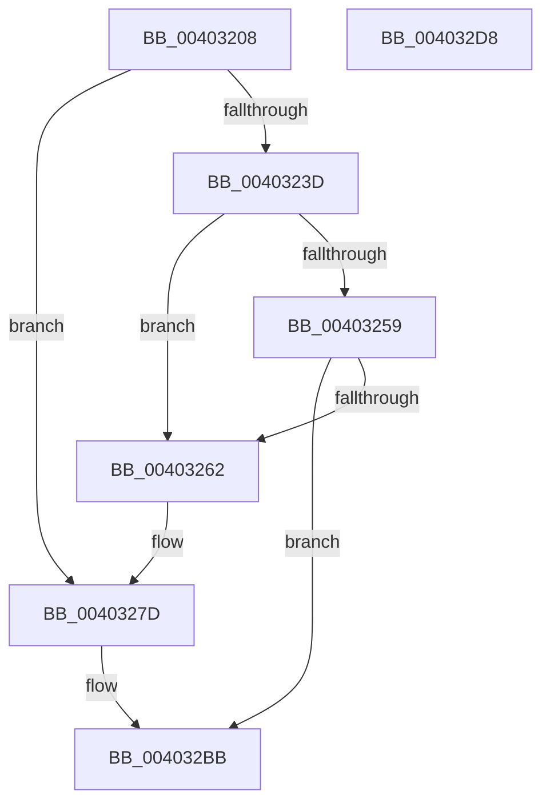

# MiFlushFileOnlyMdl

- RVA: `0x00403208`–`0x004032D9` (길이 `209` bytes)
- VA: `0x0000000140403208`
- 실행 섹션: `.text`
- PDB 이름 있음: `예`; PDB Function 태그: `아니요`
- unwind 정보 RVA: `0x0005D7BC`
- 디코드: `56`개 명령, `209/209` bytes 표시
- 미해석 바이트: `0` (있으면 어셈블리에 `.byte`로 보존)

> 이 문서는 커널 이미지의 기계어와 PDB 기호를 분석해 생성했습니다. 4번과 5번은 함수 원형과 자료형을 바이너리 사용 방식에서 추정한 C 해석이며 원본 소스 복구 결과는 아닙니다.

## 1. Dependencies

- 직접 호출 지점: **3**; 고유 호출 대상: **3**
- 직접 호출자로 확인된 함수: **2**
- RIP 상대 이미지 참조: **0**

### Outgoing calls
- `0x0040324F` → [MiTransferFileExtent](../4C/MiTransferFileExtent_function_004CAADC.md) (function, `0x004CAADC`)
- `0x00403277` → [KeBugCheckEx](../4F/KeBugCheckEx_function_004FD660.md) (function, `0x004FD660`)
- `0x00403294` → [MiPersistMdl](MiPersistMdl_function_00402B2C.md) (function, `0x00402B2C`)

### Direct callers
- [MiFlushSection](MiFlushSection_function_004036B0.md) at `0x0040459A`
- [MiGatherMappedPages](MiGatherMappedPages_function_00404E80.md) at `0x004052AE`

### Static image references
- 디코드된 RIP-relative 메모리 참조가 없습니다.

## 2. Other-region calls and transfers

- 다른 실행 섹션으로 향하는 call: **0**
- 별도 외부 분기/꼬리 이동을 확인하지 못했습니다.

## 3. Assembly (complete function range)

```asm
00403208  4C 8B DC                        mov r11, rsp
0040320B  49 89 5B 08                     mov qword ptr [r11 + 8], rbx
0040320F  49 89 6B 10                     mov qword ptr [r11 + 0x10], rbp
00403213  49 89 73 18                     mov qword ptr [r11 + 0x18], rsi
00403217  49 89 7B 20                     mov qword ptr [r11 + 0x20], rdi
0040321B  41 56                           push r14
0040321D  48 83 EC 30                     sub rsp, 0x30
00403221  48 8B 7C 24 60                  mov rdi, qword ptr [rsp + 0x60]
00403226  49 8B F0                        mov rsi, r8
00403229  48 8B EA                        mov rbp, rdx
0040322C  48 8B 07                        mov rax, qword ptr [rdi]
0040322F  8A 48 3E                        mov cl, byte ptr [rax + 0x3e]
00403232  80 E1 0C                        and cl, 0xc
00403235  80 F9 08                        cmp cl, 8
00403238  48 8B CA                        mov rcx, rdx
0040323B  75 40                           jne 0x14040327d
0040323D  48 8B 5C 24 68                  mov rbx, qword ptr [rsp + 0x68]
00403242  41 B9 01 00 00 00               mov r9d, 1
00403248  48 8B D7                        mov rdx, rdi
0040324B  49 89 5B E8                     mov qword ptr [r11 - 0x18], rbx
0040324F  E8 88 78 0C 00                  call 0x1404caadc
00403254  83 3B 00                        cmp dword ptr [rbx], 0
00403257  75 09                           jne 0x140403262
00403259  8B 45 28                        mov eax, dword ptr [rbp + 0x28]
0040325C  48 39 43 08                     cmp qword ptr [rbx + 8], rax
00403260  74 59                           je 0x1404032bb
00403262  4C 8B CE                        mov r9, rsi
00403265  48 89 6C 24 20                  mov qword ptr [rsp + 0x20], rbp
0040326A  4C 8B C7                        mov r8, rdi
0040326D  BA 84 14 00 00                  mov edx, 0x1484
00403272  B9 1A 00 00 00                  mov ecx, 0x1a
00403277  E8 E4 A3 0F 00                  call 0x1404fd660
0040327C  CC                              int3
0040327D  8B 7A 2C                        mov edi, dword ptr [rdx + 0x2c]
00403280  8B 5A 20                        mov ebx, dword ptr [rdx + 0x20]
00403283  8B 72 28                        mov esi, dword ptr [rdx + 0x28]
00403286  4C 8B 74 24 68                  mov r14, qword ptr [rsp + 0x68]
0040328B  49 83 66 08 00                  and qword ptr [r14 + 8], 0
00403290  41 83 26 00                     and dword ptr [r14], 0
00403294  E8 93 F8 FF FF                  call 0x140402b2c
00403299  8D 0C 1F                        lea ecx, [rdi + rbx]
0040329C  81 E1 FF 0F 00 00               and ecx, 0xfff
004032A2  48 8D 86 FF 0F 00 00            lea rax, [rsi + 0xfff]
004032A9  48 03 C8                        add rcx, rax
004032AC  48 81 E1 00 F0 FF FF            and rcx, 0xfffffffffffff000
004032B3  41 83 26 00                     and dword ptr [r14], 0
004032B7  49 89 4E 08                     mov qword ptr [r14 + 8], rcx
004032BB  48 8B 5C 24 40                  mov rbx, qword ptr [rsp + 0x40]
004032C0  33 C0                           xor eax, eax
004032C2  48 8B 6C 24 48                  mov rbp, qword ptr [rsp + 0x48]
004032C7  48 8B 74 24 50                  mov rsi, qword ptr [rsp + 0x50]
004032CC  48 8B 7C 24 58                  mov rdi, qword ptr [rsp + 0x58]
004032D1  48 83 C4 30                     add rsp, 0x30
004032D5  41 5E                           pop r14
004032D7  C3                              ret
004032D8  CC                              int3
```

## 4. C-style interpretation (structured pseudocode)

```c
__int64 __fastcall MiFlushFileOnlyMdl(__int64 a1, __int64 a2, __int64 a3, __int64 a4, __int64 a5, __int64 a6)
{
    __int64 result;
    __int64 v_rsp;
    unsigned __int64 v_stack_m18;
    unsigned __int64 v_stack_p10;
    unsigned __int64 v_stack_p18;
    unsigned __int64 v_stack_p20;
    unsigned __int64 v_stack_p8;

    *(unsigned __int64 *)(v_rsp + 8) = v_rbx;
    *(unsigned __int64 *)(v_rsp + 16) = v_rbp;
    *(unsigned __int64 *)(v_rsp + 24) = v_rsi;
    *(unsigned __int64 *)(v_rsp + 32) = v_rdi;
    v_rsp = (v_rsp) - (48);
    a1 = (unsigned __int8)((*(unsigned __int8 *)(*(unsigned __int64 *)(a5) + 62)) & (12));
    if (((unsigned __int8)(a1)) != 8) goto loc_0040327D;
    *(unsigned __int64 *)(v_rsp - 24) = a6;
    result = MiTransferFileExtent(a2, a5, a3, 1);
    if ((*(unsigned int *)(a6)) != 0) goto loc_00403262;
    if ((*(unsigned __int64 *)(a6 + 8)) == ((unsigned int)(*(unsigned int *)(a2 + 40)))) goto loc_004032BB;
loc_00403262:
    v_stack_m18 = a2;
    result = KeBugCheckEx(26, (unsigned int)(0x1484ULL), a5, a3);
loc_0040327D:
    result = MiPersistMdl(26, (unsigned int)(0x1484ULL), a5, a3);
    a1 = (unsigned int)(((unsigned int)(*(unsigned int *)((unsigned int)(0x1484ULL) + 44)) + (unsigned int)(*(unsigned int *)((unsigned int)(0x1484ULL) + 32)) * 1) & (0xFFFULL));
    a1 = (a1) + ((unsigned int)(*(unsigned int *)((unsigned int)(0x1484ULL) + 40)) + 4095);
    a1 = (a1) & (0xFFFFFFFFFFFFF000ULL);
    *(unsigned __int64 *)(a6 + 8) = a1;
loc_004032BB:
    result = 0;
    v_rsp = (v_rsp) + (48);
    return result;
}
```

## 5. (Beta) C Style

```c
int64_t MiFlushFileOnlyMdl(int64_t Arg1, void *Arg2, int64_t Arg3, int64_t Arg4, void *Arg5, void *Arg6)
{
    uint8_t *arg2 = (uint8_t *)Arg2;
    uint8_t *arg5 = (uint8_t *)Arg5;
    uint8_t *arg6 = (uint8_t *)Arg6;

    int64_t result;
    int64_t local_rsp;
    uint64_t v_stack_m18;
    uint64_t v_stack_p10;
    uint64_t v_stack_p18;
    uint64_t v_stack_p20;
    uint64_t v_stack_p8;

    *(uint64_t *)(local_rsp + 0x8) = local_rbx;
    *(uint64_t *)(local_rsp + 0x10) = local_rbp;
    *(uint64_t *)(local_rsp + 0x18) = local_rsi;
    *(uint64_t *)(local_rsp + 0x20) = local_rdi;
    local_rsp = (local_rsp) - (48);
    Arg1 = (uint8_t)((*(uint8_t *)(*(uint64_t *)(arg5) + 0x3E)) & (12));
    if (((uint8_t)(Arg1)) != 8) goto loc_0040327D;
    *(void **)(local_rsp - 0x18) = Arg6;
    result = MiTransferFileExtent(Arg2, Arg5, Arg3, 1);
    if ((*(uint32_t *)(arg6)) != 0) goto loc_00403262;
    if ((*(uint64_t *)(arg6 + 0x8)) == ((uint32_t)(*(uint32_t *)(arg2 + 0x28)))) goto loc_004032BB;
loc_00403262:
    v_stack_m18 = Arg2;
    result = KeBugCheckEx(26, (uint32_t)(0x1484ULL), Arg5, Arg3);
loc_0040327D:
    result = MiPersistMdl(26, (uint32_t)(0x1484ULL), Arg5, Arg3);
    Arg1 = (uint32_t)(((uint32_t)(*(uint32_t *)((uint32_t)(0x1484ULL) + 0x2C)) + (uint32_t)(*(uint32_t *)((uint32_t)(0x1484ULL) + 0x20)) * 1) & (0xFFFULL));
    Arg1 = (Arg1) + ((uint32_t)(*(uint32_t *)((uint32_t)(0x1484ULL) + 0x28)) + 4095);
    Arg1 = (Arg1) & (0xFFFFFFFFFFFFF000ULL);
    *(uint64_t *)(arg6 + 0x8) = Arg1;
loc_004032BB:
    result = 0;
    local_rsp = (local_rsp) + (48);
    return result;
}
```

### 관측된 메모리 오프셋

구조체 형식이 확인되지 않은 접근은 인자 기준의 오프셋으로만 기록했습니다.

| 기준 인자 | 오프셋 표현 | 폭 (bit) | 접근 |
|---|---:|---:|---|
| `Arg2` | `+ 0x28` | `32` | `R` |
| `Arg5` | `+ 0x0` | `64` | `R` |
| `Arg6` | `+ 0x0` | `32` | `R` |
| `Arg6` | `+ 0x0` | `32` | `R/W` |
| `Arg6` | `+ 0x8` | `64` | `R` |
| `Arg6` | `+ 0x8` | `64` | `R/W` |
| `Arg6` | `+ 0x8` | `64` | `W` |

## 6. Execution-region graph

[열기: 2D/3D 그래프와 함수 탐색 컨트롤 패널](../../../control-panel.html?section=text&rva=0x00403208&view=graph)

- 2D 그래프는 위에서 아래로 흐르고, 3D 그래프는 빈 공간을 드래그해 회전합니다. Shift+드래그는 이동, 휠은 확대·축소, 함수 노드 선택은 대상 보고서 이동입니다.

### Static fallback


