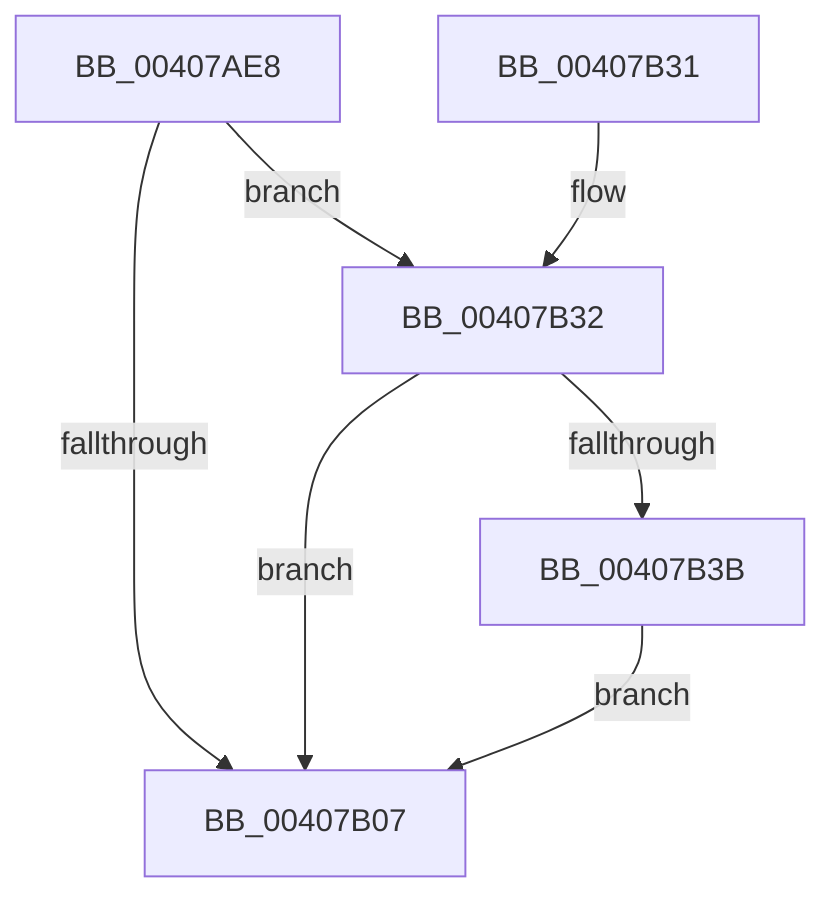

# MiFreeModWriterEntry

- RVA: `0x00407AE8`–`0x00407B44` (길이 `92` bytes)
- VA: `0x0000000140407AE8`
- 실행 섹션: `.text`
- PDB 이름 있음: `예`; PDB Function 태그: `아니요`
- unwind 정보 RVA: `0x0009A3D0`
- 디코드: `29`개 명령, `92/92` bytes 표시
- 미해석 바이트: `0` (있으면 어셈블리에 `.byte`로 보존)

> 이 문서는 커널 이미지의 기계어와 PDB 기호를 분석해 생성했습니다. 4번과 5번은 함수 원형과 자료형을 바이너리 사용 방식에서 추정한 C 해석이며 원본 소스 복구 결과는 아닙니다.

## 1. Dependencies

- 직접 호출 지점: **3**; 고유 호출 대상: **2**
- 직접 호출자로 확인된 함수: **4**
- RIP 상대 이미지 참조: **0**

### Outgoing calls
- `0x00407B0C` → [ExFreePoolWithTag](../../poolcode/B8/ExFreePoolWithTag_function_00B82870.md) (function, `0x00B82870`)
- `0x00407B1C` → [MiReleaseWriteInProgressCharges](MiReleaseWriteInProgressCharges_function_00407B4C.md) (function, `0x00407B4C`)
- `0x00407B3D` → [ExFreePoolWithTag](../../poolcode/B8/ExFreePoolWithTag_function_00B82870.md) (function, `0x00B82870`)

### Direct callers
- [MiDeleteMappedMdls](MiDeleteMappedMdls_function_00402C10.md) at `0x00402C70`
- [MiMappedPageWriter](MiMappedPageWriter_function_00404AC0.md) at `0x00404CEB`
- [MiWriteComplete](MiWriteComplete_function_004069B0.md) at `0x00406BFF`
- [MiDeletePagefile](../../page/7F/MiDeletePagefile_function_007FFB88.md) at `0x007FFBB1`

### Static image references
- 디코드된 RIP-relative 메모리 참조가 없습니다.

## 2. Other-region calls and transfers

- 다른 실행 섹션으로 향하는 call: **2**
  - `0x00407B0C` → [ExFreePoolWithTag](../../poolcode/B8/ExFreePoolWithTag_function_00B82870.md) (`.text` → `POOLCODE`)
  - `0x00407B3D` → [ExFreePoolWithTag](../../poolcode/B8/ExFreePoolWithTag_function_00B82870.md) (`.text` → `POOLCODE`)
- 별도 외부 분기/꼬리 이동을 확인하지 못했습니다.

## 3. Assembly (complete function range)

```asm
00407AE8  48 89 5C 24 08                  mov qword ptr [rsp + 8], rbx
00407AED  48 89 74 24 10                  mov qword ptr [rsp + 0x10], rsi
00407AF2  57                              push rdi
00407AF3  48 83 EC 20                     sub rsp, 0x20
00407AF7  8B 41 28                        mov eax, dword ptr [rcx + 0x28]
00407AFA  8B FA                           mov edi, edx
00407AFC  48 8B 71 38                     mov rsi, qword ptr [rcx + 0x38]
00407B00  48 8B D9                        mov rbx, rcx
00407B03  A8 20                           test al, 0x20
00407B05  75 2B                           jne 0x140407b32
00407B07  33 D2                           xor edx, edx
00407B09  48 8B CB                        mov rcx, rbx
00407B0C  E8 5F AD 77 00                  call 0x140b82870
00407B11  44 8B C7                        mov r8d, edi
00407B14  BA 01 00 00 00                  mov edx, 1
00407B19  48 8B CE                        mov rcx, rsi
00407B1C  E8 2B 00 00 00                  call 0x140407b4c
00407B21  48 8B 5C 24 30                  mov rbx, qword ptr [rsp + 0x30]
00407B26  48 8B 74 24 38                  mov rsi, qword ptr [rsp + 0x38]
00407B2B  48 83 C4 20                     add rsp, 0x20
00407B2F  5F                              pop rdi
00407B30  C3                              ret
00407B31  CC                              int3
00407B32  48 8B 49 48                     mov rcx, qword ptr [rcx + 0x48]
00407B36  48 85 C9                        test rcx, rcx
00407B39  74 CC                           je 0x140407b07
00407B3B  33 D2                           xor edx, edx
00407B3D  E8 2E AD 77 00                  call 0x140b82870
00407B42  EB C3                           jmp 0x140407b07
```

## 4. C-style interpretation (structured pseudocode)

```c
__int64 __fastcall MiFreeModWriterEntry(__int64 a1, int a2)
{
    __int64 result;
    __int64 v_rsp;
    unsigned __int64 v_stack_p10;
    unsigned __int64 v_stack_p8;

    v_stack_p8 = v_rbx;
    v_stack_p10 = v_rsi;
    v_rsp = (v_rsp) - (32);
    if ((((unsigned __int8)((unsigned int)(*(unsigned int *)(a1 + 40)))) & (32)) != 0) goto loc_00407B32;
loc_00407B07:
    a2 = 0;
    result = ExFreePoolWithTag(a1, a2, a3, a4);
    result = MiReleaseWriteInProgressCharges(*(unsigned __int64 *)(a1 + 56), 1, (unsigned int)((unsigned int)((unsigned int)(a2))), a4);
    v_rsp = (v_rsp) + (32);
    return result;
loc_00407B32:
    if (*(unsigned __int64 *)(*(unsigned __int64 *)(a1 + 56) + 72) == 0) goto loc_00407B07;
    a2 = 0;
    result = ExFreePoolWithTag(*(unsigned __int64 *)(*(unsigned __int64 *)(a1 + 56) + 72), a2, (unsigned int)((unsigned int)((unsigned int)(a2))), a4);
    goto loc_00407B07;
}
```

## 5. (Beta) C Style

```c
int64_t MiFreeModWriterEntry(void *Arg1, int32_t Arg2)
{
    uint8_t *arg1 = (uint8_t *)Arg1;

    int64_t result;
    int64_t local_rsp;
    uint64_t v_stack_p10;
    uint64_t v_stack_p8;

    v_stack_p8 = local_rbx;
    v_stack_p10 = local_rsi;
    local_rsp = (local_rsp) - (32);
    if ((((uint8_t)((uint32_t)(*(uint32_t *)(arg1 + 0x28)))) & (32)) != 0) goto loc_00407B32;
loc_00407B07:
    Arg2 = 0;
    result = ExFreePoolWithTag(Arg1, Arg2, a3, a4);
    result = MiReleaseWriteInProgressCharges(*(uint64_t *)(arg1 + 0x38), 1, (uint32_t)((uint32_t)((uint32_t)(Arg2))), a4);
    local_rsp = (local_rsp) + (32);
    return result;
loc_00407B32:
    if (*(uint64_t *)(*(uint64_t *)(arg1 + 0x38) + 0x48) == 0) goto loc_00407B07;
    Arg2 = 0;
    result = ExFreePoolWithTag(*(uint64_t *)(*(uint64_t *)(arg1 + 0x38) + 0x48), Arg2, (uint32_t)((uint32_t)((uint32_t)(Arg2))), a4);
    goto loc_00407B07;
}
```

### 관측된 메모리 오프셋

구조체 형식이 확인되지 않은 접근은 인자 기준의 오프셋으로만 기록했습니다.

| 기준 인자 | 오프셋 표현 | 폭 (bit) | 접근 |
|---|---:|---:|---|
| `Arg1` | `+ 0x28` | `32` | `R` |
| `Arg1` | `+ 0x38` | `64` | `R` |
| `Arg1` | `+ 0x48` | `64` | `R` |

## 6. Execution-region graph

[열기: 2D/3D 그래프와 함수 탐색 컨트롤 패널](../../../control-panel.html?section=text&rva=0x00407AE8&view=graph)

- 2D 그래프는 위에서 아래로 흐르고, 3D 그래프는 빈 공간을 드래그해 회전합니다. Shift+드래그는 이동, 휠은 확대·축소, 함수 노드 선택은 대상 보고서 이동입니다.

### Static fallback


