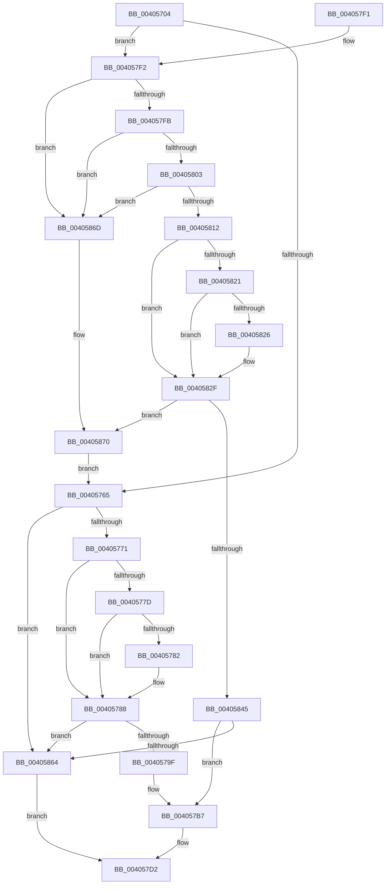

# MiGetPageForWriteCluster

- RVA: `0x00405704`–`0x0040587E` (길이 `378` bytes)
- VA: `0x0000000140405704`
- 실행 섹션: `.text`
- PDB 이름 있음: `예`; PDB Function 태그: `아니요`
- unwind 정보 RVA: `0x0009A820`
- 디코드: `104`개 명령, `378/378` bytes 표시
- 미해석 바이트: `0` (있으면 어셈블리에 `.byte`로 보존)

> 이 문서는 커널 이미지의 기계어와 PDB 기호를 분석해 생성했습니다. 4번과 5번은 함수 원형과 자료형을 바이너리 사용 방식에서 추정한 C 해석이며 원본 소스 복구 결과는 아닙니다.

## 1. Dependencies

- 직접 호출 지점: **4**; 고유 호출 대상: **3**
- 직접 호출자로 확인된 함수: **1**
- RIP 상대 이미지 참조: **2**

### Outgoing calls
- `0x0040574A` → [MiLockTransitionLeafPageEx](MiLockTransitionLeafPageEx_function_00405884.md) (function, `0x00405884`)
- `0x00405847` → [MiReferencePageForModifiedWrite](MiReferencePageForModifiedWrite_function_00405DAC.md) (function, `0x00405DAC`)
- `0x00405856` → [MiUnlockPage](../31/MiUnlockPage_function_0031A3E0.md) (function, `0x0031A3E0`)
- `0x00405874` → [MiUnlockPage](../31/MiUnlockPage_function_0031A3E0.md) (function, `0x0031A3E0`)

### Direct callers
- [MiBuildReservationCluster](MiBuildReservationCluster_function_004071A0.md) at `0x00407497`
- [MiBuildReservationCluster](MiBuildReservationCluster_function_004071A0.md) at `0x0040759D`

### Static image references
- `0x00405771` → RVA `0x00E2DC80` (`.data`; read)
- `0x0040579F` → RVA `0x00E37478` (`.data`; read)

## 2. Other-region calls and transfers

- 다른 실행 섹션으로 향하는 call: **0**
- 별도 외부 분기/꼬리 이동을 확인하지 못했습니다.

## 3. Assembly (complete function range)

```asm
00405704  4C 8B DC                        mov r11, rsp
00405707  49 89 5B 08                     mov qword ptr [r11 + 8], rbx
0040570B  49 89 6B 10                     mov qword ptr [r11 + 0x10], rbp
0040570F  49 89 73 18                     mov qword ptr [r11 + 0x18], rsi
00405713  49 89 7B 20                     mov qword ptr [r11 + 0x20], rdi
00405717  41 54                           push r12
00405719  41 56                           push r14
0040571B  41 57                           push r15
0040571D  48 83 EC 30                     sub rsp, 0x30
00405721  4C 8B 7C 24 70                  mov r15, qword ptr [rsp + 0x70]
00405726  48 8B C2                        mov rax, rdx
00405729  49 8B D8                        mov rbx, r8
0040572C  49 8D 53 D8                     lea rdx, [r11 - 0x28]
00405730  48 8B E9                        mov rbp, rcx
00405733  33 F6                           xor esi, esi
00405735  45 33 C0                        xor r8d, r8d
00405738  40 88 74 24 20                  mov byte ptr [rsp + 0x20], sil
0040573D  48 8B C8                        mov rcx, rax
00405740  41 C7 07 01 00 00 00            mov dword ptr [r15], 1
00405747  4D 8B F1                        mov r14, r9
0040574A  E8 35 01 00 00                  call 0x140405884
0040574F  49 BC 00 00 00 00 00 DE FF FF   movabs r12, 0xffffde0000000000
00405759  48 8B F8                        mov rdi, rax
0040575C  48 85 C0                        test rax, rax
0040575F  0F 85 8D 00 00 00               jne 0x1404057f2
00405765  41 8B 0E                        mov ecx, dword ptr [r14]
00405768  83 F9 1F                        cmp ecx, 0x1f
0040576B  0F 87 F3 00 00 00               ja 0x140405864
00405771  48 8B 05 08 85 A2 00            mov rax, qword ptr [rip + 0xa28508]
00405778  48 85 C0                        test rax, rax
0040577B  74 0B                           je 0x140405788
0040577D  F6 C3 10                        test bl, 0x10
00405780  75 06                           jne 0x140405788
00405782  48 F7 D0                        not rax
00405785  48 23 D8                        and rbx, rax
00405788  48 8B 45 08                     mov rax, qword ptr [rbp + 8]
0040578C  48 C1 EB 20                     shr rbx, 0x20
00405790  48 0F A3 18                     bt qword ptr [rax], rbx
00405794  0F 92 C0                        setb al
00405797  84 C0                           test al, al
00405799  0F 85 C5 00 00 00               jne 0x140405864
0040579F  48 8B 05 D2 1C A3 00            mov rax, qword ptr [rip + 0xa31cd2]
004057A6  48 8D 3C 40                     lea rdi, [rax + rax*2]
004057AA  48 C1 E7 04                     shl rdi, 4
004057AE  49 8B C4                        mov rax, r12
004057B1  48 03 F8                        add rdi, rax
004057B4  8D 71 01                        lea esi, [rcx + 1]
004057B7  41 89 36                        mov dword ptr [r14], esi
004057BA  49 8B C4                        mov rax, r12
004057BD  48 2B F8                        sub rdi, rax
004057C0  48 B8 AB AA AA AA AA AA AA AA   movabs rax, 0xaaaaaaaaaaaaaaab
004057CA  48 C1 FF 04                     sar rdi, 4
004057CE  48 0F AF C7                     imul rax, rdi
004057D2  48 8B 5C 24 50                  mov rbx, qword ptr [rsp + 0x50]
004057D7  48 8B 6C 24 58                  mov rbp, qword ptr [rsp + 0x58]
004057DC  48 8B 74 24 60                  mov rsi, qword ptr [rsp + 0x60]
004057E1  48 8B 7C 24 68                  mov rdi, qword ptr [rsp + 0x68]
004057E6  48 83 C4 30                     add rsp, 0x30
004057EA  41 5F                           pop r15
004057EC  41 5E                           pop r14
004057EE  41 5C                           pop r12
004057F0  C3                              ret
004057F1  CC                              int3
004057F2  8A 40 22                        mov al, byte ptr [rax + 0x22]
004057F5  24 07                           and al, 7
004057F7  3C 03                           cmp al, 3
004057F9  75 72                           jne 0x14040586d
004057FB  8B 47 20                        mov eax, dword ptr [rdi + 0x20]
004057FE  66 85 C0                        test ax, ax
00405801  75 6A                           jne 0x14040586d
00405803  48 8B 47 10                     mov rax, qword ptr [rdi + 0x10]
00405807  48 25 1F FC 00 FC               and rax, 0xfffffffffc00fc1f
0040580D  48 3B C3                        cmp rax, rbx
00405810  75 5B                           jne 0x14040586d
00405812  48 8B 0D 67 84 A2 00            mov rcx, qword ptr [rip + 0xa28467]
00405819  48 8B C3                        mov rax, rbx
0040581C  48 85 C9                        test rcx, rcx
0040581F  74 0E                           je 0x14040582f
00405821  F6 C3 10                        test bl, 0x10
00405824  75 09                           jne 0x14040582f
00405826  48 8B C1                        mov rax, rcx
00405829  48 F7 D0                        not rax
0040582C  48 23 C3                        and rax, rbx
0040582F  48 8B 4D 08                     mov rcx, qword ptr [rbp + 8]
00405833  48 C1 E8 20                     shr rax, 0x20
00405837  48 0F A3 01                     bt qword ptr [rcx], rax
0040583B  48 8B CF                        mov rcx, rdi
0040583E  0F 92 C0                        setb al
00405841  84 C0                           test al, al
00405843  75 2B                           jne 0x140405870
00405845  33 D2                           xor edx, edx
00405847  E8 60 05 00 00                  call 0x140405dac
0040584C  8A 54 24 20                     mov dl, byte ptr [rsp + 0x20]
00405850  48 8B CF                        mov rcx, rdi
00405853  41 89 07                        mov dword ptr [r15], eax
00405856  E8 85 4B F1 FF                  call 0x14031a3e0
0040585B  41 39 37                        cmp dword ptr [r15], esi
0040585E  0F 85 53 FF FF FF               jne 0x1404057b7
00405864  48 83 C8 FF                     or rax, 0xffffffffffffffff
00405868  E9 65 FF FF FF                  jmp 0x1404057d2
0040586D  48 8B CF                        mov rcx, rdi
00405870  8A 54 24 20                     mov dl, byte ptr [rsp + 0x20]
00405874  E8 67 4B F1 FF                  call 0x14031a3e0
00405879  E9 E7 FE FF FF                  jmp 0x140405765
```

## 4. C-style interpretation (structured pseudocode)

```c
__int64 __fastcall MiGetPageForWriteCluster(__int64 a1, __int64 a2, __int64 a3, __int64 a4, __int64 a5)
{
    __int64 result;
    __int64 v_rbx;
    __int64 v_rdi;
    __int64 v_rsi;
    __int64 v_rsp;
    unsigned __int8 v_stack_m28;
    unsigned __int64 v_stack_p10;
    unsigned __int64 v_stack_p18;
    unsigned __int64 v_stack_p20;
    unsigned __int64 v_stack_p8;

    *(unsigned __int64 *)(v_rsp + 8) = v_rbx;
    *(unsigned __int64 *)(v_rsp + 16) = v_rbp;
    *(unsigned __int64 *)(v_rsp + 24) = v_rsi;
    *(unsigned __int64 *)(v_rsp + 32) = v_rdi;
    v_rsp = (v_rsp) - (48);
    v_rsi = 0;
    a3 = 0;
    v_stack_m28 = 0;
    *(unsigned int *)(a5) = 1;
    result = MiLockTransitionLeafPageEx(a2, v_rsp - 40, a3, a4);
    if (result != 0) goto loc_004057F2;
loc_00405765:
    if (((unsigned int)((unsigned int)(*(unsigned int *)(a4)))) > 31) goto loc_00405864;
    if (*(unsigned __int64 *)(v_rip + 10650888) == 0) goto loc_00405788;
    result = *(unsigned __int64 *)(v_rip + 10650888);
    v_rbx = a3;
    if (((0) & (16)) == 0) {
        result = ~(*(unsigned __int64 *)(v_rip + 10650888));
        v_rbx = (a3) & (result);
    }
    v_rbx = (v_rbx) >> (32);
    result = (condition_is_below) ? 1 : 0;
    if ((unsigned __int8)(result) != 0) goto loc_00405864;
    v_rdi = (*(unsigned __int64 *)(v_rip + 10689746) + *(unsigned __int64 *)(v_rip + 10689746) * 2) << (4);
    v_rdi = (v_rdi) + (v_r12);
loc_004057B7:
    *(unsigned int *)(a4) = (unsigned int)((unsigned int)(*(unsigned int *)(a4)) + 1);
    v_rdi = (v_rdi) - (v_r12);
    v_rdi = (v_rdi) >> (4);
    result = (v_r12) * (v_rdi);
loc_004057D2:
    v_rsp = (v_rsp) + (48);
    return result;
loc_004057F2:
    result = (unsigned __int8)((*(unsigned __int8 *)(result + 34)) & (7));
    if (((unsigned __int8)(result)) != 3) goto loc_0040586D;
    if ((unsigned __int16)((unsigned int)(*(unsigned int *)(v_stack_p20 + 32))) != 0) goto loc_0040586D;
    result = (*(unsigned __int64 *)(v_stack_p20 + 16)) & (0xFFFFFFFFFC00FC1FULL);
    if (result != v_stack_p8) goto loc_0040586D;
    if (*(unsigned __int64 *)(v_rip + 10650727) == 0) goto loc_0040582F;
    result = v_stack_p8;
    if ((((unsigned __int8)(v_stack_p8)) & (16)) == 0) {
        result = *(unsigned __int64 *)(v_rip + 10650727);
        result = ~(result);
        result = (result) & (v_stack_p8);
    }
    result = (result) >> (32);
    result = (condition_is_below) ? 1 : 0;
    if ((unsigned __int8)(result) != 0) goto loc_00405870;
    a2 = 0;
    result = MiReferencePageForModifiedWrite(v_stack_p20, a2, a3, a4);
    *(unsigned int *)(a5) = (unsigned int)(result);
    result = MiUnlockPage(v_stack_p20, v_stack_p20, a3, a4);
    if ((*(unsigned int *)(a5)) != ((unsigned int)(v_stack_p18))) goto loc_004057B7;
loc_00405864:
    result = (result) | (-1);
    goto loc_004057D2;
loc_0040586D:
loc_00405870:
    result = MiUnlockPage(v_stack_p20, v_stack_p20, a3, a4);
    goto loc_00405765;
}
```

## 5. (Beta) C Style

```c
int64_t MiGetPageForWriteCluster(void *Arg1, int64_t Arg2, int64_t Arg3, void *Arg4, void *Arg5)
{
    uint8_t *arg1 = (uint8_t *)Arg1;
    uint8_t *arg4 = (uint8_t *)Arg4;
    uint8_t *arg5 = (uint8_t *)Arg5;

    int64_t result;
    int64_t local_rbx;
    int64_t local_rdi;
    int64_t local_rsi;
    int64_t local_rsp;
    uint8_t v_stack_m28;
    uint64_t v_stack_p10;
    uint64_t v_stack_p18;
    uint64_t v_stack_p20;
    uint64_t v_stack_p8;

    *(uint64_t *)(local_rsp + 0x8) = local_rbx;
    *(uint64_t *)(local_rsp + 0x10) = local_rbp;
    *(uint64_t *)(local_rsp + 0x18) = local_rsi;
    *(uint64_t *)(local_rsp + 0x20) = local_rdi;
    local_rsp = (local_rsp) - (48);
    local_rsi = 0;
    Arg3 = 0;
    v_stack_m28 = 0;
    *(uint32_t *)(arg5) = 1;
    result = MiLockTransitionLeafPageEx(Arg2, local_rsp - 40, Arg3, Arg4);
    if (result != 0) goto loc_004057F2;
loc_00405765:
    if (((uint32_t)((uint32_t)(*(uint32_t *)(arg4)))) > 31) goto loc_00405864;
    if (*(uint64_t *)(v_rip + 0xA28508) == 0) goto loc_00405788;
    result = *(uint64_t *)(v_rip + 0xA28508);
    local_rbx = Arg3;
    if (((0) & (16)) == 0) {
        result = ~(*(uint64_t *)(v_rip + 0xA28508));
        local_rbx = (Arg3) & (result);
    }
    local_rbx = (local_rbx) >> (32);
    result = (condition_is_below) ? 1 : 0;
    if ((uint8_t)(result) != 0) goto loc_00405864;
    local_rdi = (*(uint64_t *)(v_rip + 0xA31CD2) + *(uint64_t *)(v_rip + 0xA31CD2) * 2) << (4);
    local_rdi = (local_rdi) + (local_r12);
loc_004057B7:
    *(uint32_t *)(arg4) = (uint32_t)((uint32_t)(*(uint32_t *)(arg4)) + 1);
    local_rdi = (local_rdi) - (local_r12);
    local_rdi = (local_rdi) >> (4);
    result = (local_r12) * (local_rdi);
loc_004057D2:
    local_rsp = (local_rsp) + (48);
    return result;
loc_004057F2:
    result = (uint8_t)((*(uint8_t *)(result + 0x22)) & (7));
    if (((uint8_t)(result)) != 3) goto loc_0040586D;
    if ((uint16_t)((uint32_t)(*(uint32_t *)(v_stack_p20 + 0x20))) != 0) goto loc_0040586D;
    result = (*(uint64_t *)(v_stack_p20 + 0x10)) & (0xFFFFFFFFFC00FC1FULL);
    if (result != v_stack_p8) goto loc_0040586D;
    if (*(uint64_t *)(v_rip + 0xA28467) == 0) goto loc_0040582F;
    result = v_stack_p8;
    if ((((uint8_t)(v_stack_p8)) & (16)) == 0) {
        result = *(uint64_t *)(v_rip + 0xA28467);
        result = ~(result);
        result = (result) & (v_stack_p8);
    }
    result = (result) >> (32);
    result = (condition_is_below) ? 1 : 0;
    if ((uint8_t)(result) != 0) goto loc_00405870;
    Arg2 = 0;
    result = MiReferencePageForModifiedWrite(v_stack_p20, Arg2, Arg3, Arg4);
    *(uint32_t *)(arg5) = (uint32_t)(result);
    result = MiUnlockPage(v_stack_p20, v_stack_p20, Arg3, Arg4);
    if ((*(uint32_t *)(arg5)) != ((uint32_t)(v_stack_p18))) goto loc_004057B7;
loc_00405864:
    result = (result) | (-1);
    goto loc_004057D2;
loc_0040586D:
loc_00405870:
    result = MiUnlockPage(v_stack_p20, v_stack_p20, Arg3, Arg4);
    goto loc_00405765;
}
```

### 관측된 메모리 오프셋

구조체 형식이 확인되지 않은 접근은 인자 기준의 오프셋으로만 기록했습니다.

| 기준 인자 | 오프셋 표현 | 폭 (bit) | 접근 |
|---|---:|---:|---|
| `Arg1` | `+ 0x8` | `64` | `R` |
| `Arg4` | `+ 0x0` | `32` | `R` |
| `Arg4` | `+ 0x0` | `32` | `W` |
| `Arg5` | `+ 0x0` | `32` | `R` |
| `Arg5` | `+ 0x0` | `32` | `W` |

## 6. Execution-region graph

[열기: 2D/3D 그래프와 함수 탐색 컨트롤 패널](../../../control-panel.html?section=text&rva=0x00405704&view=graph)

- 2D 그래프는 위에서 아래로 흐르고, 3D 그래프는 빈 공간을 드래그해 회전합니다. Shift+드래그는 이동, 휠은 확대·축소, 함수 노드 선택은 대상 보고서 이동입니다.

### Static fallback


