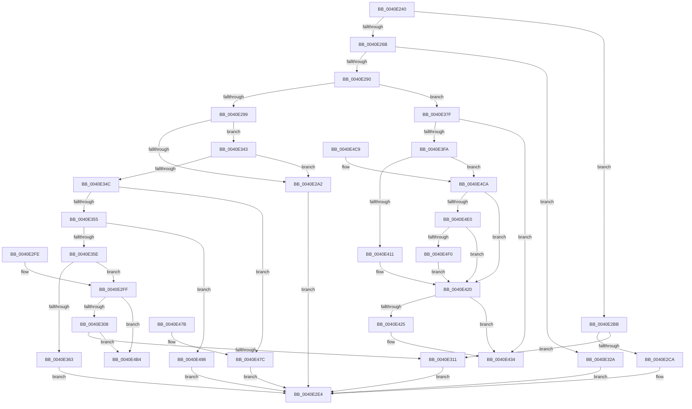

# MiInitializeProbePacketVm

- RVA: `0x0040E240`–`0x0040E4F8` (길이 `696` bytes)
- VA: `0x000000014040E240`
- 실행 섹션: `.text`
- PDB 이름 있음: `예`; PDB Function 태그: `아니요`
- unwind 정보 RVA: `0x0009B89C`
- 디코드: `172`개 명령, `696/696` bytes 표시
- 미해석 바이트: `0` (있으면 어셈블리에 `.byte`로 보존)

> 이 문서는 커널 이미지의 기계어와 PDB 기호를 분석해 생성했습니다. 4번과 5번은 함수 원형과 자료형을 바이너리 사용 방식에서 추정한 C 해석이며 원본 소스 복구 결과는 아닙니다.

## 1. Dependencies

- 직접 호출 지점: **2**; 고유 호출 대상: **1**
- 직접 호출자로 확인된 함수: **1**
- RIP 상대 이미지 참조: **11**

### Outgoing calls
- `0x0040E2E7` → [MiLockProbePacketWorkingSet](MiLockProbePacketWorkingSet_function_0040E500.md) (function, `0x0040E500`)
- `0x0040E399` → [MiLockProbePacketWorkingSet](MiLockProbePacketWorkingSet_function_0040E500.md) (function, `0x0040E500`)

### Direct callers
- [MiProbeAndLockPrepare](../23/MiProbeAndLockPrepare_function_0023BB40.md) at `0x0023BC89`

### Static image references
- `0x0040E26E` → RVA `0x00E38AA8` (`.data`; read)
- `0x0040E2A5` → RVA `0x00E38480` (`.data`; read)
- `0x0040E314` → RVA `0x00E38200` (`.data`; read)
- `0x0040E32D` → RVA `0x00E380C0` (`.data`; read)
- `0x0040E366` → RVA `0x00E38340` (`.data`; read)
- `0x0040E382` → RVA `0x00E3D680` (`.data`; read)
- `0x0040E419` → RVA `0x00E38BB8` (`.data`; read)
- `0x0040E44D` → RVA `0x00E30088` (`.data`; read)
- `0x0040E47F` → RVA `0x00E37F80` (`.data`; read)
- `0x0040E49B` → RVA `0x00E37E40` (`.data`; read)
- `0x0040E4E0` → RVA `0x00FC6AB0` (`ALMOSTRO`; read)

## 2. Other-region calls and transfers

- 다른 실행 섹션으로 향하는 call: **0**
- 별도 외부 분기/꼬리 이동을 확인하지 못했습니다.

## 3. Assembly (complete function range)

```asm
0040E240  48 89 5C 24 08                  mov qword ptr [rsp + 8], rbx
0040E245  48 89 74 24 10                  mov qword ptr [rsp + 0x10], rsi
0040E24A  57                              push rdi
0040E24B  48 83 EC 20                     sub rsp, 0x20
0040E24F  48 8B 79 08                     mov rdi, qword ptr [rcx + 8]
0040E253  33 F6                           xor esi, esi
0040E255  48 B8 00 00 00 00 00 80 FF FF   movabs rax, 0xffff800000000000
0040E25F  48 89 71 28                     mov qword ptr [rcx + 0x28], rsi
0040E263  48 8B D9                        mov rbx, rcx
0040E266  48 3B F8                        cmp rdi, rax
0040E269  72 50                           jb 0x14040e2bb
0040E26B  48 8B C7                        mov rax, rdi
0040E26E  48 8D 0D 33 A8 A2 00            lea rcx, [rip + 0xa2a833]
0040E275  48 C1 E8 27                     shr rax, 0x27
0040E279  25 FF 01 00 00                  and eax, 0x1ff
0040E27E  2D 00 01 00 00                  sub eax, 0x100
0040E283  0F B6 0C 08                     movzx ecx, byte ptr [rax + rcx]
0040E287  83 F9 05                        cmp ecx, 5
0040E28A  0F 84 9A 00 00 00               je 0x14040e32a
0040E290  83 F9 07                        cmp ecx, 7
0040E293  0F 84 E6 00 00 00               je 0x14040e37f
0040E299  83 F9 04                        cmp ecx, 4
0040E29C  0F 85 A1 00 00 00               jne 0x14040e343
0040E2A2  8B 43 48                        mov eax, dword ptr [rbx + 0x48]
0040E2A5  48 8D 0D D4 A1 A2 00            lea rcx, [rip + 0xa2a1d4]
0040E2AC  83 E0 F4                        and eax, 0xfffffff4
0040E2AF  48 89 4B 68                     mov qword ptr [rbx + 0x68], rcx
0040E2B3  83 C8 04                        or eax, 4
0040E2B6  89 43 48                        mov dword ptr [rbx + 0x48], eax
0040E2B9  EB 29                           jmp 0x14040e2e4
0040E2BB  48 B8 FF FF FE FF FF 7F 00 00   movabs rax, 0x7ffffffeffff
0040E2C5  48 3B F8                        cmp rdi, rax
0040E2C8  77 47                           ja 0x14040e311
0040E2CA  8B 49 48                        mov ecx, dword ptr [rcx + 0x48]
0040E2CD  48 8B 43 58                     mov rax, qword ptr [rbx + 0x58]
0040E2D1  83 E1 F1                        and ecx, 0xfffffff1
0040E2D4  83 C9 01                        or ecx, 1
0040E2D7  48 05 00 04 00 00               add rax, 0x400
0040E2DD  48 89 43 68                     mov qword ptr [rbx + 0x68], rax
0040E2E1  89 4B 48                        mov dword ptr [rbx + 0x48], ecx
0040E2E4  48 8B CB                        mov rcx, rbx
0040E2E7  E8 14 02 00 00                  call 0x14040e500
0040E2EC  33 C0                           xor eax, eax
0040E2EE  48 8B 5C 24 30                  mov rbx, qword ptr [rsp + 0x30]
0040E2F3  48 8B 74 24 38                  mov rsi, qword ptr [rsp + 0x38]
0040E2F8  48 83 C4 20                     add rsp, 0x20
0040E2FC  5F                              pop rdi
0040E2FD  C3                              ret
0040E2FE  CC                              int3
0040E2FF  83 F9 12                        cmp ecx, 0x12
0040E302  0F 84 AC 01 00 00               je 0x14040e4b4
0040E308  83 F9 0F                        cmp ecx, 0xf
0040E30B  0F 84 A3 01 00 00               je 0x14040e4b4
0040E311  8B 43 48                        mov eax, dword ptr [rbx + 0x48]
0040E314  48 8D 0D E5 9E A2 00            lea rcx, [rip + 0xa29ee5]
0040E31B  83 E0 F5                        and eax, 0xfffffff5
0040E31E  48 89 4B 68                     mov qword ptr [rbx + 0x68], rcx
0040E322  83 C8 05                        or eax, 5
0040E325  89 43 48                        mov dword ptr [rbx + 0x48], eax
0040E328  EB BA                           jmp 0x14040e2e4
0040E32A  8B 43 48                        mov eax, dword ptr [rbx + 0x48]
0040E32D  48 8D 0D 8C 9D A2 00            lea rcx, [rip + 0xa29d8c]
0040E334  83 E0 F3                        and eax, 0xfffffff3
0040E337  48 89 4B 68                     mov qword ptr [rbx + 0x68], rcx
0040E33B  83 C8 03                        or eax, 3
0040E33E  89 43 48                        mov dword ptr [rbx + 0x48], eax
0040E341  EB A1                           jmp 0x14040e2e4
0040E343  83 F9 0E                        cmp ecx, 0xe
0040E346  0F 84 56 FF FF FF               je 0x14040e2a2
0040E34C  83 F9 11                        cmp ecx, 0x11
0040E34F  0F 84 27 01 00 00               je 0x14040e47c
0040E355  83 F9 0B                        cmp ecx, 0xb
0040E358  0F 84 3A 01 00 00               je 0x14040e498
0040E35E  83 F9 0D                        cmp ecx, 0xd
0040E361  75 9C                           jne 0x14040e2ff
0040E363  8B 43 48                        mov eax, dword ptr [rbx + 0x48]
0040E366  48 8D 0D D3 9F A2 00            lea rcx, [rip + 0xa29fd3]
0040E36D  83 E0 F8                        and eax, 0xfffffff8
0040E370  48 89 4B 68                     mov qword ptr [rbx + 0x68], rcx
0040E374  83 C8 08                        or eax, 8
0040E377  89 43 48                        mov dword ptr [rbx + 0x48], eax
0040E37A  E9 65 FF FF FF                  jmp 0x14040e2e4
0040E37F  8B 43 48                        mov eax, dword ptr [rbx + 0x48]
0040E382  48 8D 0D F7 F2 A2 00            lea rcx, [rip + 0xa2f2f7]
0040E389  48 89 4B 68                     mov qword ptr [rbx + 0x68], rcx
0040E38D  83 E0 F2                        and eax, 0xfffffff2
0040E390  83 C8 02                        or eax, 2
0040E393  48 8B CB                        mov rcx, rbx
0040E396  89 43 48                        mov dword ptr [rbx + 0x48], eax
0040E399  E8 62 01 00 00                  call 0x14040e500
0040E39E  48 8B C7                        mov rax, rdi
0040E3A1  48 C1 E8 12                     shr rax, 0x12
0040E3A5  25 F8 FF FF 3F                  and eax, 0x3ffffff8
0040E3AA  48 B9 00 00 00 40 FB F6 FF FF   movabs rcx, 0xfffff6fb40000000
0040E3B4  48 8B 04 08                     mov rax, qword ptr [rax + rcx]
0040E3B8  48 B9 FF FF FF FF FF 00 00 00   movabs rcx, 0xffffffffff
0040E3C2  48 C1 E8 0C                     shr rax, 0xc
0040E3C6  48 23 C1                        and rax, rcx
0040E3C9  48 8D 04 40                     lea rax, [rax + rax*2]
0040E3CD  48 C1 E0 04                     shl rax, 4
0040E3D1  48 B9 00 00 00 00 00 DE FF FF   movabs rcx, 0xffffde0000000000
0040E3DB  48 03 C1                        add rax, rcx
0040E3DE  48 8B 08                        mov rcx, qword ptr [rax]
0040E3E1  8B 50 24                        mov edx, dword ptr [rax + 0x24]
0040E3E4  81 E2 00 00 FF 03               and edx, 0x3ff0000
0040E3EA  48 D1 E9                        shr rcx, 1
0040E3ED  48 C1 E2 0F                     shl rdx, 0xf
0040E3F1  0F BA F1 1F                     btr ecx, 0x1f
0040E3F5  48 0B D1                        or rdx, rcx
0040E3F8  74 3A                           je 0x14040e434
0040E3FA  48 B8 00 00 00 00 00 FF FF FF   movabs rax, 0xffffff0000000000
0040E404  48 03 C2                        add rax, rdx
0040E407  48 83 F8 01                     cmp rax, 1
0040E40B  0F 86 B9 00 00 00               jbe 0x14040e4ca
0040E411  48 8D 72 FF                     lea rsi, [rdx - 1]
0040E415  48 C1 E6 04                     shl rsi, 4
0040E419  48 03 35 98 A7 A2 00            add rsi, qword ptr [rip + 0xa2a798]
0040E420  48 85 F6                        test rsi, rsi
0040E423  74 0F                           je 0x14040e434
0040E425  48 C1 EF 12                     shr rdi, 0x12
0040E429  83 E7 07                        and edi, 7
0040E42C  48 8D 04 BF                     lea rax, [rdi + rdi*4]
0040E430  48 8D 34 C6                     lea rsi, [rsi + rax*8]
0040E434  48 8B 56 18                     mov rdx, qword ptr [rsi + 0x18]
0040E438  48 8B CA                        mov rcx, rdx
0040E43B  48 83 E1 FE                     and rcx, 0xfffffffffffffffe
0040E43F  F6 C2 01                        test dl, 1
0040E442  48 0F 44 CA                     cmove rcx, rdx
0040E446  48 8B 01                        mov rax, qword ptr [rcx]
0040E449  0F B7 48 3C                     movzx ecx, word ptr [rax + 0x3c]
0040E44D  48 8B 05 34 1C A2 00            mov rax, qword ptr [rip + 0xa21c34]
0040E454  81 E1 FF 03 00 00               and ecx, 0x3ff
0040E45A  48 8B 0C C8                     mov rcx, qword ptr [rax + rcx*8]
0040E45E  48 81 C1 80 49 00 00            add rcx, 0x4980
0040E465  48 89 4B 68                     mov qword ptr [rbx + 0x68], rcx
0040E469  33 C0                           xor eax, eax
0040E46B  48 8B 5C 24 30                  mov rbx, qword ptr [rsp + 0x30]
0040E470  48 8B 74 24 38                  mov rsi, qword ptr [rsp + 0x38]
0040E475  48 83 C4 20                     add rsp, 0x20
0040E479  5F                              pop rdi
0040E47A  C3                              ret
0040E47B  CC                              int3
0040E47C  8B 43 48                        mov eax, dword ptr [rbx + 0x48]
0040E47F  48 8D 0D FA 9A A2 00            lea rcx, [rip + 0xa29afa]
0040E486  83 E0 F7                        and eax, 0xfffffff7
0040E489  48 89 4B 68                     mov qword ptr [rbx + 0x68], rcx
0040E48D  83 C8 07                        or eax, 7
0040E490  89 43 48                        mov dword ptr [rbx + 0x48], eax
0040E493  E9 4C FE FF FF                  jmp 0x14040e2e4
0040E498  8B 43 48                        mov eax, dword ptr [rbx + 0x48]
0040E49B  48 8D 0D 9E 99 A2 00            lea rcx, [rip + 0xa2999e]
0040E4A2  83 E0 F6                        and eax, 0xfffffff6
0040E4A5  48 89 4B 68                     mov qword ptr [rbx + 0x68], rcx
0040E4A9  83 C8 06                        or eax, 6
0040E4AC  89 43 48                        mov dword ptr [rbx + 0x48], eax
0040E4AF  E9 30 FE FF FF                  jmp 0x14040e2e4
0040E4B4  48 8B 5C 24 30                  mov rbx, qword ptr [rsp + 0x30]
0040E4B9  B8 05 00 00 C0                  mov eax, 0xc0000005
0040E4BE  48 8B 74 24 38                  mov rsi, qword ptr [rsp + 0x38]
0040E4C3  48 83 C4 20                     add rsp, 0x20
0040E4C7  5F                              pop rdi
0040E4C8  C3                              ret
0040E4C9  CC                              int3
0040E4CA  48 B8 01 00 00 00 00 01 00 00   movabs rax, 0x10000000001
0040E4D4  48 8B F2                        mov rsi, rdx
0040E4D7  48 3B D0                        cmp rdx, rax
0040E4DA  0F 85 40 FF FF FF               jne 0x14040e420
0040E4E0  48 8B 05 C9 85 BB 00            mov rax, qword ptr [rip + 0xbb85c9]
0040E4E7  48 85 C0                        test rax, rax
0040E4EA  0F 84 30 FF FF FF               je 0x14040e420
0040E4F0  48 8B F0                        mov rsi, rax
0040E4F3  E9 28 FF FF FF                  jmp 0x14040e420
```

## 4. C-style interpretation (structured pseudocode)

```c
__int64 __fastcall MiInitializeProbePacketVm(__int64 a1)
{
    __int64 result;
    __int64 v_rdi;
    __int64 v_rsi;
    __int64 v_rsp;
    unsigned __int64 v_stack_p10;
    unsigned __int64 v_stack_p30;
    unsigned __int64 v_stack_p38;
    unsigned __int64 v_stack_p58;
    unsigned __int64 v_stack_p60;
    unsigned __int64 v_stack_p8;

    v_stack_p8 = v_rbx;
    v_stack_p10 = v_rsi;
    v_rsp = (v_rsp) - (32);
    v_rsi = 0;
    *(unsigned __int64 *)(a1 + 40) = 0;
    if ((*(unsigned __int64 *)(a1 + 8)) < result) goto loc_0040E2BB;
    result = (*(unsigned __int64 *)(a1 + 8)) >> (39);
    result = (unsigned int)((result) & (511));
    result = (unsigned int)((result) - (256));
    if (((unsigned int)(*(unsigned __int8 *)(result + v_rip + 10659891 * 1))) == 5) goto loc_0040E32A;
    if (((unsigned int)(*(unsigned __int8 *)(result + v_rip + 10659891 * 1))) == 7) goto loc_0040E37F;
    if (((unsigned int)(*(unsigned __int8 *)(result + v_rip + 10659891 * 1))) != 4) goto loc_0040E343;
loc_0040E2A2:
    result = (unsigned int)(((unsigned int)(*(unsigned int *)(a1 + 72))) & (0xFFFFFFF4ULL));
    *(unsigned __int64 *)(a1 + 104) = v_rip + 10658260;
    result = (unsigned int)((result) | (4));
    *(unsigned int *)(a1 + 72) = (unsigned int)(result);
    goto loc_0040E2E4;
loc_0040E2BB:
    if ((*(unsigned __int64 *)(a1 + 8)) > result) goto loc_0040E311;
    a1 = (unsigned int)(((unsigned int)(*(unsigned int *)(v_rip + 10658260 + 72))) & (0xFFFFFFF1ULL));
    a1 = (unsigned int)((a1) | (1));
    result = (*(unsigned __int64 *)(a1 + 88)) + (0x400ULL);
    *(unsigned __int64 *)(a1 + 104) = result;
    *(unsigned int *)(a1 + 72) = (unsigned int)(a1);
loc_0040E2E4:
    result = MiLockProbePacketWorkingSet(a1, a2, a3, a4);
    result = 0;
    v_rsp = (v_rsp) + (32);
    return result;
loc_0040E2FF:
    if (((unsigned int)(a1)) == 18) goto loc_0040E4B4;
    if (((unsigned int)(a1)) == 15) goto loc_0040E4B4;
loc_0040E311:
    result = (unsigned int)(((unsigned int)(*(unsigned int *)(v_stack_p8 + 72))) & (0xFFFFFFF5ULL));
    *(unsigned __int64 *)(v_stack_p8 + 104) = v_rip + 10657509;
    result = (unsigned int)((result) | (5));
    *(unsigned int *)(v_stack_p8 + 72) = (unsigned int)(result);
    goto loc_0040E2E4;
loc_0040E32A:
    result = (unsigned int)(((unsigned int)(*(unsigned int *)(v_stack_p8 + 72))) & (0xFFFFFFF3ULL));
    *(unsigned __int64 *)(v_stack_p8 + 104) = v_rip + 10657164;
    result = (unsigned int)((result) | (3));
    *(unsigned int *)(v_stack_p8 + 72) = (unsigned int)(result);
    goto loc_0040E2E4;
loc_0040E343:
    if (((unsigned int)(v_rip + 10657164)) == 14) goto loc_0040E2A2;
    if (((unsigned int)(v_rip + 10657164)) == 17) goto loc_0040E47C;
    if (((unsigned int)(v_rip + 10657164)) == 11) goto loc_0040E498;
    if (((unsigned int)(v_rip + 10657164)) != 13) goto loc_0040E2FF;
    result = (unsigned int)(((unsigned int)(*(unsigned int *)(v_stack_p8 + 72))) & (0xFFFFFFF8ULL));
    *(unsigned __int64 *)(v_stack_p8 + 104) = v_rip + 10657747;
    result = (unsigned int)((result) | (8));
    *(unsigned int *)(v_stack_p8 + 72) = (unsigned int)(result);
    goto loc_0040E2E4;
loc_0040E37F:
    *(unsigned __int64 *)(v_stack_p8 + 104) = v_rip + 10679031;
    result = (unsigned int)(((unsigned int)(*(unsigned int *)(v_stack_p8 + 72))) & (0xFFFFFFF2ULL));
    result = (unsigned int)((result) | (2));
    *(unsigned int *)(v_stack_p8 + 72) = (unsigned int)(result);
    result = MiLockProbePacketWorkingSet(v_stack_p8, a2, a3, a4);
    result = (*(unsigned __int64 *)(a1 + 8)) >> (18);
    result = (unsigned int)((result) & (0x3FFFFFF8ULL));
    result = (*(unsigned __int64 *)(result + v_stack_p8 * 1)) >> (12);
    result = (result) & (v_stack_p8);
    result = (result + result * 2) << (4);
    result = (result) + (v_stack_p8);
    a2 = (unsigned int)(((unsigned int)(*(unsigned int *)(result + 36))) & (0x3FF0000ULL));
    a1 = (*(unsigned __int64 *)(result)) >> (1);
    a2 = (a2) << (15);
    a2 = (a2) | (a1);
    if (condition_is_equal) goto loc_0040E434;
    result = (result) + (a2);
    if (result <= 1) goto loc_0040E4CA;
    v_rsi = (a2 - 1) << (4);
    v_rsi = (v_rsi) + (*(unsigned __int64 *)(v_rip + 10659736));
loc_0040E420:
    v_rdi = *(unsigned __int64 *)(a1 + 8);
    if (v_rsi != 0) {
        v_rdi = (*(unsigned __int64 *)(a1 + 8)) >> (18);
        v_rdi = (unsigned int)((v_rdi) & (7));
        result = v_rdi + v_rdi * 4;
        v_rsi = v_rsi + result * 8;
    }
    a1 = (*(unsigned __int64 *)(v_rsi + 24)) & (-2);
    if ((((unsigned __int8)(*(unsigned __int64 *)(v_rsi + 24))) & (1)) == 0) { a1 = *(unsigned __int64 *)(v_rsi + 24); }
    a1 = (unsigned int)((*(unsigned __int16 *)(*(unsigned __int64 *)(a1) + 60)) & (0x3FFULL));
    a1 = (*(unsigned __int64 *)(*(unsigned __int64 *)(v_rip + 10624052) + a1 * 8)) + (0x4980ULL);
    *(unsigned __int64 *)(v_stack_p8 + 104) = a1;
    result = 0;
    v_rsp = (v_rsp) + (32);
    return result;
loc_0040E47C:
    result = (unsigned int)(((unsigned int)(*(unsigned int *)(v_stack_p30 + 72))) & (0xFFFFFFF7ULL));
    *(unsigned __int64 *)(v_stack_p30 + 104) = v_rip + 10656506;
    result = (unsigned int)((result) | (7));
    *(unsigned int *)(v_stack_p30 + 72) = (unsigned int)(result);
    goto loc_0040E2E4;
loc_0040E498:
    result = (unsigned int)(((unsigned int)(*(unsigned int *)(v_stack_p30 + 72))) & (0xFFFFFFF6ULL));
    *(unsigned __int64 *)(v_stack_p30 + 104) = v_rip + 10656158;
    result = (unsigned int)((result) | (6));
    *(unsigned int *)(v_stack_p30 + 72) = (unsigned int)(result);
    goto loc_0040E2E4;
loc_0040E4B4:
    v_rsp = (v_rsp) + (32);
    return (unsigned int)(0xC0000005ULL);
loc_0040E4CA:
    if ((*(unsigned __int64 *)(v_rsi + 24)) != ((unsigned int)(0xC0000005ULL))) goto loc_0040E420;
    if (*(unsigned __int64 *)(v_rip + 12289481) == 0) goto loc_0040E420;
    goto loc_0040E420;
}
```

## 5. (Beta) C Style

```c
int64_t MiInitializeProbePacketVm(void *Arg1)
{
    uint8_t *arg1 = (uint8_t *)Arg1;

    int64_t result;
    int64_t local_rdi;
    int64_t local_rsi;
    int64_t local_rsp;
    uint64_t v_stack_p10;
    uint64_t v_stack_p30;
    uint64_t v_stack_p38;
    uint64_t v_stack_p58;
    uint64_t v_stack_p60;
    uint64_t v_stack_p8;

    v_stack_p8 = local_rbx;
    v_stack_p10 = local_rsi;
    local_rsp = (local_rsp) - (32);
    local_rsi = 0;
    *(uint64_t *)(arg1 + 0x28) = 0;
    if ((*(uint64_t *)(arg1 + 0x8)) < result) goto loc_0040E2BB;
    result = (*(uint64_t *)(arg1 + 0x8)) >> (39);
    result = (uint32_t)((result) & (511));
    result = (uint32_t)((result) - (256));
    if (((uint32_t)(*(uint8_t *)(result + v_rip + 0xA2A833 * 1))) == 5) goto loc_0040E32A;
    if (((uint32_t)(*(uint8_t *)(result + v_rip + 0xA2A833 * 1))) == 7) goto loc_0040E37F;
    if (((uint32_t)(*(uint8_t *)(result + v_rip + 0xA2A833 * 1))) != 4) goto loc_0040E343;
loc_0040E2A2:
    result = (uint32_t)(((uint32_t)(*(uint32_t *)(arg1 + 0x48))) & (0xFFFFFFF4ULL));
    *(uint64_t *)(arg1 + 0x68) = v_rip + 10658260;
    result = (uint32_t)((result) | (4));
    *(uint32_t *)(arg1 + 0x48) = (uint32_t)(result);
    goto loc_0040E2E4;
loc_0040E2BB:
    if ((*(uint64_t *)(arg1 + 0x8)) > result) goto loc_0040E311;
    Arg1 = (uint32_t)(((uint32_t)(*(uint32_t *)(v_rip + 0xA2A1D4 + 0x48))) & (0xFFFFFFF1ULL));
    Arg1 = (uint32_t)((Arg1) | (1));
    result = (*(uint64_t *)(arg1 + 0x58)) + (0x400ULL);
    *(uint64_t *)(arg1 + 0x68) = result;
    *(uint32_t *)(arg1 + 0x48) = (uint32_t)(Arg1);
loc_0040E2E4:
    result = MiLockProbePacketWorkingSet(Arg1, a2, a3, a4);
    result = 0;
    local_rsp = (local_rsp) + (32);
    return result;
loc_0040E2FF:
    if (((uint32_t)(Arg1)) == 18) goto loc_0040E4B4;
    if (((uint32_t)(Arg1)) == 15) goto loc_0040E4B4;
loc_0040E311:
    result = (uint32_t)(((uint32_t)(*(uint32_t *)(v_stack_p8 + 0x48))) & (0xFFFFFFF5ULL));
    *(uint64_t *)(v_stack_p8 + 0x68) = v_rip + 10657509;
    result = (uint32_t)((result) | (5));
    *(uint32_t *)(v_stack_p8 + 0x48) = (uint32_t)(result);
    goto loc_0040E2E4;
loc_0040E32A:
    result = (uint32_t)(((uint32_t)(*(uint32_t *)(v_stack_p8 + 0x48))) & (0xFFFFFFF3ULL));
    *(uint64_t *)(v_stack_p8 + 0x68) = v_rip + 10657164;
    result = (uint32_t)((result) | (3));
    *(uint32_t *)(v_stack_p8 + 0x48) = (uint32_t)(result);
    goto loc_0040E2E4;
loc_0040E343:
    if (((uint32_t)(v_rip + 10657164)) == 14) goto loc_0040E2A2;
    if (((uint32_t)(v_rip + 10657164)) == 17) goto loc_0040E47C;
    if (((uint32_t)(v_rip + 10657164)) == 11) goto loc_0040E498;
    if (((uint32_t)(v_rip + 10657164)) != 13) goto loc_0040E2FF;
    result = (uint32_t)(((uint32_t)(*(uint32_t *)(v_stack_p8 + 0x48))) & (0xFFFFFFF8ULL));
    *(uint64_t *)(v_stack_p8 + 0x68) = v_rip + 10657747;
    result = (uint32_t)((result) | (8));
    *(uint32_t *)(v_stack_p8 + 0x48) = (uint32_t)(result);
    goto loc_0040E2E4;
loc_0040E37F:
    *(uint64_t *)(v_stack_p8 + 0x68) = v_rip + 10679031;
    result = (uint32_t)(((uint32_t)(*(uint32_t *)(v_stack_p8 + 0x48))) & (0xFFFFFFF2ULL));
    result = (uint32_t)((result) | (2));
    *(uint32_t *)(v_stack_p8 + 0x48) = (uint32_t)(result);
    result = MiLockProbePacketWorkingSet(v_stack_p8, a2, a3, a4);
    result = (*(uint64_t *)(arg1 + 0x8)) >> (18);
    result = (uint32_t)((result) & (0x3FFFFFF8ULL));
    result = (*(uint64_t *)(result + v_stack_p8 * 1)) >> (12);
    result = (result) & (v_stack_p8);
    result = (result + result * 2) << (4);
    result = (result) + (v_stack_p8);
    a2 = (uint32_t)(((uint32_t)(*(uint32_t *)(result + 0x24))) & (0x3FF0000ULL));
    Arg1 = (*(uint64_t *)(result)) >> (1);
    a2 = (a2) << (15);
    a2 = (a2) | (Arg1);
    if (condition_is_equal) goto loc_0040E434;
    result = (result) + (a2);
    if (result <= 1) goto loc_0040E4CA;
    local_rsi = (a2 - 1) << (4);
    local_rsi = (local_rsi) + (*(uint64_t *)(v_rip + 0xA2A798));
loc_0040E420:
    local_rdi = *(uint64_t *)(arg1 + 0x8);
    if (local_rsi != 0) {
        local_rdi = (*(uint64_t *)(arg1 + 0x8)) >> (18);
        local_rdi = (uint32_t)((local_rdi) & (7));
        result = local_rdi + local_rdi * 4;
        local_rsi = local_rsi + result * 8;
    }
    Arg1 = (*(uint64_t *)(local_rsi + 0x18)) & (-2);
    if ((((uint8_t)(*(uint64_t *)(local_rsi + 0x18))) & (1)) == 0) { Arg1 = *(uint64_t *)(local_rsi + 0x18); }
    Arg1 = (uint32_t)((*(uint16_t *)(*(uint64_t *)(arg1) + 0x3C)) & (0x3FFULL));
    Arg1 = (*(uint64_t *)(*(uint64_t *)(v_rip + 0xA21C34) + arg1 * 8)) + (0x4980ULL);
    *(void **)(v_stack_p8 + 0x68) = Arg1;
    result = 0;
    local_rsp = (local_rsp) + (32);
    return result;
loc_0040E47C:
    result = (uint32_t)(((uint32_t)(*(uint32_t *)(v_stack_p30 + 0x48))) & (0xFFFFFFF7ULL));
    *(uint64_t *)(v_stack_p30 + 0x68) = v_rip + 10656506;
    result = (uint32_t)((result) | (7));
    *(uint32_t *)(v_stack_p30 + 0x48) = (uint32_t)(result);
    goto loc_0040E2E4;
loc_0040E498:
    result = (uint32_t)(((uint32_t)(*(uint32_t *)(v_stack_p30 + 0x48))) & (0xFFFFFFF6ULL));
    *(uint64_t *)(v_stack_p30 + 0x68) = v_rip + 10656158;
    result = (uint32_t)((result) | (6));
    *(uint32_t *)(v_stack_p30 + 0x48) = (uint32_t)(result);
    goto loc_0040E2E4;
loc_0040E4B4:
    local_rsp = (local_rsp) + (32);
    return (uint32_t)(0xC0000005ULL);
loc_0040E4CA:
    if ((*(uint64_t *)(local_rsi + 0x18)) != ((uint32_t)(0xC0000005ULL))) goto loc_0040E420;
    if (*(uint64_t *)(v_rip + 0xBB85C9) == 0) goto loc_0040E420;
    goto loc_0040E420;
}
```

### 관측된 메모리 오프셋

구조체 형식이 확인되지 않은 접근은 인자 기준의 오프셋으로만 기록했습니다.

| 기준 인자 | 오프셋 표현 | 폭 (bit) | 접근 |
|---|---:|---:|---|
| `Arg1` | `+ 0x8` | `64` | `R` |
| `Arg1` | `+ 0x28` | `64` | `W` |
| `Arg1` | `+ 0x48` | `32` | `R` |
| `Arg1` | `+ 0x48` | `32` | `W` |
| `Arg1` | `+ 0x58` | `64` | `R` |
| `Arg1` | `+ 0x68` | `64` | `W` |

## 6. Execution-region graph

[열기: 2D/3D 그래프와 함수 탐색 컨트롤 패널](../../../control-panel.html?section=text&rva=0x0040E240&view=graph)

- 2D 그래프는 위에서 아래로 흐르고, 3D 그래프는 빈 공간을 드래그해 회전합니다. Shift+드래그는 이동, 휠은 확대·축소, 함수 노드 선택은 대상 보고서 이동입니다.

### Static fallback


