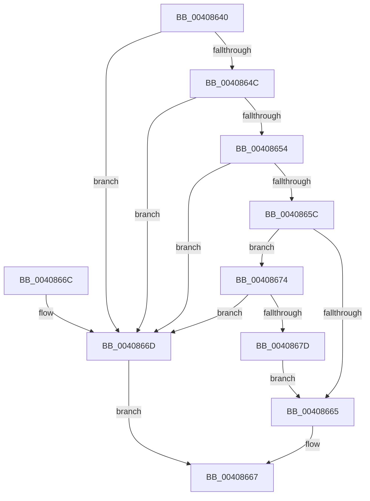

# MiIsRetryIoStatus

- RVA: `0x00408640`–`0x0040867F` (길이 `63` bytes)
- VA: `0x0000000140408640`
- 실행 섹션: `.text`
- PDB 이름 있음: `예`; PDB Function 태그: `아니요`
- unwind 정보 RVA: `0x0007A1AC`
- 디코드: `19`개 명령, `63/63` bytes 표시
- 미해석 바이트: `0` (있으면 어셈블리에 `.byte`로 보존)

> 이 문서는 커널 이미지의 기계어와 PDB 기호를 분석해 생성했습니다. 4번과 5번은 함수 원형과 자료형을 바이너리 사용 방식에서 추정한 C 해석이며 원본 소스 복구 결과는 아닙니다.

## 1. Dependencies

- 직접 호출 지점: **1**; 고유 호출 대상: **1**
- 직접 호출자로 확인된 함수: **10**
- RIP 상대 이미지 참조: **0**

### Outgoing calls
- `0x00408674` → [FsRtlIsTotalDeviceFailure](FsRtlIsTotalDeviceFailure_function_00408710.md) (function, `0x00408710`)

### Direct callers
- [MiZeroPageWrite](../29/MiZeroPageWrite_function_0029F280.md) at `0x0029F48A`
- [MiFinishHardFault](../2B/MiFinishHardFault_function_002B6F10.md) at `0x002B77C5`
- [MiWaitForInPageComplete](../38/MiWaitForInPageComplete_function_00380AB8.md) at `0x00380F90`
- [MiFlushSection](MiFlushSection_function_004036B0.md) at `0x004044EE`
- [MiWriteComplete](MiWriteComplete_function_004069B0.md) at `0x00406D5B`
- [MiReadPagefilePage](../66/MiReadPagefilePage_function_0066F78C.md) at `0x0066FA3E`
- [sub_006E46EA](../6E/Unknown_function_006E46EA.md) at `0x006E4711`
- [sub_006EC582](../6E/Unknown_function_006EC582.md) at `0x006EC5E2`
- [MiReadImageHeaders](../../page/98/MiReadImageHeaders_function_00987DAC.md) at `0x00987EF1`
- [MiLogFailedDriverLoad](../../page/A2/MiLogFailedDriverLoad_function_00A24ACC.md) at `0x00A24C05`

### Static image references
- 디코드된 RIP-relative 메모리 참조가 없습니다.

## 2. Other-region calls and transfers

- 다른 실행 섹션으로 향하는 call: **0**
- 별도 외부 분기/꼬리 이동을 확인하지 못했습니다.

## 3. Assembly (complete function range)

```asm
00408640  48 83 EC 28                     sub rsp, 0x28
00408644  81 F9 9A 00 00 C0               cmp ecx, 0xc000009a
0040864A  74 21                           je 0x14040866d
0040864C  81 F9 17 00 00 C0               cmp ecx, 0xc0000017
00408652  74 19                           je 0x14040866d
00408654  81 F9 A1 00 00 C0               cmp ecx, 0xc00000a1
0040865A  74 11                           je 0x14040866d
0040865C  48 81 FA 00 10 00 00            cmp rdx, 0x1000
00408663  77 0F                           ja 0x140408674
00408665  33 C0                           xor eax, eax
00408667  48 83 C4 28                     add rsp, 0x28
0040866B  C3                              ret
0040866C  CC                              int3
0040866D  B8 01 00 00 00                  mov eax, 1
00408672  EB F3                           jmp 0x140408667
00408674  E8 97 00 00 00                  call 0x140408710
00408679  84 C0                           test al, al
0040867B  74 F0                           je 0x14040866d
0040867D  EB E6                           jmp 0x140408665
```

## 4. C-style interpretation (structured pseudocode)

```c
__int64 __fastcall MiIsRetryIoStatus(int a1, __int64 a2)
{
    __int64 result;
    __int64 v_rsp;

    v_rsp = (v_rsp) - (40);
    if (a1 == 0xC000009AULL) goto loc_0040866D;
    if (a1 == 0xC0000017ULL) goto loc_0040866D;
    if (a1 == 0xC00000A1ULL) goto loc_0040866D;
    if (a2 > 0x1000ULL) goto loc_00408674;
loc_00408665:
    result = 0;
loc_00408667:
    v_rsp = (v_rsp) + (40);
    return result;
loc_0040866D:
    goto loc_00408667;
loc_00408674:
    result = FsRtlIsTotalDeviceFailure(a1, a2, a3, a4);
    if ((unsigned __int8)(result) == 0) goto loc_0040866D;
    goto loc_00408665;
}
```

## 5. (Beta) C Style

```c
int64_t MiIsRetryIoStatus(int32_t Arg1, int64_t Arg2)
{
    int64_t result;
    int64_t local_rsp;

    local_rsp = (local_rsp) - (40);
    if (Arg1 == 0xC000009AULL) goto loc_0040866D;
    if (Arg1 == 0xC0000017ULL) goto loc_0040866D;
    if (Arg1 == 0xC00000A1ULL) goto loc_0040866D;
    if (Arg2 > 0x1000ULL) goto loc_00408674;
loc_00408665:
    result = 0;
loc_00408667:
    local_rsp = (local_rsp) + (40);
    return result;
loc_0040866D:
    goto loc_00408667;
loc_00408674:
    result = FsRtlIsTotalDeviceFailure(Arg1, Arg2, a3, a4);
    if ((uint8_t)(result) == 0) goto loc_0040866D;
    goto loc_00408665;
}
```

## 6. Execution-region graph

[열기: 2D/3D 그래프와 함수 탐색 컨트롤 패널](../../../control-panel.html?section=text&rva=0x00408640&view=graph)

- 2D 그래프는 위에서 아래로 흐르고, 3D 그래프는 빈 공간을 드래그해 회전합니다. Shift+드래그는 이동, 휠은 확대·축소, 함수 노드 선택은 대상 보고서 이동입니다.

### Static fallback


