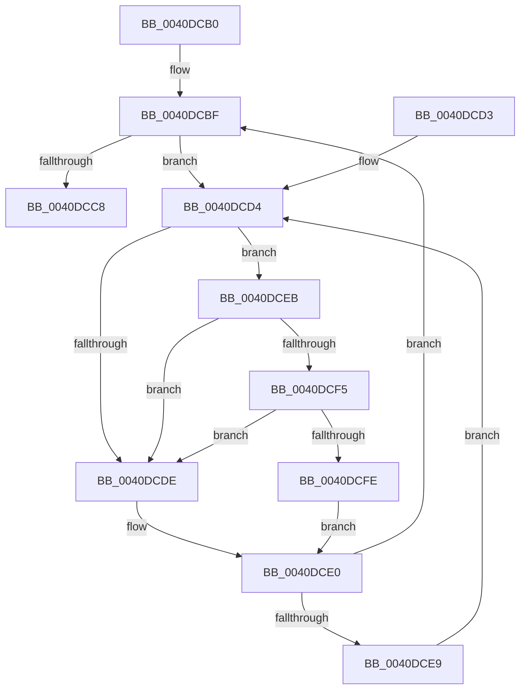

# MiLockNestedPageAtDpcInline

- RVA: `0x0040DCB0`–`0x0040DD07` (길이 `87` bytes)
- VA: `0x000000014040DCB0`
- 실행 섹션: `.text`
- PDB 이름 있음: `예`; PDB Function 태그: `아니요`
- unwind 정보 RVA: `0x00070720`
- 디코드: `29`개 명령, `87/87` bytes 표시
- 미해석 바이트: `0` (있으면 어셈블리에 `.byte`로 보존)

> 이 문서는 커널 이미지의 기계어와 PDB 기호를 분석해 생성했습니다. 4번과 5번은 함수 원형과 자료형을 바이너리 사용 방식에서 추정한 C 해석이며 원본 소스 복구 결과는 아닙니다.

## 1. Dependencies

- 직접 호출 지점: **2**; 고유 호출 대상: **2**
- 직접 호출자로 확인된 함수: **0**
- RIP 상대 이미지 참조: **2**

### Outgoing calls
- `0x0040DCF5` → [KiCheckVpBackingLongSpinWaitHypercall](../30/KiCheckVpBackingLongSpinWaitHypercall_function_0030F490.md) (function, `0x0030F490`)
- `0x0040DD00` → [HvlNotifyLongSpinWait](../30/HvlNotifyLongSpinWait_function_0030F460.md) (function, `0x0030F460`)

### Direct callers
- 이 함수 시작 RVA로 연결되는 직접 call은 확인되지 않았습니다. 간접 호출은 완전히 역산할 수 없습니다.

### Static image references
- `0x0040DCD6` → RVA `0x00FC52AC` (`ALMOSTRO`; reference)
- `0x0040DCEB` → RVA `0x00FC6AB8` (`ALMOSTRO`; read)

## 2. Other-region calls and transfers

- 다른 실행 섹션으로 향하는 call: **0**
- 별도 외부 분기/꼬리 이동을 확인하지 못했습니다.

## 3. Assembly (complete function range)

```asm
0040DCB0  48 89 5C 24 08                  mov qword ptr [rsp + 8], rbx
0040DCB5  57                              push rdi
0040DCB6  48 83 EC 20                     sub rsp, 0x20
0040DCBA  48 8B D9                        mov rbx, rcx
0040DCBD  33 FF                           xor edi, edi
0040DCBF  F0 48 0F BA 6B 18 3F            lock bts qword ptr [rbx + 0x18], 0x3f
0040DCC6  72 0C                           jb 0x14040dcd4
0040DCC8  48 8B 5C 24 30                  mov rbx, qword ptr [rsp + 0x30]
0040DCCD  48 83 C4 20                     add rsp, 0x20
0040DCD1  5F                              pop rdi
0040DCD2  C3                              ret
0040DCD3  CC                              int3
0040DCD4  FF C7                           inc edi
0040DCD6  85 3D D0 75 BB 00               test dword ptr [rip + 0xbb75d0], edi
0040DCDC  74 0D                           je 0x14040dceb
0040DCDE  F3 90                           pause
0040DCE0  48 8B 43 18                     mov rax, qword ptr [rbx + 0x18]
0040DCE4  48 85 C0                        test rax, rax
0040DCE7  79 D6                           jns 0x14040dcbf
0040DCE9  EB E9                           jmp 0x14040dcd4
0040DCEB  8B 05 C7 8D BB 00               mov eax, dword ptr [rip + 0xbb8dc7]
0040DCF1  A8 40                           test al, 0x40
0040DCF3  74 E9                           je 0x14040dcde
0040DCF5  E8 96 17 F0 FF                  call 0x14030f490
0040DCFA  84 C0                           test al, al
0040DCFC  74 E0                           je 0x14040dcde
0040DCFE  8B CF                           mov ecx, edi
0040DD00  E8 5B 17 F0 FF                  call 0x14030f460
0040DD05  EB D9                           jmp 0x14040dce0
```

## 4. C-style interpretation (structured pseudocode)

```c
__int64 __fastcall MiLockNestedPageAtDpcInline(__int64 a1)
{
    __int64 result;
    __int64 v_rdi;
    __int64 v_rsp;
    unsigned __int64 v_stack_p8;

    v_stack_p8 = v_rbx;
    v_rsp = (v_rsp) - (32);
    v_rdi = 0;
loc_0040DCBF:
    if (condition_is_below) goto loc_0040DCD4;
    v_rsp = (v_rsp) + (32);
    return result;
loc_0040DCD4:
    v_rdi = (unsigned int)((v_rdi) + 1);
    if (((*(unsigned int *)(v_rip + 12285392)) & ((unsigned int)(v_rdi))) == 0) goto loc_0040DCEB;
loc_0040DCDE:
loc_0040DCE0:
    if (!sign_flag) goto loc_0040DCBF;
    goto loc_0040DCD4;
loc_0040DCEB:
    if ((((unsigned __int8)((unsigned int)(*(unsigned int *)(v_rip + 12291527)))) & (64)) == 0) goto loc_0040DCDE;
    result = KiCheckVpBackingLongSpinWaitHypercall(a1, a2, a3, a4);
    if ((unsigned __int8)(result) == 0) goto loc_0040DCDE;
    result = HvlNotifyLongSpinWait((unsigned int)((unsigned int)(v_rdi)), a2, a3, a4);
    goto loc_0040DCE0;
}
```

## 5. (Beta) C Style

```c
int64_t MiLockNestedPageAtDpcInline(void *Arg1)
{
    uint8_t *arg1 = (uint8_t *)Arg1;

    int64_t result;
    int64_t local_rdi;
    int64_t local_rsp;
    uint64_t v_stack_p8;

    v_stack_p8 = local_rbx;
    local_rsp = (local_rsp) - (32);
    local_rdi = 0;
loc_0040DCBF:
    if (condition_is_below) goto loc_0040DCD4;
    local_rsp = (local_rsp) + (32);
    return result;
loc_0040DCD4:
    local_rdi = (uint32_t)((local_rdi) + 1);
    if (((*(uint32_t *)(v_rip + 0xBB75D0)) & ((uint32_t)(local_rdi))) == 0) goto loc_0040DCEB;
loc_0040DCDE:
loc_0040DCE0:
    if (!sign_flag) goto loc_0040DCBF;
    goto loc_0040DCD4;
loc_0040DCEB:
    if ((((uint8_t)((uint32_t)(*(uint32_t *)(v_rip + 0xBB8DC7)))) & (64)) == 0) goto loc_0040DCDE;
    result = KiCheckVpBackingLongSpinWaitHypercall(Arg1, a2, a3, a4);
    if ((uint8_t)(result) == 0) goto loc_0040DCDE;
    result = HvlNotifyLongSpinWait((uint32_t)((uint32_t)(local_rdi)), a2, a3, a4);
    goto loc_0040DCE0;
}
```

### 관측된 메모리 오프셋

구조체 형식이 확인되지 않은 접근은 인자 기준의 오프셋으로만 기록했습니다.

| 기준 인자 | 오프셋 표현 | 폭 (bit) | 접근 |
|---|---:|---:|---|
| `Arg1` | `+ 0x18` | `64` | `R` |
| `Arg1` | `+ 0x18` | `64` | `R/W` |

## 6. Execution-region graph

[열기: 2D/3D 그래프와 함수 탐색 컨트롤 패널](../../../control-panel.html?section=text&rva=0x0040DCB0&view=graph)

- 2D 그래프는 위에서 아래로 흐르고, 3D 그래프는 빈 공간을 드래그해 회전합니다. Shift+드래그는 이동, 휠은 확대·축소, 함수 노드 선택은 대상 보고서 이동입니다.

### Static fallback


