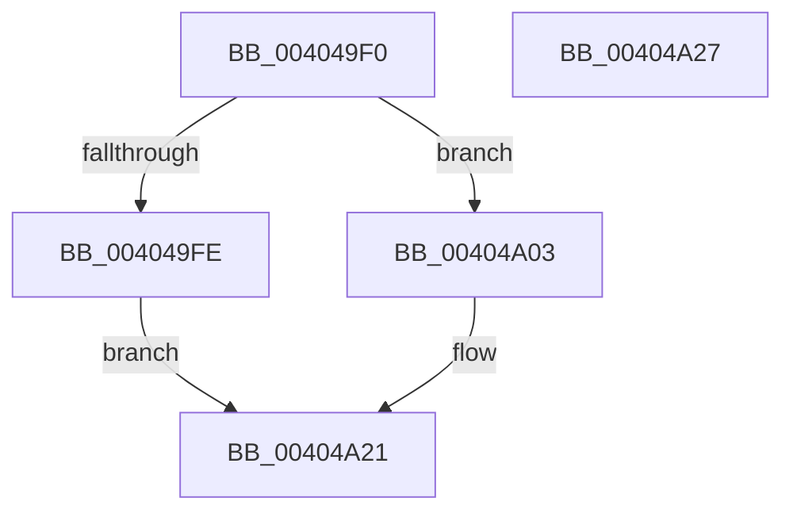

# MiLockSpecialPurposeMemoryCachedPage

- RVA: `0x004049F0`–`0x00404A28` (길이 `56` bytes)
- VA: `0x00000001404049F0`
- 실행 섹션: `.text`
- PDB 이름 있음: `예`; PDB Function 태그: `아니요`
- unwind 정보 RVA: `0x0005CF00`
- 디코드: `17`개 명령, `56/56` bytes 표시
- 미해석 바이트: `0` (있으면 어셈블리에 `.byte`로 보존)

> 이 문서는 커널 이미지의 기계어와 PDB 기호를 분석해 생성했습니다. 4번과 5번은 함수 원형과 자료형을 바이너리 사용 방식에서 추정한 C 해석이며 원본 소스 복구 결과는 아닙니다.

## 1. Dependencies

- 직접 호출 지점: **2**; 고유 호출 대상: **2**
- 직접 호출자로 확인된 함수: **19**
- RIP 상대 이미지 참조: **0**

### Outgoing calls
- `0x00404A03` → [MiReuseStandbyPage](../44/MiReuseStandbyPage_function_0044CA90.md) (function, `0x0044CA90`)
- `0x00404A0B` → [MiReleaseFreshPageLocked](../44/MiReleaseFreshPageLocked_function_0044CDD8.md) (function, `0x0044CDD8`)

### Direct callers
- [MiHandleForkTransitionPte](../22/MiHandleForkTransitionPte_function_0022D34C.md) at `0x0022D91E`
- [MiDecommitHandleTransitionPte](../24/MiDecommitHandleTransitionPte_function_0024037C.md) at `0x00240641`
- [MiActOnPte](../24/MiActOnPte_function_00244C90.md) at `0x00245868`
- [MiResolveTransitionFault](../28/MiResolveTransitionFault_function_00282940.md) at `0x00283179`
- [MiGetWorkingSetInfoList](../2A/MiGetWorkingSetInfoList_function_002AF770.md) at `0x002B0C99`
- [MiSetProtectionOnTransitionPte](../2C/MiSetProtectionOnTransitionPte_function_002C586C.md) at `0x002C5A51`
- [sub_002F6E32](../2F/Unknown_function_002F6E32.md) at `0x002F759E`
- [MiSharePages](../31/MiSharePages_function_00315110.md) at `0x00316032`
- [MiResolveProtoPteFault](../32/MiResolveProtoPteFault_function_00321750.md) at `0x00322265`
- [sub_0032BD21](../32/Unknown_function_0032BD21.md) at `0x0032C18C`
- [MiTryDeleteTransitionPte](../37/MiTryDeleteTransitionPte_function_003710DC.md) at `0x0037127C`
- [MiPurgeSubsection](../37/MiPurgeSubsection_function_003712F0.md) at `0x003718C1`
- [MiOutSwapWorkingSetPte](../37/MiOutSwapWorkingSetPte_function_00372190.md) at `0x0037274E`
- [MiReservePageFileSpaceForPage](../38/MiReservePageFileSpaceForPage_function_0038377C.md) at `0x00383D21`
- [MiSetSystemCodeProtection](../38/MiSetSystemCodeProtection_function_00384420.md) at `0x003849D9`
- [MiUpdatePrefetchPriority](MiUpdatePrefetchPriority_function_00402CB0.md) at `0x00402FE6`
- [MiFlushSection](MiFlushSection_function_004036B0.md) at `0x00403EEE`
- [MiLockTransitionLeafPageEx](MiLockTransitionLeafPageEx_function_00405884.md) at `0x00405A69`
- [sub_006E3DE4](../6E/Unknown_function_006E3DE4.md) at `0x006E3DEA`

### Static image references
- 디코드된 RIP-relative 메모리 참조가 없습니다.

## 2. Other-region calls and transfers

- 다른 실행 섹션으로 향하는 call: **0**
- 별도 외부 분기/꼬리 이동을 확인하지 못했습니다.

## 3. Assembly (complete function range)

```asm
004049F0  40 53                           push rbx
004049F2  48 83 EC 20                     sub rsp, 0x20
004049F6  48 8B D9                        mov rbx, rcx
004049F9  F6 C2 02                        test dl, 2
004049FC  74 05                           je 0x140404a03
004049FE  48 8B C1                        mov rax, rcx
00404A01  EB 1E                           jmp 0x140404a21
00404A03  E8 88 80 04 00                  call 0x14044ca90
00404A08  48 8B CB                        mov rcx, rbx
00404A0B  E8 C8 83 04 00                  call 0x14044cdd8
00404A10  48 B8 FF FF FF FF FF FF FF 7F   movabs rax, 0x7fffffffffffffff
00404A1A  F0 48 21 43 18                  lock and qword ptr [rbx + 0x18], rax
00404A1F  33 C0                           xor eax, eax
00404A21  48 83 C4 20                     add rsp, 0x20
00404A25  5B                              pop rbx
00404A26  C3                              ret
00404A27  CC                              int3
```

## 4. C-style interpretation (structured pseudocode)

```c
__int64 __fastcall MiLockSpecialPurposeMemoryCachedPage(__int64 a1, unsigned __int8 a2)
{
    __int64 result;
    __int64 v_rsp;

    v_rsp = (v_rsp) - (32);
    if (((a2) & (2)) == 0) goto loc_00404A03;
    goto loc_00404A21;
loc_00404A03:
    result = MiReuseStandbyPage(a1, a2, a3, a4);
    result = MiReleaseFreshPageLocked(a1, a2, a3, a4);
    result = 0;
loc_00404A21:
    v_rsp = (v_rsp) + (32);
    return result;
}
```

## 5. (Beta) C Style

```c
int64_t MiLockSpecialPurposeMemoryCachedPage(void *Arg1, uint8_t Arg2)
{
    uint8_t *arg1 = (uint8_t *)Arg1;

    int64_t result;
    int64_t local_rsp;

    local_rsp = (local_rsp) - (32);
    if (((Arg2) & (2)) == 0) goto loc_00404A03;
    goto loc_00404A21;
loc_00404A03:
    result = MiReuseStandbyPage(Arg1, Arg2, a3, a4);
    result = MiReleaseFreshPageLocked(Arg1, Arg2, a3, a4);
    result = 0;
loc_00404A21:
    local_rsp = (local_rsp) + (32);
    return result;
}
```

### 관측된 메모리 오프셋

구조체 형식이 확인되지 않은 접근은 인자 기준의 오프셋으로만 기록했습니다.

| 기준 인자 | 오프셋 표현 | 폭 (bit) | 접근 |
|---|---:|---:|---|
| `Arg1` | `+ 0x18` | `64` | `R/W` |

## 6. Execution-region graph

[열기: 2D/3D 그래프와 함수 탐색 컨트롤 패널](../../../control-panel.html?section=text&rva=0x004049F0&view=graph)

- 2D 그래프는 위에서 아래로 흐르고, 3D 그래프는 빈 공간을 드래그해 회전합니다. Shift+드래그는 이동, 휠은 확대·축소, 함수 노드 선택은 대상 보고서 이동입니다.

### Static fallback


