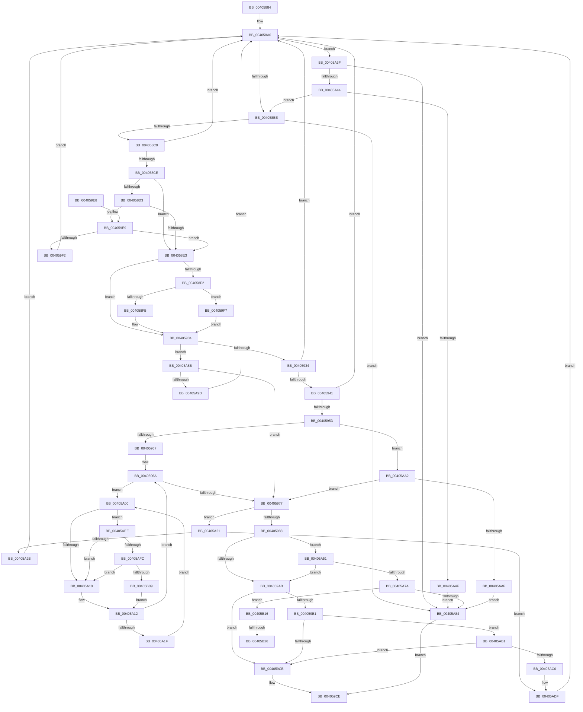

# MiLockTransitionLeafPageEx

- RVA: `0x00405884`–`0x00405B37` (길이 `691` bytes)
- VA: `0x0000000140405884`
- 실행 섹션: `.text`
- PDB 이름 있음: `예`; PDB Function 태그: `예`
- unwind 정보 RVA: `0x0009A840`
- 디코드: `164`개 명령, `691/691` bytes 표시
- 미해석 바이트: `0` (있으면 어셈블리에 `.byte`로 보존)

> 이 문서는 커널 이미지의 기계어와 PDB 기호를 분석해 생성했습니다. 4번과 5번은 함수 원형과 자료형을 바이너리 사용 방식에서 추정한 C 해석이며 원본 소스 복구 결과는 아닙니다.

## 1. Dependencies

- 직접 호출 지점: **9**; 고유 호출 대상: **8**
- 직접 호출자로 확인된 함수: **14**
- RIP 상대 이미지 참조: **6**

### Outgoing calls
- `0x004058A9` → [MI_READ_PTE_LOCK_FREE](../28/MI_READ_PTE_LOCK_FREE_function_002828A0.md) (function, `0x002828A0`)
- `0x0040597A` → [MI_READ_PTE_LOCK_FREE](../28/MI_READ_PTE_LOCK_FREE_function_002828A0.md) (function, `0x002828A0`)
- `0x00405A69` → [MiLockSpecialPurposeMemoryCachedPage](MiLockSpecialPurposeMemoryCachedPage_function_004049F0.md) (function, `0x004049F0`)
- `0x00405A8E` → [MiSafeLockPage](../32/MiSafeLockPage_function_00321620.md) (function, `0x00321620`)
- `0x00405AD9` → [KeBugCheckEx](../4F/KeBugCheckEx_function_004FD660.md) (function, `0x004FD660`)
- `0x00405AE4` → [MiUnlockPage](../31/MiUnlockPage_function_0031A3E0.md) (function, `0x0031A3E0`)
- `0x00405AFC` → [KiCheckVpBackingLongSpinWaitHypercall](../30/KiCheckVpBackingLongSpinWaitHypercall_function_0030F490.md) (function, `0x0030F490`)
- `0x00405B0C` → [HvlNotifyLongSpinWait](../30/HvlNotifyLongSpinWait_function_0030F460.md) (function, `0x0030F460`)
- `0x00405B2C` → [KiLowerIrqlProcessIrqlFlags](../4F/KiLowerIrqlProcessIrqlFlags_function_004F5698.md) (function, `0x004F5698`)

### Direct callers
- [MiReplacePageTablePage](../22/MiReplacePageTablePage_function_00229184.md) at `0x0022977D`
- [MiUserFault](../32/MiUserFault_function_00329840.md) at `0x0032A111`
- [sub_0032B8CD](../32/Unknown_function_0032B8CD.md) at `0x0032B95B`
- [MiGetPageForWriteCluster](MiGetPageForWriteCluster_function_00405704.md) at `0x0040574A`
- [MiMakeTransitionHeatBatch](MiMakeTransitionHeatBatch_function_00409A94.md) at `0x00409D24`
- [MiMakeOutswappedPageResident](../43/MiMakeOutswappedPageResident_function_00431AD0.md) at `0x00431B8B`
- [MiHandleSpecialPurposeMemoryCachedFault](../44/MiHandleSpecialPurposeMemoryCachedFault_function_0044C740.md) at `0x0044C8DE`
- [MiCheckCommitReleaseFromVad](../66/MiCheckCommitReleaseFromVad_function_0066EB90.md) at `0x0066EE75`
- [MiWalkResetCommitPte](../66/MiWalkResetCommitPte_function_0066FD30.md) at `0x0066FD5F`
- [MiQueryVaPhysicalContiguity](../68/MiQueryVaPhysicalContiguity_function_006875B8.md) at `0x0068781B`
- [MiStoreDiscardPoisonedPage](../69/MiStoreDiscardPoisonedPage_function_00692858.md) at `0x00692C11`
- [MiMakeVaRangePhysicallyContiguous](../69/MiMakeVaRangePhysicallyContiguous_function_006936E0.md) at `0x0069381E`
- [sub_006D6E94](../6D/Unknown_function_006D6E94.md) at `0x006D6ECD`
- [sub_006D9212](../6D/Unknown_function_006D9212.md) at `0x006D9510`
- [sub_006D9212](../6D/Unknown_function_006D9212.md) at `0x006D963A`

### Static image references
- `0x004058D3` → RVA `0x00E2DC80` (`.data`; read)
- `0x00405934` → RVA `0x00E2DCE0` (`.data`; read)
- `0x0040598C` → RVA `0x00E30088` (`.data`; read)
- `0x00405A03` → RVA `0x00FC52AC` (`ALMOSTRO`; reference)
- `0x00405AEE` → RVA `0x00FC6AB8` (`ALMOSTRO`; read)
- `0x00405B16` → RVA `0x00FC6D20` (`ALMOSTRO`; read)

## 2. Other-region calls and transfers

- 다른 실행 섹션으로 향하는 call: **0**
- call이 아닌 외부 분기/꼬리 이동: **2**
  - `0x00405B20` → [sub_006EC43C](../6E/Unknown_function_006EC43C.md) (`tail-transfer`)
  - `0x00405B32` → [sub_006EC43C](../6E/Unknown_function_006EC43C.md) (`tail-transfer`)

## 3. Assembly (complete function range)

```asm
00405884  48 89 5C 24 08                  mov qword ptr [rsp + 8], rbx
00405889  48 89 74 24 18                  mov qword ptr [rsp + 0x18], rsi
0040588E  48 89 7C 24 20                  mov qword ptr [rsp + 0x20], rdi
00405893  41 54                           push r12
00405895  41 56                           push r14
00405897  41 57                           push r15
00405899  48 83 EC 30                     sub rsp, 0x30
0040589D  45 8B E0                        mov r12d, r8d
004058A0  48 8B F2                        mov rsi, rdx
004058A3  4C 8B F9                        mov r15, rcx
004058A6  49 8B CF                        mov rcx, r15
004058A9  E8 F2 CF E7 FF                  call 0x1402828a0
004058AE  48 8B D8                        mov rbx, rax
004058B1  83 E0 01                        and eax, 1
004058B4  48 83 FE 01                     cmp rsi, 1
004058B8  0F 87 81 01 00 00               ja 0x140405a3f
004058BE  48 0F BA E3 0B                  bt rbx, 0xb
004058C3  0F 83 BB 01 00 00               jae 0x140405a84
004058C9  48 85 C0                        test rax, rax
004058CC  75 D8                           jne 0x1404058a6
004058CE  48 85 DB                        test rbx, rbx
004058D1  74 10                           je 0x1404058e3
004058D3  48 8B 05 A6 83 A2 00            mov rax, qword ptr [rip + 0xa283a6]
004058DA  48 85 C0                        test rax, rax
004058DD  0F 85 06 01 00 00               jne 0x1404059e9
004058E3  48 8B 0D 96 83 A2 00            mov rcx, qword ptr [rip + 0xa28396]
004058EA  48 8B C3                        mov rax, rbx
004058ED  48 85 C9                        test rcx, rcx
004058F0  74 12                           je 0x140405904
004058F2  F6 C3 10                        test bl, 0x10
004058F5  0F 85 FC 00 00 00               jne 0x1404059f7
004058FB  48 8B C1                        mov rax, rcx
004058FE  48 F7 D0                        not rax
00405901  48 23 C3                        and rax, rbx
00405904  48 B9 FF FF FF FF FF 00 00 00   movabs rcx, 0xffffffffff
0040590E  48 C1 E8 0C                     shr rax, 0xc
00405912  48 23 C1                        and rax, rcx
00405915  48 8D 0C 40                     lea rcx, [rax + rax*2]
00405919  48 03 C9                        add rcx, rcx
0040591C  48 BA 00 00 00 00 00 DE FF FF   movabs rdx, 0xffffde0000000000
00405926  48 8D 3C CA                     lea rdi, [rdx + rcx*8]
0040592A  48 83 FE 01                     cmp rsi, 1
0040592E  0F 87 57 01 00 00               ja 0x140405a8b
00405934  48 3B 05 A5 83 A2 00            cmp rax, qword ptr [rip + 0xa283a5]
0040593B  0F 87 65 FF FF FF               ja 0x1404058a6
00405941  48 B8 28 00 00 00 00 DE FF FF   movabs rax, 0xffffde0000000028
0040594B  48 8B 04 C8                     mov rax, qword ptr [rax + rcx*8]
0040594F  48 C1 E8 36                     shr rax, 0x36
00405953  0F BA E0 00                     bt eax, 0
00405957  0F 83 49 FF FF FF               jae 0x1404058a6
0040595D  48 83 FE 01                     cmp rsi, 1
00405961  0F 84 3B 01 00 00               je 0x140405aa2
00405967  45 33 F6                        xor r14d, r14d
0040596A  F0 48 0F BA 6F 18 3F            lock bts qword ptr [rdi + 0x18], 0x3f
00405971  0F 82 89 00 00 00               jb 0x140405a00
00405977  49 8B CF                        mov rcx, r15
0040597A  E8 21 CF E7 FF                  call 0x1402828a0
0040597F  48 3B C3                        cmp rax, rbx
00405982  0F 85 99 00 00 00               jne 0x140405a21
00405988  48 8B 47 28                     mov rax, qword ptr [rdi + 0x28]
0040598C  48 8B 0D F5 A6 A2 00            mov rcx, qword ptr [rip + 0xa2a6f5]
00405993  48 C1 E8 2B                     shr rax, 0x2b
00405997  25 FF 03 00 00                  and eax, 0x3ff
0040599C  48 8B 04 C1                     mov rax, qword ptr [rcx + rax*8]
004059A0  8B 40 04                        mov eax, dword ptr [rax + 4]
004059A3  84 C0                           test al, al
004059A5  0F 88 A6 00 00 00               js 0x140405a51
004059AB  48 83 FE 01                     cmp rsi, 1
004059AF  77 1A                           ja 0x1404059cb
004059B1  48 8B 47 08                     mov rax, qword ptr [rdi + 8]
004059B5  48 B9 00 00 00 00 00 00 00 80   movabs rcx, 0x8000000000000000
004059BF  48 0B C1                        or rax, rcx
004059C2  49 3B C7                        cmp rax, r15
004059C5  0F 85 E6 00 00 00               jne 0x140405ab1
004059CB  48 8B C7                        mov rax, rdi
004059CE  48 8B 5C 24 50                  mov rbx, qword ptr [rsp + 0x50]
004059D3  48 8B 74 24 60                  mov rsi, qword ptr [rsp + 0x60]
004059D8  48 8B 7C 24 68                  mov rdi, qword ptr [rsp + 0x68]
004059DD  48 83 C4 30                     add rsp, 0x30
004059E1  41 5F                           pop r15
004059E3  41 5E                           pop r14
004059E5  41 5C                           pop r12
004059E7  C3                              ret
004059E8  CC                              int3
004059E9  48 85 C3                        test rbx, rax
004059EC  0F 85 F1 FE FF FF               jne 0x1404058e3
004059F2  E9 AF FE FF FF                  jmp 0x1404058a6
004059F7  48 83 E0 EF                     and rax, 0xffffffffffffffef
004059FB  E9 04 FF FF FF                  jmp 0x140405904
00405A00  41 FF C6                        inc r14d
00405A03  44 85 35 A2 F8 BB 00            test dword ptr [rip + 0xbbf8a2], r14d
00405A0A  0F 84 DE 00 00 00               je 0x140405aee
00405A10  F3 90                           pause
00405A12  48 8B 47 18                     mov rax, qword ptr [rdi + 0x18]
00405A16  48 85 C0                        test rax, rax
00405A19  0F 89 4B FF FF FF               jns 0x14040596a
00405A1F  EB DF                           jmp 0x140405a00
00405A21  48 83 FE 01                     cmp rsi, 1
00405A25  0F 87 B4 00 00 00               ja 0x140405adf
00405A2B  48 B8 FF FF FF FF FF FF FF 7F   movabs rax, 0x7fffffffffffffff
00405A35  F0 48 21 47 18                  lock and qword ptr [rdi + 0x18], rax
00405A3A  E9 67 FE FF FF                  jmp 0x1404058a6
00405A3F  48 85 C0                        test rax, rax
00405A42  75 40                           jne 0x140405a84
00405A44  48 0F BA E3 0A                  bt rbx, 0xa
00405A49  0F 83 6F FE FF FF               jae 0x1404058be
00405A4F  EB 33                           jmp 0x140405a84
00405A51  33 C0                           xor eax, eax
00405A53  48 8B CF                        mov rcx, rdi
00405A56  48 83 FE 01                     cmp rsi, 1
00405A5A  0F 94 C0                        sete al
00405A5D  8B D0                           mov edx, eax
00405A5F  83 CA 02                        or edx, 2
00405A62  41 F6 C4 01                     test r12b, 1
00405A66  0F 44 D0                        cmove edx, eax
00405A69  E8 82 EF FF FF                  call 0x1404049f0
00405A6E  48 8B F8                        mov rdi, rax
00405A71  48 85 C0                        test rax, rax
00405A74  0F 85 31 FF FF FF               jne 0x1404059ab
00405A7A  48 83 FE 01                     cmp rsi, 1
00405A7E  0F 87 92 00 00 00               ja 0x140405b16
00405A84  33 C0                           xor eax, eax
00405A86  E9 43 FF FF FF                  jmp 0x1404059ce
00405A8B  48 8B C8                        mov rcx, rax
00405A8E  E8 8D BB F1 FF                  call 0x140321620
00405A93  88 06                           mov byte ptr [rsi], al
00405A95  3C 11                           cmp al, 0x11
00405A97  0F 85 DA FE FF FF               jne 0x140405977
00405A9D  E9 04 FE FF FF                  jmp 0x1404058a6
00405AA2  F0 48 0F BA 6F 18 3F            lock bts qword ptr [rdi + 0x18], 0x3f
00405AA9  0F 83 C8 FE FF FF               jae 0x140405977
00405AAF  EB D3                           jmp 0x140405a84
00405AB1  48 8B 47 28                     mov rax, qword ptr [rdi + 0x28]
00405AB5  48 0F BA E0 28                  bt rax, 0x28
00405ABA  0F 82 0B FF FF FF               jb 0x1404059cb
00405AC0  48 8B 47 08                     mov rax, qword ptr [rdi + 8]
00405AC4  4C 8B CB                        mov r9, rbx
00405AC7  4D 8B C7                        mov r8, r15
00405ACA  48 89 44 24 20                  mov qword ptr [rsp + 0x20], rax
00405ACF  BA 11 04 00 00                  mov edx, 0x411
00405AD4  B9 1A 00 00 00                  mov ecx, 0x1a
00405AD9  E8 82 7B 0F 00                  call 0x1404fd660
00405ADE  CC                              int3
00405ADF  8A 16                           mov dl, byte ptr [rsi]
00405AE1  48 8B CF                        mov rcx, rdi
00405AE4  E8 F7 48 F1 FF                  call 0x14031a3e0
00405AE9  E9 B8 FD FF FF                  jmp 0x1404058a6
00405AEE  8B 05 C4 0F BC 00               mov eax, dword ptr [rip + 0xbc0fc4]
00405AF4  A8 40                           test al, 0x40
00405AF6  0F 84 14 FF FF FF               je 0x140405a10
00405AFC  E8 8F 99 F0 FF                  call 0x14030f490
00405B01  84 C0                           test al, al
00405B03  0F 84 07 FF FF FF               je 0x140405a10
00405B09  41 8B CE                        mov ecx, r14d
00405B0C  E8 4F 99 F0 FF                  call 0x14030f460
00405B11  E9 FC FE FF FF                  jmp 0x140405a12
00405B16  83 3D 03 12 BC 00 00            cmp dword ptr [rip + 0xbc1203], 0
00405B1D  0F B6 1E                        movzx ebx, byte ptr [rsi]
00405B20  0F 84 16 69 2E 00               je 0x1406ec43c
00405B26  44 0F 20 C1                     mov rcx, cr8
00405B2A  8A D3                           mov dl, bl
00405B2C  E8 67 FB 0E 00                  call 0x1404f5698
00405B31  90                              nop
00405B32  E9 05 69 2E 00                  jmp 0x1406ec43c
```

## 4. C-style interpretation (structured pseudocode)

```c
__int64 __fastcall MiLockTransitionLeafPageEx(__int64 a1, __int64 a2, int a3)
{
    __int64 result;
    __int64 v_r14;
    __int64 v_rsp;
    unsigned __int64 v_stack_p18;
    unsigned __int64 v_stack_p20;
    unsigned __int64 v_stack_p8;

    v_stack_p8 = v_rbx;
    v_stack_p18 = v_rsi;
    v_stack_p20 = v_rdi;
    v_rsp = (v_rsp) - (48);
loc_004058A6:
    result = MI_READ_PTE_LOCK_FREE(a1, a2, a3, a4);
    result = (unsigned int)((result) & (1));
    if (a2 > 1) goto loc_00405A3F;
loc_004058BE:
    if (a2 >= 1) goto loc_00405A84;
    if (result != 0) goto loc_004058A6;
    if (result == 0) goto loc_004058E3;
    if (*(unsigned __int64 *)(v_rip + 10650534) != 0) goto loc_004059E9;
loc_004058E3:
    if (*(unsigned __int64 *)(v_rip + 10650518) == 0) goto loc_00405904;
    if ((((unsigned __int8)(result)) & (16)) != 0) goto loc_004059F7;
    result = ~(*(unsigned __int64 *)(v_rip + 10650518));
    result = (result) & (result);
loc_00405904:
    result = (result) >> (12);
    result = (result) & (*(unsigned __int64 *)(v_rip + 10650518));
    a1 = (result + result * 2) + (result + result * 2);
    if (a2 > 1) goto loc_00405A8B;
    if (result > (*(unsigned __int64 *)(v_rip + 10650533))) goto loc_004058A6;
    result = (*(unsigned __int64 *)(result + a1 * 8)) >> (54);
    if (condition_is_above_or_equal) goto loc_004058A6;
    if (a2 == 1) goto loc_00405AA2;
    v_r14 = 0;
loc_0040596A:
    if (condition_is_below) goto loc_00405A00;
loc_00405977:
    result = MI_READ_PTE_LOCK_FREE(a1, a2, a3, a4);
    if (result != result) goto loc_00405A21;
    result = (*(unsigned __int64 *)(a2 + a1 * 8 + 40)) >> (43);
    result = (unsigned int)((result) & (0x3FFULL));
    if (sign_flag) goto loc_00405A51;
loc_004059AB:
    if (a2 > 1) goto loc_004059CB;
    result = (*(unsigned __int64 *)(a2 + a1 * 8 + 8)) | (*(unsigned __int64 *)(v_rip + 10659573));
    if (result != a1) goto loc_00405AB1;
loc_004059CB:
loc_004059CE:
    v_rsp = (v_rsp) + (48);
    return a2 + a1 * 8;
loc_004059E9:
    if (((v_stack_p8) & (a2 + a1 * 8)) != 0) goto loc_004058E3;
    goto loc_004058A6;
loc_004059F7:
    result = (a2 + a1 * 8) & (-17);
    goto loc_00405904;
loc_00405A00:
    v_r14 = (unsigned int)((v_r14) + 1);
    if (((*(unsigned int *)(v_rip + 12318882)) & ((unsigned int)(v_r14))) == 0) goto loc_00405AEE;
loc_00405A10:
loc_00405A12:
    if (!sign_flag) goto loc_0040596A;
    goto loc_00405A00;
loc_00405A21:
    if (v_stack_p18 > 1) goto loc_00405ADF;
    goto loc_004058A6;
loc_00405A3F:
    if (*(unsigned __int64 *)(v_stack_p20 + 24) != 0) goto loc_00405A84;
    if (condition_is_above_or_equal) goto loc_004058BE;
    goto loc_00405A84;
loc_00405A51:
    result = 0;
    result = (v_stack_p18 == 1) ? 1 : 0;
    a2 = (unsigned int)(((unsigned int)((unsigned int)(result))) | (2));
    if ((((unsigned __int8)((unsigned int)(a3))) & (1)) == 0) { a2 = (unsigned int)(result); }
    result = MiLockSpecialPurposeMemoryCachedPage(v_stack_p20, a2, a3, a4);
    if (result != 0) goto loc_004059AB;
    if (v_stack_p18 > 1) goto loc_00405B16;
loc_00405A84:
    result = 0;
    goto loc_004059CE;
loc_00405A8B:
    result = MiSafeLockPage(0, a2, a3, a4);
    *(unsigned __int8 *)(v_stack_p18) = (unsigned __int8)(result);
    if (((unsigned __int8)(result)) != 17) goto loc_00405977;
    goto loc_004058A6;
loc_00405AA2:
    if (((unsigned __int8)(result)) >= 17) goto loc_00405977;
    goto loc_00405A84;
loc_00405AB1:
    if (((unsigned __int8)(result)) < 17) goto loc_004059CB;
    v_stack_p20 = *(unsigned __int64 *)(result + 8);
    result = KeBugCheckEx(26, (unsigned int)(0x411ULL), a1, v_stack_p8);
loc_00405ADF:
    result = MiUnlockPage(result, *(unsigned __int8 *)(v_stack_p18), a1, v_stack_p8);
    goto loc_004058A6;
loc_00405AEE:
    if ((((unsigned __int8)((unsigned int)(*(unsigned int *)(v_rip + 12324804)))) & (64)) == 0) goto loc_00405A10;
    result = KiCheckVpBackingLongSpinWaitHypercall(result, *(unsigned __int8 *)(v_stack_p18), a1, v_stack_p8);
    if ((unsigned __int8)(result) == 0) goto loc_00405A10;
    result = HvlNotifyLongSpinWait((unsigned int)((unsigned int)(v_r14)), *(unsigned __int8 *)(v_stack_p18), a1, v_stack_p8);
    goto loc_00405A12;
loc_00405B16:
    result = KiLowerIrqlProcessIrqlFlags(v_cr8, (unsigned __int8)(*(unsigned __int8 *)(v_stack_p18)), a1, v_stack_p8);
}
```

## 5. (Beta) C Style

```c
int64_t MiLockTransitionLeafPageEx(int64_t Arg1, int64_t Arg2, int32_t Arg3)
{
    int64_t result;
    int64_t local_r14;
    int64_t local_rsp;
    uint64_t v_stack_p18;
    uint64_t v_stack_p20;
    uint64_t v_stack_p8;

    v_stack_p8 = local_rbx;
    v_stack_p18 = local_rsi;
    v_stack_p20 = local_rdi;
    local_rsp = (local_rsp) - (48);
loc_004058A6:
    result = MI_READ_PTE_LOCK_FREE(Arg1, Arg2, Arg3, a4);
    result = (uint32_t)((result) & (1));
    if (Arg2 > 1) goto loc_00405A3F;
loc_004058BE:
    if (Arg2 >= 1) goto loc_00405A84;
    if (result != 0) goto loc_004058A6;
    if (result == 0) goto loc_004058E3;
    if (*(uint64_t *)(v_rip + 0xA283A6) != 0) goto loc_004059E9;
loc_004058E3:
    if (*(uint64_t *)(v_rip + 0xA28396) == 0) goto loc_00405904;
    if ((((uint8_t)(result)) & (16)) != 0) goto loc_004059F7;
    result = ~(*(uint64_t *)(v_rip + 0xA28396));
    result = (result) & (result);
loc_00405904:
    result = (result) >> (12);
    result = (result) & (*(uint64_t *)(v_rip + 0xA28396));
    Arg1 = (result + result * 2) + (result + result * 2);
    if (Arg2 > 1) goto loc_00405A8B;
    if (result > (*(uint64_t *)(v_rip + 0xA283A5))) goto loc_004058A6;
    result = (*(uint64_t *)(result + Arg1 * 8)) >> (54);
    if (condition_is_above_or_equal) goto loc_004058A6;
    if (Arg2 == 1) goto loc_00405AA2;
    local_r14 = 0;
loc_0040596A:
    if (condition_is_below) goto loc_00405A00;
loc_00405977:
    result = MI_READ_PTE_LOCK_FREE(Arg1, Arg2, Arg3, a4);
    if (result != result) goto loc_00405A21;
    result = (*(uint64_t *)(Arg2 + Arg1 * 8 + 0x28)) >> (43);
    result = (uint32_t)((result) & (0x3FFULL));
    if (sign_flag) goto loc_00405A51;
loc_004059AB:
    if (Arg2 > 1) goto loc_004059CB;
    result = (*(uint64_t *)(Arg2 + Arg1 * 8 + 0x8)) | (*(uint64_t *)(v_rip + 0xA2A6F5));
    if (result != Arg1) goto loc_00405AB1;
loc_004059CB:
loc_004059CE:
    local_rsp = (local_rsp) + (48);
    return Arg2 + Arg1 * 8;
loc_004059E9:
    if (((v_stack_p8) & (Arg2 + Arg1 * 8)) != 0) goto loc_004058E3;
    goto loc_004058A6;
loc_004059F7:
    result = (Arg2 + Arg1 * 8) & (-17);
    goto loc_00405904;
loc_00405A00:
    local_r14 = (uint32_t)((local_r14) + 1);
    if (((*(uint32_t *)(v_rip + 0xBBF8A2)) & ((uint32_t)(local_r14))) == 0) goto loc_00405AEE;
loc_00405A10:
loc_00405A12:
    if (!sign_flag) goto loc_0040596A;
    goto loc_00405A00;
loc_00405A21:
    if (v_stack_p18 > 1) goto loc_00405ADF;
    goto loc_004058A6;
loc_00405A3F:
    if (*(uint64_t *)(v_stack_p20 + 0x18) != 0) goto loc_00405A84;
    if (condition_is_above_or_equal) goto loc_004058BE;
    goto loc_00405A84;
loc_00405A51:
    result = 0;
    result = (v_stack_p18 == 1) ? 1 : 0;
    Arg2 = (uint32_t)(((uint32_t)((uint32_t)(result))) | (2));
    if ((((uint8_t)((uint32_t)(Arg3))) & (1)) == 0) { Arg2 = (uint32_t)(result); }
    result = MiLockSpecialPurposeMemoryCachedPage(v_stack_p20, Arg2, Arg3, a4);
    if (result != 0) goto loc_004059AB;
    if (v_stack_p18 > 1) goto loc_00405B16;
loc_00405A84:
    result = 0;
    goto loc_004059CE;
loc_00405A8B:
    result = MiSafeLockPage(0, Arg2, Arg3, a4);
    *(uint8_t *)(v_stack_p18) = (uint8_t)(result);
    if (((uint8_t)(result)) != 17) goto loc_00405977;
    goto loc_004058A6;
loc_00405AA2:
    if (((uint8_t)(result)) >= 17) goto loc_00405977;
    goto loc_00405A84;
loc_00405AB1:
    if (((uint8_t)(result)) < 17) goto loc_004059CB;
    v_stack_p20 = *(uint64_t *)(result + 0x8);
    result = KeBugCheckEx(26, (uint32_t)(0x411ULL), Arg1, v_stack_p8);
loc_00405ADF:
    result = MiUnlockPage(result, *(uint8_t *)(v_stack_p18), Arg1, v_stack_p8);
    goto loc_004058A6;
loc_00405AEE:
    if ((((uint8_t)((uint32_t)(*(uint32_t *)(v_rip + 0xBC0FC4)))) & (64)) == 0) goto loc_00405A10;
    result = KiCheckVpBackingLongSpinWaitHypercall(result, *(uint8_t *)(v_stack_p18), Arg1, v_stack_p8);
    if ((uint8_t)(result) == 0) goto loc_00405A10;
    result = HvlNotifyLongSpinWait((uint32_t)((uint32_t)(local_r14)), *(uint8_t *)(v_stack_p18), Arg1, v_stack_p8);
    goto loc_00405A12;
loc_00405B16:
    result = KiLowerIrqlProcessIrqlFlags(v_cr8, (uint8_t)(*(uint8_t *)(v_stack_p18)), Arg1, v_stack_p8);
}
```

## 6. Execution-region graph

[열기: 2D/3D 그래프와 함수 탐색 컨트롤 패널](../../../control-panel.html?section=text&rva=0x00405884&view=graph)

- 2D 그래프는 위에서 아래로 흐르고, 3D 그래프는 빈 공간을 드래그해 회전합니다. Shift+드래그는 이동, 휠은 확대·축소, 함수 노드 선택은 대상 보고서 이동입니다.

### Static fallback


