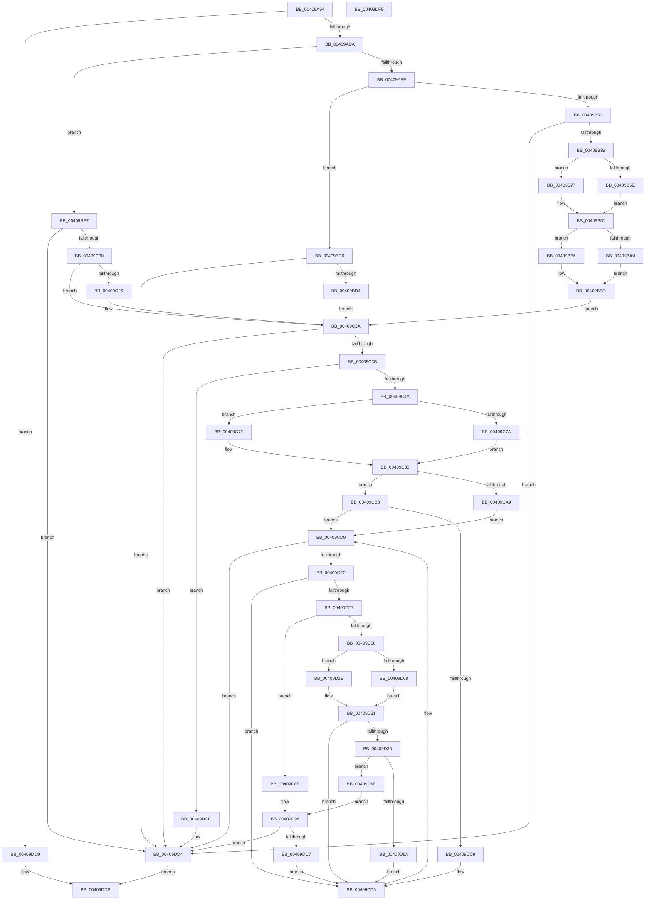

# MiMakeTransitionHeatBatch

- RVA: `0x00409A94`–`0x00409DF9` (길이 `869` bytes)
- VA: `0x0000000140409A94`
- 실행 섹션: `.text`
- PDB 이름 있음: `예`; PDB Function 태그: `아니요`
- unwind 정보 RVA: `0x0008C20C`
- 디코드: `222`개 명령, `869/869` bytes 표시
- 미해석 바이트: `0` (있으면 어셈블리에 `.byte`로 보존)

> 이 문서는 커널 이미지의 기계어와 PDB 기호를 분석해 생성했습니다. 4번과 5번은 함수 원형과 자료형을 바이너리 사용 방식에서 추정한 C 해석이며 원본 소스 복구 결과는 아닙니다.

## 1. Dependencies

- 직접 호출 지점: **11**; 고유 호출 대상: **9**
- 직접 호출자로 확인된 함수: **3**
- RIP 상대 이미지 참조: **1**

### Outgoing calls
- `0x00409AC5` → [MiSetActivePfnHeat](MiSetActivePfnHeat_function_00409E00.md) (function, `0x00409E00`)
- `0x00409BC6` → [MiGetSystemRegionType](../28/MiGetSystemRegionType_function_0028EC80.md) (function, `0x0028EC80`)
- `0x00409BF2` → [MiGetPrototypePteBoundaries](../69/MiGetPrototypePteBoundaries_function_006995B8.md) (function, `0x006995B8`)
- `0x00409C2A` → [MiGetTransitionPageHeatList](../68/MiGetTransitionPageHeatList_function_0068BFF4.md) (function, `0x0068BFF4`)
- `0x00409C58` → [MiInitializePageHeatList](../44/MiInitializePageHeatList_function_00446000.md) (function, `0x00446000`)
- `0x00409CE5` → [MI_READ_PTE_LOCK_FREE](../28/MI_READ_PTE_LOCK_FREE_function_002828A0.md) (function, `0x002828A0`)
- `0x00409D12` → [MiTryLockLeafPage](../37/MiTryLockLeafPage_function_003728DC.md) (function, `0x003728DC`)
- `0x00409D24` → [MiLockTransitionLeafPageEx](MiLockTransitionLeafPageEx_function_00405884.md) (function, `0x00405884`)
- `0x00409D73` → [MiSetActivePfnHeat](MiSetActivePfnHeat_function_00409E00.md) (function, `0x00409E00`)
- `0x00409DBE` → [MiAddPageToHeatRanges](../44/MiAddPageToHeatRanges_function_00446064.md) (function, `0x00446064`)
- `0x00409DCF` → [MiSetActivePfnHeat](MiSetActivePfnHeat_function_00409E00.md) (function, `0x00409E00`)

### Direct callers
- [sub_00283AFC](../28/Unknown_function_00283AFC.md) at `0x00283B95`
- [MmCopyToCachedPage](../34/MmCopyToCachedPage_function_00347B44.md) at `0x00347FD2`
- [sub_006DF29A](../6D/Unknown_function_006DF29A.md) at `0x006DF2AC`

### Static image references
- `0x00409ACA` → RVA `0x00FC6AB8` (`ALMOSTRO`; read)

## 2. Other-region calls and transfers

- 다른 실행 섹션으로 향하는 call: **0**
- 별도 외부 분기/꼬리 이동을 확인하지 못했습니다.

## 3. Assembly (complete function range)

```asm
00409A94  48 8B C4                        mov rax, rsp
00409A97  48 89 58 08                     mov qword ptr [rax + 8], rbx
00409A9B  48 89 68 10                     mov qword ptr [rax + 0x10], rbp
00409A9F  48 89 70 18                     mov qword ptr [rax + 0x18], rsi
00409AA3  57                              push rdi
00409AA4  41 54                           push r12
00409AA6  41 55                           push r13
00409AA8  41 56                           push r14
00409AAA  41 57                           push r15
00409AAC  48 83 EC 30                     sub rsp, 0x30
00409AB0  48 83 60 C8 00                  and qword ptr [rax - 0x38], 0
00409AB5  48 8B DA                        mov rbx, rdx
00409AB8  48 83 60 20 00                  and qword ptr [rax + 0x20], 0
00409ABD  33 D2                           xor edx, edx
00409ABF  4D 8B E0                        mov r12, r8
00409AC2  4C 8B F9                        mov r15, rcx
00409AC5  E8 36 03 00 00                  call 0x140409e00
00409ACA  F7 05 E4 CF BB 00 00 00 20 00   test dword ptr [rip + 0xbbcfe4], 0x200000
00409AD4  0F 84 FF 02 00 00               je 0x140409dd9
00409ADA  49 8B 6F 08                     mov rbp, qword ptr [r15 + 8]
00409ADE  48 B8 00 00 00 00 00 00 00 80   movabs rax, 0x8000000000000000
00409AE8  48 0B E8                        or rbp, rax
00409AEB  45 33 F6                        xor r14d, r14d
00409AEE  49 8B 47 28                     mov rax, qword ptr [r15 + 0x28]
00409AF2  48 8B CD                        mov rcx, rbp
00409AF5  48 85 C0                        test rax, rax
00409AF8  0F 88 E9 00 00 00               js 0x140409be7
00409AFE  45 33 ED                        xor r13d, r13d
00409B01  48 C1 E1 19                     shl rcx, 0x19
00409B05  49 B8 00 00 00 00 80 F6 FF FF   movabs r8, 0xfffff68000000000
00409B0F  49 8B C0                        mov rax, r8
00409B12  48 C1 E0 19                     shl rax, 0x19
00409B16  48 2B C8                        sub rcx, rax
00409B19  48 B8 FF FF FE FF FF 7F 00 00   movabs rax, 0x7ffffffeffff
00409B23  48 C1 F9 10                     sar rcx, 0x10
00409B27  48 3B C8                        cmp rcx, rax
00409B2A  0F 87 96 00 00 00               ja 0x140409bc6
00409B30  48 85 DB                        test rbx, rbx
00409B33  0F 84 9B 02 00 00               je 0x140409dd4
00409B39  8B 43 18                        mov eax, dword ptr [rbx + 0x18]
00409B3C  48 81 E1 00 00 E0 FF            and rcx, 0xffffffffffe00000
00409B43  0F B6 53 20                     movzx edx, byte ptr [rbx + 0x20]
00409B47  49 BA F8 FF FF FF 7F 00 00 00   movabs r10, 0x7ffffffff8
00409B51  48 C1 E2 20                     shl rdx, 0x20
00409B55  49 B9 FF FF FF FF 0F 00 00 00   movabs r9, 0xfffffffff
00409B5F  48 0B D0                        or rdx, rax
00409B62  48 8B C2                        mov rax, rdx
00409B65  48 C1 E0 0C                     shl rax, 0xc
00409B69  48 3B C8                        cmp rcx, rax
00409B6C  73 09                           jae 0x140409b77
00409B6E  49 23 D1                        and rdx, r9
00409B71  48 C1 E2 03                     shl rdx, 3
00409B75  EB 0A                           jmp 0x140409b81
00409B77  48 8B D1                        mov rdx, rcx
00409B7A  48 C1 EA 09                     shr rdx, 9
00409B7E  49 23 D2                        and rdx, r10
00409B81  49 8B C0                        mov rax, r8
00409B84  48 8D 3C 02                     lea rdi, [rdx + rax]
00409B88  48 81 C1 00 F0 1F 00            add rcx, 0x1ff000
00409B8F  8B 43 1C                        mov eax, dword ptr [rbx + 0x1c]
00409B92  0F B6 53 21                     movzx edx, byte ptr [rbx + 0x21]
00409B96  48 C1 E2 20                     shl rdx, 0x20
00409B9A  48 0B D0                        or rdx, rax
00409B9D  48 8B C2                        mov rax, rdx
00409BA0  48 C1 E0 0C                     shl rax, 0xc
00409BA4  48 3B C8                        cmp rcx, rax
00409BA7  76 0D                           jbe 0x140409bb6
00409BA9  49 23 D1                        and rdx, r9
00409BAC  48 8D 0C D5 00 00 00 00         lea rcx, [rdx*8]
00409BB4  EB 07                           jmp 0x140409bbd
00409BB6  48 C1 E9 09                     shr rcx, 9
00409BBA  49 23 CA                        and rcx, r10
00409BBD  49 8B C0                        mov rax, r8
00409BC0  48 8D 34 01                     lea rsi, [rcx + rax]
00409BC4  EB 64                           jmp 0x140409c2a
00409BC6  E8 B5 50 E8 FF                  call 0x14028ec80
00409BCB  83 F8 05                        cmp eax, 5
00409BCE  0F 85 00 02 00 00               jne 0x140409dd4
00409BD4  48 8B FD                        mov rdi, rbp
00409BD7  48 81 E7 00 F0 FF FF            and rdi, 0xfffffffffffff000
00409BDE  48 8D B7 F8 0F 00 00            lea rsi, [rdi + 0xff8]
00409BE5  EB 43                           jmp 0x140409c2a
00409BE7  48 8D 54 24 20                  lea rdx, [rsp + 0x20]
00409BEC  41 BD 01 00 00 00               mov r13d, 1
00409BF2  E8 C1 F9 28 00                  call 0x1406995b8
00409BF7  48 85 C0                        test rax, rax
00409BFA  0F 84 D4 01 00 00               je 0x140409dd4
00409C00  48 8B 4C 24 20                  mov rcx, qword ptr [rsp + 0x20]
00409C05  48 8B FD                        mov rdi, rbp
00409C08  48 81 E7 00 F0 FF FF            and rdi, 0xfffffffffffff000
00409C0F  48 3B F8                        cmp rdi, rax
00409C12  48 8D 14 C8                     lea rdx, [rax + rcx*8]
00409C16  48 8D B7 F8 0F 00 00            lea rsi, [rdi + 0xff8]
00409C1D  48 0F 42 F8                     cmovb rdi, rax
00409C21  48 3B F2                        cmp rsi, rdx
00409C24  72 04                           jb 0x140409c2a
00409C26  48 8D 72 F8                     lea rsi, [rdx - 8]
00409C2A  E8 C5 23 28 00                  call 0x14068bff4
00409C2F  4C 8B F0                        mov r14, rax
00409C32  48 85 C0                        test rax, rax
00409C35  0F 84 99 01 00 00               je 0x140409dd4
00409C3B  BA 01 00 00 00                  mov edx, 1
00409C40  48 83 F8 FF                     cmp rax, -1
00409C44  0F 84 82 01 00 00               je 0x140409dcc
00409C4A  44 8B 08                        mov r9d, dword ptr [rax]
00409C4D  44 8D 42 01                     lea r8d, [rdx + 1]
00409C51  41 C1 E9 03                     shr r9d, 3
00409C55  48 8B C8                        mov rcx, rax
00409C58  E8 A3 C3 03 00                  call 0x140446000
00409C5D  8B 09                           mov ecx, dword ptr [rcx]
00409C5F  BA FF FF FF FF                  mov edx, 0xffffffff
00409C64  44 8B C1                        mov r8d, ecx
00409C67  49 8B C4                        mov rax, r12
00409C6A  49 C1 E8 03                     shr r8, 3
00409C6E  4C 3B E2                        cmp r12, rdx
00409C71  48 0F 43 C2                     cmovae rax, rdx
00409C75  4C 3B C0                        cmp r8, rax
00409C78  76 05                           jbe 0x140409c7f
00409C7A  C1 E9 03                        shr ecx, 3
00409C7D  EB 09                           jmp 0x140409c88
00409C7F  4C 3B E2                        cmp r12, rdx
00409C82  41 0F 42 D4                     cmovb edx, r12d
00409C86  8B CA                           mov ecx, edx
00409C88  4D 3B E0                        cmp r12, r8
00409C8B  48 8B DD                        mov rbx, rbp
00409C8E  48 8B C6                        mov rax, rsi
00409C91  41 BC 01 00 00 00               mov r12d, 1
00409C97  48 0F 46 DF                     cmovbe rbx, rdi
00409C9B  48 2B C5                        sub rax, rbp
00409C9E  48 C1 F8 03                     sar rax, 3
00409CA2  41 03 C4                        add eax, r12d
00409CA5  3B C1                           cmp eax, ecx
00409CA7  72 0F                           jb 0x140409cb8
00409CA9  8B C1                           mov eax, ecx
00409CAB  48 8D 75 F8                     lea rsi, [rbp - 8]
00409CAF  48 8B DD                        mov rbx, rbp
00409CB2  48 8D 34 C6                     lea rsi, [rsi + rax*8]
00409CB6  EB 21                           jmp 0x140409cd9
00409CB8  48 8B C6                        mov rax, rsi
00409CBB  48 2B C3                        sub rax, rbx
00409CBE  48 C1 F8 03                     sar rax, 3
00409CC2  41 03 C4                        add eax, r12d
00409CC5  3B C1                           cmp eax, ecx
00409CC7  76 10                           jbe 0x140409cd9
00409CC9  8B C1                           mov eax, ecx
00409CCB  48 8B DE                        mov rbx, rsi
00409CCE  48 C1 E0 03                     shl rax, 3
00409CD2  48 2B D8                        sub rbx, rax
00409CD5  48 83 C3 08                     add rbx, 8
00409CD9  48 3B DE                        cmp rbx, rsi
00409CDC  0F 87 F2 00 00 00               ja 0x140409dd4
00409CE2  48 8B CB                        mov rcx, rbx
00409CE5  E8 B6 8B E7 FF                  call 0x1402828a0
00409CEA  25 01 0C 00 00                  and eax, 0xc01
00409CEF  48 3D 00 08 00 00               cmp rax, 0x800
00409CF5  75 DE                           jne 0x140409cd5
00409CF7  48 3B DD                        cmp rbx, rbp
00409CFA  0F 84 8E 00 00 00               je 0x140409d8e
00409D00  48 8B CB                        mov rcx, rbx
00409D03  45 85 ED                        test r13d, r13d
00409D06  74 16                           je 0x140409d1e
00409D08  4C 8D 44 24 78                  lea r8, [rsp + 0x78]
00409D0D  BA 03 00 00 00                  mov edx, 3
00409D12  E8 C5 8B F6 FF                  call 0x1403728dc
00409D17  48 8B 7C 24 78                  mov rdi, qword ptr [rsp + 0x78]
00409D1C  EB 13                           jmp 0x140409d31
00409D1E  45 8B C4                        mov r8d, r12d
00409D21  49 8B D4                        mov rdx, r12
00409D24  E8 5B BB FF FF                  call 0x140405884
00409D29  48 8B F8                        mov rdi, rax
00409D2C  48 89 44 24 78                  mov qword ptr [rsp + 0x78], rax
00409D31  48 85 FF                        test rdi, rdi
00409D34  74 9F                           je 0x140409cd5
00409D36  48 8B 4F 10                     mov rcx, qword ptr [rdi + 0x10]
00409D3A  4C 8B C1                        mov r8, rcx
00409D3D  48 8B D1                        mov rdx, rcx
00409D40  48 C1 EA 0B                     shr rdx, 0xb
00409D44  41 81 E0 00 04 00 00            and r8d, 0x400
00409D4B  48 C1 E9 03                     shr rcx, 3
00409D4F  4D 85 C0                        test r8, r8
00409D52  0F 45 CA                        cmovne ecx, edx
00409D55  41 84 CC                        test r12b, cl
00409D58  75 14                           jne 0x140409d6e
00409D5A  48 B8 FF FF FF FF FF FF FF 7F   movabs rax, 0x7fffffffffffffff
00409D64  F0 48 21 47 18                  lock and qword ptr [rdi + 0x18], rax
00409D69  E9 67 FF FF FF                  jmp 0x140409cd5
00409D6E  33 D2                           xor edx, edx
00409D70  48 8B CF                        mov rcx, rdi
00409D73  E8 88 00 00 00                  call 0x140409e00
00409D78  48 B8 FF FF FF FF FF FF FF 7F   movabs rax, 0x7fffffffffffffff
00409D82  F0 48 21 47 18                  lock and qword ptr [rdi + 0x18], rax
00409D87  48 8B 54 24 78                  mov rdx, qword ptr [rsp + 0x78]
00409D8C  EB 08                           jmp 0x140409d96
00409D8E  49 8B D7                        mov rdx, r15
00409D91  48 89 54 24 78                  mov qword ptr [rsp + 0x78], rdx
00409D96  48 B8 00 00 00 00 00 DE FF FF   movabs rax, 0xffffde0000000000
00409DA0  48 2B D0                        sub rdx, rax
00409DA3  41 B8 03 00 00 00               mov r8d, 3
00409DA9  48 C1 FA 04                     sar rdx, 4
00409DAD  48 B8 AB AA AA AA AA AA AA AA   movabs rax, 0xaaaaaaaaaaaaaaab
00409DB7  48 0F AF D0                     imul rdx, rax
00409DBB  49 8B CE                        mov rcx, r14
00409DBE  E8 A1 C2 03 00                  call 0x140446064
00409DC3  85 C0                           test eax, eax
00409DC5  75 0D                           jne 0x140409dd4
00409DC7  E9 09 FF FF FF                  jmp 0x140409cd5
00409DCC  49 8B CF                        mov rcx, r15
00409DCF  E8 2C 00 00 00                  call 0x140409e00
00409DD4  49 8B C6                        mov rax, r14
00409DD7  EB 02                           jmp 0x140409ddb
00409DD9  33 C0                           xor eax, eax
00409DDB  48 8B 5C 24 60                  mov rbx, qword ptr [rsp + 0x60]
00409DE0  48 8B 6C 24 68                  mov rbp, qword ptr [rsp + 0x68]
00409DE5  48 8B 74 24 70                  mov rsi, qword ptr [rsp + 0x70]
00409DEA  48 83 C4 30                     add rsp, 0x30
00409DEE  41 5F                           pop r15
00409DF0  41 5E                           pop r14
00409DF2  41 5D                           pop r13
00409DF4  41 5C                           pop r12
00409DF6  5F                              pop rdi
00409DF7  C3                              ret
00409DF8  CC                              int3
```

## 4. C-style interpretation (structured pseudocode)

```c
__int64 __fastcall MiMakeTransitionHeatBatch(__int64 a1, __int64 a2, __int64 a3)
{
    __int64 result;
    __int64 v_r13;
    __int64 v_r14;
    __int64 v_rbp;
    __int64 v_rbx;
    __int64 v_rdi;
    __int64 v_rsi;
    __int64 v_rsp;
    unsigned __int64 v_stack_m38;
    unsigned __int64 v_stack_p10;
    unsigned __int64 v_stack_p18;
    unsigned __int64 v_stack_p20;
    unsigned __int64 v_stack_p8;

    *(unsigned __int64 *)(v_rsp + 8) = v_rbx;
    *(unsigned __int64 *)(v_rsp + 16) = v_rbp;
    *(unsigned __int64 *)(v_rsp + 24) = v_rsi;
    v_rsp = (v_rsp) - (48);
    a2 = 0;
    result = MiSetActivePfnHeat(a1, a2, a3, a4);
    if (((*(unsigned int *)(v_rip + 12308452)) & (0x200000ULL)) == 0) goto loc_00409DD9;
    v_rbp = (*(unsigned __int64 *)(a1 + 8)) | (result);
    v_r14 = 0;
    if (sign_flag) goto loc_00409BE7;
    v_r13 = 0;
    a1 = (v_rbp) << (25);
    result = (a3) << (25);
    a1 = (a1) - (result);
    a1 = (a1) >> (16);
    if (a1 > result) goto loc_00409BC6;
    if (0 == 0) goto loc_00409DD4;
    a1 = (a1) & (0xFFFFFFFFFFE00000ULL);
    a2 = (*(unsigned __int8 *)(a2 + 32)) << (32);
    a2 = (a2) | ((unsigned int)(*(unsigned int *)(a2 + 24)));
    result = (a2) << (12);
    if (a1 >= result) goto loc_00409B77;
    a2 = (a2) & (a4);
    a2 = (a2) << (3);
    goto loc_00409B81;
loc_00409B77:
    a2 = (a1) >> (9);
    a2 = (a2) & (v_r10);
loc_00409B81:
    a1 = (a1) + (0x1FF000ULL);
    a2 = (*(unsigned __int8 *)(a2 + 33)) << (32);
    a2 = (a2) | ((unsigned int)(*(unsigned int *)(a2 + 28)));
    result = (a2) << (12);
    if (a1 <= result) goto loc_00409BB6;
    a2 = (a2) & (a4);
    goto loc_00409BBD;
loc_00409BB6:
    a1 = (a2 * 8) >> (9);
    a1 = (a1) & (v_r10);
loc_00409BBD:
    goto loc_00409C2A;
loc_00409BC6:
    result = MiGetSystemRegionType(a1, a2, a3, a4);
    if (((unsigned int)(result)) != 5) goto loc_00409DD4;
    v_rdi = (v_rbp) & (0xFFFFFFFFFFFFF000ULL);
    goto loc_00409C2A;
loc_00409BE7:
    result = MiGetPrototypePteBoundaries(a1, v_stack_m38, a3, a4);
    if (result == 0) goto loc_00409DD4;
    v_rdi = (v_rbp) & (0xFFFFFFFFFFFFF000ULL);
    if (v_rdi < result) { v_rdi = result; }
    v_rsi = v_rdi + 4088;
    if ((v_rdi + 4088) >= (result + v_stack_m38 * 8)) {
        v_rsi = result + v_stack_m38 * 8 - 8;
    }
    result = MiGetTransitionPageHeatList(v_stack_m38, result + v_stack_m38 * 8, a3, a4);
    if (result == 0) goto loc_00409DD4;
    if (result == -1) goto loc_00409DCC;
    a4 = (unsigned int)(((unsigned int)(*(unsigned int *)(result))) >> (3));
    result = MiInitializePageHeatList(result, 1, 1 + 1, a4);
    a3 = ((unsigned int)((unsigned int)((unsigned int)(*(unsigned int *)(result))))) >> (3);
    if (a3 >= ((unsigned int)(0xFFFFFFFFULL))) { a3 = (unsigned int)(0xFFFFFFFFULL); }
    if (a3 <= a3) goto loc_00409C7F;
    a1 = (unsigned int)(((unsigned int)(*(unsigned int *)(result))) >> (3));
    goto loc_00409C88;
loc_00409C7F:
    a2 = (unsigned int)(0xFFFFFFFFULL);
    if (a3 < ((unsigned int)(0xFFFFFFFFULL))) { a2 = (unsigned int)(a3); }
loc_00409C88:
    v_rbx = v_rbp;
    if (a3 <= a3) { v_rbx = v_rdi; }
    result = (v_rsi) - (v_rbp);
    result = (result) >> (3);
    result = (unsigned int)((result) + (1));
    if (((unsigned int)(result)) < ((unsigned int)((unsigned int)((unsigned int)(a2))))) goto loc_00409CB8;
    goto loc_00409CD9;
loc_00409CB8:
    result = (v_rbp - 8 + (unsigned int)((unsigned int)((unsigned int)((unsigned int)(a2)))) * 8) - (v_rbp);
    result = (result) >> (3);
    result = (unsigned int)((result) + (1));
    if (((unsigned int)(result)) <= ((unsigned int)((unsigned int)((unsigned int)(a2))))) goto loc_00409CD9;
    result = ((unsigned int)((unsigned int)((unsigned int)((unsigned int)(a2))))) << (3);
    v_rbx = (v_rbp - 8 + (unsigned int)((unsigned int)((unsigned int)((unsigned int)(a2)))) * 8) - (result);
loc_00409CD5:
    v_rbx = (v_rbx) + (8);
loc_00409CD9:
    if (v_rbx > (v_rbp - 8 + (unsigned int)((unsigned int)((unsigned int)((unsigned int)(a2)))) * 8)) goto loc_00409DD4;
    result = MI_READ_PTE_LOCK_FREE(v_rbx, a2, a3, a4);
    result = (unsigned int)((result) & (0xC01ULL));
    if (result != 0x800ULL) goto loc_00409CD5;
    if (v_rbx == v_rbp) goto loc_00409D8E;
    if (1 == 0) goto loc_00409D1E;
    result = MiTryLockLeafPage(v_rbx, 3, v_stack_p20, a4);
    goto loc_00409D31;
loc_00409D1E:
    result = MiLockTransitionLeafPageEx(v_rbx, 1, 1, a4);
    v_stack_p20 = result;
loc_00409D31:
    if (result == 0) goto loc_00409CD5;
    a2 = (*(unsigned __int64 *)(result + 16)) >> (11);
    a3 = (unsigned int)((*(unsigned __int64 *)(result + 16)) & (0x400ULL));
    a1 = (*(unsigned __int64 *)(result + 16)) >> (3);
    if (a3 != 0) { a1 = (unsigned int)(a2); }
    if (((1) & ((unsigned __int8)(a1))) != 0) goto loc_00409D6E;
    goto loc_00409CD5;
loc_00409D6E:
    a2 = 0;
    result = MiSetActivePfnHeat(result, a2, a3, a4);
    goto loc_00409D96;
loc_00409D8E:
    v_stack_p20 = a1;
loc_00409D96:
    a2 = (a1) - (result);
    a2 = (a2) >> (4);
    a2 = (a2) * (result);
    result = MiAddPageToHeatRanges(result, a2, 3, a4);
    if ((unsigned int)(result) != 0) goto loc_00409DD4;
    goto loc_00409CD5;
loc_00409DCC:
    result = MiSetActivePfnHeat(a1, a2, 3, a4);
loc_00409DD4:
    goto loc_00409DDB;
loc_00409DD9:
    result = 0;
loc_00409DDB:
    v_rsp = (v_rsp) + (48);
    return result;
}
```

## 5. (Beta) C Style

```c
int64_t MiMakeTransitionHeatBatch(void *Arg1, int64_t Arg2, int64_t Arg3)
{
    uint8_t *arg1 = (uint8_t *)Arg1;

    int64_t result;
    int64_t local_r13;
    int64_t local_r14;
    int64_t local_rbp;
    int64_t local_rbx;
    int64_t local_rdi;
    int64_t local_rsi;
    int64_t local_rsp;
    uint64_t v_stack_m38;
    uint64_t v_stack_p10;
    uint64_t v_stack_p18;
    uint64_t v_stack_p20;
    uint64_t v_stack_p8;

    *(uint64_t *)(local_rsp + 0x8) = local_rbx;
    *(uint64_t *)(local_rsp + 0x10) = local_rbp;
    *(uint64_t *)(local_rsp + 0x18) = local_rsi;
    local_rsp = (local_rsp) - (48);
    Arg2 = 0;
    result = MiSetActivePfnHeat(Arg1, Arg2, Arg3, a4);
    if (((*(uint32_t *)(v_rip + 0xBBCFE4)) & (0x200000ULL)) == 0) goto loc_00409DD9;
    local_rbp = (*(uint64_t *)(arg1 + 0x8)) | (result);
    local_r14 = 0;
    if (sign_flag) goto loc_00409BE7;
    local_r13 = 0;
    Arg1 = (local_rbp) << (25);
    result = (Arg3) << (25);
    Arg1 = (Arg1) - (result);
    Arg1 = (Arg1) >> (16);
    if (Arg1 > result) goto loc_00409BC6;
    if (0 == 0) goto loc_00409DD4;
    Arg1 = (Arg1) & (0xFFFFFFFFFFE00000ULL);
    Arg2 = (*(uint8_t *)(Arg2 + 0x20)) << (32);
    Arg2 = (Arg2) | ((uint32_t)(*(uint32_t *)(Arg2 + 0x18)));
    result = (Arg2) << (12);
    if (Arg1 >= result) goto loc_00409B77;
    Arg2 = (Arg2) & (a4);
    Arg2 = (Arg2) << (3);
    goto loc_00409B81;
loc_00409B77:
    Arg2 = (Arg1) >> (9);
    Arg2 = (Arg2) & (local_r10);
loc_00409B81:
    Arg1 = (Arg1) + (0x1FF000ULL);
    Arg2 = (*(uint8_t *)(Arg2 + 0x21)) << (32);
    Arg2 = (Arg2) | ((uint32_t)(*(uint32_t *)(Arg2 + 0x1C)));
    result = (Arg2) << (12);
    if (Arg1 <= result) goto loc_00409BB6;
    Arg2 = (Arg2) & (a4);
    goto loc_00409BBD;
loc_00409BB6:
    Arg1 = (Arg2 * 8) >> (9);
    Arg1 = (Arg1) & (local_r10);
loc_00409BBD:
    goto loc_00409C2A;
loc_00409BC6:
    result = MiGetSystemRegionType(Arg1, Arg2, Arg3, a4);
    if (((uint32_t)(result)) != 5) goto loc_00409DD4;
    local_rdi = (local_rbp) & (0xFFFFFFFFFFFFF000ULL);
    goto loc_00409C2A;
loc_00409BE7:
    result = MiGetPrototypePteBoundaries(Arg1, v_stack_m38, Arg3, a4);
    if (result == 0) goto loc_00409DD4;
    local_rdi = (local_rbp) & (0xFFFFFFFFFFFFF000ULL);
    if (local_rdi < result) { local_rdi = result; }
    local_rsi = local_rdi + 4088;
    if ((local_rdi + 4088) >= (result + v_stack_m38 * 8)) {
        local_rsi = result + v_stack_m38 * 8 - 8;
    }
    result = MiGetTransitionPageHeatList(v_stack_m38, result + v_stack_m38 * 8, Arg3, a4);
    if (result == 0) goto loc_00409DD4;
    if (result == -1) goto loc_00409DCC;
    a4 = (uint32_t)(((uint32_t)(*(uint32_t *)(result))) >> (3));
    result = MiInitializePageHeatList(result, 1, 1 + 1, a4);
    Arg3 = ((uint32_t)((uint32_t)((uint32_t)(*(uint32_t *)(result))))) >> (3);
    if (Arg3 >= ((uint32_t)(0xFFFFFFFFULL))) { Arg3 = (uint32_t)(0xFFFFFFFFULL); }
    if (Arg3 <= Arg3) goto loc_00409C7F;
    Arg1 = (uint32_t)(((uint32_t)(*(uint32_t *)(result))) >> (3));
    goto loc_00409C88;
loc_00409C7F:
    Arg2 = (uint32_t)(0xFFFFFFFFULL);
    if (Arg3 < ((uint32_t)(0xFFFFFFFFULL))) { Arg2 = (uint32_t)(Arg3); }
loc_00409C88:
    local_rbx = local_rbp;
    if (Arg3 <= Arg3) { local_rbx = local_rdi; }
    result = (local_rsi) - (local_rbp);
    result = (result) >> (3);
    result = (uint32_t)((result) + (1));
    if (((uint32_t)(result)) < ((uint32_t)((uint32_t)((uint32_t)(Arg2))))) goto loc_00409CB8;
    goto loc_00409CD9;
loc_00409CB8:
    result = (local_rbp - 8 + (uint32_t)((uint32_t)((uint32_t)((uint32_t)(Arg2)))) * 8) - (local_rbp);
    result = (result) >> (3);
    result = (uint32_t)((result) + (1));
    if (((uint32_t)(result)) <= ((uint32_t)((uint32_t)((uint32_t)(Arg2))))) goto loc_00409CD9;
    result = ((uint32_t)((uint32_t)((uint32_t)((uint32_t)(Arg2))))) << (3);
    local_rbx = (local_rbp - 8 + (uint32_t)((uint32_t)((uint32_t)((uint32_t)(Arg2)))) * 8) - (result);
loc_00409CD5:
    local_rbx = (local_rbx) + (8);
loc_00409CD9:
    if (local_rbx > (local_rbp - 8 + (uint32_t)((uint32_t)((uint32_t)((uint32_t)(Arg2)))) * 8)) goto loc_00409DD4;
    result = MI_READ_PTE_LOCK_FREE(local_rbx, Arg2, Arg3, a4);
    result = (uint32_t)((result) & (0xC01ULL));
    if (result != 0x800ULL) goto loc_00409CD5;
    if (local_rbx == local_rbp) goto loc_00409D8E;
    if (1 == 0) goto loc_00409D1E;
    result = MiTryLockLeafPage(local_rbx, 3, v_stack_p20, a4);
    goto loc_00409D31;
loc_00409D1E:
    result = MiLockTransitionLeafPageEx(local_rbx, 1, 1, a4);
    v_stack_p20 = result;
loc_00409D31:
    if (result == 0) goto loc_00409CD5;
    Arg2 = (*(uint64_t *)(result + 0x10)) >> (11);
    Arg3 = (uint32_t)((*(uint64_t *)(result + 0x10)) & (0x400ULL));
    Arg1 = (*(uint64_t *)(result + 0x10)) >> (3);
    if (Arg3 != 0) { Arg1 = (uint32_t)(Arg2); }
    if (((1) & ((uint8_t)(Arg1))) != 0) goto loc_00409D6E;
    goto loc_00409CD5;
loc_00409D6E:
    Arg2 = 0;
    result = MiSetActivePfnHeat(result, Arg2, Arg3, a4);
    goto loc_00409D96;
loc_00409D8E:
    v_stack_p20 = Arg1;
loc_00409D96:
    Arg2 = (Arg1) - (result);
    Arg2 = (Arg2) >> (4);
    Arg2 = (Arg2) * (result);
    result = MiAddPageToHeatRanges(result, Arg2, 3, a4);
    if ((uint32_t)(result) != 0) goto loc_00409DD4;
    goto loc_00409CD5;
loc_00409DCC:
    result = MiSetActivePfnHeat(Arg1, Arg2, 3, a4);
loc_00409DD4:
    goto loc_00409DDB;
loc_00409DD9:
    result = 0;
loc_00409DDB:
    local_rsp = (local_rsp) + (48);
    return result;
}
```

### 관측된 메모리 오프셋

구조체 형식이 확인되지 않은 접근은 인자 기준의 오프셋으로만 기록했습니다.

| 기준 인자 | 오프셋 표현 | 폭 (bit) | 접근 |
|---|---:|---:|---|
| `Arg1` | `+ 0x8` | `64` | `R` |
| `Arg1` | `+ 0x28` | `64` | `R` |

## 6. Execution-region graph

[열기: 2D/3D 그래프와 함수 탐색 컨트롤 패널](../../../control-panel.html?section=text&rva=0x00409A94&view=graph)

- 2D 그래프는 위에서 아래로 흐르고, 3D 그래프는 빈 공간을 드래그해 회전합니다. Shift+드래그는 이동, 휠은 확대·축소, 함수 노드 선택은 대상 보고서 이동입니다.

### Static fallback


