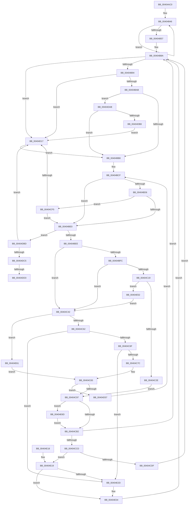

# MiMappedPageWriter

- RVA: `0x00404AC0`–`0x00404E78` (길이 `952` bytes)
- VA: `0x0000000140404AC0`
- 실행 섹션: `.text`
- PDB 이름 있음: `예`; PDB Function 태그: `예`
- unwind 정보 RVA: `0x0009A798`
- 디코드: `211`개 명령, `952/952` bytes 표시
- 미해석 바이트: `0` (있으면 어셈블리에 `.byte`로 보존)

> 이 문서는 커널 이미지의 기계어와 PDB 기호를 분석해 생성했습니다. 4번과 5번은 함수 원형과 자료형을 바이너리 사용 방식에서 추정한 C 해석이며 원본 소스 복구 결과는 아닙니다.

## 1. Dependencies

- 직접 호출 지점: **16**; 고유 호출 대상: **13**
- 직접 호출자로 확인된 함수: **0**
- RIP 상대 이미지 참조: **1**

### Outgoing calls
- `0x00404B03` → [memset](../6C/memset_function_006C6C40.md) (function, `0x006C6C40`)
- `0x00404B21` → [KeSetPriorityThread](../2C/KeSetPriorityThread_function_002C76E0.md) (function, `0x002C76E0`)
- `0x00404C0C` → [MiAllocatePool](../35/MiAllocatePool_function_0035B540.md) (function, `0x0035B540`)
- `0x00404C21` → [MiChargeForWriteInProgressPage](../28/MiChargeForWriteInProgressPage_function_00286D60.md) (function, `0x00286D60`)
- `0x00404C4A` → [MiLockPartitionMappedWriter](MiLockPartitionMappedWriter_function_00403150.md) (function, `0x00403150`)
- `0x00404C89` → [MiUnlockPartitionMappedWriter](MiUnlockPartitionMappedWriter_function_004030EC.md) (function, `0x004030EC`)
- `0x00404CC0` → [MiGatherMappedPages](MiGatherMappedPages_function_00404E80.md) (function, `0x00404E80`)
- `0x00404CEB` → [MiFreeModWriterEntry](MiFreeModWriterEntry_function_00407AE8.md) (function, `0x00407AE8`)
- `0x00404D4A` → [KeWaitForMultipleObjects](../20/KeWaitForMultipleObjects_function_0020D110.md) (function, `0x0020D110`)
- `0x00404D99` → [KeWaitForMultipleObjects](../20/KeWaitForMultipleObjects_function_0020D110.md) (function, `0x0020D110`)
- `0x00404DD6` → [MiDeleteMappedMdls](MiDeleteMappedMdls_function_00402C10.md) (function, `0x00402C10`)
- `0x00404DE2` → [KeSetActualBasePriorityThread](../3C/KeSetActualBasePriorityThread_function_003C4370.md) (function, `0x003C4370`)
- `0x00404DF2` → [_security_check_cookie](../6A/_security_check_cookie_function_006AC640.md) (function, `0x006AC640`)
- `0x00404E1F` → [MiLockPartitionMappedWriter](MiLockPartitionMappedWriter_function_00403150.md) (function, `0x00403150`)
- `0x00404E48` → [MiUnlockPartitionMappedWriter](MiUnlockPartitionMappedWriter_function_004030EC.md) (function, `0x004030EC`)
- `0x00404E57` → [ExFreePoolWithTag](../../poolcode/B8/ExFreePoolWithTag_function_00B82870.md) (function, `0x00B82870`)

### Direct callers
- 이 함수 시작 RVA로 연결되는 직접 call은 확인되지 않았습니다. 간접 호출은 완전히 역산할 수 없습니다.

### Static image references
- `0x00404ADF` → RVA `0x00E0A740` (`.data`; read)

## 2. Other-region calls and transfers

- 다른 실행 섹션으로 향하는 call: **1**
  - `0x00404E57` → [ExFreePoolWithTag](../../poolcode/B8/ExFreePoolWithTag_function_00B82870.md) (`.text` → `POOLCODE`)
- call이 아닌 외부 분기/꼬리 이동: **1**
  - `0x00404DCD` → [sub_006EC370](../6E/Unknown_function_006EC370.md) (`tail-transfer`)

## 3. Assembly (complete function range)

```asm
00404AC0  4C 8B DC                        mov r11, rsp
00404AC3  49 89 5B 10                     mov qword ptr [r11 + 0x10], rbx
00404AC7  49 89 6B 18                     mov qword ptr [r11 + 0x18], rbp
00404ACB  49 89 73 20                     mov qword ptr [r11 + 0x20], rsi
00404ACF  57                              push rdi
00404AD0  41 54                           push r12
00404AD2  41 55                           push r13
00404AD4  41 56                           push r14
00404AD6  41 57                           push r15
00404AD8  48 81 EC C0 04 00 00            sub rsp, 0x4c0
00404ADF  48 8B 05 5A 5C A0 00            mov rax, qword ptr [rip + 0xa05c5a]
00404AE6  48 33 C4                        xor rax, rsp
00404AE9  48 89 84 24 B0 04 00 00         mov qword ptr [rsp + 0x4b0], rax
00404AF1  48 8B D9                        mov rbx, rcx
00404AF4  33 D2                           xor edx, edx
00404AF6  49 8D 8B E0 FB FF FF            lea rcx, [r11 - 0x420]
00404AFD  41 B8 88 00 00 00               mov r8d, 0x88
00404B03  E8 38 21 2C 00                  call 0x1406c6c40
00404B08  65 48 8B 2C 25 88 01 00 00      mov rbp, qword ptr gs:[0x188]
00404B11  0F 57 C0                        xorps xmm0, xmm0
00404B14  48 8B CD                        mov rcx, rbp
00404B17  BA 12 00 00 00                  mov edx, 0x12
00404B1C  0F 11 44 24 50                  movups xmmword ptr [rsp + 0x50], xmm0
00404B21  E8 BA 2B EC FF                  call 0x1402c76e0
00404B26  83 8D A4 05 00 00 02            or dword ptr [rbp + 0x5a4], 2
00404B2D  48 8D 8C 24 C0 00 00 00         lea rcx, [rsp + 0xc0]
00404B35  89 44 24 48                     mov dword ptr [rsp + 0x48], eax
00404B39  48 8D 93 90 1C 00 00            lea rdx, [rbx + 0x1c90]
00404B40  41 B8 10 00 00 00               mov r8d, 0x10
00404B46  48 89 11                        mov qword ptr [rcx], rdx
00404B49  48 83 C2 18                     add rdx, 0x18
00404B4D  48 8D 49 08                     lea rcx, [rcx + 8]
00404B51  49 83 E8 01                     sub r8, 1
00404B55  75 EF                           jne 0x140404b46
00404B57  48 8D 43 58                     lea rax, [rbx + 0x58]
00404B5B  41 83 CE FF                     or r14d, 0xffffffff
00404B5F  48 89 84 24 40 01 00 00         mov qword ptr [rsp + 0x140], rax
00404B67  48 8D 83 48 03 00 00            lea rax, [rbx + 0x348]
00404B6E  48 89 84 24 48 01 00 00         mov qword ptr [rsp + 0x148], rax
00404B76  65 48 8B 04 25 88 01 00 00      mov rax, qword ptr gs:[0x188]
00404B7F  48 C7 80 50 05 00 00 03 00 00 00  mov qword ptr [rax + 0x550], 3
00404B8A  41 83 FE FF                     cmp r14d, -1
00404B8E  0F 84 83 01 00 00               je 0x140404d17
00404B94  48 8B 83 C0 4B 00 00            mov rax, qword ptr [rbx + 0x4bc0]
00404B9B  48 8B 8B A0 4C 00 00            mov rcx, qword ptr [rbx + 0x4ca0]
00404BA2  48 3B C1                        cmp rax, rcx
00404BA5  0F 86 6C 01 00 00               jbe 0x140404d17
00404BAB  48 2B C1                        sub rax, rcx
00404BAE  48 83 F8 10                     cmp rax, 0x10
00404BB2  0F 82 F3 01 00 00               jb 0x140404dab
00404BB8  41 B8 A0 4C 00 00               mov r8d, 0x4ca0
00404BBE  4C 8B FB                        mov r15, rbx
00404BC1  4C 89 44 24 40                  mov qword ptr [rsp + 0x40], r8
00404BC6  41 BC C0 4B 00 00               mov r12d, 0x4bc0
00404BCC  4C 8B EB                        mov r13, rbx
00404BCF  8B 53 5C                        mov edx, dword ptr [rbx + 0x5c]
00404BD2  85 D2                           test edx, edx
00404BD4  75 0A                           jne 0x140404be0
00404BD6  41 83 FE 10                     cmp r14d, 0x10
00404BDA  0F 82 15 01 00 00               jb 0x140404cf5
00404BE0  4B 8B 04 3C                     mov rax, qword ptr [r12 + r15]
00404BE4  4B 3B 04 28                     cmp rax, qword ptr [r8 + r13]
00404BE8  0F 84 CF 01 00 00               je 0x140404dbd
00404BEE  8B 83 98 02 00 00               mov eax, dword ptr [rbx + 0x298]
00404BF4  39 83 A0 02 00 00               cmp dword ptr [rbx + 0x2a0], eax
00404BFA  73 46                           jae 0x140404c42
00404BFC  BA 18 01 00 00                  mov edx, 0x118
00404C01  B9 40 00 00 00                  mov ecx, 0x40
00404C06  41 B8 4D 6D 57 65               mov r8d, 0x65576d4d
00404C0C  E8 2F 69 F5 FF                  call 0x14035b540
00404C11  48 8B F8                        mov rdi, rax
00404C14  48 85 C0                        test rax, rax
00404C17  74 29                           je 0x140404c42
00404C19  BA 01 00 00 00                  mov edx, 1
00404C1E  48 8B CB                        mov rcx, rbx
00404C21  E8 3A 21 E8 FF                  call 0x140286d60
00404C26  85 C0                           test eax, eax
00404C28  0F 84 24 02 00 00               je 0x140404e52
00404C2E  48 C7 07 61 00 00 00            mov qword ptr [rdi], 0x61
00404C35  48 8D B3 A8 02 00 00            lea rsi, [rbx + 0x2a8]
00404C3C  48 89 5F 38                     mov qword ptr [rdi + 0x38], rbx
00404C40  EB 55                           jmp 0x140404c97
00404C42  48 8B D5                        mov rdx, rbp
00404C45  48 8B CB                        mov rcx, rbx
00404C48  33 FF                           xor edi, edi
00404C4A  E8 01 E5 FF FF                  call 0x140403150
00404C4F  48 8D B3 A8 02 00 00            lea rsi, [rbx + 0x2a8]
00404C56  48 8B 06                        mov rax, qword ptr [rsi]
00404C59  48 3B C6                        cmp rax, rsi
00404C5C  0F 84 FF 01 00 00               je 0x140404e61
00404C62  48 8B F8                        mov rdi, rax
00404C65  48 39 70 08                     cmp qword ptr [rax + 8], rsi
00404C69  0F 85 BE 01 00 00               jne 0x140404e2d
00404C6F  48 8B 00                        mov rax, qword ptr [rax]
00404C72  48 39 78 08                     cmp qword ptr [rax + 8], rdi
00404C76  0F 85 B1 01 00 00               jne 0x140404e2d
00404C7C  48 89 06                        mov qword ptr [rsi], rax
00404C7F  48 89 70 08                     mov qword ptr [rax + 8], rsi
00404C83  48 8B D5                        mov rdx, rbp
00404C86  48 8B CB                        mov rcx, rbx
00404C89  E8 5E E4 FF FF                  call 0x1404030ec
00404C8E  48 85 FF                        test rdi, rdi
00404C91  0F 84 C0 00 00 00               je 0x140404d57
00404C97  B8 01 00 00 00                  mov eax, 1
00404C9C  F0 0F C1 83 A0 02 00 00         lock xadd dword ptr [rbx + 0x2a0], eax
00404CA4  FF C0                           inc eax
00404CA6  3B 83 A4 02 00 00               cmp eax, dword ptr [rbx + 0x2a4]
00404CAC  0F 87 BB 01 00 00               ja 0x140404e6d
00404CB2  48 83 67 60 00                  and qword ptr [rdi + 0x60], 0
00404CB7  4C 8B C7                        mov r8, rdi
00404CBA  41 8B D6                        mov edx, r14d
00404CBD  48 8B CB                        mov rcx, rbx
00404CC0  E8 BB 01 00 00                  call 0x140404e80
00404CC5  85 C0                           test eax, eax
00404CC7  0F 85 BD FE FF FF               jne 0x140404b8a
00404CCD  F0 FF 8B A0 02 00 00            lock dec dword ptr [rbx + 0x2a0]
00404CD4  8B 47 28                        mov eax, dword ptr [rdi + 0x28]
00404CD7  A8 01                           test al, 1
00404CD9  0F 85 3A 01 00 00               jne 0x140404e19
00404CDF  48 83 27 00                     and qword ptr [rdi], 0
00404CE3  BA 01 00 00 00                  mov edx, 1
00404CE8  48 8B CF                        mov rcx, rdi
00404CEB  E8 F8 2D 00 00                  call 0x140407ae8
00404CF0  E9 95 FE FF FF                  jmp 0x140404b8a
00404CF5  41 8B C6                        mov eax, r14d
00404CF8  48 6B C8 58                     imul rcx, rax, 0x58
00404CFC  48 8B 84 19 10 16 00 00         mov rax, qword ptr [rcx + rbx + 0x1610]
00404D04  48 B9 FF FF FF FF 3F 00 00 00   movabs rcx, 0x3fffffffff
00404D0E  48 3B C1                        cmp rax, rcx
00404D11  0F 85 C9 FE FF FF               jne 0x140404be0
00404D17  41 B9 08 00 00 00               mov r9d, 8
00404D1D  48 8D 84 24 50 01 00 00         lea rax, [rsp + 0x150]
00404D25  48 89 44 24 38                  mov qword ptr [rsp + 0x38], rax
00404D2A  48 8D 94 24 C0 00 00 00         lea rdx, [rsp + 0xc0]
00404D32  48 83 64 24 30 00               and qword ptr [rsp + 0x30], 0
00404D38  C6 44 24 28 00                  mov byte ptr [rsp + 0x28], 0
00404D3D  45 8D 41 F9                     lea r8d, [r9 - 7]
00404D41  C6 44 24 20 00                  mov byte ptr [rsp + 0x20], 0
00404D46  41 8D 49 0A                     lea ecx, [r9 + 0xa]
00404D4A  E8 C1 83 E0 FF                  call 0x14020d110
00404D4F  44 8B F0                        mov r14d, eax
00404D52  E9 61 FE FF FF                  jmp 0x140404bb8
00404D57  41 B9 13 00 00 00               mov r9d, 0x13
00404D5D  48 8D 43 58                     lea rax, [rbx + 0x58]
00404D61  48 89 44 24 50                  mov qword ptr [rsp + 0x50], rax
00404D66  48 8D 54 24 50                  lea rdx, [rsp + 0x50]
00404D6B  48 8D 83 B8 02 00 00            lea rax, [rbx + 0x2b8]
00404D72  48 89 44 24 58                  mov qword ptr [rsp + 0x58], rax
00404D77  48 8D 44 24 60                  lea rax, [rsp + 0x60]
00404D7C  48 89 44 24 38                  mov qword ptr [rsp + 0x38], rax
00404D81  45 8D 41 EE                     lea r8d, [r9 - 0x12]
00404D85  48 83 64 24 30 00               and qword ptr [rsp + 0x30], 0
00404D8B  41 8D 49 EF                     lea ecx, [r9 - 0x11]
00404D8F  C6 44 24 28 00                  mov byte ptr [rsp + 0x28], 0
00404D94  C6 44 24 20 00                  mov byte ptr [rsp + 0x20], 0
00404D99  E8 72 83 E0 FF                  call 0x14020d110
00404D9E  44 8B F0                        mov r14d, eax
00404DA1  4C 8B 44 24 40                  mov r8, qword ptr [rsp + 0x40]
00404DA6  E9 24 FE FF FF                  jmp 0x140404bcf
00404DAB  83 BB 44 03 00 00 00            cmp dword ptr [rbx + 0x344], 0
00404DB2  0F 85 00 FE FF FF               jne 0x140404bb8
00404DB8  E9 5A FF FF FF                  jmp 0x140404d17
00404DBD  85 D2                           test edx, edx
00404DBF  0F 84 52 FF FF FF               je 0x140404d17
00404DC5  8B 83 A0 02 00 00               mov eax, dword ptr [rbx + 0x2a0]
00404DCB  85 C0                           test eax, eax
00404DCD  0F 85 9D 75 2E 00               jne 0x1406ec370
00404DD3  48 8B CB                        mov rcx, rbx
00404DD6  E8 35 DE FF FF                  call 0x140402c10
00404DDB  8B 54 24 48                     mov edx, dword ptr [rsp + 0x48]
00404DDF  48 8B CD                        mov rcx, rbp
00404DE2  E8 89 F5 FB FF                  call 0x1403c4370
00404DE7  48 8B 8C 24 B0 04 00 00         mov rcx, qword ptr [rsp + 0x4b0]
00404DEF  48 33 CC                        xor rcx, rsp
00404DF2  E8 49 78 2A 00                  call 0x1406ac640
00404DF7  4C 8D 9C 24 C0 04 00 00         lea r11, [rsp + 0x4c0]
00404DFF  49 8B 5B 38                     mov rbx, qword ptr [r11 + 0x38]
00404E03  49 8B 6B 40                     mov rbp, qword ptr [r11 + 0x40]
00404E07  49 8B 73 48                     mov rsi, qword ptr [r11 + 0x48]
00404E0B  49 8B E3                        mov rsp, r11
00404E0E  41 5F                           pop r15
00404E10  41 5E                           pop r14
00404E12  41 5D                           pop r13
00404E14  41 5C                           pop r12
00404E16  5F                              pop rdi
00404E17  C3                              ret
00404E18  CC                              int3
00404E19  48 8B D5                        mov rdx, rbp
00404E1C  48 8B CB                        mov rcx, rbx
00404E1F  E8 2C E3 FF FF                  call 0x140403150
00404E24  48 8B 46 08                     mov rax, qword ptr [rsi + 8]
00404E28  48 39 30                        cmp qword ptr [rax], rsi
00404E2B  74 07                           je 0x140404e34
00404E2D  B9 03 00 00 00                  mov ecx, 3
00404E32  CD 29                           int 0x29
00404E34  48 89 37                        mov qword ptr [rdi], rsi
00404E37  48 8B D5                        mov rdx, rbp
00404E3A  48 89 47 08                     mov qword ptr [rdi + 8], rax
00404E3E  48 8B CB                        mov rcx, rbx
00404E41  48 89 38                        mov qword ptr [rax], rdi
00404E44  48 89 7E 08                     mov qword ptr [rsi + 8], rdi
00404E48  E8 9F E2 FF FF                  call 0x1404030ec
00404E4D  E9 38 FD FF FF                  jmp 0x140404b8a
00404E52  33 D2                           xor edx, edx
00404E54  48 8B CF                        mov rcx, rdi
00404E57  E8 14 DA 77 00                  call 0x140b82870
00404E5C  E9 E1 FD FF FF                  jmp 0x140404c42
00404E61  C6 83 D0 02 00 00 01            mov byte ptr [rbx + 0x2d0], 1
00404E68  E9 16 FE FF FF                  jmp 0x140404c83
00404E6D  89 83 A4 02 00 00               mov dword ptr [rbx + 0x2a4], eax
00404E73  E9 3A FE FF FF                  jmp 0x140404cb2
```

## 4. C-style interpretation (structured pseudocode)

```c
__int64 __fastcall MiMappedPageWriter(__int64 a1, int a2)
{
    __int64 result;
    __int64 v_r14;
    __int64 v_rdi;
    __int64 v_rsp;
    unsigned __int64 v_stack_m28;
    unsigned __int64 v_stack_m38;
    unsigned __int64 v_stack_m398;
    unsigned __int64 v_stack_m3A0;
    unsigned __int64 v_stack_m3A8;
    unsigned __int64 v_stack_m428;
    unsigned __int64 v_stack_m488;
    unsigned __int64 v_stack_m490;
    unsigned __int64 v_stack_m498;
    unsigned int v_stack_m4A0;
    unsigned __int64 v_stack_m4A8;
    unsigned __int64 v_stack_m4B0;
    unsigned __int64 v_stack_m4B8;
    unsigned __int8 v_stack_m4C0;
    unsigned __int8 v_stack_m4C8;

    *(unsigned __int64 *)(v_rsp + 16) = v_rbx;
    *(unsigned __int64 *)(v_rsp + 24) = v_rbp;
    *(unsigned __int64 *)(v_rsp + 32) = v_rsi;
    v_rsp = (v_rsp) - (0x4C0ULL);
    result = (*(unsigned __int64 *)(v_rip + 10509402)) ^ (v_rsp);
    v_stack_m38 = result;
    a2 = 0;
    result = memset(v_rsp - 1056, a2, 136, a4);
    v_stack_m498 = v_xmm0;
    result = KeSetPriorityThread(*(unsigned __int64 *)(gs_base + (0 + 392)), 18, 136, a4);
    v_stack_m4A0 = (unsigned int)(result);
loc_00404B46:
    *(unsigned __int64 *)(v_stack_m428) = a1 + 7312;
    a2 = (a1 + 7312) + (24);
    a3 = (16) - (1);
    if (condition_is_not_equal) goto loc_00404B46;
    v_r14 = (unsigned int)((v_r14) | (0xFFFFFFFFULL));
    v_stack_m3A8 = a1 + 88;
    v_stack_m3A0 = a1 + 840;
    *(unsigned __int64 *)(*(unsigned __int64 *)(gs_base + (0 + 392)) + 1360) = 3;
loc_00404B8A:
    if (((unsigned int)(v_r14)) == -1) goto loc_00404D17;
    if ((*(unsigned __int64 *)(a1 + 19392)) <= (*(unsigned __int64 *)(a1 + 19616))) goto loc_00404D17;
    result = (*(unsigned __int64 *)(a1 + 19392)) - (*(unsigned __int64 *)(a1 + 19616));
    if (result < 16) goto loc_00404DAB;
loc_00404BB8:
    v_stack_m4A8 = (unsigned int)(0x4CA0ULL);
loc_00404BCF:
    if ((unsigned int)((unsigned int)(*(unsigned int *)(a1 + 92))) != 0) goto loc_00404BE0;
    if (((unsigned int)(v_r14)) < 16) goto loc_00404CF5;
loc_00404BE0:
    if ((*(unsigned __int64 *)((unsigned int)(0x4BC0ULL) + a1 * 1)) == (*(unsigned __int64 *)((unsigned int)(0x4CA0ULL) + a1 * 1))) goto loc_00404DBD;
    if ((*(unsigned int *)(a1 + 672)) >= ((unsigned int)((unsigned int)(*(unsigned int *)(a1 + 664))))) goto loc_00404C42;
    result = MiAllocatePool(64, 280, (unsigned int)(0x65576D4DULL), a4);
    if (result == 0) goto loc_00404C42;
    result = MiChargeForWriteInProgressPage(a1, 1, (unsigned int)(0x65576D4DULL), a4);
    if ((unsigned int)(result) == 0) goto loc_00404E52;
    *(unsigned __int64 *)(result) = 97;
    *(unsigned __int64 *)(result + 56) = a1;
    goto loc_00404C97;
loc_00404C42:
    v_rdi = 0;
    result = MiLockPartitionMappedWriter(a1, *(unsigned __int64 *)(gs_base + (0 + 392)), (unsigned int)(0x65576D4DULL), a4);
    if ((*(unsigned __int64 *)(a1 + 680)) == (a1 + 680)) goto loc_00404E61;
    if ((*(unsigned __int64 *)(*(unsigned __int64 *)(a1 + 680) + 8)) != (a1 + 680)) goto loc_00404E2D;
    if ((*(unsigned __int64 *)(*(unsigned __int64 *)(*(unsigned __int64 *)(a1 + 680)) + 8)) != (*(unsigned __int64 *)(a1 + 680))) goto loc_00404E2D;
    *(unsigned __int64 *)(a1 + 680) = *(unsigned __int64 *)(*(unsigned __int64 *)(a1 + 680));
    *(unsigned __int64 *)(*(unsigned __int64 *)(*(unsigned __int64 *)(a1 + 680)) + 8) = a1 + 680;
loc_00404C83:
    result = MiUnlockPartitionMappedWriter(a1, *(unsigned __int64 *)(gs_base + (0 + 392)), (unsigned int)(0x65576D4DULL), a4);
    if (*(unsigned __int64 *)(a1 + 680) == 0) goto loc_00404D57;
loc_00404C97:
    result = (unsigned int)((1) + 1);
    if (((unsigned int)(result)) > (*(unsigned int *)(a1 + 676))) goto loc_00404E6D;
loc_00404CB2:
    result = MiGatherMappedPages(a1, (unsigned int)((unsigned int)(v_r14)), *(unsigned __int64 *)(a1 + 680), a4);
    if ((unsigned int)(result) != 0) goto loc_00404B8A;
    if ((((unsigned __int8)((unsigned int)(*(unsigned int *)(*(unsigned __int64 *)(a1 + 680) + 40)))) & (1)) != 0) goto loc_00404E19;
    result = MiFreeModWriterEntry(*(unsigned __int64 *)(a1 + 680), 1, *(unsigned __int64 *)(a1 + 680), a4);
    goto loc_00404B8A;
loc_00404CF5:
    a1 = (*(unsigned __int64 *)(a1 + 680)) * ((unsigned int)((unsigned int)(v_r14)));
    if ((*(unsigned __int64 *)(a1 + a1 * 1 + 5648)) != a1) goto loc_00404BE0;
loc_00404D17:
    v_stack_m4B0 = v_stack_m398;
    v_stack_m4C0 = 0;
    v_stack_m4C8 = 0;
    result = KeWaitForMultipleObjects(8 + 10, v_stack_m428, 8 - 7, 8);
    goto loc_00404BB8;
loc_00404D57:
    v_stack_m498 = a1 + 88;
    v_stack_m490 = a1 + 696;
    v_stack_m4B0 = v_stack_m488;
    v_stack_m4C0 = 0;
    v_stack_m4C8 = 0;
    result = KeWaitForMultipleObjects(19 - 17, v_stack_m498, 19 - 18, 19);
    goto loc_00404BCF;
loc_00404DAB:
    if ((*(unsigned int *)(a1 + 836)) != 0) goto loc_00404BB8;
    goto loc_00404D17;
loc_00404DBD:
    if ((unsigned int)(v_stack_m498) == 0) goto loc_00404D17;
    result = MiDeleteMappedMdls(a1, v_stack_m498, v_stack_m4A8, 19);
    result = KeSetActualBasePriorityThread(*(unsigned __int64 *)(gs_base + (0 + 392)), (unsigned int)(v_stack_m4A0), v_stack_m4A8, 19);
    a1 = (v_stack_m38) ^ (v_rsp);
    result = _security_check_cookie(a1, (unsigned int)(v_stack_m4A0), v_stack_m4A8, 19);
    return result;
loc_00404E19:
    result = MiLockPartitionMappedWriter(*(unsigned __int64 *)(v_stack_m28 + 56), *(unsigned __int64 *)(v_stack_m28 + 64), v_stack_m4A8, 19);
    if ((*(unsigned __int64 *)(*(unsigned __int64 *)(*(unsigned __int64 *)(v_stack_m28 + 72) + 8))) != (*(unsigned __int64 *)(v_stack_m28 + 72))) {
        a1 = 3;
    }
    *(unsigned __int64 *)(*(unsigned __int64 *)(a1 + 680)) = *(unsigned __int64 *)(v_stack_m28 + 72);
    *(unsigned __int64 *)(*(unsigned __int64 *)(a1 + 680) + 8) = *(unsigned __int64 *)(*(unsigned __int64 *)(v_stack_m28 + 72) + 8);
    *(unsigned __int64 *)(*(unsigned __int64 *)(*(unsigned __int64 *)(v_stack_m28 + 72) + 8)) = *(unsigned __int64 *)(a1 + 680);
    *(unsigned __int64 *)(*(unsigned __int64 *)(v_stack_m28 + 72) + 8) = *(unsigned __int64 *)(a1 + 680);
    result = MiUnlockPartitionMappedWriter(*(unsigned __int64 *)(v_stack_m28 + 56), *(unsigned __int64 *)(v_stack_m28 + 64), v_stack_m4A8, 19);
    goto loc_00404B8A;
loc_00404E52:
    a2 = 0;
    result = ExFreePoolWithTag(*(unsigned __int64 *)(a1 + 680), a2, v_stack_m4A8, 19);
    goto loc_00404C42;
loc_00404E61:
    *(unsigned __int8 *)(*(unsigned __int64 *)(v_stack_m28 + 56) + 720) = 1;
    goto loc_00404C83;
loc_00404E6D:
    *(unsigned int *)(*(unsigned __int64 *)(v_stack_m28 + 56) + 676) = (unsigned int)(result);
    goto loc_00404CB2;
}
```

## 5. (Beta) C Style

```c
int64_t MiMappedPageWriter(void *Arg1, int32_t Arg2)
{
    uint8_t *arg1 = (uint8_t *)Arg1;

    int64_t result;
    int64_t local_r14;
    int64_t local_rdi;
    int64_t local_rsp;
    uint64_t v_stack_m28;
    uint64_t v_stack_m38;
    uint64_t v_stack_m398;
    uint64_t v_stack_m3A0;
    uint64_t v_stack_m3A8;
    uint64_t v_stack_m428;
    uint64_t v_stack_m488;
    uint64_t v_stack_m490;
    uint64_t v_stack_m498;
    uint32_t v_stack_m4A0;
    uint64_t v_stack_m4A8;
    uint64_t v_stack_m4B0;
    uint64_t v_stack_m4B8;
    uint8_t v_stack_m4C0;
    uint8_t v_stack_m4C8;

    *(uint64_t *)(local_rsp + 0x10) = local_rbx;
    *(uint64_t *)(local_rsp + 0x18) = local_rbp;
    *(uint64_t *)(local_rsp + 0x20) = local_rsi;
    local_rsp = (local_rsp) - (0x4C0ULL);
    result = (*(uint64_t *)(v_rip + 0xA05C5A)) ^ (local_rsp);
    v_stack_m38 = result;
    Arg2 = 0;
    result = memset(local_rsp - 1056, Arg2, 136, a4);
    v_stack_m498 = v_xmm0;
    result = KeSetPriorityThread(*(uint64_t *)(gs_base + (0 + 0x188)), 18, 136, a4);
    v_stack_m4A0 = (uint32_t)(result);
loc_00404B46:
    *(void **)(v_stack_m428) = Arg1 + 7312;
    Arg2 = (Arg1 + 7312) + (24);
    a3 = (16) - (1);
    if (condition_is_not_equal) goto loc_00404B46;
    local_r14 = (uint32_t)((local_r14) | (0xFFFFFFFFULL));
    v_stack_m3A8 = Arg1 + 88;
    v_stack_m3A0 = Arg1 + 840;
    *(uint64_t *)(*(uint64_t *)(gs_base + (0 + 0x188)) + 0x550) = 3;
loc_00404B8A:
    if (((uint32_t)(local_r14)) == -1) goto loc_00404D17;
    if ((*(uint64_t *)(arg1 + 0x4BC0)) <= (*(uint64_t *)(arg1 + 0x4CA0))) goto loc_00404D17;
    result = (*(uint64_t *)(arg1 + 0x4BC0)) - (*(uint64_t *)(arg1 + 0x4CA0));
    if (result < 16) goto loc_00404DAB;
loc_00404BB8:
    v_stack_m4A8 = (uint32_t)(0x4CA0ULL);
loc_00404BCF:
    if ((uint32_t)((uint32_t)(*(uint32_t *)(arg1 + 0x5C))) != 0) goto loc_00404BE0;
    if (((uint32_t)(local_r14)) < 16) goto loc_00404CF5;
loc_00404BE0:
    if ((*(uint64_t *)((uint32_t)(0x4BC0ULL) + arg1 * 1)) == (*(uint64_t *)((uint32_t)(0x4CA0ULL) + arg1 * 1))) goto loc_00404DBD;
    if ((*(uint32_t *)(arg1 + 0x2A0)) >= ((uint32_t)((uint32_t)(*(uint32_t *)(arg1 + 0x298))))) goto loc_00404C42;
    result = MiAllocatePool(64, 280, (uint32_t)(0x65576D4DULL), a4);
    if (result == 0) goto loc_00404C42;
    result = MiChargeForWriteInProgressPage(Arg1, 1, (uint32_t)(0x65576D4DULL), a4);
    if ((uint32_t)(result) == 0) goto loc_00404E52;
    *(uint64_t *)(result) = 97;
    *(void **)(result + 0x38) = Arg1;
    goto loc_00404C97;
loc_00404C42:
    local_rdi = 0;
    result = MiLockPartitionMappedWriter(Arg1, *(uint64_t *)(gs_base + (0 + 0x188)), (uint32_t)(0x65576D4DULL), a4);
    if ((*(uint64_t *)(arg1 + 0x2A8)) == (Arg1 + 680)) goto loc_00404E61;
    if ((*(uint64_t *)(*(uint64_t *)(arg1 + 0x2A8) + 0x8)) != (Arg1 + 680)) goto loc_00404E2D;
    if ((*(uint64_t *)(*(uint64_t *)(*(uint64_t *)(arg1 + 0x2A8)) + 0x8)) != (*(uint64_t *)(arg1 + 0x2A8))) goto loc_00404E2D;
    *(uint64_t *)(arg1 + 0x2A8) = *(uint64_t *)(*(uint64_t *)(arg1 + 0x2A8));
    *(void **)(*(uint64_t *)(*(uint64_t *)(arg1 + 0x2A8)) + 0x8) = Arg1 + 680;
loc_00404C83:
    result = MiUnlockPartitionMappedWriter(Arg1, *(uint64_t *)(gs_base + (0 + 0x188)), (uint32_t)(0x65576D4DULL), a4);
    if (*(uint64_t *)(arg1 + 0x2A8) == 0) goto loc_00404D57;
loc_00404C97:
    result = (uint32_t)((1) + 1);
    if (((uint32_t)(result)) > (*(uint32_t *)(arg1 + 0x2A4))) goto loc_00404E6D;
loc_00404CB2:
    result = MiGatherMappedPages(Arg1, (uint32_t)((uint32_t)(local_r14)), *(uint64_t *)(arg1 + 0x2A8), a4);
    if ((uint32_t)(result) != 0) goto loc_00404B8A;
    if ((((uint8_t)((uint32_t)(*(uint32_t *)(*(uint64_t *)(arg1 + 0x2A8) + 0x28)))) & (1)) != 0) goto loc_00404E19;
    result = MiFreeModWriterEntry(*(uint64_t *)(arg1 + 0x2A8), 1, *(uint64_t *)(arg1 + 0x2A8), a4);
    goto loc_00404B8A;
loc_00404CF5:
    Arg1 = (*(uint64_t *)(arg1 + 0x2A8)) * ((uint32_t)((uint32_t)(local_r14)));
    if ((*(uint64_t *)(arg1 + arg1 * 1 + 0x1610)) != Arg1) goto loc_00404BE0;
loc_00404D17:
    v_stack_m4B0 = v_stack_m398;
    v_stack_m4C0 = 0;
    v_stack_m4C8 = 0;
    result = KeWaitForMultipleObjects(8 + 10, v_stack_m428, 8 - 7, 8);
    goto loc_00404BB8;
loc_00404D57:
    v_stack_m498 = Arg1 + 88;
    v_stack_m490 = Arg1 + 696;
    v_stack_m4B0 = v_stack_m488;
    v_stack_m4C0 = 0;
    v_stack_m4C8 = 0;
    result = KeWaitForMultipleObjects(19 - 17, v_stack_m498, 19 - 18, 19);
    goto loc_00404BCF;
loc_00404DAB:
    if ((*(uint32_t *)(arg1 + 0x344)) != 0) goto loc_00404BB8;
    goto loc_00404D17;
loc_00404DBD:
    if ((uint32_t)(v_stack_m498) == 0) goto loc_00404D17;
    result = MiDeleteMappedMdls(Arg1, v_stack_m498, v_stack_m4A8, 19);
    result = KeSetActualBasePriorityThread(*(uint64_t *)(gs_base + (0 + 0x188)), (uint32_t)(v_stack_m4A0), v_stack_m4A8, 19);
    Arg1 = (v_stack_m38) ^ (local_rsp);
    result = _security_check_cookie(Arg1, (uint32_t)(v_stack_m4A0), v_stack_m4A8, 19);
    return result;
loc_00404E19:
    result = MiLockPartitionMappedWriter(*(uint64_t *)(v_stack_m28 + 0x38), *(uint64_t *)(v_stack_m28 + 0x40), v_stack_m4A8, 19);
    if ((*(uint64_t *)(*(uint64_t *)(*(uint64_t *)(v_stack_m28 + 0x48) + 0x8))) != (*(uint64_t *)(v_stack_m28 + 0x48))) {
        Arg1 = 3;
    }
    *(uint64_t *)(*(uint64_t *)(arg1 + 0x2A8)) = *(uint64_t *)(v_stack_m28 + 0x48);
    *(uint64_t *)(*(uint64_t *)(arg1 + 0x2A8) + 0x8) = *(uint64_t *)(*(uint64_t *)(v_stack_m28 + 0x48) + 0x8);
    *(uint64_t *)(*(uint64_t *)(*(uint64_t *)(v_stack_m28 + 0x48) + 0x8)) = *(uint64_t *)(arg1 + 0x2A8);
    *(uint64_t *)(*(uint64_t *)(v_stack_m28 + 0x48) + 0x8) = *(uint64_t *)(arg1 + 0x2A8);
    result = MiUnlockPartitionMappedWriter(*(uint64_t *)(v_stack_m28 + 0x38), *(uint64_t *)(v_stack_m28 + 0x40), v_stack_m4A8, 19);
    goto loc_00404B8A;
loc_00404E52:
    Arg2 = 0;
    result = ExFreePoolWithTag(*(uint64_t *)(arg1 + 0x2A8), Arg2, v_stack_m4A8, 19);
    goto loc_00404C42;
loc_00404E61:
    *(uint8_t *)(*(uint64_t *)(v_stack_m28 + 0x38) + 0x2D0) = 1;
    goto loc_00404C83;
loc_00404E6D:
    *(uint32_t *)(*(uint64_t *)(v_stack_m28 + 0x38) + 0x2A4) = (uint32_t)(result);
    goto loc_00404CB2;
}
```

### 관측된 메모리 오프셋

구조체 형식이 확인되지 않은 접근은 인자 기준의 오프셋으로만 기록했습니다.

| 기준 인자 | 오프셋 표현 | 폭 (bit) | 접근 |
|---|---:|---:|---|
| `Arg1` | `+ 0x0` | `64` | `R` |
| `Arg1` | `+ 0x0` | `64` | `W` |
| `Arg1` | `+ 0x8` | `64` | `R` |
| `Arg1` | `+ 0x8` | `64` | `W` |
| `Arg1` | `+ 0x58` | `64` | `R` |
| `Arg1` | `+ 0x5C` | `32` | `R` |
| `Arg1` | `+ 0x298` | `32` | `R` |
| `Arg1` | `+ 0x2A0` | `32` | `R` |
| `Arg1` | `+ 0x2A0` | `32` | `R/W` |
| `Arg1` | `+ 0x2A4` | `32` | `R` |
| `Arg1` | `+ 0x2A4` | `32` | `W` |
| `Arg1` | `+ 0x2A8` | `64` | `R` |
| `Arg1` | `+ 0x2B8` | `64` | `R` |
| `Arg1` | `+ 0x2D0` | `8` | `W` |
| `Arg1` | `+ 0x344` | `32` | `R` |
| `Arg1` | `+ 0x348` | `64` | `R` |
| `Arg1` | `+ 0x1C90` | `64` | `R` |
| `Arg1` | `+ 0x4BC0` | `64` | `R` |
| `Arg1` | `+ 0x4CA0` | `64` | `R` |

## 6. Execution-region graph

[열기: 2D/3D 그래프와 함수 탐색 컨트롤 패널](../../../control-panel.html?section=text&rva=0x00404AC0&view=graph)

- 2D 그래프는 위에서 아래로 흐르고, 3D 그래프는 빈 공간을 드래그해 회전합니다. Shift+드래그는 이동, 휠은 확대·축소, 함수 노드 선택은 대상 보고서 이동입니다.

### Static fallback


