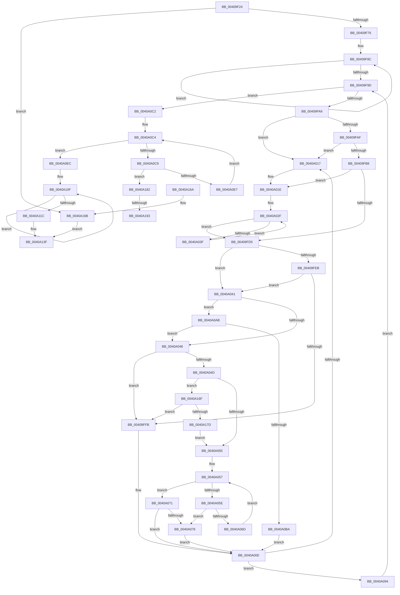

# MiOrderTrimList

- RVA: `0x00409F24`–`0x0040A1A7` (길이 `643` bytes)
- VA: `0x0000000140409F24`
- 실행 섹션: `.text`
- PDB 이름 있음: `예`; PDB Function 태그: `예`
- unwind 정보 RVA: `0x0009AC60`
- 디코드: `176`개 명령, `643/643` bytes 표시
- 미해석 바이트: `0` (있으면 어셈블리에 `.byte`로 보존)

> 이 문서는 커널 이미지의 기계어와 PDB 기호를 분석해 생성했습니다. 4번과 5번은 함수 원형과 자료형을 바이너리 사용 방식에서 추정한 C 해석이며 원본 소스 복구 결과는 아닙니다.

## 1. Dependencies

- 직접 호출 지점: **7**; 고유 호출 대상: **7**
- 직접 호출자로 확인된 함수: **1**
- RIP 상대 이미지 참조: **1**

### Outgoing calls
- `0x00409F61` → [memset](../6C/memset_function_006C6C40.md) (function, `0x006C6C40`)
- `0x00409FC8` → [MiUpdateClaimDistribution](MiUpdateClaimDistribution_function_0040A1B0.md) (function, `0x0040A1B0`)
- `0x00409FF2` → [MiIsStoreProcess](../2B/MiIsStoreProcess_function_002B62E0.md) (function, `0x002B62E0`)
- `0x0040A0B1` → [MiWorkingSetVeryLarge](MiWorkingSetVeryLarge_function_0040A210.md) (function, `0x0040A210`)
- `0x0040A0FE` → [memcpy](../6C/memcpy_function_006C6840.md) (function, `0x006C6840`)
- `0x0040A128` → [MiComputeAgeDistribution](MiComputeAgeDistribution_function_0040A360.md) (function, `0x0040A360`)
- `0x0040A14A` → [_security_check_cookie](../6A/_security_check_cookie_function_006AC640.md) (function, `0x006AC640`)

### Direct callers
- [MiProcessWorkingSets](../34/MiProcessWorkingSets_function_0034E710.md) at `0x0034ED12`

### Static image references
- `0x00409F3B` → RVA `0x00E0A740` (`.data`; read)

## 2. Other-region calls and transfers

- 다른 실행 섹션으로 향하는 call: **0**
- call이 아닌 외부 분기/꼬리 이동: **2**
  - `0x0040A18D` → [sub_006EC6DC + 0x2F](../6E/Unknown_function_006EC6DC.md) (`tail-transfer`)
  - `0x0040A1A2` → [sub_006EC6DC](../6E/Unknown_function_006EC6DC.md) (`tail-transfer`)

## 3. Assembly (complete function range)

```asm
00409F24  48 89 5C 24 18                  mov qword ptr [rsp + 0x18], rbx
00409F29  55                              push rbp
00409F2A  56                              push rsi
00409F2B  57                              push rdi
00409F2C  41 54                           push r12
00409F2E  41 55                           push r13
00409F30  41 56                           push r14
00409F32  41 57                           push r15
00409F34  48 81 EC 40 01 00 00            sub rsp, 0x140
00409F3B  48 8B 05 FE 07 A0 00            mov rax, qword ptr [rip + 0xa007fe]
00409F42  48 33 C4                        xor rax, rsp
00409F45  48 89 84 24 30 01 00 00         mov qword ptr [rsp + 0x130], rax
00409F4D  8B DA                           mov ebx, edx
00409F4F  89 54 24 24                     mov dword ptr [rsp + 0x24], edx
00409F53  33 D2                           xor edx, edx
00409F55  4C 8B E9                        mov r13, rcx
00409F58  48 8D 4C 24 30                  lea rcx, [rsp + 0x30]
00409F5D  44 8D 42 40                     lea r8d, [rdx + 0x40]
00409F61  E8 DA CC 2B 00                  call 0x1406c6c40
00409F66  49 8D B5 C8 44 00 00            lea rsi, [r13 + 0x44c8]
00409F6D  48 39 36                        cmp qword ptr [rsi], rsi
00409F70  0F 84 F5 01 00 00               je 0x14040a16b
00409F76  4D 8B BD C0 44 00 00            mov r15, qword ptr [r13 + 0x44c0]
00409F7D  48 8D 44 24 70                  lea rax, [rsp + 0x70]
00409F82  33 FF                           xor edi, edi
00409F84  48 89 7C 24 28                  mov qword ptr [rsp + 0x28], rdi
00409F89  8D 4F 0C                        lea ecx, [rdi + 0xc]
00409F8C  48 89 40 08                     mov qword ptr [rax + 8], rax
00409F90  48 89 00                        mov qword ptr [rax], rax
00409F93  48 83 C0 10                     add rax, 0x10
00409F97  48 83 E9 01                     sub rcx, 1
00409F9B  75 EF                           jne 0x140409f8c
00409F9D  4C 8B 36                        mov r14, qword ptr [rsi]
00409FA0  4C 3B F6                        cmp r14, rsi
00409FA3  0F 84 19 01 00 00               je 0x14040a0c2
00409FA9  49 39 76 08                     cmp qword ptr [r14 + 8], rsi
00409FAD  75 68                           jne 0x14040a017
00409FAF  49 8B 06                        mov rax, qword ptr [r14]
00409FB2  4C 39 70 08                     cmp qword ptr [rax + 8], r14
00409FB6  75 5F                           jne 0x14040a017
00409FB8  48 89 06                        mov qword ptr [rsi], rax
00409FBB  48 8D 54 24 30                  lea rdx, [rsp + 0x30]
00409FC0  49 8D 4E E8                     lea rcx, [r14 - 0x18]
00409FC4  48 89 70 08                     mov qword ptr [rax + 8], rsi
00409FC8  E8 E3 01 00 00                  call 0x14040a1b0
00409FCD  4C 8B E7                        mov r12, rdi
00409FD0  83 FB 08                        cmp ebx, 8
00409FD3  72 49                           jb 0x14040a01e
00409FD5  41 8B 9E A0 00 00 00            mov ebx, dword ptr [r14 + 0xa0]
00409FDC  41 8B 86 A0 00 00 00            mov eax, dword ptr [r14 + 0xa0]
00409FE3  89 5C 24 20                     mov dword ptr [rsp + 0x20], ebx
00409FE7  A8 0F                           test al, 0xf
00409FE9  75 56                           jne 0x14040a041
00409FEB  49 8D 8E E8 FB FF FF            lea rcx, [r14 - 0x418]
00409FF2  E8 E9 C2 EA FF                  call 0x1402b62e0
00409FF7  85 C0                           test eax, eax
00409FF9  74 46                           je 0x14040a041
00409FFB  BA 0B 00 00 00                  mov edx, 0xb
0040A000  8B C2                           mov eax, edx
0040A002  48 8D 4C 24 70                  lea rcx, [rsp + 0x70]
0040A007  48 C1 E0 04                     shl rax, 4
0040A00B  48 03 C8                        add rcx, rax
0040A00E  48 8B 01                        mov rax, qword ptr [rcx]
0040A011  48 39 48 08                     cmp qword ptr [rax + 8], rcx
0040A015  74 7D                           je 0x14040a094
0040A017  B9 03 00 00 00                  mov ecx, 3
0040A01C  CD 29                           int 0x29
0040A01E  8B C3                           mov eax, ebx
0040A020  49 8D 4E 10                     lea rcx, [r14 + 0x10]
0040A024  BA 08 00 00 00                  mov edx, 8
0040A029  2B D3                           sub edx, ebx
0040A02B  48 8D 0C C1                     lea rcx, [rcx + rax*8]
0040A02F  48 8B 01                        mov rax, qword ptr [rcx]
0040A032  48 8D 49 08                     lea rcx, [rcx + 8]
0040A036  4C 03 E0                        add r12, rax
0040A039  48 83 EA 01                     sub rdx, 1
0040A03D  74 96                           je 0x140409fd5
0040A03F  EB EE                           jmp 0x14040a02f
0040A041  80 7C 24 22 02                  cmp byte ptr [rsp + 0x22], 2
0040A046  74 63                           je 0x14040a0ab
0040A048  4D 85 E4                        test r12, r12
0040A04B  74 AE                           je 0x140409ffb
0040A04D  84 DB                           test bl, bl
0040A04F  0F 88 1A 01 00 00               js 0x14040a16f
0040A055  8B D7                           mov edx, edi
0040A057  8B C2                           mov eax, edx
0040A059  83 FA 09                        cmp edx, 9
0040A05C  73 13                           jae 0x14040a071
0040A05E  B8 00 00 10 00                  mov eax, 0x100000
0040A063  8B CA                           mov ecx, edx
0040A065  48 D3 E8                        shr rax, cl
0040A068  4C 3B E0                        cmp r12, rax
0040A06B  73 09                           jae 0x14040a076
0040A06D  FF C2                           inc edx
0040A06F  EB E6                           jmp 0x14040a057
0040A071  83 F8 0A                        cmp eax, 0xa
0040A074  73 8A                           jae 0x14040a000
0040A076  4C 8B 44 24 28                  mov r8, qword ptr [rsp + 0x28]
0040A07B  48 83 C8 FF                     or rax, 0xffffffffffffffff
0040A07F  4B 8D 0C 20                     lea rcx, [r8 + r12]
0040A083  49 3B C8                        cmp rcx, r8
0040A086  48 0F 43 C1                     cmovae rax, rcx
0040A08A  48 89 44 24 28                  mov qword ptr [rsp + 0x28], rax
0040A08F  E9 6C FF FF FF                  jmp 0x14040a000
0040A094  8B 5C 24 24                     mov ebx, dword ptr [rsp + 0x24]
0040A098  49 89 06                        mov qword ptr [r14], rax
0040A09B  49 89 4E 08                     mov qword ptr [r14 + 8], rcx
0040A09F  4C 89 70 08                     mov qword ptr [rax + 8], r14
0040A0A3  4C 89 31                        mov qword ptr [rcx], r14
0040A0A6  E9 F2 FE FF FF                  jmp 0x140409f9d
0040A0AB  33 D2                           xor edx, edx
0040A0AD  49 8D 4E E8                     lea rcx, [r14 - 0x18]
0040A0B1  E8 5A 01 00 00                  call 0x14040a210
0040A0B6  85 C0                           test eax, eax
0040A0B8  75 8E                           jne 0x14040a048
0040A0BA  8D 50 0A                        lea edx, [rax + 0xa]
0040A0BD  E9 3E FF FF FF                  jmp 0x14040a000
0040A0C2  8B D7                           mov edx, edi
0040A0C4  83 FA 0C                        cmp edx, 0xc
0040A0C7  73 23                           jae 0x14040a0ec
0040A0C9  8B C2                           mov eax, edx
0040A0CB  48 8D 4C 24 70                  lea rcx, [rsp + 0x70]
0040A0D0  48 C1 E0 04                     shl rax, 4
0040A0D4  44 8D 42 01                     lea r8d, [rdx + 1]
0040A0D8  48 03 C8                        add rcx, rax
0040A0DB  48 8B 01                        mov rax, qword ptr [rcx]
0040A0DE  48 3B C1                        cmp rax, rcx
0040A0E1  0F 85 9B 00 00 00               jne 0x14040a182
0040A0E7  41 8B D0                        mov edx, r8d
0040A0EA  EB D8                           jmp 0x14040a0c4
0040A0EC  49 8D 8F 58 01 00 00            lea rcx, [r15 + 0x158]
0040A0F3  41 B8 40 00 00 00               mov r8d, 0x40
0040A0F9  48 8D 54 24 30                  lea rdx, [rsp + 0x30]
0040A0FE  E8 3D C7 2B 00                  call 0x1406c6840
0040A103  49 8D 97 88 01 00 00            lea rdx, [r15 + 0x188]
0040A10A  BB 02 00 00 00                  mov ebx, 2
0040A10F  48 03 3A                        add rdi, qword ptr [rdx]
0040A112  48 8D 52 08                     lea rdx, [rdx + 8]
0040A116  48 83 EB 01                     sub rbx, 1
0040A11A  75 F3                           jne 0x14040a10f
0040A11C  33 D2                           xor edx, edx
0040A11E  49 89 BF 50 01 00 00            mov qword ptr [r15 + 0x150], rdi
0040A125  49 8B CD                        mov rcx, r13
0040A128  E8 33 02 00 00                  call 0x14040a360
0040A12D  66 41 89 87 12 01 00 00         mov word ptr [r15 + 0x112], ax
0040A135  48 8B 44 24 28                  mov rax, qword ptr [rsp + 0x28]
0040A13A  41 C6 47 36 01                  mov byte ptr [r15 + 0x36], 1
0040A13F  48 8B 8C 24 30 01 00 00         mov rcx, qword ptr [rsp + 0x130]
0040A147  48 33 CC                        xor rcx, rsp
0040A14A  E8 F1 24 2A 00                  call 0x1406ac640
0040A14F  48 8B 9C 24 90 01 00 00         mov rbx, qword ptr [rsp + 0x190]
0040A157  48 81 C4 40 01 00 00            add rsp, 0x140
0040A15E  41 5F                           pop r15
0040A160  41 5E                           pop r14
0040A162  41 5D                           pop r13
0040A164  41 5C                           pop r12
0040A166  5F                              pop rdi
0040A167  5E                              pop rsi
0040A168  5D                              pop rbp
0040A169  C3                              ret
0040A16A  CC                              int3
0040A16B  33 C0                           xor eax, eax
0040A16D  EB D0                           jmp 0x14040a13f
0040A16F  49 8B 46 78                     mov rax, qword ptr [r14 + 0x78]
0040A173  49 3B 46 58                     cmp rax, qword ptr [r14 + 0x58]
0040A177  0F 86 7E FE FF FF               jbe 0x140409ffb
0040A17D  E9 D3 FE FF FF                  jmp 0x14040a055
0040A182  48 89 06                        mov qword ptr [rsi], rax
0040A185  48 89 70 08                     mov qword ptr [rax + 8], rsi
0040A189  41 83 F8 0C                     cmp r8d, 0xc
0040A18D  0F 83 78 25 2E 00               jae 0x1406ec70b
0040A193  41 8B C0                        mov eax, r8d
0040A196  4C 8D 4C 24 70                  lea r9, [rsp + 0x70]
0040A19B  48 C1 E0 04                     shl rax, 4
0040A19F  4C 03 C8                        add r9, rax
0040A1A2  E9 35 25 2E 00                  jmp 0x1406ec6dc
```

## 4. C-style interpretation (structured pseudocode)

```c
__int64 __fastcall MiOrderTrimList(__int64 a1, int a2)
{
    __int64 result;
    __int64 v_r12;
    __int64 v_rbx;
    __int64 v_rdi;
    __int64 v_rsp;
    unsigned __int64 v_stack_m108;
    unsigned __int64 v_stack_m148;
    unsigned __int64 v_stack_m150;
    unsigned int v_stack_m154;
    unsigned __int8 v_stack_m156;
    unsigned int v_stack_m158;
    unsigned __int64 v_stack_m48;
    unsigned __int64 v_stack_p18;
    unsigned __int64 v_stack_p70;

    v_stack_p18 = v_rbx;
    v_rsp = (v_rsp) - (320);
    result = (*(unsigned __int64 *)(v_rip + 10487806)) ^ (v_rsp);
    v_stack_m48 = result;
    v_stack_m154 = a2;
    a2 = 0;
    result = memset(v_stack_m148, a2, a2 + 64, a4);
    if ((*(unsigned __int64 *)(a1 + 17608)) == (a1 + 17608)) goto loc_0040A16B;
    v_rdi = 0;
    v_stack_m150 = 0;
loc_00409F8C:
    *(unsigned __int64 *)(v_stack_m108 + 8) = v_stack_m108;
    *(unsigned __int64 *)(v_stack_m108) = v_stack_m108;
    result = (v_stack_m108) + (16);
    a1 = (v_rdi + 12) - (1);
    if (condition_is_not_equal) goto loc_00409F8C;
loc_00409F9D:
    if ((*(unsigned __int64 *)(a1 + 17608)) == (a1 + 17608)) goto loc_0040A0C2;
    if ((*(unsigned __int64 *)(*(unsigned __int64 *)(a1 + 17608) + 8)) != (a1 + 17608)) goto loc_0040A017;
    if ((*(unsigned __int64 *)(*(unsigned __int64 *)(*(unsigned __int64 *)(a1 + 17608)) + 8)) != (*(unsigned __int64 *)(a1 + 17608))) goto loc_0040A017;
    *(unsigned __int64 *)(a1 + 17608) = *(unsigned __int64 *)(*(unsigned __int64 *)(a1 + 17608));
    *(unsigned __int64 *)(*(unsigned __int64 *)(*(unsigned __int64 *)(a1 + 17608)) + 8) = a1 + 17608;
    result = MiUpdateClaimDistribution(*(unsigned __int64 *)(a1 + 17608) - 24, v_stack_m148, a2 + 64, a4);
    if (((unsigned int)((unsigned int)(a2))) < 8) goto loc_0040A01E;
loc_00409FD5:
    v_stack_m158 = (unsigned int)((unsigned int)(*(unsigned int *)(*(unsigned __int64 *)(a1 + 17608) + 160)));
    if ((((unsigned __int8)((unsigned int)(*(unsigned int *)(*(unsigned __int64 *)(a1 + 17608) + 160)))) & (15)) != 0) goto loc_0040A041;
    result = MiIsStoreProcess(*(unsigned __int64 *)(a1 + 17608) - 1048, v_stack_m148, a2 + 64, a4);
    if ((unsigned int)(result) == 0) goto loc_0040A041;
loc_00409FFB:
loc_0040A000:
    result = (11) << (4);
    a1 = (v_stack_m108) + (result);
    if ((*(unsigned __int64 *)(*(unsigned __int64 *)(a1) + 8)) == a1) goto loc_0040A094;
loc_0040A017:
loc_0040A01E:
    a2 = (unsigned int)((8) - ((unsigned int)((unsigned int)(*(unsigned int *)(*(unsigned __int64 *)(a1 + 17608) + 160)))));
loc_0040A02F:
    v_r12 = (0) + (*(unsigned __int64 *)(*(unsigned __int64 *)(a1 + 17608) + 16 + (unsigned int)((unsigned int)((unsigned int)(*(unsigned int *)(*(unsigned __int64 *)(a1 + 17608) + 160)))) * 8));
    a2 = (a2) - (1);
    if (condition_is_equal) goto loc_00409FD5;
    goto loc_0040A02F;
loc_0040A041:
    if (v_stack_m156 == 2) goto loc_0040A0AB;
loc_0040A048:
    if (v_r12 == 0) goto loc_00409FFB;
    if (sign_flag) goto loc_0040A16F;
loc_0040A055:
loc_0040A057:
    if (0 >= 9) goto loc_0040A071;
    result = ((unsigned int)(0x100000ULL)) >> (0);
    if (v_r12 >= result) goto loc_0040A076;
    a2 = (unsigned int)((0) + 1);
    goto loc_0040A057;
loc_0040A071:
    if (((unsigned int)(result)) >= 10) goto loc_0040A000;
loc_0040A076:
    result = (result) | (-1);
    if ((v_stack_m150 + v_r12 * 1) >= v_stack_m150) { result = v_stack_m150 + v_r12 * 1; }
    v_stack_m150 = result;
    goto loc_0040A000;
loc_0040A094:
    *(unsigned __int64 *)(*(unsigned __int64 *)(a1 + 17608)) = result;
    *(unsigned __int64 *)(*(unsigned __int64 *)(a1 + 17608) + 8) = v_stack_m150 + v_r12 * 1;
    *(unsigned __int64 *)(result + 8) = *(unsigned __int64 *)(a1 + 17608);
    *(unsigned __int64 *)(v_stack_m150 + v_r12 * 1) = *(unsigned __int64 *)(a1 + 17608);
    goto loc_00409F9D;
loc_0040A0AB:
    a2 = 0;
    result = MiWorkingSetVeryLarge(*(unsigned __int64 *)(a1 + 17608) - 24, a2, v_stack_m150, a4);
    if ((unsigned int)(result) != 0) goto loc_0040A048;
    goto loc_0040A000;
loc_0040A0C2:
loc_0040A0C4:
    if (0 >= 12) goto loc_0040A0EC;
    result = (0) << (4);
    a1 = (v_stack_m108) + (result);
    if ((*(unsigned __int64 *)(a1)) != a1) goto loc_0040A182;
    goto loc_0040A0C4;
loc_0040A0EC:
    result = memcpy(*(unsigned __int64 *)(a1 + 17600) + 344, v_stack_m148, 64, a4);
loc_0040A10F:
    v_rdi = (v_rdi) + (*(unsigned __int64 *)(*(unsigned __int64 *)(a1 + 17600) + 392));
    v_rbx = (2) - (1);
    if (condition_is_not_equal) goto loc_0040A10F;
    a2 = 0;
    *(unsigned __int64 *)(*(unsigned __int64 *)(a1 + 17600) + 336) = v_rdi;
    result = MiComputeAgeDistribution(a1, a2, 64, a4);
    *(unsigned __int16 *)(*(unsigned __int64 *)(a1 + 17600) + 274) = (unsigned __int16)(result);
    *(unsigned __int8 *)(*(unsigned __int64 *)(a1 + 17600) + 54) = 1;
loc_0040A13F:
    a1 = (v_stack_m48) ^ (v_rsp);
    result = _security_check_cookie(a1, a2, 64, a4);
    v_rsp = (v_rsp) + (320);
    return result;
loc_0040A16B:
    result = 0;
    goto loc_0040A13F;
loc_0040A16F:
    if ((*(unsigned __int64 *)(*(unsigned __int64 *)(a1 + 17608) + 120)) <= (*(unsigned __int64 *)(*(unsigned __int64 *)(a1 + 17608) + 88))) goto loc_00409FFB;
    goto loc_0040A055;
loc_0040A182:
    *(unsigned __int64 *)(a1 + 17608) = *(unsigned __int64 *)(*(unsigned __int64 *)(a1 + 17608) + 120);
    *(unsigned __int64 *)(*(unsigned __int64 *)(*(unsigned __int64 *)(a1 + 17608) + 120) + 8) = a1 + 17608;
    result = (64) << (4);
    a4 = (v_stack_p70) + (result);
}
```

## 5. (Beta) C Style

```c
int64_t MiOrderTrimList(void *Arg1, int32_t Arg2)
{
    uint8_t *arg1 = (uint8_t *)Arg1;

    int64_t result;
    int64_t local_r12;
    int64_t local_rbx;
    int64_t local_rdi;
    int64_t local_rsp;
    uint64_t v_stack_m108;
    uint64_t v_stack_m148;
    uint64_t v_stack_m150;
    uint32_t v_stack_m154;
    uint8_t v_stack_m156;
    uint32_t v_stack_m158;
    uint64_t v_stack_m48;
    uint64_t v_stack_p18;
    uint64_t v_stack_p70;

    v_stack_p18 = local_rbx;
    local_rsp = (local_rsp) - (320);
    result = (*(uint64_t *)(v_rip + 0xA007FE)) ^ (local_rsp);
    v_stack_m48 = result;
    v_stack_m154 = Arg2;
    Arg2 = 0;
    result = memset(v_stack_m148, Arg2, Arg2 + 64, a4);
    if ((*(uint64_t *)(arg1 + 0x44C8)) == (Arg1 + 17608)) goto loc_0040A16B;
    local_rdi = 0;
    v_stack_m150 = 0;
loc_00409F8C:
    *(uint64_t *)(v_stack_m108 + 0x8) = v_stack_m108;
    *(uint64_t *)(v_stack_m108) = v_stack_m108;
    result = (v_stack_m108) + (16);
    Arg1 = (local_rdi + 12) - (1);
    if (condition_is_not_equal) goto loc_00409F8C;
loc_00409F9D:
    if ((*(uint64_t *)(arg1 + 0x44C8)) == (Arg1 + 17608)) goto loc_0040A0C2;
    if ((*(uint64_t *)(*(uint64_t *)(arg1 + 0x44C8) + 0x8)) != (Arg1 + 17608)) goto loc_0040A017;
    if ((*(uint64_t *)(*(uint64_t *)(*(uint64_t *)(arg1 + 0x44C8)) + 0x8)) != (*(uint64_t *)(arg1 + 0x44C8))) goto loc_0040A017;
    *(uint64_t *)(arg1 + 0x44C8) = *(uint64_t *)(*(uint64_t *)(arg1 + 0x44C8));
    *(void **)(*(uint64_t *)(*(uint64_t *)(arg1 + 0x44C8)) + 0x8) = Arg1 + 17608;
    result = MiUpdateClaimDistribution(*(uint64_t *)(arg1 + 0x44C8) - 24, v_stack_m148, Arg2 + 64, a4);
    if (((uint32_t)((uint32_t)(Arg2))) < 8) goto loc_0040A01E;
loc_00409FD5:
    v_stack_m158 = (uint32_t)((uint32_t)(*(uint32_t *)(*(uint64_t *)(arg1 + 0x44C8) + 0xA0)));
    if ((((uint8_t)((uint32_t)(*(uint32_t *)(*(uint64_t *)(arg1 + 0x44C8) + 0xA0)))) & (15)) != 0) goto loc_0040A041;
    result = MiIsStoreProcess(*(uint64_t *)(arg1 + 0x44C8) - 1048, v_stack_m148, Arg2 + 64, a4);
    if ((uint32_t)(result) == 0) goto loc_0040A041;
loc_00409FFB:
loc_0040A000:
    result = (11) << (4);
    Arg1 = (v_stack_m108) + (result);
    if ((*(uint64_t *)(*(uint64_t *)(arg1) + 0x8)) == Arg1) goto loc_0040A094;
loc_0040A017:
loc_0040A01E:
    Arg2 = (uint32_t)((8) - ((uint32_t)((uint32_t)(*(uint32_t *)(*(uint64_t *)(arg1 + 0x44C8) + 0xA0)))));
loc_0040A02F:
    local_r12 = (0) + (*(uint64_t *)(*(uint64_t *)(arg1 + 0x44C8) + 0x10 + (uint32_t)((uint32_t)((uint32_t)(*(uint32_t *)(*(uint64_t *)(arg1 + 0x44C8) + 0xA0)))) * 8));
    Arg2 = (Arg2) - (1);
    if (condition_is_equal) goto loc_00409FD5;
    goto loc_0040A02F;
loc_0040A041:
    if (v_stack_m156 == 2) goto loc_0040A0AB;
loc_0040A048:
    if (local_r12 == 0) goto loc_00409FFB;
    if (sign_flag) goto loc_0040A16F;
loc_0040A055:
loc_0040A057:
    if (0 >= 9) goto loc_0040A071;
    result = ((uint32_t)(0x100000ULL)) >> (0);
    if (local_r12 >= result) goto loc_0040A076;
    Arg2 = (uint32_t)((0) + 1);
    goto loc_0040A057;
loc_0040A071:
    if (((uint32_t)(result)) >= 10) goto loc_0040A000;
loc_0040A076:
    result = (result) | (-1);
    if ((v_stack_m150 + local_r12 * 1) >= v_stack_m150) { result = v_stack_m150 + local_r12 * 1; }
    v_stack_m150 = result;
    goto loc_0040A000;
loc_0040A094:
    *(uint64_t *)(*(uint64_t *)(arg1 + 0x44C8)) = result;
    *(uint64_t *)(*(uint64_t *)(arg1 + 0x44C8) + 0x8) = v_stack_m150 + local_r12 * 1;
    *(uint64_t *)(result + 0x8) = *(uint64_t *)(arg1 + 0x44C8);
    *(uint64_t *)(v_stack_m150 + local_r12 * 1) = *(uint64_t *)(arg1 + 0x44C8);
    goto loc_00409F9D;
loc_0040A0AB:
    Arg2 = 0;
    result = MiWorkingSetVeryLarge(*(uint64_t *)(arg1 + 0x44C8) - 24, Arg2, v_stack_m150, a4);
    if ((uint32_t)(result) != 0) goto loc_0040A048;
    goto loc_0040A000;
loc_0040A0C2:
loc_0040A0C4:
    if (0 >= 12) goto loc_0040A0EC;
    result = (0) << (4);
    Arg1 = (v_stack_m108) + (result);
    if ((*(uint64_t *)(arg1)) != Arg1) goto loc_0040A182;
    goto loc_0040A0C4;
loc_0040A0EC:
    result = memcpy(*(uint64_t *)(arg1 + 0x44C0) + 344, v_stack_m148, 64, a4);
loc_0040A10F:
    local_rdi = (local_rdi) + (*(uint64_t *)(*(uint64_t *)(arg1 + 0x44C0) + 0x188));
    local_rbx = (2) - (1);
    if (condition_is_not_equal) goto loc_0040A10F;
    Arg2 = 0;
    *(uint64_t *)(*(uint64_t *)(arg1 + 0x44C0) + 0x150) = local_rdi;
    result = MiComputeAgeDistribution(Arg1, Arg2, 64, a4);
    *(uint16_t *)(*(uint64_t *)(arg1 + 0x44C0) + 0x112) = (uint16_t)(result);
    *(uint8_t *)(*(uint64_t *)(arg1 + 0x44C0) + 0x36) = 1;
loc_0040A13F:
    Arg1 = (v_stack_m48) ^ (local_rsp);
    result = _security_check_cookie(Arg1, Arg2, 64, a4);
    local_rsp = (local_rsp) + (320);
    return result;
loc_0040A16B:
    result = 0;
    goto loc_0040A13F;
loc_0040A16F:
    if ((*(uint64_t *)(*(uint64_t *)(arg1 + 0x44C8) + 0x78)) <= (*(uint64_t *)(*(uint64_t *)(arg1 + 0x44C8) + 0x58))) goto loc_00409FFB;
    goto loc_0040A055;
loc_0040A182:
    *(uint64_t *)(arg1 + 0x44C8) = *(uint64_t *)(*(uint64_t *)(arg1 + 0x44C8) + 0x78);
    *(void **)(*(uint64_t *)(*(uint64_t *)(arg1 + 0x44C8) + 0x78) + 0x8) = Arg1 + 17608;
    result = (64) << (4);
    a4 = (v_stack_p70) + (result);
}
```

### 관측된 메모리 오프셋

구조체 형식이 확인되지 않은 접근은 인자 기준의 오프셋으로만 기록했습니다.

| 기준 인자 | 오프셋 표현 | 폭 (bit) | 접근 |
|---|---:|---:|---|
| `Arg1` | `+ 0x0` | `64` | `R` |
| `Arg1` | `+ 0x0` | `64` | `W` |
| `Arg1` | `+ 0x44C0` | `64` | `R` |
| `Arg1` | `+ 0x44C8` | `64` | `R` |

## 6. Execution-region graph

[열기: 2D/3D 그래프와 함수 탐색 컨트롤 패널](../../../control-panel.html?section=text&rva=0x00409F24&view=graph)

- 2D 그래프는 위에서 아래로 흐르고, 3D 그래프는 빈 공간을 드래그해 회전합니다. Shift+드래그는 이동, 휠은 확대·축소, 함수 노드 선택은 대상 보고서 이동입니다.

### Static fallback


