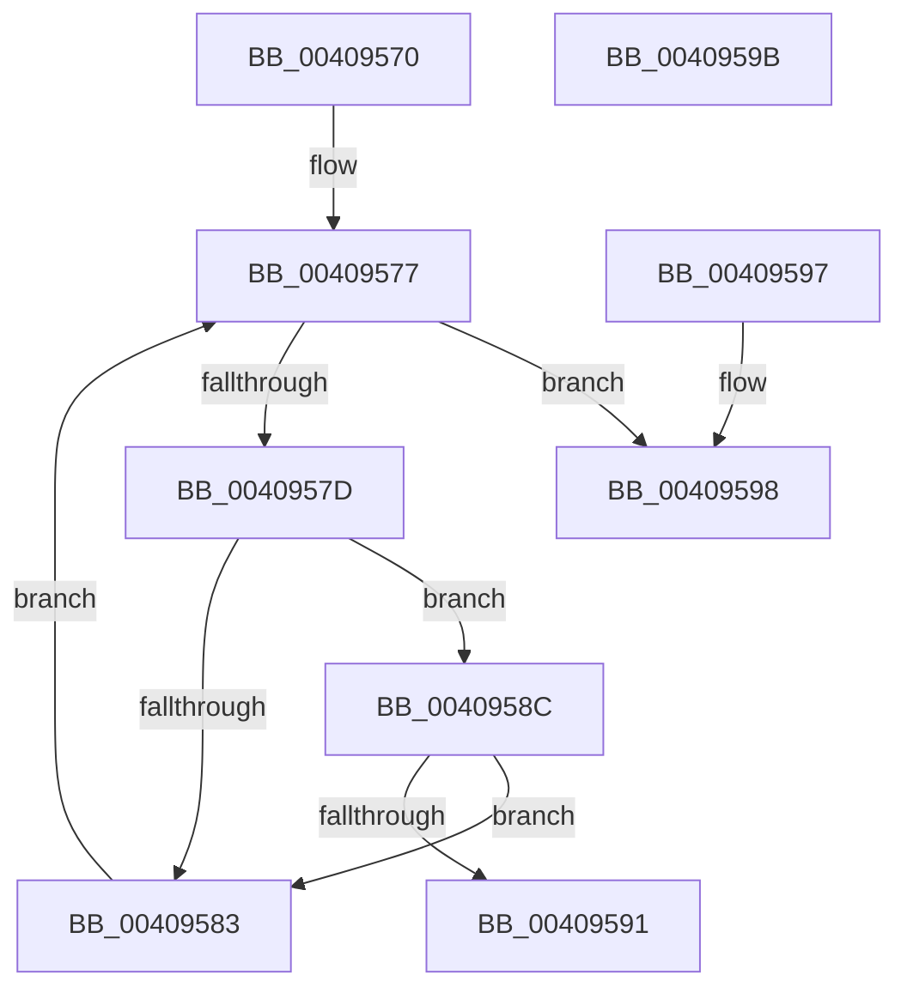

# MiPageAlreadyLocked

- RVA: `0x00409570`–`0x0040959C` (길이 `44` bytes)
- VA: `0x0000000140409570`
- 실행 섹션: `.text`
- PDB 이름 있음: `예`; PDB Function 태그: `아니요`
- unwind 정보 RVA: `0x000DB714`
- 디코드: `17`개 명령, `44/44` bytes 표시
- 미해석 바이트: `0` (있으면 어셈블리에 `.byte`로 보존)

> 이 문서는 커널 이미지의 기계어와 PDB 기호를 분석해 생성했습니다. 4번과 5번은 함수 원형과 자료형을 바이너리 사용 방식에서 추정한 C 해석이며 원본 소스 복구 결과는 아닙니다.

## 1. Dependencies

- 직접 호출 지점: **0**; 고유 호출 대상: **0**
- 직접 호출자로 확인된 함수: **1**
- RIP 상대 이미지 참조: **0**

### Outgoing calls
- 직접 디코드된 call 명령이 없습니다.

### Direct callers
- [sub_006DBD20](../6D/Unknown_function_006DBD20.md) at `0x006DBDC7`

### Static image references
- 디코드된 RIP-relative 메모리 참조가 없습니다.

## 2. Other-region calls and transfers

- 다른 실행 섹션으로 향하는 call: **0**
- 별도 외부 분기/꼬리 이동을 확인하지 못했습니다.

## 3. Assembly (complete function range)

```asm
00409570  45 33 C0                        xor r8d, r8d
00409573  48 8D 41 10                     lea rax, [rcx + 0x10]
00409577  49 83 F8 04                     cmp r8, 4
0040957B  7D 1B                           jge 0x140409598
0040957D  80 78 08 00                     cmp byte ptr [rax + 8], 0
00409581  75 09                           jne 0x14040958c
00409583  49 FF C0                        inc r8
00409586  48 83 C0 18                     add rax, 0x18
0040958A  EB EB                           jmp 0x140409577
0040958C  48 3B 10                        cmp rdx, qword ptr [rax]
0040958F  75 F2                           jne 0x140409583
00409591  B8 01 00 00 00                  mov eax, 1
00409596  C3                              ret
00409597  CC                              int3
00409598  33 C0                           xor eax, eax
0040959A  C3                              ret
0040959B  CC                              int3
```

## 4. C-style interpretation (structured pseudocode)

```c
__int64 __fastcall MiPageAlreadyLocked(__int64 a1, __int64 a2, int a3)
{
    __int64 result;

    a3 = 0;
loc_00409577:
    if (0 >= 4) goto loc_00409598;
    if ((*(unsigned __int8 *)(a1 + 16 + 8)) != 0) goto loc_0040958C;
loc_00409583:
    a3 = (a3) + 1;
    result = (a1 + 16) + (24);
    goto loc_00409577;
loc_0040958C:
    if (a2 != (*(unsigned __int64 *)(result))) goto loc_00409583;
    return 1;
loc_00409598:
    result = 0;
    return result;
}
```

## 5. (Beta) C Style

```c
int64_t MiPageAlreadyLocked(void *Arg1, int64_t Arg2, int32_t Arg3)
{
    uint8_t *arg1 = (uint8_t *)Arg1;

    int64_t result;

    Arg3 = 0;
loc_00409577:
    if (0 >= 4) goto loc_00409598;
    if ((*(uint8_t *)(arg1 + 0x10 + 0x8)) != 0) goto loc_0040958C;
loc_00409583:
    Arg3 = (Arg3) + 1;
    result = (Arg1 + 16) + (24);
    goto loc_00409577;
loc_0040958C:
    if (Arg2 != (*(uint64_t *)(result))) goto loc_00409583;
    return 1;
loc_00409598:
    result = 0;
    return result;
}
```

### 관측된 메모리 오프셋

구조체 형식이 확인되지 않은 접근은 인자 기준의 오프셋으로만 기록했습니다.

| 기준 인자 | 오프셋 표현 | 폭 (bit) | 접근 |
|---|---:|---:|---|
| `Arg1` | `+ 0x0` | `64` | `R` |
| `Arg1` | `+ 0x8` | `8` | `R` |
| `Arg1` | `+ 0x10` | `64` | `R` |

## 6. Execution-region graph

[열기: 2D/3D 그래프와 함수 탐색 컨트롤 패널](../../../control-panel.html?section=text&rva=0x00409570&view=graph)

- 2D 그래프는 위에서 아래로 흐르고, 3D 그래프는 빈 공간을 드래그해 회전합니다. Shift+드래그는 이동, 휠은 확대·축소, 함수 노드 선택은 대상 보고서 이동입니다.

### Static fallback


