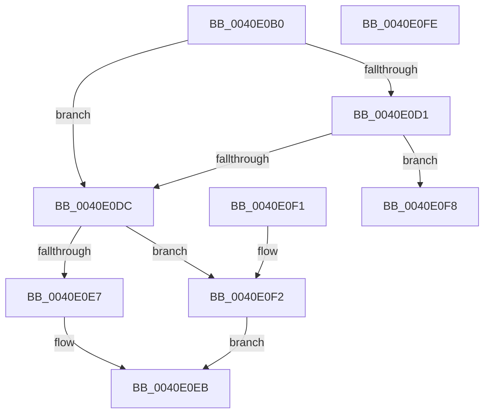

# MiPageStandbyLookasideStatus

- RVA: `0x0040E0B0`–`0x0040E0FF` (길이 `79` bytes)
- VA: `0x000000014040E0B0`
- 실행 섹션: `.text`
- PDB 이름 있음: `예`; PDB Function 태그: `아니요`
- unwind 정보 RVA: `0x000DB714`
- 디코드: `23`개 명령, `79/79` bytes 표시
- 미해석 바이트: `0` (있으면 어셈블리에 `.byte`로 보존)

> 이 문서는 커널 이미지의 기계어와 PDB 기호를 분석해 생성했습니다. 4번과 5번은 함수 원형과 자료형을 바이너리 사용 방식에서 추정한 C 해석이며 원본 소스 복구 결과는 아닙니다.

## 1. Dependencies

- 직접 호출 지점: **0**; 고유 호출 대상: **0**
- 직접 호출자로 확인된 함수: **1**
- RIP 상대 이미지 참조: **1**

### Outgoing calls
- 직접 디코드된 call 명령이 없습니다.

### Direct callers
- [MiReservePageFileSpaceForPage](../38/MiReservePageFileSpaceForPage_function_0038377C.md) at `0x00383C6E`
- [MiReservePageFileSpaceForPage](../38/MiReservePageFileSpaceForPage_function_0038377C.md) at `0x00383E4E`

### Static image references
- `0x0040E0C5` → RVA `0x00E35C00` (`.data`; read)

## 2. Other-region calls and transfers

- 다른 실행 섹션으로 향하는 call: **0**
- 별도 외부 분기/꼬리 이동을 확인하지 못했습니다.

## 3. Assembly (complete function range)

```asm
0040E0B0  48 8D 14 49                     lea rdx, [rcx + rcx*2]
0040E0B4  48 C1 E2 04                     shl rdx, 4
0040E0B8  48 B8 00 00 00 00 00 DE FF FF   movabs rax, 0xffffde0000000000
0040E0C2  48 03 D0                        add rdx, rax
0040E0C5  48 8B 05 34 7B A2 00            mov rax, qword ptr [rip + 0xa27b34]
0040E0CC  48 3B C8                        cmp rcx, rax
0040E0CF  72 0B                           jb 0x14040e0dc
0040E0D1  48 05 00 08 00 00               add rax, 0x800
0040E0D7  48 3B C8                        cmp rcx, rax
0040E0DA  72 1C                           jb 0x14040e0f8
0040E0DC  48 8B 42 10                     mov rax, qword ptr [rdx + 0x10]
0040E0E0  48 0F BA E0 0A                  bt rax, 0xa
0040E0E5  73 0B                           jae 0x14040e0f2
0040E0E7  48 C1 E8 03                     shr rax, 3
0040E0EB  F7 D0                           not eax
0040E0ED  83 E0 01                        and eax, 1
0040E0F0  C3                              ret
0040E0F1  CC                              int3
0040E0F2  48 C1 E8 1B                     shr rax, 0x1b
0040E0F6  EB F3                           jmp 0x14040e0eb
0040E0F8  B8 02 00 00 00                  mov eax, 2
0040E0FD  C3                              ret
0040E0FE  CC                              int3
```

## 4. C-style interpretation (structured pseudocode)

```c
__int64 __fastcall MiPageStandbyLookasideStatus(__int64 a1)
{
    __int64 result;

    a2 = (a1 + a1 * 2) << (4);
    a2 = (a2) + (result);
    if (a1 < (*(unsigned __int64 *)(v_rip + 10648372))) goto loc_0040E0DC;
    result = (*(unsigned __int64 *)(v_rip + 10648372)) + (0x800ULL);
    if (a1 < result) goto loc_0040E0F8;
loc_0040E0DC:
    if (a1 >= result) goto loc_0040E0F2;
    result = (*(unsigned __int64 *)(a2 + 16)) >> (3);
loc_0040E0EB:
    result = (unsigned int)(~(result));
    result = (unsigned int)((result) & (1));
    return result;
loc_0040E0F2:
    result = (result) >> (27);
    goto loc_0040E0EB;
loc_0040E0F8:
    return 2;
}
```

## 5. (Beta) C Style

```c
int64_t MiPageStandbyLookasideStatus(void *Arg1)
{
    uint8_t *arg1 = (uint8_t *)Arg1;

    int64_t result;

    a2 = (Arg1 + Arg1 * 2) << (4);
    a2 = (a2) + (result);
    if (Arg1 < (*(uint64_t *)(v_rip + 0xA27B34))) goto loc_0040E0DC;
    result = (*(uint64_t *)(v_rip + 0xA27B34)) + (0x800ULL);
    if (Arg1 < result) goto loc_0040E0F8;
loc_0040E0DC:
    if (Arg1 >= result) goto loc_0040E0F2;
    result = (*(uint64_t *)(a2 + 0x10)) >> (3);
loc_0040E0EB:
    result = (uint32_t)(~(result));
    result = (uint32_t)((result) & (1));
    return result;
loc_0040E0F2:
    result = (result) >> (27);
    goto loc_0040E0EB;
loc_0040E0F8:
    return 2;
}
```

### 관측된 메모리 오프셋

구조체 형식이 확인되지 않은 접근은 인자 기준의 오프셋으로만 기록했습니다.

| 기준 인자 | 오프셋 표현 | 폭 (bit) | 접근 |
|---|---:|---:|---|
| `Arg1` | `+ 0x0 + rcx*2` | `64` | `R` |

## 6. Execution-region graph

[열기: 2D/3D 그래프와 함수 탐색 컨트롤 패널](../../../control-panel.html?section=text&rva=0x0040E0B0&view=graph)

- 2D 그래프는 위에서 아래로 흐르고, 3D 그래프는 빈 공간을 드래그해 회전합니다. Shift+드래그는 이동, 휠은 확대·축소, 함수 노드 선택은 대상 보고서 이동입니다.

### Static fallback


