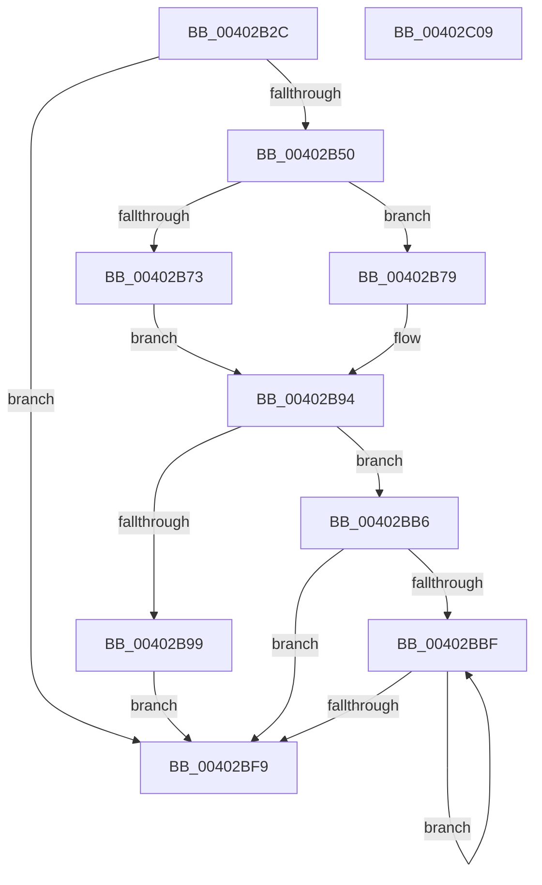

# MiPersistMdl

- RVA: `0x00402B2C`–`0x00402C0A` (길이 `222` bytes)
- VA: `0x0000000140402B2C`
- 실행 섹션: `.text`
- PDB 이름 있음: `예`; PDB Function 태그: `아니요`
- unwind 정보 RVA: `0x0009A6A8`
- 디코드: `58`개 명령, `222/222` bytes 표시
- 미해석 바이트: `0` (있으면 어셈블리에 `.byte`로 보존)

> 이 문서는 커널 이미지의 기계어와 PDB 기호를 분석해 생성했습니다. 4번과 5번은 함수 원형과 자료형을 바이너리 사용 방식에서 추정한 C 해석이며 원본 소스 복구 결과는 아닙니다.

## 1. Dependencies

- 직접 호출 지점: **6**; 고유 호출 대상: **6**
- 직접 호출자로 확인된 함수: **1**
- RIP 상대 이미지 참조: **1**

### Outgoing calls
- `0x00402B8F` → [MmMapLockedPagesSpecifyCache](../31/MmMapLockedPagesSpecifyCache_function_00318800.md) (function, `0x00318800`)
- `0x00402BA3` → [MiPersistMemory](../68/MiPersistMemory_function_00681A40.md) (function, `0x00681A40`)
- `0x00402BAF` → [MmUnmapLockedPages](../24/MmUnmapLockedPages_function_00246E60.md) (function, `0x00246E60`)
- `0x00402BCD` → [MiMapPageInHyperSpaceWorker](../33/MiMapPageInHyperSpaceWorker_function_00332B10.md) (function, `0x00332B10`)
- `0x00402BD8` → [MiPersistVa](../68/MiPersistVa_function_00681AB8.md) (function, `0x00681AB8`)
- `0x00402BEA` → [MiUnmapPageInHyperSpaceWorker](../43/MiUnmapPageInHyperSpaceWorker_function_00432800.md) (function, `0x00432800`)

### Direct callers
- [MiFlushFileOnlyMdl](MiFlushFileOnlyMdl_function_00403208.md) at `0x00403294`

### Static image references
- `0x00402B3B` → RVA `0x00E2DC40` (`.data`; read)

## 2. Other-region calls and transfers

- 다른 실행 섹션으로 향하는 call: **0**
- 별도 외부 분기/꼬리 이동을 확인하지 못했습니다.

## 3. Assembly (complete function range)

```asm
00402B2C  48 89 5C 24 08                  mov qword ptr [rsp + 8], rbx
00402B31  48 89 74 24 18                  mov qword ptr [rsp + 0x18], rsi
00402B36  57                              push rdi
00402B37  48 83 EC 30                     sub rsp, 0x30
00402B3B  80 3D FE B0 A2 00 00            cmp byte ptr [rip + 0xa2b0fe], 0
00402B42  48 8B D9                        mov rbx, rcx
00402B45  C6 44 24 48 00                  mov byte ptr [rsp + 0x48], 0
00402B4A  0F 85 A9 00 00 00               jne 0x140402bf9
00402B50  8B 51 2C                        mov edx, dword ptr [rcx + 0x2c]
00402B53  03 51 20                        add edx, dword ptr [rcx + 0x20]
00402B56  8B 79 28                        mov edi, dword ptr [rcx + 0x28]
00402B59  81 E2 FF 0F 00 00               and edx, 0xfff
00402B5F  48 81 C7 FF 0F 00 00            add rdi, 0xfff
00402B66  48 03 FA                        add rdi, rdx
00402B69  48 C1 EF 0C                     shr rdi, 0xc
00402B6D  F6 41 0A 05                     test byte ptr [rcx + 0xa], 5
00402B71  74 06                           je 0x140402b79
00402B73  48 8B 41 18                     mov rax, qword ptr [rcx + 0x18]
00402B77  EB 1B                           jmp 0x140402b94
00402B79  45 33 C9                        xor r9d, r9d
00402B7C  C7 44 24 28 10 00 00 C0         mov dword ptr [rsp + 0x28], 0xc0000010
00402B84  83 64 24 20 00                  and dword ptr [rsp + 0x20], 0
00402B89  33 D2                           xor edx, edx
00402B8B  45 8D 41 01                     lea r8d, [r9 + 1]
00402B8F  E8 6C 5C F1 FF                  call 0x140318800
00402B94  48 85 C0                        test rax, rax
00402B97  74 1D                           je 0x140402bb6
00402B99  48 C1 E7 0C                     shl rdi, 0xc
00402B9D  48 8B C8                        mov rcx, rax
00402BA0  48 8B D7                        mov rdx, rdi
00402BA3  E8 98 EE 27 00                  call 0x140681a40
00402BA8  48 8B 4B 18                     mov rcx, qword ptr [rbx + 0x18]
00402BAC  48 8B D3                        mov rdx, rbx
00402BAF  E8 AC 42 E4 FF                  call 0x140246e60
00402BB4  EB 43                           jmp 0x140402bf9
00402BB6  48 8D 73 30                     lea rsi, [rbx + 0x30]
00402BBA  48 85 FF                        test rdi, rdi
00402BBD  74 3A                           je 0x140402bf9
00402BBF  48 8B 0E                        mov rcx, qword ptr [rsi]
00402BC2  48 8D 54 24 48                  lea rdx, [rsp + 0x48]
00402BC7  41 B8 00 00 00 20               mov r8d, 0x20000000
00402BCD  E8 3E FF F2 FF                  call 0x140332b10
00402BD2  48 8B C8                        mov rcx, rax
00402BD5  48 8B D8                        mov rbx, rax
00402BD8  E8 DB EE 27 00                  call 0x140681ab8
00402BDD  8A 54 24 48                     mov dl, byte ptr [rsp + 0x48]
00402BE1  41 B8 00 00 00 80               mov r8d, 0x80000000
00402BE7  48 8B CB                        mov rcx, rbx
00402BEA  E8 11 FC 02 00                  call 0x140432800
00402BEF  48 8D 76 08                     lea rsi, [rsi + 8]
00402BF3  48 83 EF 01                     sub rdi, 1
00402BF7  75 C6                           jne 0x140402bbf
00402BF9  48 8B 5C 24 40                  mov rbx, qword ptr [rsp + 0x40]
00402BFE  48 8B 74 24 50                  mov rsi, qword ptr [rsp + 0x50]
00402C03  48 83 C4 30                     add rsp, 0x30
00402C07  5F                              pop rdi
00402C08  C3                              ret
00402C09  CC                              int3
```

## 4. C-style interpretation (structured pseudocode)

```c
__int64 __fastcall MiPersistMdl(__int64 a1, __int64 a2, __int64 a3, int a4)
{
    __int64 result;
    __int64 v_rdi;
    __int64 v_rsp;
    unsigned int v_stack_m10;
    unsigned int v_stack_m18;
    unsigned __int8 v_stack_p10;
    unsigned __int64 v_stack_p18;
    unsigned __int64 v_stack_p8;

    v_stack_p8 = v_rbx;
    v_stack_p18 = v_rsi;
    v_rsp = (v_rsp) - (48);
    v_stack_p10 = 0;
    if ((*(unsigned __int8 *)(v_rip + 10662142)) != 0) goto loc_00402BF9;
    a2 = (unsigned int)(((unsigned int)(*(unsigned int *)(a1 + 44))) + (*(unsigned int *)(a1 + 32)));
    a2 = (unsigned int)((a2) & (0xFFFULL));
    v_rdi = ((unsigned int)(*(unsigned int *)(a1 + 40))) + (0xFFFULL);
    v_rdi = (v_rdi) + (a2);
    v_rdi = (v_rdi) >> (12);
    if (((*(unsigned __int8 *)(a1 + 10)) & (5)) == 0) goto loc_00402B79;
    goto loc_00402B94;
loc_00402B79:
    a4 = 0;
    v_stack_m10 = 0xC0000010ULL;
    a2 = 0;
    result = MmMapLockedPagesSpecifyCache(a1, a2, a4 + 1, a4);
loc_00402B94:
    if (result == 0) goto loc_00402BB6;
    v_rdi = (v_rdi) << (12);
    result = MiPersistMemory(result, v_rdi, a4 + 1, a4);
    result = MmUnmapLockedPages(*(unsigned __int64 *)(a1 + 24), a1, a4 + 1, a4);
    goto loc_00402BF9;
loc_00402BB6:
    if (v_rdi == 0) goto loc_00402BF9;
loc_00402BBF:
    result = MiMapPageInHyperSpaceWorker(*(unsigned __int64 *)(a1 + 48), v_stack_p10, (unsigned int)(0x20000000ULL), a4);
    result = MiPersistVa(result, v_stack_p10, (unsigned int)(0x20000000ULL), a4);
    result = MiUnmapPageInHyperSpaceWorker(result, v_stack_p10, (unsigned int)(0x80000000ULL), a4);
    v_rdi = (v_rdi) - (1);
    if (condition_is_not_equal) goto loc_00402BBF;
loc_00402BF9:
    v_rsp = (v_rsp) + (48);
    return result;
}
```

## 5. (Beta) C Style

```c
int64_t MiPersistMdl(void *Arg1, int64_t Arg2, int64_t Arg3, int32_t Arg4)
{
    uint8_t *arg1 = (uint8_t *)Arg1;

    int64_t result;
    int64_t local_rdi;
    int64_t local_rsp;
    uint32_t v_stack_m10;
    uint32_t v_stack_m18;
    uint8_t v_stack_p10;
    uint64_t v_stack_p18;
    uint64_t v_stack_p8;

    v_stack_p8 = local_rbx;
    v_stack_p18 = local_rsi;
    local_rsp = (local_rsp) - (48);
    v_stack_p10 = 0;
    if ((*(uint8_t *)(v_rip + 0xA2B0FE)) != 0) goto loc_00402BF9;
    Arg2 = (uint32_t)(((uint32_t)(*(uint32_t *)(arg1 + 0x2C))) + (*(uint32_t *)(arg1 + 0x20)));
    Arg2 = (uint32_t)((Arg2) & (0xFFFULL));
    local_rdi = ((uint32_t)(*(uint32_t *)(arg1 + 0x28))) + (0xFFFULL);
    local_rdi = (local_rdi) + (Arg2);
    local_rdi = (local_rdi) >> (12);
    if (((*(uint8_t *)(arg1 + 0xA)) & (5)) == 0) goto loc_00402B79;
    goto loc_00402B94;
loc_00402B79:
    Arg4 = 0;
    v_stack_m10 = 0xC0000010ULL;
    Arg2 = 0;
    result = MmMapLockedPagesSpecifyCache(Arg1, Arg2, Arg4 + 1, Arg4);
loc_00402B94:
    if (result == 0) goto loc_00402BB6;
    local_rdi = (local_rdi) << (12);
    result = MiPersistMemory(result, local_rdi, Arg4 + 1, Arg4);
    result = MmUnmapLockedPages(*(uint64_t *)(arg1 + 0x18), Arg1, Arg4 + 1, Arg4);
    goto loc_00402BF9;
loc_00402BB6:
    if (local_rdi == 0) goto loc_00402BF9;
loc_00402BBF:
    result = MiMapPageInHyperSpaceWorker(*(uint64_t *)(arg1 + 0x30), v_stack_p10, (uint32_t)(0x20000000ULL), Arg4);
    result = MiPersistVa(result, v_stack_p10, (uint32_t)(0x20000000ULL), Arg4);
    result = MiUnmapPageInHyperSpaceWorker(result, v_stack_p10, (uint32_t)(0x80000000ULL), Arg4);
    local_rdi = (local_rdi) - (1);
    if (condition_is_not_equal) goto loc_00402BBF;
loc_00402BF9:
    local_rsp = (local_rsp) + (48);
    return result;
}
```

### 관측된 메모리 오프셋

구조체 형식이 확인되지 않은 접근은 인자 기준의 오프셋으로만 기록했습니다.

| 기준 인자 | 오프셋 표현 | 폭 (bit) | 접근 |
|---|---:|---:|---|
| `Arg1` | `+ 0x0` | `64` | `R` |
| `Arg1` | `+ 0x8` | `64` | `R` |
| `Arg1` | `+ 0xA` | `8` | `R` |
| `Arg1` | `+ 0x18` | `64` | `R` |
| `Arg1` | `+ 0x20` | `32` | `R` |
| `Arg1` | `+ 0x28` | `32` | `R` |
| `Arg1` | `+ 0x2C` | `32` | `R` |
| `Arg1` | `+ 0x30` | `64` | `R` |

## 6. Execution-region graph

[열기: 2D/3D 그래프와 함수 탐색 컨트롤 패널](../../../control-panel.html?section=text&rva=0x00402B2C&view=graph)

- 2D 그래프는 위에서 아래로 흐르고, 3D 그래프는 빈 공간을 드래그해 회전합니다. Shift+드래그는 이동, 휠은 확대·축소, 함수 노드 선택은 대상 보고서 이동입니다.

### Static fallback


