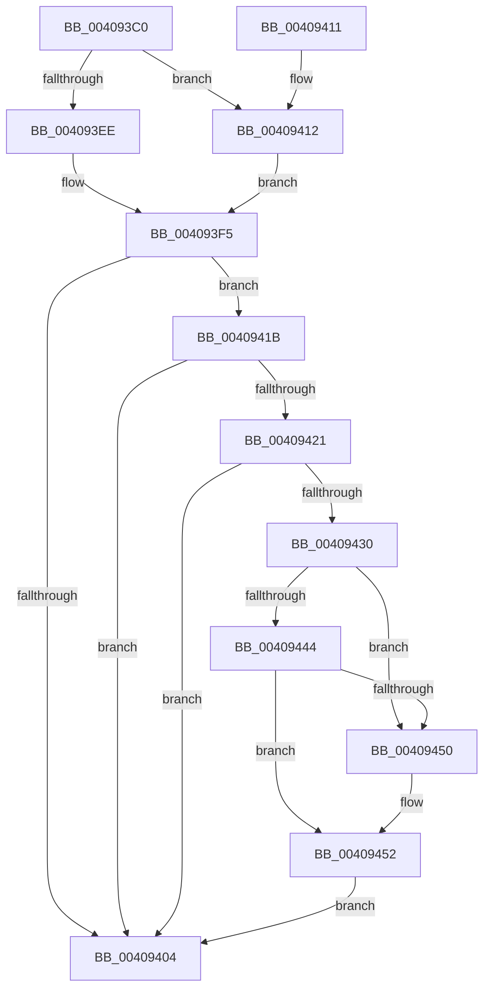

# MiProcessCommitIntact

- RVA: `0x004093C0`–`0x00409460` (길이 `160` bytes)
- VA: `0x00000001404093C0`
- 실행 섹션: `.text`
- PDB 이름 있음: `예`; PDB Function 태그: `아니요`
- unwind 정보 RVA: `0x00072DE4`
- 디코드: `45`개 명령, `160/160` bytes 표시
- 미해석 바이트: `0` (있으면 어셈블리에 `.byte`로 보존)

> 이 문서는 커널 이미지의 기계어와 PDB 기호를 분석해 생성했습니다. 4번과 5번은 함수 원형과 자료형을 바이너리 사용 방식에서 추정한 C 해석이며 원본 소스 복구 결과는 아닙니다.

## 1. Dependencies

- 직접 호출 지점: **4**; 고유 호출 대상: **4**
- 직접 호출자로 확인된 함수: **2**
- RIP 상대 이미지 참조: **1**

### Outgoing calls
- `0x00409432` → [MiLockVadTree](../27/MiLockVadTree_function_0027C0F0.md) (function, `0x0027C0F0`)
- `0x0040943A` → [MiLocateAddress](../31/MiLocateAddress_function_003168D0.md) (function, `0x003168D0`)
- `0x00409447` → [MiIsVadEligibleForCommitRelease](../4F/MiIsVadEligibleForCommitRelease_function_004FB6FC.md) (function, `0x004FB6FC`)
- `0x00409459` → [MiUnlockVadTree](../29/MiUnlockVadTree_function_00297020.md) (function, `0x00297020`)

### Direct callers
- [sub_0023DB14](../23/Unknown_function_0023DB14.md) at `0x0023DB2D`
- [MiSplitReducedCommitClonePage](../4F/MiSplitReducedCommitClonePage_function_004FA808.md) at `0x004FA827`

### Static image references
- `0x004093EE` → RVA `0x00E38860` (`.data`; read)

## 2. Other-region calls and transfers

- 다른 실행 섹션으로 향하는 call: **0**
- 별도 외부 분기/꼬리 이동을 확인하지 못했습니다.

## 3. Assembly (complete function range)

```asm
004093C0  48 89 5C 24 08                  mov qword ptr [rsp + 8], rbx
004093C5  57                              push rdi
004093C6  48 83 EC 20                     sub rsp, 0x20
004093CA  65 48 8B 04 25 88 01 00 00      mov rax, qword ptr gs:[0x188]
004093D3  BB 01 00 00 00                  mov ebx, 1
004093D8  48 8B F9                        mov rdi, rcx
004093DB  48 8B 90 B8 00 00 00            mov rdx, qword ptr [rax + 0xb8]
004093E2  8B 82 B8 04 00 00               mov eax, dword ptr [rdx + 0x4b8]
004093E8  24 0F                           and al, 0xf
004093EA  3A C3                           cmp al, bl
004093EC  75 24                           jne 0x140409412
004093EE  4C 8D 05 6B F4 A2 00            lea r8, [rip + 0xa2f46b]
004093F5  8B 82 B8 04 00 00               mov eax, dword ptr [rdx + 0x4b8]
004093FB  C1 E8 18                        shr eax, 0x18
004093FE  24 30                           and al, 0x30
00409400  3C 30                           cmp al, 0x30
00409402  74 17                           je 0x14040941b
00409404  8B C3                           mov eax, ebx
00409406  48 8B 5C 24 30                  mov rbx, qword ptr [rsp + 0x30]
0040940B  48 83 C4 20                     add rsp, 0x20
0040940F  5F                              pop rdi
00409410  C3                              ret
00409411  CC                              int3
00409412  4C 8D 82 E0 04 00 00            lea r8, [rdx + 0x4e0]
00409419  EB DA                           jmp 0x1404093f5
0040941B  49 83 38 00                     cmp qword ptr [r8], 0
0040941F  74 E3                           je 0x140409404
00409421  48 B8 00 00 00 00 00 80 FF FF   movabs rax, 0xffff800000000000
0040942B  48 3B F8                        cmp rdi, rax
0040942E  73 D4                           jae 0x140409404
00409430  8B CB                           mov ecx, ebx
00409432  E8 B9 2C E7 FF                  call 0x14027c0f0
00409437  48 8B CF                        mov rcx, rdi
0040943A  E8 91 D4 F0 FF                  call 0x1403168d0
0040943F  48 85 C0                        test rax, rax
00409442  74 0C                           je 0x140409450
00409444  48 8B C8                        mov rcx, rax
00409447  E8 B0 22 0F 00                  call 0x1404fb6fc
0040944C  85 C0                           test eax, eax
0040944E  74 02                           je 0x140409452
00409450  33 DB                           xor ebx, ebx
00409452  B2 11                           mov dl, 0x11
00409454  B9 01 00 00 00                  mov ecx, 1
00409459  E8 C2 DB E8 FF                  call 0x140297020
0040945E  EB A4                           jmp 0x140409404
```

## 4. C-style interpretation (structured pseudocode)

```c
__int64 __fastcall MiProcessCommitIntact(__int64 a1)
{
    __int64 result;
    __int64 v_rbx;
    __int64 v_rsp;
    unsigned __int64 v_stack_p8;

    v_stack_p8 = v_rbx;
    v_rsp = (v_rsp) - (32);
    result = (unsigned __int8)(((unsigned int)(*(unsigned int *)(*(unsigned __int64 *)(*(unsigned __int64 *)(gs_base + (0 + 392)) + 184) + 1208))) & (15));
    if (((unsigned __int8)(result)) != 1) goto loc_00409412;
loc_004093F5:
    result = (unsigned int)(((unsigned int)(*(unsigned int *)(*(unsigned __int64 *)(*(unsigned __int64 *)(gs_base + (0 + 392)) + 184) + 1208))) >> (24));
    result = (unsigned __int8)((result) & (48));
    if (((unsigned __int8)(result)) == 48) goto loc_0040941B;
loc_00409404:
    v_rsp = (v_rsp) + (32);
    return 1;
loc_00409412:
    goto loc_004093F5;
loc_0040941B:
    if ((*(unsigned __int64 *)(*(unsigned __int64 *)(*(unsigned __int64 *)(gs_base + (0 + 392)) + 184) + 1248)) == 0) goto loc_00409404;
    if (a1 >= 1) goto loc_00409404;
    result = MiLockVadTree((unsigned int)((unsigned int)(v_stack_p8)), *(unsigned __int64 *)(*(unsigned __int64 *)(gs_base + (0 + 392)) + 184), *(unsigned __int64 *)(*(unsigned __int64 *)(gs_base + (0 + 392)) + 184) + 1248, a4);
    result = MiLocateAddress(a1, *(unsigned __int64 *)(*(unsigned __int64 *)(gs_base + (0 + 392)) + 184), *(unsigned __int64 *)(*(unsigned __int64 *)(gs_base + (0 + 392)) + 184) + 1248, a4);
    if (result == 0) goto loc_00409450;
    result = MiIsVadEligibleForCommitRelease(result, *(unsigned __int64 *)(*(unsigned __int64 *)(gs_base + (0 + 392)) + 184), *(unsigned __int64 *)(*(unsigned __int64 *)(gs_base + (0 + 392)) + 184) + 1248, a4);
    v_rbx = v_stack_p8;
    if ((unsigned int)(result) != 0) {
        v_rbx = 0;
    }
    result = MiUnlockVadTree(1, 17, *(unsigned __int64 *)(*(unsigned __int64 *)(gs_base + (0 + 392)) + 184) + 1248, a4);
    goto loc_00409404;
}
```

## 5. (Beta) C Style

```c
int64_t MiProcessCommitIntact(int64_t Arg1)
{
    int64_t result;
    int64_t local_rbx;
    int64_t local_rsp;
    uint64_t v_stack_p8;

    v_stack_p8 = local_rbx;
    local_rsp = (local_rsp) - (32);
    result = (uint8_t)(((uint32_t)(*(uint32_t *)(*(uint64_t *)(*(uint64_t *)(gs_base + (0 + 0x188)) + 0xB8) + 0x4B8))) & (15));
    if (((uint8_t)(result)) != 1) goto loc_00409412;
loc_004093F5:
    result = (uint32_t)(((uint32_t)(*(uint32_t *)(*(uint64_t *)(*(uint64_t *)(gs_base + (0 + 0x188)) + 0xB8) + 0x4B8))) >> (24));
    result = (uint8_t)((result) & (48));
    if (((uint8_t)(result)) == 48) goto loc_0040941B;
loc_00409404:
    local_rsp = (local_rsp) + (32);
    return 1;
loc_00409412:
    goto loc_004093F5;
loc_0040941B:
    if ((*(uint64_t *)(*(uint64_t *)(*(uint64_t *)(gs_base + (0 + 0x188)) + 0xB8) + 0x4E0)) == 0) goto loc_00409404;
    if (Arg1 >= 1) goto loc_00409404;
    result = MiLockVadTree((uint32_t)((uint32_t)(v_stack_p8)), *(uint64_t *)(*(uint64_t *)(gs_base + (0 + 0x188)) + 0xB8), *(uint64_t *)(*(uint64_t *)(gs_base + (0 + 0x188)) + 0xB8) + 1248, a4);
    result = MiLocateAddress(Arg1, *(uint64_t *)(*(uint64_t *)(gs_base + (0 + 0x188)) + 0xB8), *(uint64_t *)(*(uint64_t *)(gs_base + (0 + 0x188)) + 0xB8) + 1248, a4);
    if (result == 0) goto loc_00409450;
    result = MiIsVadEligibleForCommitRelease(result, *(uint64_t *)(*(uint64_t *)(gs_base + (0 + 0x188)) + 0xB8), *(uint64_t *)(*(uint64_t *)(gs_base + (0 + 0x188)) + 0xB8) + 1248, a4);
    local_rbx = v_stack_p8;
    if ((uint32_t)(result) != 0) {
        local_rbx = 0;
    }
    result = MiUnlockVadTree(1, 17, *(uint64_t *)(*(uint64_t *)(gs_base + (0 + 0x188)) + 0xB8) + 1248, a4);
    goto loc_00409404;
}
```

## 6. Execution-region graph

[열기: 2D/3D 그래프와 함수 탐색 컨트롤 패널](../../../control-panel.html?section=text&rva=0x004093C0&view=graph)

- 2D 그래프는 위에서 아래로 흐르고, 3D 그래프는 빈 공간을 드래그해 회전합니다. Shift+드래그는 이동, 휠은 확대·축소, 함수 노드 선택은 대상 보고서 이동입니다.

### Static fallback


