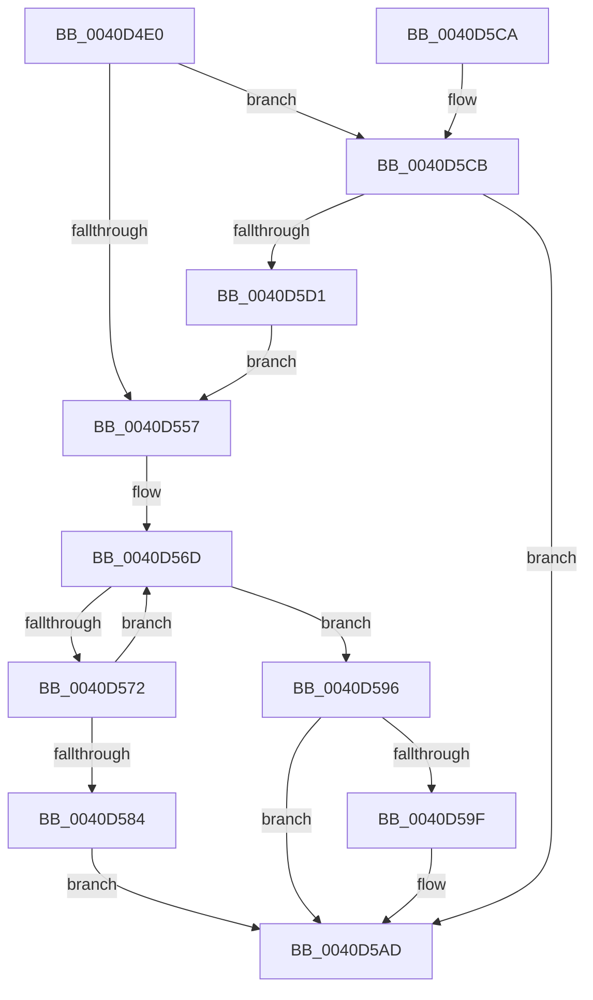

# MiRebuildPageTableAges

- RVA: `0x0040D4E0`–`0x0040D5D3` (길이 `243` bytes)
- VA: `0x000000014040D4E0`
- 실행 섹션: `.text`
- PDB 이름 있음: `예`; PDB Function 태그: `아니요`
- unwind 정보 RVA: `0x0009B164`
- 디코드: `66`개 명령, `243/243` bytes 표시
- 미해석 바이트: `0` (있으면 어셈블리에 `.byte`로 보존)

> 이 문서는 커널 이미지의 기계어와 PDB 기호를 분석해 생성했습니다. 4번과 5번은 함수 원형과 자료형을 바이너리 사용 방식에서 추정한 C 해석이며 원본 소스 복구 결과는 아닙니다.

## 1. Dependencies

- 직접 호출 지점: **5**; 고유 호출 대상: **5**
- 직접 호출자로 확인된 함수: **5**
- RIP 상대 이미지 참조: **1**

### Outgoing calls
- `0x0040D51E` → [MI_READ_PTE_LOCK_FREE](../28/MI_READ_PTE_LOCK_FREE_function_002828A0.md) (function, `0x002828A0`)
- `0x0040D565` → [MiCountWslesInPageTable](MiCountWslesInPageTable_function_0040D5DC.md) (function, `0x0040D5DC`)
- `0x0040D58F` → [MiSetPfnOldestWsleLeafAge](../29/MiSetPfnOldestWsleLeafAge_function_00293AC4.md) (function, `0x00293AC4`)
- `0x0040D5A8` → [MiRemoveActivePageTableLinks](../29/MiRemoveActivePageTableLinks_function_00291FA8.md) (function, `0x00291FA8`)
- `0x0040D5B5` → [_security_check_cookie](../6A/_security_check_cookie_function_006AC640.md) (function, `0x006AC640`)

### Direct callers
- [MiAddWorkingSetEntries](../27/MiAddWorkingSetEntries_function_0027DC00.md) at `0x0027E398`
- [MiSetVaAgeList](../29/MiSetVaAgeList_function_00290A20.md) at `0x00291781`
- [sub_00291CF5](../29/Unknown_function_00291CF5.md) at `0x00291CFE`
- [sub_0029273F](../29/Unknown_function_0029273F.md) at `0x00292941`
- [MiFastTrimWorkingSet](../2A/MiFastTrimWorkingSet_function_002AD420.md) at `0x002AD757`

### Static image references
- `0x0040D4EC` → RVA `0x00E0A740` (`.data`; read)

## 2. Other-region calls and transfers

- 다른 실행 섹션으로 향하는 call: **0**
- 별도 외부 분기/꼬리 이동을 확인하지 못했습니다.

## 3. Assembly (complete function range)

```asm
0040D4E0  48 89 5C 24 18                  mov qword ptr [rsp + 0x18], rbx
0040D4E5  55                              push rbp
0040D4E6  56                              push rsi
0040D4E7  57                              push rdi
0040D4E8  48 83 EC 60                     sub rsp, 0x60
0040D4EC  48 8B 05 4D D2 9F 00            mov rax, qword ptr [rip + 0x9fd24d]
0040D4F3  48 33 C4                        xor rax, rsp
0040D4F6  48 89 44 24 50                  mov qword ptr [rsp + 0x50], rax
0040D4FB  48 8B F9                        mov rdi, rcx
0040D4FE  41 8B F0                        mov esi, r8d
0040D501  48 8B CA                        mov rcx, rdx
0040D504  48 8B EA                        mov rbp, rdx
0040D507  48 C1 E9 12                     shr rcx, 0x12
0040D50B  81 E1 F8 FF FF 3F               and ecx, 0x3ffffff8
0040D511  48 B8 00 00 00 40 FB F6 FF FF   movabs rax, 0xfffff6fb40000000
0040D51B  48 03 C8                        add rcx, rax
0040D51E  E8 7D 53 E7 FF                  call 0x1402828a0
0040D523  48 C1 E8 0C                     shr rax, 0xc
0040D527  48 B9 FF FF FF FF FF 00 00 00   movabs rcx, 0xffffffffff
0040D531  48 23 C1                        and rax, rcx
0040D534  48 8D 1C 40                     lea rbx, [rax + rax*2]
0040D538  48 C1 E3 04                     shl rbx, 4
0040D53C  48 B8 00 00 00 00 00 DE FF FF   movabs rax, 0xffffde0000000000
0040D546  48 03 D8                        add rbx, rax
0040D549  48 8B 03                        mov rax, qword ptr [rbx]
0040D54C  48 C1 E8 2D                     shr rax, 0x2d
0040D550  A9 FF 03 00 00                  test eax, 0x3ff
0040D555  75 74                           jne 0x14040d5cb
0040D557  44 8B CE                        mov r9d, esi
0040D55A  4C 8D 44 24 30                  lea r8, [rsp + 0x30]
0040D55F  48 8B D5                        mov rdx, rbp
0040D562  48 8B CF                        mov rcx, rdi
0040D565  E8 72 00 00 00                  call 0x14040d5dc
0040D56A  41 B0 08                        mov r8b, 8
0040D56D  45 84 C0                        test r8b, r8b
0040D570  74 24                           je 0x14040d596
0040D572  41 80 C0 FF                     add r8b, 0xff
0040D576  41 0F B6 C0                     movzx eax, r8b
0040D57A  44 8B 4C 84 30                  mov r9d, dword ptr [rsp + rax*4 + 0x30]
0040D57F  45 85 C9                        test r9d, r9d
0040D582  74 E9                           je 0x14040d56d
0040D584  83 64 24 20 00                  and dword ptr [rsp + 0x20], 0
0040D589  48 8B D3                        mov rdx, rbx
0040D58C  48 8B CF                        mov rcx, rdi
0040D58F  E8 30 65 E8 FF                  call 0x140293ac4
0040D594  EB 17                           jmp 0x14040d5ad
0040D596  8B 43 24                        mov eax, dword ptr [rbx + 0x24]
0040D599  0F BA E0 1A                     bt eax, 0x1a
0040D59D  73 0E                           jae 0x14040d5ad
0040D59F  45 33 C0                        xor r8d, r8d
0040D5A2  48 8B D3                        mov rdx, rbx
0040D5A5  48 8B CF                        mov rcx, rdi
0040D5A8  E8 FB 49 E8 FF                  call 0x140291fa8
0040D5AD  48 8B 4C 24 50                  mov rcx, qword ptr [rsp + 0x50]
0040D5B2  48 33 CC                        xor rcx, rsp
0040D5B5  E8 86 F0 29 00                  call 0x1406ac640
0040D5BA  48 8B 9C 24 90 00 00 00         mov rbx, qword ptr [rsp + 0x90]
0040D5C2  48 83 C4 60                     add rsp, 0x60
0040D5C6  5F                              pop rdi
0040D5C7  5E                              pop rsi
0040D5C8  5D                              pop rbp
0040D5C9  C3                              ret
0040D5CA  CC                              int3
0040D5CB  40 F6 C6 01                     test sil, 1
0040D5CF  74 DC                           je 0x14040d5ad
0040D5D1  EB 84                           jmp 0x14040d557
```

## 4. C-style interpretation (structured pseudocode)

```c
__int64 __fastcall MiRebuildPageTableAges(__int64 a1, __int64 a2, int a3)
{
    __int64 result;
    __int64 v_rbx;
    __int64 v_rsp;
    unsigned __int64 v_stack_m28;
    unsigned __int64 v_stack_m48;
    unsigned int v_stack_m58;
    unsigned __int64 v_stack_p18;

    v_stack_p18 = v_rbx;
    v_rsp = (v_rsp) - (96);
    result = (*(unsigned __int64 *)(v_rip + 10474061)) ^ (v_rsp);
    v_stack_m28 = result;
    a1 = (a2) >> (18);
    a1 = (unsigned int)((a1) & (0x3FFFFFF8ULL));
    a1 = (a1) + (result);
    result = MI_READ_PTE_LOCK_FREE(a1, a2, a3, a4);
    result = (result) >> (12);
    result = (result) & (a1);
    v_rbx = (result + result * 2) << (4);
    v_rbx = (v_rbx) + (result);
    result = (*(unsigned __int64 *)(v_rbx)) >> (45);
    if ((((unsigned int)(result)) & (0x3FFULL)) != 0) goto loc_0040D5CB;
loc_0040D557:
    result = MiCountWslesInPageTable(a1, a2, v_stack_m48, (unsigned int)((unsigned int)((unsigned int)(a3))));
loc_0040D56D:
    if (8 == 0) goto loc_0040D596;
    a3 = (unsigned __int8)((8) + (255));
    if ((unsigned int)((unsigned int)(*(unsigned int *)(v_rsp + (unsigned __int8)(a3) * 4 + 48))) == 0) goto loc_0040D56D;
    result = MiSetPfnOldestWsleLeafAge(a1, v_rbx, a3, (unsigned int)(*(unsigned int *)(v_rsp + (unsigned __int8)(a3) * 4 + 48)));
    goto loc_0040D5AD;
loc_0040D596:
    result = (unsigned int)(*(unsigned int *)(v_rbx + 36));
    if (!(condition_is_above_or_equal)) {
        a3 = 0;
        a2 = v_rbx;
        a1 = a1;
        result = MiRemoveActivePageTableLinks(a1, a2, a3, (unsigned int)(*(unsigned int *)(v_rsp + (unsigned __int8)(a3) * 4 + 48)));
    }
    a1 = (v_stack_m28) ^ (v_rsp);
    result = _security_check_cookie(a1, a2, a3, (unsigned int)(*(unsigned int *)(v_rsp + (unsigned __int8)(a3) * 4 + 48)));
    v_rsp = (v_rsp) + (96);
    return result;
loc_0040D5CB:
    if ((((unsigned __int8)((unsigned int)(a3))) & (1)) == 0) goto loc_0040D5AD;
    goto loc_0040D557;
}
```

## 5. (Beta) C Style

```c
int64_t MiRebuildPageTableAges(int64_t Arg1, int64_t Arg2, int32_t Arg3)
{
    int64_t result;
    int64_t local_rbx;
    int64_t local_rsp;
    uint64_t v_stack_m28;
    uint64_t v_stack_m48;
    uint32_t v_stack_m58;
    uint64_t v_stack_p18;

    v_stack_p18 = local_rbx;
    local_rsp = (local_rsp) - (96);
    result = (*(uint64_t *)(v_rip + 0x9FD24D)) ^ (local_rsp);
    v_stack_m28 = result;
    Arg1 = (Arg2) >> (18);
    Arg1 = (uint32_t)((Arg1) & (0x3FFFFFF8ULL));
    Arg1 = (Arg1) + (result);
    result = MI_READ_PTE_LOCK_FREE(Arg1, Arg2, Arg3, a4);
    result = (result) >> (12);
    result = (result) & (Arg1);
    local_rbx = (result + result * 2) << (4);
    local_rbx = (local_rbx) + (result);
    result = (*(uint64_t *)(local_rbx)) >> (45);
    if ((((uint32_t)(result)) & (0x3FFULL)) != 0) goto loc_0040D5CB;
loc_0040D557:
    result = MiCountWslesInPageTable(Arg1, Arg2, v_stack_m48, (uint32_t)((uint32_t)((uint32_t)(Arg3))));
loc_0040D56D:
    if (8 == 0) goto loc_0040D596;
    Arg3 = (uint8_t)((8) + (255));
    if ((uint32_t)((uint32_t)(*(uint32_t *)(local_rsp + (uint8_t)(Arg3) * 4 + 0x30))) == 0) goto loc_0040D56D;
    result = MiSetPfnOldestWsleLeafAge(Arg1, local_rbx, Arg3, (uint32_t)(*(uint32_t *)(local_rsp + (uint8_t)(Arg3) * 4 + 0x30)));
    goto loc_0040D5AD;
loc_0040D596:
    result = (uint32_t)(*(uint32_t *)(local_rbx + 0x24));
    if (!(condition_is_above_or_equal)) {
        Arg3 = 0;
        Arg2 = local_rbx;
        Arg1 = Arg1;
        result = MiRemoveActivePageTableLinks(Arg1, Arg2, Arg3, (uint32_t)(*(uint32_t *)(local_rsp + (uint8_t)(Arg3) * 4 + 0x30)));
    }
    Arg1 = (v_stack_m28) ^ (local_rsp);
    result = _security_check_cookie(Arg1, Arg2, Arg3, (uint32_t)(*(uint32_t *)(local_rsp + (uint8_t)(Arg3) * 4 + 0x30)));
    local_rsp = (local_rsp) + (96);
    return result;
loc_0040D5CB:
    if ((((uint8_t)((uint32_t)(Arg3))) & (1)) == 0) goto loc_0040D5AD;
    goto loc_0040D557;
}
```

## 6. Execution-region graph

[열기: 2D/3D 그래프와 함수 탐색 컨트롤 패널](../../../control-panel.html?section=text&rva=0x0040D4E0&view=graph)

- 2D 그래프는 위에서 아래로 흐르고, 3D 그래프는 빈 공간을 드래그해 회전합니다. Shift+드래그는 이동, 휠은 확대·축소, 함수 노드 선택은 대상 보고서 이동입니다.

### Static fallback


