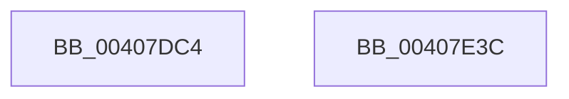

# MiRefPageFileSpaceBitmaps

- RVA: `0x00407DC4`–`0x00407E3D` (길이 `121` bytes)
- VA: `0x0000000140407DC4`
- 실행 섹션: `.text`
- PDB 이름 있음: `예`; PDB Function 태그: `아니요`
- unwind 정보 RVA: `0x0006F978`
- 디코드: `32`개 명령, `121/121` bytes 표시
- 미해석 바이트: `0` (있으면 어셈블리에 `.byte`로 보존)

> 이 문서는 커널 이미지의 기계어와 PDB 기호를 분석해 생성했습니다. 4번과 5번은 함수 원형과 자료형을 바이너리 사용 방식에서 추정한 C 해석이며 원본 소스 복구 결과는 아닙니다.

## 1. Dependencies

- 직접 호출 지점: **2**; 고유 호출 대상: **2**
- 직접 호출자로 확인된 함수: **5**
- RIP 상대 이미지 참조: **0**

### Outgoing calls
- `0x00407DE9` → [ExAcquireSpinLockExclusive](../24/ExAcquireSpinLockExclusive_function_00248690.md) (function, `0x00248690`)
- `0x00407E16` → [MiReleaseSpinLockExclusive](../24/MiReleaseSpinLockExclusive_function_002482C0.md) (function, `0x002482C0`)

### Direct callers
- [sub_00249850](../24/Unknown_function_00249850.md) at `0x0024988A`
- [MiStoreWriteModifiedPages](../2B/MiStoreWriteModifiedPages_function_002B46C4.md) at `0x002B4C57`
- [MiStoreContractVirtualPagefileApc](../3A/MiStoreContractVirtualPagefileApc_function_003A4710.md) at `0x003A477D`
- [MiFindPageFileWriteCluster](../3E/MiFindPageFileWriteCluster_function_003E2B00.md) at `0x003E2C56`
- [MiBuildReservationCluster](MiBuildReservationCluster_function_004071A0.md) at `0x0040721D`

### Static image references
- 디코드된 RIP-relative 메모리 참조가 없습니다.

## 2. Other-region calls and transfers

- 다른 실행 섹션으로 향하는 call: **0**
- 별도 외부 분기/꼬리 이동을 확인하지 못했습니다.

## 3. Assembly (complete function range)

```asm
00407DC4  48 89 5C 24 08                  mov qword ptr [rsp + 8], rbx
00407DC9  48 89 74 24 10                  mov qword ptr [rsp + 0x10], rsi
00407DCE  48 89 7C 24 18                  mov qword ptr [rsp + 0x18], rdi
00407DD3  41 56                           push r14
00407DD5  48 83 EC 20                     sub rsp, 0x20
00407DD9  48 8D B1 C8 00 00 00            lea rsi, [rcx + 0xc8]
00407DE0  48 8B D9                        mov rbx, rcx
00407DE3  48 8B CE                        mov rcx, rsi
00407DE6  4C 8B F2                        mov r14, rdx
00407DE9  E8 A2 08 E4 FF                  call 0x140248690
00407DEE  48 8B 7B 50                     mov rdi, qword ptr [rbx + 0x50]
00407DF2  8A D0                           mov dl, al
00407DF4  48 8B CE                        mov rcx, rsi
00407DF7  FF 07                           inc dword ptr [rdi]
00407DF9  0F 10 07                        movups xmm0, xmmword ptr [rdi]
00407DFC  41 0F 11 06                     movups xmmword ptr [r14], xmm0
00407E00  0F 10 4F 10                     movups xmm1, xmmword ptr [rdi + 0x10]
00407E04  41 0F 11 4E 10                  movups xmmword ptr [r14 + 0x10], xmm1
00407E09  F2 0F 10 47 20                  movsd xmm0, qword ptr [rdi + 0x20]
00407E0E  F2 41 0F 11 46 20               movsd qword ptr [r14 + 0x20], xmm0
00407E14  8B 1B                           mov ebx, dword ptr [rbx]
00407E16  E8 A5 04 E4 FF                  call 0x1402482c0
00407E1B  48 8B 74 24 38                  mov rsi, qword ptr [rsp + 0x38]
00407E20  49 89 3E                        mov qword ptr [r14], rdi
00407E23  48 8B 7C 24 40                  mov rdi, qword ptr [rsp + 0x40]
00407E28  41 89 5E 08                     mov dword ptr [r14 + 8], ebx
00407E2C  41 89 5E 18                     mov dword ptr [r14 + 0x18], ebx
00407E30  48 8B 5C 24 30                  mov rbx, qword ptr [rsp + 0x30]
00407E35  48 83 C4 20                     add rsp, 0x20
00407E39  41 5E                           pop r14
00407E3B  C3                              ret
00407E3C  CC                              int3
```

## 4. C-style interpretation (structured pseudocode)

```c
__int64 __fastcall MiRefPageFileSpaceBitmaps(__int64 a1, __int64 a2)
{
    __int64 result;
    __int64 v_rsp;
    unsigned __int64 v_stack_p10;
    unsigned __int64 v_stack_p18;
    unsigned __int64 v_stack_p8;

    v_stack_p8 = v_rbx;
    v_stack_p10 = v_rsi;
    v_stack_p18 = v_rdi;
    v_rsp = (v_rsp) - (32);
    result = ExAcquireSpinLockExclusive(a1 + 200, a2, a3, a4);
    *(unsigned __int64 *)(a2) = v_xmm0;
    *(unsigned __int64 *)(a2 + 16) = v_xmm1;
    *(unsigned __int64 *)(a2 + 32) = v_xmm0;
    result = MiReleaseSpinLockExclusive(a1 + 200, (unsigned __int8)(result), a3, a4);
    *(unsigned __int64 *)(a2) = *(unsigned __int64 *)(a1 + 80);
    *(unsigned int *)(a2 + 8) = (unsigned int)((unsigned int)(*(unsigned int *)(a1)));
    *(unsigned int *)(a2 + 24) = (unsigned int)((unsigned int)(*(unsigned int *)(a1)));
    v_rsp = (v_rsp) + (32);
    return result;
}
```

## 5. (Beta) C Style

```c
int64_t MiRefPageFileSpaceBitmaps(void *Arg1, void *Arg2)
{
    uint8_t *arg1 = (uint8_t *)Arg1;
    uint8_t *arg2 = (uint8_t *)Arg2;

    int64_t result;
    int64_t local_rsp;
    uint64_t v_stack_p10;
    uint64_t v_stack_p18;
    uint64_t v_stack_p8;

    v_stack_p8 = local_rbx;
    v_stack_p10 = local_rsi;
    v_stack_p18 = local_rdi;
    local_rsp = (local_rsp) - (32);
    result = ExAcquireSpinLockExclusive(Arg1 + 200, Arg2, a3, a4);
    *(uint64_t *)(arg2) = v_xmm0;
    *(uint64_t *)(arg2 + 0x10) = v_xmm1;
    *(uint64_t *)(arg2 + 0x20) = v_xmm0;
    result = MiReleaseSpinLockExclusive(Arg1 + 200, (uint8_t)(result), a3, a4);
    *(uint64_t *)(arg2) = *(uint64_t *)(arg1 + 0x50);
    *(uint32_t *)(arg2 + 0x8) = (uint32_t)((uint32_t)(*(uint32_t *)(arg1)));
    *(uint32_t *)(arg2 + 0x18) = (uint32_t)((uint32_t)(*(uint32_t *)(arg1)));
    local_rsp = (local_rsp) + (32);
    return result;
}
```

### 관측된 메모리 오프셋

구조체 형식이 확인되지 않은 접근은 인자 기준의 오프셋으로만 기록했습니다.

| 기준 인자 | 오프셋 표현 | 폭 (bit) | 접근 |
|---|---:|---:|---|
| `Arg1` | `+ 0x0` | `32` | `R` |
| `Arg1` | `+ 0x50` | `64` | `R` |
| `Arg1` | `+ 0xC8` | `64` | `R` |
| `Arg2` | `+ 0x0` | `64` | `W` |
| `Arg2` | `+ 0x0` | `128` | `R` |
| `Arg2` | `+ 0x8` | `32` | `W` |
| `Arg2` | `+ 0x10` | `128` | `R` |
| `Arg2` | `+ 0x18` | `32` | `W` |
| `Arg2` | `+ 0x20` | `64` | `W` |

## 6. Execution-region graph

[열기: 2D/3D 그래프와 함수 탐색 컨트롤 패널](../../../control-panel.html?section=text&rva=0x00407DC4&view=graph)

- 2D 그래프는 위에서 아래로 흐르고, 3D 그래프는 빈 공간을 드래그해 회전합니다. Shift+드래그는 이동, 휠은 확대·축소, 함수 노드 선택은 대상 보고서 이동입니다.

### Static fallback


