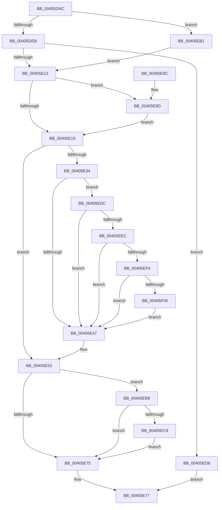

# MiReferencePageForModifiedWrite

- RVA: `0x00405DAC`–`0x00405F16` (길이 `362` bytes)
- VA: `0x0000000140405DAC`
- 실행 섹션: `.text`
- PDB 이름 있음: `예`; PDB Function 태그: `아니요`
- unwind 정보 RVA: `0x0009A888`
- 디코드: `98`개 명령, `362/362` bytes 표시
- 미해석 바이트: `0` (있으면 어셈블리에 `.byte`로 보존)

> 이 문서는 커널 이미지의 기계어와 PDB 기호를 분석해 생성했습니다. 4번과 5번은 함수 원형과 자료형을 바이너리 사용 방식에서 추정한 C 해석이며 원본 소스 복구 결과는 아닙니다.

## 1. Dependencies

- 직접 호출 지점: **5**; 고유 호출 대상: **5**
- 직접 호출자로 확인된 함수: **6**
- RIP 상대 이미지 참조: **1**

### Outgoing calls
- `0x00405E04` → [MiChargeForWriteInProgressPage](../28/MiChargeForWriteInProgressPage_function_00286D60.md) (function, `0x00286D60`)
- `0x00405E92` → [MiUnlinkPageFromListEx](../28/MiUnlinkPageFromListEx_function_00287590.md) (function, `0x00287590`)
- `0x00405EC0` → [MiGetPagePrivilege](../28/MiGetPagePrivilege_function_00285420.md) (function, `0x00285420`)
- `0x00405ED1` → [MiClearPfnImageVerified](MiClearPfnImageVerified_function_00407000.md) (function, `0x00407000`)
- `0x00405EDF` → [MiCanPfnOriginalPteBeLost](../37/MiCanPfnOriginalPteBeLost_function_00373D3C.md) (function, `0x00373D3C`)

### Direct callers
- [MiGatherMappedPages](MiGatherMappedPages_function_00404E80.md) at `0x00404FC0`
- [MiAddToReservationCluster](MiAddToReservationCluster_function_00405474.md) at `0x0040556F`
- [MiGetPageForWriteCluster](MiGetPageForWriteCluster_function_00405704.md) at `0x00405847`
- [MiFillNoReservationCluster](MiFillNoReservationCluster_function_00405B40.md) at `0x00405BE7`
- [MiBuildMappedCluster](MiBuildMappedCluster_function_00405F1C.md) at `0x00406306`
- [MiBuildMappedCluster](MiBuildMappedCluster_function_00405F1C.md) at `0x004063A3`
- [MiBuildMappedCluster](MiBuildMappedCluster_function_00405F1C.md) at `0x0040656D`
- [MiBuildMappedCluster](MiBuildMappedCluster_function_00405F1C.md) at `0x004067B5`
- [MiBuildReservationCluster](MiBuildReservationCluster_function_004071A0.md) at `0x004072C5`

### Static image references
- `0x00405DC9` → RVA `0x00E30088` (`.data`; read)

## 2. Other-region calls and transfers

- 다른 실행 섹션으로 향하는 call: **0**
- 별도 외부 분기/꼬리 이동을 확인하지 못했습니다.

## 3. Assembly (complete function range)

```asm
00405DAC  48 89 5C 24 08                  mov qword ptr [rsp + 8], rbx
00405DB1  48 89 6C 24 18                  mov qword ptr [rsp + 0x18], rbp
00405DB6  48 89 74 24 20                  mov qword ptr [rsp + 0x20], rsi
00405DBB  57                              push rdi
00405DBC  48 83 EC 20                     sub rsp, 0x20
00405DC0  48 8B 41 28                     mov rax, qword ptr [rcx + 0x28]
00405DC4  BD 01 00 00 00                  mov ebp, 1
00405DC9  4C 8B 05 B8 A2 A2 00            mov r8, qword ptr [rip + 0xa2a2b8]
00405DD0  48 8B D9                        mov rbx, rcx
00405DD3  48 C1 E8 2B                     shr rax, 0x2b
00405DD7  8B FA                           mov edi, edx
00405DD9  25 FF 03 00 00                  and eax, 0x3ff
00405DDE  49 8B 0C C0                     mov rcx, qword ptr [r8 + rax*8]
00405DE2  40 84 D5                        test bpl, dl
00405DE5  0F 85 C6 00 00 00               jne 0x140405eb1
00405DEB  44 8B 43 10                     mov r8d, dword ptr [rbx + 0x10]
00405DEF  49 C1 E8 0A                     shr r8, 0xa
00405DF3  44 23 C5                        and r8d, ebp
00405DF6  41 8B D0                        mov edx, r8d
00405DF9  83 CA 02                        or edx, 2
00405DFC  40 F6 C7 02                     test dil, 2
00405E00  41 0F 44 D0                     cmove edx, r8d
00405E04  E8 57 0F E8 FF                  call 0x140286d60
00405E09  8B F0                           mov esi, eax
00405E0B  85 C0                           test eax, eax
00405E0D  0F 84 C5 00 00 00               je 0x140405ed8
00405E13  40 F6 C7 04                     test dil, 4
00405E17  74 74                           je 0x140405e8d
00405E19  8B 43 20                        mov eax, dword ptr [rbx + 0x20]
00405E1C  41 B3 08                        mov r11b, 8
00405E1F  89 44 24 38                     mov dword ptr [rsp + 0x38], eax
00405E23  66 01 6C 24 38                  add word ptr [rsp + 0x38], bp
00405E28  8B 44 24 38                     mov eax, dword ptr [rsp + 0x38]
00405E2C  89 43 20                        mov dword ptr [rbx + 0x20], eax
00405E2F  41 84 FB                        test r11b, dil
00405E32  75 1F                           jne 0x140405e53
00405E34  8B 43 20                        mov eax, dword ptr [rbx + 0x20]
00405E37  89 44 24 38                     mov dword ptr [rsp + 0x38], eax
00405E3B  C1 E8 10                        shr eax, 0x10
00405E3E  41 84 C3                        test r11b, al
00405E41  0F 85 95 00 00 00               jne 0x140405edc
00405E47  80 64 24 3A EF                  and byte ptr [rsp + 0x3a], 0xef
00405E4C  8B 44 24 38                     mov eax, dword ptr [rsp + 0x38]
00405E50  89 43 20                        mov dword ptr [rbx + 0x20], eax
00405E53  8B 43 20                        mov eax, dword ptr [rbx + 0x20]
00405E56  89 44 24 38                     mov dword ptr [rsp + 0x38], eax
00405E5A  C1 E8 10                        shr eax, 0x10
00405E5D  41 0A C3                        or al, r11b
00405E60  88 44 24 3A                     mov byte ptr [rsp + 0x3a], al
00405E64  8B 44 24 38                     mov eax, dword ptr [rsp + 0x38]
00405E68  89 43 20                        mov dword ptr [rbx + 0x20], eax
00405E6B  8B 43 10                        mov eax, dword ptr [rbx + 0x10]
00405E6E  48 0F BA E0 0A                  bt rax, 0xa
00405E73  73 43                           jae 0x140405eb8
00405E75  8B C6                           mov eax, esi
00405E77  48 8B 5C 24 30                  mov rbx, qword ptr [rsp + 0x30]
00405E7C  48 8B 6C 24 40                  mov rbp, qword ptr [rsp + 0x40]
00405E81  48 8B 74 24 48                  mov rsi, qword ptr [rsp + 0x48]
00405E86  48 83 C4 20                     add rsp, 0x20
00405E8A  5F                              pop rdi
00405E8B  C3                              ret
00405E8C  CC                              int3
00405E8D  33 D2                           xor edx, edx
00405E8F  48 8B CB                        mov rcx, rbx
00405E92  E8 F9 16 E8 FF                  call 0x140287590
00405E97  48 8B 43 18                     mov rax, qword ptr [rbx + 0x18]
00405E9B  48 B9 00 00 00 00 00 00 00 C0   movabs rcx, 0xc000000000000000
00405EA5  48 23 C1                        and rax, rcx
00405EA8  48 89 43 18                     mov qword ptr [rbx + 0x18], rax
00405EAC  E9 68 FF FF FF                  jmp 0x140405e19
00405EB1  8B F5                           mov esi, ebp
00405EB3  E9 5B FF FF FF                  jmp 0x140405e13
00405EB8  45 33 C0                        xor r8d, r8d
00405EBB  8B D5                           mov edx, ebp
00405EBD  48 8B CB                        mov rcx, rbx
00405EC0  E8 5B F5 E7 FF                  call 0x140285420
00405EC5  A8 10                           test al, 0x10
00405EC7  74 AC                           je 0x140405e75
00405EC9  BA 1C 00 00 00                  mov edx, 0x1c
00405ECE  48 8B CB                        mov rcx, rbx
00405ED1  E8 2A 11 00 00                  call 0x140407000
00405ED6  EB 9D                           jmp 0x140405e75
00405ED8  33 C0                           xor eax, eax
00405EDA  EB 9B                           jmp 0x140405e77
00405EDC  48 8B CB                        mov rcx, rbx
00405EDF  E8 58 DE F6 FF                  call 0x140373d3c
00405EE4  85 C0                           test eax, eax
00405EE6  0F 84 5B FF FF FF               je 0x140405e47
00405EEC  F6 43 22 10                     test byte ptr [rbx + 0x22], 0x10
00405EF0  0F 85 51 FF FF FF               jne 0x140405e47
00405EF6  8B 43 10                        mov eax, dword ptr [rbx + 0x10]
00405EF9  C0 E8 02                        shr al, 2
00405EFC  40 84 C5                        test bpl, al
00405EFF  0F 84 42 FF FF FF               je 0x140405e47
00405F05  48 8B 43 10                     mov rax, qword ptr [rbx + 0x10]
00405F09  48 83 E0 FB                     and rax, 0xfffffffffffffffb
00405F0D  48 89 43 10                     mov qword ptr [rbx + 0x10], rax
00405F11  E9 31 FF FF FF                  jmp 0x140405e47
```

## 4. C-style interpretation (structured pseudocode)

```c
__int64 __fastcall MiReferencePageForModifiedWrite(__int64 a1, int a2)
{
    __int64 result;
    __int64 v_rsp;
    unsigned int v_stack_p10;
    unsigned __int8 v_stack_p12;
    unsigned __int64 v_stack_p18;
    unsigned __int64 v_stack_p20;
    unsigned __int64 v_stack_p8;

    v_stack_p8 = v_rbx;
    v_stack_p18 = v_rbp;
    v_stack_p20 = v_rsi;
    v_rsp = (v_rsp) - (32);
    result = (*(unsigned __int64 *)(a1 + 40)) >> (43);
    result = (unsigned int)((result) & (0x3FFULL));
    if (((1) & ((unsigned __int8)(a2))) != 0) goto loc_00405EB1;
    a3 = ((unsigned int)(*(unsigned int *)(a1 + 16))) >> (10);
    a3 = (unsigned int)((a3) & (1));
    a2 = (unsigned int)(((unsigned int)((unsigned int)(a3))) | (2));
    if ((((unsigned __int8)((unsigned int)(a2))) & (2)) == 0) { a2 = (unsigned int)(a3); }
    result = MiChargeForWriteInProgressPage(*(unsigned __int64 *)(*(unsigned __int64 *)(v_rip + 10658488) + result * 8), a2, a3, a4);
    if ((unsigned int)(result) == 0) goto loc_00405ED8;
loc_00405E13:
    if ((((unsigned __int8)((unsigned int)(a2))) & (4)) == 0) goto loc_00405E8D;
loc_00405E19:
    v_stack_p10 = (unsigned int)((unsigned int)(*(unsigned int *)(a1 + 32)));
    *(unsigned int *)(a1 + 32) = (unsigned int)((unsigned int)(v_stack_p10));
    if (((8) & ((unsigned __int8)((unsigned int)(a2)))) != 0) goto loc_00405E53;
    v_stack_p10 = (unsigned int)((unsigned int)(*(unsigned int *)(a1 + 32)));
    result = (unsigned int)(((unsigned int)(*(unsigned int *)(a1 + 32))) >> (16));
    if (((8) & ((unsigned __int8)(result))) != 0) goto loc_00405EDC;
loc_00405E47:
    *(unsigned int *)(a1 + 32) = (unsigned int)((unsigned int)(v_stack_p10));
loc_00405E53:
    v_stack_p10 = (unsigned int)((unsigned int)(*(unsigned int *)(a1 + 32)));
    result = (unsigned int)(((unsigned int)(*(unsigned int *)(a1 + 32))) >> (16));
    result = (unsigned __int8)((result) | (8));
    v_stack_p12 = (unsigned __int8)(result);
    *(unsigned int *)(a1 + 32) = (unsigned int)((unsigned int)(v_stack_p10));
    if (condition_is_above_or_equal) goto loc_00405EB8;
loc_00405E75:
loc_00405E77:
    v_rsp = (v_rsp) + (32);
    return (unsigned int)((unsigned int)((unsigned int)((unsigned int)(result))));
loc_00405E8D:
    a2 = 0;
    result = MiUnlinkPageFromListEx(v_stack_p8, a2, a3, a4);
    result = (*(unsigned __int64 *)(v_stack_p8 + 24)) & (v_stack_p8);
    *(unsigned __int64 *)(v_stack_p8 + 24) = result;
    goto loc_00405E19;
loc_00405EB1:
    goto loc_00405E13;
loc_00405EB8:
    a3 = 0;
    result = MiGetPagePrivilege(v_stack_p8, (unsigned int)((unsigned int)(v_stack_p18)), a3, a4);
    if ((((unsigned __int8)(result)) & (16)) == 0) goto loc_00405E75;
    result = MiClearPfnImageVerified(v_stack_p8, 28, a3, a4);
    goto loc_00405E75;
loc_00405ED8:
    result = 0;
    goto loc_00405E77;
loc_00405EDC:
    result = MiCanPfnOriginalPteBeLost(v_stack_p8, 28, a3, a4);
    if ((unsigned int)(result) == 0) goto loc_00405E47;
    if (((*(unsigned __int8 *)(v_stack_p8 + 34)) & (16)) != 0) goto loc_00405E47;
    result = (unsigned __int8)(((unsigned int)(*(unsigned int *)(v_stack_p8 + 16))) >> (2));
    if ((((unsigned __int8)(v_stack_p18)) & ((unsigned __int8)(result))) == 0) goto loc_00405E47;
    result = (*(unsigned __int64 *)(v_stack_p8 + 16)) & (-5);
    *(unsigned __int64 *)(v_stack_p8 + 16) = result;
    goto loc_00405E47;
}
```

## 5. (Beta) C Style

```c
int64_t MiReferencePageForModifiedWrite(void *Arg1, int32_t Arg2)
{
    uint8_t *arg1 = (uint8_t *)Arg1;

    int64_t result;
    int64_t local_rsp;
    uint32_t v_stack_p10;
    uint8_t v_stack_p12;
    uint64_t v_stack_p18;
    uint64_t v_stack_p20;
    uint64_t v_stack_p8;

    v_stack_p8 = local_rbx;
    v_stack_p18 = local_rbp;
    v_stack_p20 = local_rsi;
    local_rsp = (local_rsp) - (32);
    result = (*(uint64_t *)(arg1 + 0x28)) >> (43);
    result = (uint32_t)((result) & (0x3FFULL));
    if (((1) & ((uint8_t)(Arg2))) != 0) goto loc_00405EB1;
    a3 = ((uint32_t)(*(uint32_t *)(arg1 + 0x10))) >> (10);
    a3 = (uint32_t)((a3) & (1));
    Arg2 = (uint32_t)(((uint32_t)((uint32_t)(a3))) | (2));
    if ((((uint8_t)((uint32_t)(Arg2))) & (2)) == 0) { Arg2 = (uint32_t)(a3); }
    result = MiChargeForWriteInProgressPage(*(uint64_t *)(*(uint64_t *)(v_rip + 0xA2A2B8) + result * 8), Arg2, a3, a4);
    if ((uint32_t)(result) == 0) goto loc_00405ED8;
loc_00405E13:
    if ((((uint8_t)((uint32_t)(Arg2))) & (4)) == 0) goto loc_00405E8D;
loc_00405E19:
    v_stack_p10 = (uint32_t)((uint32_t)(*(uint32_t *)(arg1 + 0x20)));
    *(uint32_t *)(arg1 + 0x20) = (uint32_t)((uint32_t)(v_stack_p10));
    if (((8) & ((uint8_t)((uint32_t)(Arg2)))) != 0) goto loc_00405E53;
    v_stack_p10 = (uint32_t)((uint32_t)(*(uint32_t *)(arg1 + 0x20)));
    result = (uint32_t)(((uint32_t)(*(uint32_t *)(arg1 + 0x20))) >> (16));
    if (((8) & ((uint8_t)(result))) != 0) goto loc_00405EDC;
loc_00405E47:
    *(uint32_t *)(arg1 + 0x20) = (uint32_t)((uint32_t)(v_stack_p10));
loc_00405E53:
    v_stack_p10 = (uint32_t)((uint32_t)(*(uint32_t *)(arg1 + 0x20)));
    result = (uint32_t)(((uint32_t)(*(uint32_t *)(arg1 + 0x20))) >> (16));
    result = (uint8_t)((result) | (8));
    v_stack_p12 = (uint8_t)(result);
    *(uint32_t *)(arg1 + 0x20) = (uint32_t)((uint32_t)(v_stack_p10));
    if (condition_is_above_or_equal) goto loc_00405EB8;
loc_00405E75:
loc_00405E77:
    local_rsp = (local_rsp) + (32);
    return (uint32_t)((uint32_t)((uint32_t)((uint32_t)(result))));
loc_00405E8D:
    Arg2 = 0;
    result = MiUnlinkPageFromListEx(v_stack_p8, Arg2, a3, a4);
    result = (*(uint64_t *)(v_stack_p8 + 0x18)) & (v_stack_p8);
    *(uint64_t *)(v_stack_p8 + 0x18) = result;
    goto loc_00405E19;
loc_00405EB1:
    goto loc_00405E13;
loc_00405EB8:
    a3 = 0;
    result = MiGetPagePrivilege(v_stack_p8, (uint32_t)((uint32_t)(v_stack_p18)), a3, a4);
    if ((((uint8_t)(result)) & (16)) == 0) goto loc_00405E75;
    result = MiClearPfnImageVerified(v_stack_p8, 28, a3, a4);
    goto loc_00405E75;
loc_00405ED8:
    result = 0;
    goto loc_00405E77;
loc_00405EDC:
    result = MiCanPfnOriginalPteBeLost(v_stack_p8, 28, a3, a4);
    if ((uint32_t)(result) == 0) goto loc_00405E47;
    if (((*(uint8_t *)(v_stack_p8 + 0x22)) & (16)) != 0) goto loc_00405E47;
    result = (uint8_t)(((uint32_t)(*(uint32_t *)(v_stack_p8 + 0x10))) >> (2));
    if ((((uint8_t)(v_stack_p18)) & ((uint8_t)(result))) == 0) goto loc_00405E47;
    result = (*(uint64_t *)(v_stack_p8 + 0x10)) & (-5);
    *(uint64_t *)(v_stack_p8 + 0x10) = result;
    goto loc_00405E47;
}
```

### 관측된 메모리 오프셋

구조체 형식이 확인되지 않은 접근은 인자 기준의 오프셋으로만 기록했습니다.

| 기준 인자 | 오프셋 표현 | 폭 (bit) | 접근 |
|---|---:|---:|---|
| `Arg1` | `+ 0x10` | `32` | `R` |
| `Arg1` | `+ 0x10` | `64` | `R` |
| `Arg1` | `+ 0x10` | `64` | `W` |
| `Arg1` | `+ 0x18` | `64` | `R` |
| `Arg1` | `+ 0x18` | `64` | `W` |
| `Arg1` | `+ 0x20` | `32` | `R` |
| `Arg1` | `+ 0x20` | `32` | `W` |
| `Arg1` | `+ 0x22` | `8` | `R` |
| `Arg1` | `+ 0x28` | `64` | `R` |

## 6. Execution-region graph

[열기: 2D/3D 그래프와 함수 탐색 컨트롤 패널](../../../control-panel.html?section=text&rva=0x00405DAC&view=graph)

- 2D 그래프는 위에서 아래로 흐르고, 3D 그래프는 빈 공간을 드래그해 회전합니다. Shift+드래그는 이동, 휠은 확대·축소, 함수 노드 선택은 대상 보고서 이동입니다.

### Static fallback


