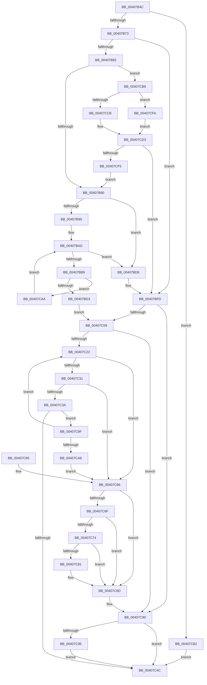

# MiReleaseWriteInProgressCharges

- RVA: `0x00407B4C`–`0x00407D04` (길이 `440` bytes)
- VA: `0x0000000140407B4C`
- 실행 섹션: `.text`
- PDB 이름 있음: `예`; PDB Function 태그: `아니요`
- unwind 정보 RVA: `0x0009A9A8`
- 디코드: `112`개 명령, `440/440` bytes 표시
- 미해석 바이트: `0` (있으면 어셈블리에 `.byte`로 보존)

> 이 문서는 커널 이미지의 기계어와 PDB 기호를 분석해 생성했습니다. 4번과 5번은 함수 원형과 자료형을 바이너리 사용 방식에서 추정한 C 해석이며 원본 소스 복구 결과는 아닙니다.

## 1. Dependencies

- 직접 호출 지점: **6**; 고유 호출 대상: **6**
- 직접 호출자로 확인된 함수: **5**
- RIP 상대 이미지 참조: **1**

### Outgoing calls
- `0x00407BF8` → [MiSignalCommitSignals](../24/MiSignalCommitSignals_function_00249090.md) (function, `0x00249090`)
- `0x00407CB2` → [MiReturnResident](../28/MiReturnResident_function_00286890.md) (function, `0x00286890`)
- `0x00407CCB` → [ExAcquireSpinLockExclusive](../24/ExAcquireSpinLockExclusive_function_00248690.md) (function, `0x00248690`)
- `0x00407CD9` → [MiRestockOverCommit](MiRestockOverCommit_function_00407D94.md) (function, `0x00407D94`)
- `0x00407CE7` → [MiReleaseSpinLockExclusive](../24/MiReleaseSpinLockExclusive_function_002482C0.md) (function, `0x002482C0`)
- `0x00407CFD` → [ExAcquireSpinLockExclusiveAtDpcLevel](../24/ExAcquireSpinLockExclusiveAtDpcLevel_function_00248E80.md) (function, `0x00248E80`)

### Direct callers
- [MiAddPageToInsertList](../24/MiAddPageToInsertList_function_0024A950.md) at `0x0024ADD4`
- [MiWriteComplete](MiWriteComplete_function_004069B0.md) at `0x00406E28`
- [MiFreeModWriterEntry](MiFreeModWriterEntry_function_00407AE8.md) at `0x00407B1C`
- [sub_006E3DF6](../6E/Unknown_function_006E3DF6.md) at `0x006E3E55`
- [sub_006EC446](../6E/Unknown_function_006EC446.md) at `0x006EC4A6`
- [sub_006EC446](../6E/Unknown_function_006EC446.md) at `0x006EC577`

### Static image references
- `0x00407B73` → RVA `0x00E38D00` (`.data`; read)

## 2. Other-region calls and transfers

- 다른 실행 섹션으로 향하는 call: **0**
- 별도 외부 분기/꼬리 이동을 확인하지 못했습니다.

## 3. Assembly (complete function range)

```asm
00407B4C  48 89 5C 24 08                  mov qword ptr [rsp + 8], rbx
00407B51  48 89 6C 24 10                  mov qword ptr [rsp + 0x10], rbp
00407B56  48 89 74 24 20                  mov qword ptr [rsp + 0x20], rsi
00407B5B  57                              push rdi
00407B5C  41 56                           push r14
00407B5E  41 57                           push r15
00407B60  48 83 EC 20                     sub rsp, 0x20
00407B64  48 8B DA                        mov rbx, rdx
00407B67  48 8B F9                        mov rdi, rcx
00407B6A  45 85 C0                        test r8d, r8d
00407B6D  0F 84 3F 01 00 00               je 0x140407cb2
00407B73  4C 8D 3D 86 11 A3 00            lea r15, [rip + 0xa31186]
00407B7A  48 8B F2                        mov rsi, rdx
00407B7D  48 85 D2                        test rdx, rdx
00407B80  74 7B                           je 0x140407bfd
00407B82  48 83 B9 08 42 00 00 00         cmp qword ptr [rcx + 0x4208], 0
00407B8A  0F 85 29 01 00 00               jne 0x140407cb9
00407B90  49 3B FF                        cmp rdi, r15
00407B93  75 43                           jne 0x140407bd8
00407B95  65 4C 8B 04 25 20 00 00 00      mov r8, qword ptr gs:[0x20]
00407B9E  41 0F 0D 88 98 8B 00 00         prefetchw byte ptr [r8 + 0x8b98]
00407BA6  41 8B 90 98 8B 00 00            mov edx, dword ptr [r8 + 0x8b98]
00407BAD  48 8D 04 32                     lea rax, [rdx + rsi]
00407BB1  48 3D 00 01 00 00               cmp rax, 0x100
00407BB7  77 1F                           ja 0x140407bd8
00407BB9  8D 0C 32                        lea ecx, [rdx + rsi]
00407BBC  8B C2                           mov eax, edx
00407BBE  F0 41 0F B1 88 98 8B 00 00      lock cmpxchg dword ptr [r8 + 0x8b98], ecx
00407BC7  48 63 C8                        movsxd rcx, eax
00407BCA  48 3B CA                        cmp rcx, rdx
00407BCD  0F 85 D7 00 00 00               jne 0x140407caa
00407BD3  4C 8B C3                        mov r8, rbx
00407BD6  EB 31                           jmp 0x140407c09
00407BD8  4C 8B C6                        mov r8, rsi
00407BDB  49 F7 D8                        neg r8
00407BDE  F0 4C 01 87 80 4B 00 00         lock add qword ptr [rdi + 0x4b80], r8
00407BE6  F0 4C 0F C1 87 40 4B 00 00      lock xadd qword ptr [rdi + 0x4b40], r8
00407BEF  49 8B D0                        mov rdx, r8
00407BF2  48 8B CF                        mov rcx, rdi
00407BF5  48 2B D6                        sub rdx, rsi
00407BF8  E8 93 14 E4 FF                  call 0x140249090
00407BFD  4C 8B C3                        mov r8, rbx
00407C00  49 3B FF                        cmp rdi, r15
00407C03  0F 85 87 00 00 00               jne 0x140407c90
00407C09  65 4C 8B 0C 25 20 00 00 00      mov r9, qword ptr gs:[0x20]
00407C12  41 83 CA FF                     or r10d, 0xffffffff
00407C16  41 8B 91 9C 8B 00 00            mov edx, dword ptr [r9 + 0x8b9c]
00407C1D  41 3B D2                        cmp edx, r10d
00407C20  74 6E                           je 0x140407c90
00407C22  48 63 CA                        movsxd rcx, edx
00407C25  48 03 CB                        add rcx, rbx
00407C28  48 81 F9 00 01 00 00            cmp rcx, 0x100
00407C2F  77 35                           ja 0x140407c66
00407C31  48 81 FB 00 00 08 00            cmp rbx, 0x80000
00407C38  73 2C                           jae 0x140407c66
00407C3A  8D 0C 13                        lea ecx, [rbx + rdx]
00407C3D  8B C2                           mov eax, edx
00407C3F  F0 41 0F B1 89 9C 8B 00 00      lock cmpxchg dword ptr [r9 + 0x8b9c], ecx
00407C48  8B D0                           mov edx, eax
00407C4A  75 53                           jne 0x140407c9f
00407C4C  48 8B 5C 24 40                  mov rbx, qword ptr [rsp + 0x40]
00407C51  48 8B 6C 24 48                  mov rbp, qword ptr [rsp + 0x48]
00407C56  48 8B 74 24 58                  mov rsi, qword ptr [rsp + 0x58]
00407C5B  48 83 C4 20                     add rsp, 0x20
00407C5F  41 5F                           pop r15
00407C61  41 5E                           pop r14
00407C63  5F                              pop rdi
00407C64  C3                              ret
00407C65  CC                              int3
00407C66  B9 C0 00 00 00                  mov ecx, 0xc0
00407C6B  3B D1                           cmp edx, ecx
00407C6D  7E 1E                           jle 0x140407c8d
00407C6F  41 3B D2                        cmp edx, r10d
00407C72  74 19                           je 0x140407c8d
00407C74  8B C2                           mov eax, edx
00407C76  F0 41 0F B1 89 9C 8B 00 00      lock cmpxchg dword ptr [r9 + 0x8b9c], ecx
00407C7F  75 0C                           jne 0x140407c8d
00407C81  8D 82 40 FF FF FF               lea eax, [rdx - 0xc0]
00407C87  4C 63 C0                        movsxd r8, eax
00407C8A  4C 03 C3                        add r8, rbx
00407C8D  49 8B D8                        mov rbx, r8
00407C90  48 85 DB                        test rbx, rbx
00407C93  74 B7                           je 0x140407c4c
00407C95  F0 48 01 9F 40 49 00 00         lock add qword ptr [rdi + 0x4940], rbx
00407C9D  EB AD                           jmp 0x140407c4c
00407C9F  41 3B C2                        cmp eax, r10d
00407CA2  0F 85 7A FF FF FF               jne 0x140407c22
00407CA8  EB BC                           jmp 0x140407c66
00407CAA  48 8B D1                        mov rdx, rcx
00407CAD  E9 FB FE FF FF                  jmp 0x140407bad
00407CB2  E8 D9 EB E7 FF                  call 0x140286890
00407CB7  EB 93                           jmp 0x140407c4c
00407CB9  44 0F 20 C0                     mov rax, cr8
00407CBD  48 8D A9 F8 41 00 00            lea rbp, [rcx + 0x41f8]
00407CC4  48 8B CD                        mov rcx, rbp
00407CC7  3C 02                           cmp al, 2
00407CC9  74 2F                           je 0x140407cfa
00407CCB  E8 C0 09 E4 FF                  call 0x140248690
00407CD0  44 8A F0                        mov r14b, al
00407CD3  48 8B D3                        mov rdx, rbx
00407CD6  48 8B CF                        mov rcx, rdi
00407CD9  E8 B6 00 00 00                  call 0x140407d94
00407CDE  41 8A D6                        mov dl, r14b
00407CE1  48 8B CD                        mov rcx, rbp
00407CE4  48 8B F0                        mov rsi, rax
00407CE7  E8 D4 05 E4 FF                  call 0x1402482c0
00407CEC  48 85 F6                        test rsi, rsi
00407CEF  0F 84 08 FF FF FF               je 0x140407bfd
00407CF5  E9 96 FE FF FF                  jmp 0x140407b90
00407CFA  41 B6 11                        mov r14b, 0x11
00407CFD  E8 7E 11 E4 FF                  call 0x140248e80
00407D02  EB CF                           jmp 0x140407cd3
```

## 4. C-style interpretation (structured pseudocode)

```c
__int64 __fastcall MiReleaseWriteInProgressCharges(__int64 a1, __int64 a2, int a3)
{
    __int64 result;
    __int64 v_r10;
    __int64 v_rsp;
    unsigned __int64 v_stack_p10;
    unsigned __int64 v_stack_p20;
    unsigned __int64 v_stack_p8;

    v_stack_p8 = v_rbx;
    v_stack_p10 = v_rbp;
    v_stack_p20 = v_rsi;
    v_rsp = (v_rsp) - (32);
    if (a3 == 0) goto loc_00407CB2;
    if (a2 == 0) goto loc_00407BFD;
    if ((*(unsigned __int64 *)(a1 + 16904)) != 0) goto loc_00407CB9;
loc_00407B90:
    if (a1 != (v_rip + 10686854)) goto loc_00407BD8;
loc_00407BAD:
    if (((unsigned int)(*(unsigned int *)(*(unsigned __int64 *)(gs_base + (0 + 32)) + 35736)) + a2 * 1) > 256) goto loc_00407BD8;
    if (((int)((unsigned int)((unsigned int)((unsigned int)((unsigned int)(*(unsigned int *)(*(unsigned __int64 *)(gs_base + (0 + 32)) + 35736))))))) != ((unsigned int)(*(unsigned int *)(*(unsigned __int64 *)(gs_base + (0 + 32)) + 35736)))) goto loc_00407CAA;
    goto loc_00407C09;
loc_00407BD8:
    a3 = -(a2);
    a2 = (a3) - (a2);
    result = MiSignalCommitSignals(a1, a2, a3, a4);
loc_00407BFD:
    if (a1 != (v_rip + 10686854)) goto loc_00407C90;
loc_00407C09:
    v_r10 = (unsigned int)((v_r10) | (0xFFFFFFFFULL));
    if (((unsigned int)((unsigned int)(*(unsigned int *)(*(unsigned __int64 *)(gs_base + (0 + 32)) + 35740)))) == ((unsigned int)(v_r10))) goto loc_00407C90;
loc_00407C22:
    a1 = ((int)((unsigned int)((unsigned int)(*(unsigned int *)(*(unsigned __int64 *)(gs_base + (0 + 32)) + 35740))))) + (a2);
    if (a1 > 256) goto loc_00407C66;
    if (a2 >= 0x80000ULL) goto loc_00407C66;
    if (a2 != 0x80000ULL) goto loc_00407C9F;
loc_00407C4C:
    v_rsp = (v_rsp) + (32);
    return (unsigned int)((unsigned int)((unsigned int)(*(unsigned int *)(*(unsigned __int64 *)(gs_base + (0 + 32)) + 35740))));
loc_00407C66:
    if (((unsigned int)((unsigned int)((unsigned int)((unsigned int)((unsigned int)((unsigned int)(*(unsigned int *)(*(unsigned __int64 *)(gs_base + (0 + 32)) + 35740)))))))) <= 192) goto loc_00407C8D;
    if (((unsigned int)((unsigned int)((unsigned int)((unsigned int)((unsigned int)((unsigned int)(*(unsigned int *)(*(unsigned __int64 *)(gs_base + (0 + 32)) + 35740)))))))) == ((unsigned int)(v_r10))) goto loc_00407C8D;
    result = (unsigned int)((unsigned int)((unsigned int)((unsigned int)((unsigned int)((unsigned int)((unsigned int)(*(unsigned int *)(*(unsigned __int64 *)(gs_base + (0 + 32)) + 35740))))))));
    if (((unsigned int)((unsigned int)((unsigned int)((unsigned int)((unsigned int)((unsigned int)(*(unsigned int *)(*(unsigned __int64 *)(gs_base + (0 + 32)) + 35740)))))))) == ((unsigned int)(v_r10))) {
        result = (unsigned int)((unsigned int)((unsigned int)((unsigned int)((unsigned int)(*(unsigned int *)(*(unsigned __int64 *)(gs_base + (0 + 32)) + 35740)))))) - 192;
        a3 = (int)((unsigned int)(result));
        a3 = (a3) + (v_stack_p8);
    }
loc_00407C90:
    if (a3 == 0) goto loc_00407C4C;
    goto loc_00407C4C;
loc_00407C9F:
    if (((unsigned int)(result)) != ((unsigned int)(v_r10))) goto loc_00407C22;
    goto loc_00407C66;
loc_00407CAA:
    goto loc_00407BAD;
loc_00407CB2:
    result = MiReturnResident(192, 192, a3, *(unsigned __int64 *)(gs_base + (0 + 32)));
    goto loc_00407C4C;
loc_00407CB9:
    if (((unsigned __int8)(v_cr8)) == 2) goto loc_00407CFA;
    result = ExAcquireSpinLockExclusive(192 + 16888, 192, a3, *(unsigned __int64 *)(gs_base + (0 + 32)));
loc_00407CD3:
    result = MiRestockOverCommit(a1, a3, a3, *(unsigned __int64 *)(gs_base + (0 + 32)));
    result = MiReleaseSpinLockExclusive(192 + 16888, (unsigned __int8)((unsigned __int8)(result)), a3, *(unsigned __int64 *)(gs_base + (0 + 32)));
    if (result == 0) goto loc_00407BFD;
    goto loc_00407B90;
loc_00407CFA:
    result = ExAcquireSpinLockExclusiveAtDpcLevel(192 + 16888, (unsigned __int8)((unsigned __int8)(result)), a3, *(unsigned __int64 *)(gs_base + (0 + 32)));
    goto loc_00407CD3;
}
```

## 5. (Beta) C Style

```c
int64_t MiReleaseWriteInProgressCharges(void *Arg1, int64_t Arg2, int32_t Arg3)
{
    uint8_t *arg1 = (uint8_t *)Arg1;

    int64_t result;
    int64_t local_r10;
    int64_t local_rsp;
    uint64_t v_stack_p10;
    uint64_t v_stack_p20;
    uint64_t v_stack_p8;

    v_stack_p8 = local_rbx;
    v_stack_p10 = local_rbp;
    v_stack_p20 = local_rsi;
    local_rsp = (local_rsp) - (32);
    if (Arg3 == 0) goto loc_00407CB2;
    if (Arg2 == 0) goto loc_00407BFD;
    if ((*(uint64_t *)(arg1 + 0x4208)) != 0) goto loc_00407CB9;
loc_00407B90:
    if (Arg1 != (v_rip + 10686854)) goto loc_00407BD8;
loc_00407BAD:
    if (((uint32_t)(*(uint32_t *)(*(uint64_t *)(gs_base + (0 + 0x20)) + 0x8B98)) + Arg2 * 1) > 256) goto loc_00407BD8;
    if (((int32_t)((uint32_t)((uint32_t)((uint32_t)((uint32_t)(*(uint32_t *)(*(uint64_t *)(gs_base + (0 + 0x20)) + 0x8B98))))))) != ((uint32_t)(*(uint32_t *)(*(uint64_t *)(gs_base + (0 + 0x20)) + 0x8B98)))) goto loc_00407CAA;
    goto loc_00407C09;
loc_00407BD8:
    Arg3 = -(Arg2);
    Arg2 = (Arg3) - (Arg2);
    result = MiSignalCommitSignals(Arg1, Arg2, Arg3, a4);
loc_00407BFD:
    if (Arg1 != (v_rip + 10686854)) goto loc_00407C90;
loc_00407C09:
    local_r10 = (uint32_t)((local_r10) | (0xFFFFFFFFULL));
    if (((uint32_t)((uint32_t)(*(uint32_t *)(*(uint64_t *)(gs_base + (0 + 0x20)) + 0x8B9C)))) == ((uint32_t)(local_r10))) goto loc_00407C90;
loc_00407C22:
    Arg1 = ((int32_t)((uint32_t)((uint32_t)(*(uint32_t *)(*(uint64_t *)(gs_base + (0 + 0x20)) + 0x8B9C))))) + (Arg2);
    if (Arg1 > 256) goto loc_00407C66;
    if (Arg2 >= 0x80000ULL) goto loc_00407C66;
    if (Arg2 != 0x80000ULL) goto loc_00407C9F;
loc_00407C4C:
    local_rsp = (local_rsp) + (32);
    return (uint32_t)((uint32_t)((uint32_t)(*(uint32_t *)(*(uint64_t *)(gs_base + (0 + 0x20)) + 0x8B9C))));
loc_00407C66:
    if (((uint32_t)((uint32_t)((uint32_t)((uint32_t)((uint32_t)((uint32_t)(*(uint32_t *)(*(uint64_t *)(gs_base + (0 + 0x20)) + 0x8B9C)))))))) <= 192) goto loc_00407C8D;
    if (((uint32_t)((uint32_t)((uint32_t)((uint32_t)((uint32_t)((uint32_t)(*(uint32_t *)(*(uint64_t *)(gs_base + (0 + 0x20)) + 0x8B9C)))))))) == ((uint32_t)(local_r10))) goto loc_00407C8D;
    result = (uint32_t)((uint32_t)((uint32_t)((uint32_t)((uint32_t)((uint32_t)((uint32_t)(*(uint32_t *)(*(uint64_t *)(gs_base + (0 + 0x20)) + 0x8B9C))))))));
    if (((uint32_t)((uint32_t)((uint32_t)((uint32_t)((uint32_t)((uint32_t)(*(uint32_t *)(*(uint64_t *)(gs_base + (0 + 0x20)) + 0x8B9C)))))))) == ((uint32_t)(local_r10))) {
        result = (uint32_t)((uint32_t)((uint32_t)((uint32_t)((uint32_t)(*(uint32_t *)(*(uint64_t *)(gs_base + (0 + 0x20)) + 0x8B9C)))))) - 192;
        Arg3 = (int32_t)((uint32_t)(result));
        Arg3 = (Arg3) + (v_stack_p8);
    }
loc_00407C90:
    if (Arg3 == 0) goto loc_00407C4C;
    goto loc_00407C4C;
loc_00407C9F:
    if (((uint32_t)(result)) != ((uint32_t)(local_r10))) goto loc_00407C22;
    goto loc_00407C66;
loc_00407CAA:
    goto loc_00407BAD;
loc_00407CB2:
    result = MiReturnResident(192, 192, Arg3, *(uint64_t *)(gs_base + (0 + 0x20)));
    goto loc_00407C4C;
loc_00407CB9:
    if (((uint8_t)(v_cr8)) == 2) goto loc_00407CFA;
    result = ExAcquireSpinLockExclusive(192 + 16888, 192, Arg3, *(uint64_t *)(gs_base + (0 + 0x20)));
loc_00407CD3:
    result = MiRestockOverCommit(Arg1, Arg3, Arg3, *(uint64_t *)(gs_base + (0 + 0x20)));
    result = MiReleaseSpinLockExclusive(192 + 16888, (uint8_t)((uint8_t)(result)), Arg3, *(uint64_t *)(gs_base + (0 + 0x20)));
    if (result == 0) goto loc_00407BFD;
    goto loc_00407B90;
loc_00407CFA:
    result = ExAcquireSpinLockExclusiveAtDpcLevel(192 + 16888, (uint8_t)((uint8_t)(result)), Arg3, *(uint64_t *)(gs_base + (0 + 0x20)));
    goto loc_00407CD3;
}
```

### 관측된 메모리 오프셋

구조체 형식이 확인되지 않은 접근은 인자 기준의 오프셋으로만 기록했습니다.

| 기준 인자 | 오프셋 표현 | 폭 (bit) | 접근 |
|---|---:|---:|---|
| `Arg1` | `+ 0x41F8` | `64` | `R` |
| `Arg1` | `+ 0x4208` | `64` | `R` |

## 6. Execution-region graph

[열기: 2D/3D 그래프와 함수 탐색 컨트롤 패널](../../../control-panel.html?section=text&rva=0x00407B4C&view=graph)

- 2D 그래프는 위에서 아래로 흐르고, 3D 그래프는 빈 공간을 드래그해 회전합니다. Shift+드래그는 이동, 휠은 확대·축소, 함수 노드 선택은 대상 보고서 이동입니다.

### Static fallback


